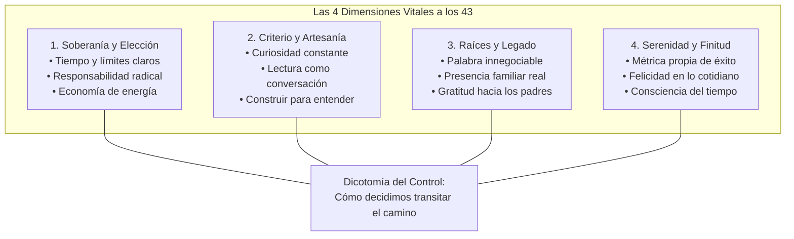

## La ilusión de tener la vida resuelta a los 43

A los 43 años no siento que tenga la vida resuelta. Tampoco creo que se trate de eso. Durante mucho tiempo crecí con la idea implícita de que al cruzar la barrera de los cuarenta uno alcanzaba una especie de meseta definitiva, un territorio despejado donde las dudas se disipaban y las respuestas llegaban en bloque. Nada más lejos de la realidad.

He aprendido, me he equivocado, he perdido, he construido, he sufrido, he disfrutado y he vuelto a empezar más de una vez. La madurez no llega cuando desaparecen las preguntas, sino cuando aprendes a convivir con ellas sin angustia. Hoy entiendo que una buena vida no se mide únicamente por lo que consigues, sino por **cómo decides vivirla, con quién la compartes y qué clase de persona eliges ser mientras pasa**.

Al observar el camino recorrido, descubro que las certezas se han vuelto más sencillas, pero infinitamente más exigentes. No pretendo dictar cátedra ni ofrecer un recetario; estas son dieciséis lecciones forjadas en tropiezos cotidianos, proyectos concluidos y silencios necesarios que hoy guían mi brújula personal.

> "No nos atrevemos a muchas cosas porque son difíciles; son difíciles porque no nos atrevemos a hacerlas, pero sobre todo porque olvidamos que el tiempo que pasa jamás retorna." — Séneca

---

## 1. El peso de las elecciones: tiempo, prioridades y soberanía personal

Cuando eres joven asumes que el tiempo es un caudal inagotable. Al llegar a los 43 notas que cada jornada exige una negociación silenciosa con tu propia energía. La libertad real no radica en acumular opciones infinitas, sino en la capacidad de elegir deliberadamente qué dejas fuera.

## 2. Las prioridades lo cambian todo

El tiempo, la energía y la atención son recursos limitados. Decir que algo es importante no sirve de mucho si mis decisiones cotidianas dicen lo contrario. Mi familia, mi palabra, mi aprendizaje y mi tranquilidad tienen que ocupar un lugar real en mi vida, no solamente aparecer en un discurso. Si revisas tu calendario bancario o las horas que pasas frente a la pantalla, descubres de inmediato cuáles son tus prioridades verdaderas, más allá de tus buenas intenciones.

## 3. Cada elección construye una parte de tu vida

No elegimos todo lo que nos sucede, pero elegimos mucho más de lo que creemos: con quién estar, qué aprender, qué tolerar, qué abandonar, cuándo insistir y cuándo cambiar de rumbo. La vida termina siendo, en buena medida, la acumulación de esas decisiones. No existen elecciones neutras; cada pequeña renuncia o cada concesión inadvertida va tallando la persona en la que te conviertes con los años.

## 4. Ser responsable también es una forma de libertad

Hacerse cargo de las consecuencias, cumplir obligaciones y dejar de buscar culpables puede ser incómodo, pero devuelve algo mucho más importante: control sobre la propia vida. Prefiero equivocarme tomando decisiones que vivir permanentemente responsabilizando a otros. Cuando dejas de señalar al entorno, a la economía o a la mala suerte, recuperas la potestad de actuar desde donde estás con lo que tienes.

## 5. No todo merece mi energía

Con los años he entendido que no todas las discusiones necesitan una respuesta, no todas las personas necesitan comprenderme y no todas las oportunidades merecen ser perseguidas. Elegir dónde poner mi atención es también elegir qué clase de vida quiero tener. La paz mental comienza en el instante exacto en que renuncias a ganar debates estériles o a convencer a quien ya decidió no escuchar.

## 6. Aprendizaje continuo, libros y proyectos propios

El trabajo intelectual y la ingeniería de software me han enseñado que el conocimiento no es un monumento estático; es un taller en constante remodelación. El criterio no se hereda ni se compra: se pule a fuerza de equivocarse en público, contrastar ideas y ensuciarse las manos construyendo cosas tangibles.

> "Aprender no consiste en acumular información como quien colecciona objetos en una vitrina; consiste en forjar un criterio capaz de distinguir lo esencial del ruido."

## 7. Nunca quiero dejar de aprender

Aprender no terminó cuando dejé la escuela. Leer, estudiar, experimentar, cuestionar lo que creo saber y aceptar que puedo estar equivocado siguen siendo algunas de mis mejores herramientas. Cuanto más aprendo, más consciente soy de todo lo que todavía ignoro. La curiosidad no es un pasatiempo de juventud; es el único antídoto duradero contra el anquilosamiento mental y la soberbia profesional.

## 8. Leer es conversar con personas que quizá nunca conocerás

Los libros me permiten entrar en otras épocas, ideas, errores y formas de entender el mundo. Leer no consiste en acumular páginas leídas; consiste en encontrar preguntas nuevas y permitir que algunas respuestas modifiquen la manera en que pienso. Cuando abres un ensayo de Marco Aurelio, de Séneca o de Montaigne, descubres que las dudas que hoy te quitan el sueño ya fueron desmenuzadas hace dos mil años por hombres que intentaban vivir con dignidad.

## 9. Cambiar de opinión no es una derrota

Una idea nueva, mejores datos o más experiencia deberían poder modificar mis conclusiones. Defender una equivocación solamente porque alguna vez fue mía no demuestra carácter; demuestra terquedad. Tener criterio también significa saber corregirse a tiempo, pedir disculpas con sencillez y soltar hipótesis que la realidad ya refutó con hechos incontestables.

## 10. Crear algo propio enseña cosas que ningún libro puede explicar por completo

Construir proyectos, probar ideas, equivocarme y empezar otra vez me ha enseñado que pensar es importante, pero hacer revela la realidad. La teoría permite imaginar escenarios impecables; la ejecución obliga a enfrentarse con los límites de los recursos, la aspereza de los errores imprevistos y el peso de las consecuencias. En el taller de la creación es donde la mente realmente madura.

## 11. Presencia para los nuestros

En un mundo saturado de pantallas, notificaciones y urgencias artificiales, el regalo más escaso y valioso que le puedes otorgar a alguien es tu presencia intacta. Nada sustituye el tiempo compartido ni la serenidad de una palabra empeñada que se honra sin excusas.

## 12. Mi palabra tiene que valer

Ser un hombre de palabra no significa no equivocarse nunca. Significa intentar cumplir lo prometido, reconocer con humildad cuando no puedo hacerlo y responder por mis actos frente a los demás. La confianza entre seres humanos se construye lentamente a lo largo de años y puede derrumbarse con sorprendente facilidad ante el primer descuido o deshonestidad.

## 13. Quiero enseñarles a mis hijos a pensar, no qué pensar

Puedo transmitirles principios, experiencia y valores sólidos, pero su vida les pertenece por entero. Mi responsabilidad como padre no es fabricar copias o versiones subordinadas de mí mismo. Es ayudarlos a desarrollar criterio propio, curiosidad indomable, responsabilidad por sus actos y suficiente confianza para cuestionar incluso aquello que yo les enseñé cuando la realidad se los demande.

> "El mayor legado que podemos dejar a nuestros hijos no son respuestas fabricadas, sino herramientas afiladas para que interroguen al mundo por cuenta propia."

## 14. La familia merece tiempo, no solamente buenas intenciones

El trabajo siempre encuentra algo más que pedir. Los proyectos nunca terminan. Siempre habrá otro problema urgente que resolver o un despliegue que revisar. Pero mis hijos crecerán en un parpadeo, mis padres envejecerán y ciertos momentos compartidos jamás volverán a repetirse. Estar verdaderamente presente con los míos no es un premio de consolación para cuando sobre tiempo; es una decisión prioritaria innegociable.

## 15. Puedo sentir orgullo de dónde vengo sin dejar de querer llegar más lejos

Mi origen forma parte indivisible de mí. No necesito rechazar mis raíces campesinas, urbanas o familiares para evolucionar profesional o personalmente. Todo lo que mis padres hicieron, sus decisiones, sus esfuerzos sostenidos, sus aciertos y sus sacrificios silenciosos forman parte de la oportunidad que hoy tengo de construir mi propia historia. La gratitud hacia el punto de partida es el suelo firme sobre el que se apoya cualquier avance genuino.

## 16. Honrar a mis padres también significa aprovechar la vida que me dieron

Nunca podré devolver completamente el hecho extraordinario de estar aquí, respirando y creando. Puedo agradecerlo viviendo con responsabilidad cotidiana, cuidando a mi familia, intentando ser una buena persona y disfrutando esta oportunidad única mientras todavía existe. Para mí, esa es la forma más honesta y profunda de decirles gracias cada mañana.

## 17. Redefinir la cima: éxito bajo tus propios términos y la belleza de lo efímero

A los veinte años resulta tentador comprar definiciones de éxito ajenas: títulos rimbombantes, aplausos colectivos o símbolos materiales de estatus. A los 43 descubres que esas métricas suelen ser jaulas doradas diseñadas para alimentar la insatisfacción constante.

## 18. El éxito necesita una definición propia

He tenido éxitos y fracasos notorios, pero dejé de creer que necesito medir mi vida con la regla de otra persona. Para mí, éxito significa poder crear con libertad, seguir aprendiendo cada semana, mantener a mi familia con dignidad, conservar mi curiosidad viva, dormir tranquilo con la conciencia limpia y sentir que sigo avanzando sin traicionarme para conseguirlo. Si una meta exige pisotear mis principios o dinamitar mi salud, el precio es sencillamente inaceptable.

## 19. La felicidad no es un lugar al que finalmente se llega

La sigo buscando, pero ya no la imagino como una estación terminal ni como un estado permanente de euforia. Está repartida en momentos ordinarios y luminosos: una conversación reposada, aprender algo nuevo que destraba un problema difícil, sentarme en la mesa con mi familia, reír a carcajadas con mis hijos, caminar temprano sin prisa o simplemente saber que las personas que amo están bien y a salvo.

## 20. La vida es pasajera; precisamente por eso importa tanto cómo la vivimos

A los 43 no siento que vaya tarde a ningún lado. Siento con mayor claridad y agudeza que el tiempo importa. Todavía quiero aprender muchísimo, construir proyectos ambiciosos, equivocarme, cambiar de opinión cuantas veces haga falta, disfrutar a fondo a mi familia, ver crecer a mis hijos y descubrir quién puedo llegar a ser. No necesito que mi vida sea perfecta; necesito que sea auténticamente mía y que, cuando mire hacia atrás en el ocaso del camino, pueda reconocerme con serenidad en cada una de las decisiones que tomé.

---

## Conclusión

Al final, probablemente eso sea lo más importante que he aprendido hasta ahora: **no tengo control sobre cuánto durará el camino, pero sí una responsabilidad enorme sobre la manera en que decido recorrerlo.**

He sufrido, he disfrutado, he ganado y he perdido. Soy exitoso bajo mis propios parámetros y todavía tengo preguntas abiertas, proyectos por arrancar y muchas cosas por aprender. Pero sobre todo tengo algo por lo que experimento una gratitud difícil de explicar con palabras: **estoy aquí**.

Y mientras pueda seguir aprendiendo, amando, creando, cuidando a los míos y tomando mis propias decisiones con serenidad, pienso aprovechar esta vida pasajera que mis padres me dieron la oportunidad de experimentar.

¿Ya estás implementando este enfoque en tu entorno? Me encantaría conocer tu experiencia y los desafíos que has enfrentado. ¡Hasta la próxima línea de código! 🚀

Deja tus comentarios en el [repositorio](https://github.com/lgzarturo/arthurolg-blog-posts/issues) o en mi perfil de [X@algforge](https://x.com/algforge). Si te es de utilidad, una estrella en [GitHub](https://github.com/lgzarturo) es de gran ayuda o no dudes en compartir este artículo con tus colegas y amigos. ¡Gracias por leer!

## Referencias

- [Marco Aurelio – Meditaciones](https://es.wikipedia.org/wiki/Meditaciones)
- [Epicteto – Enquiridión y Disertaciones](https://es.wikipedia.org/wiki/Enquiridi%C3%B3n)
- [Lucio Anneo Séneca – Sobre la brevedad de la vida](https://es.wikipedia.org/wiki/De_brevitate_vitae)
