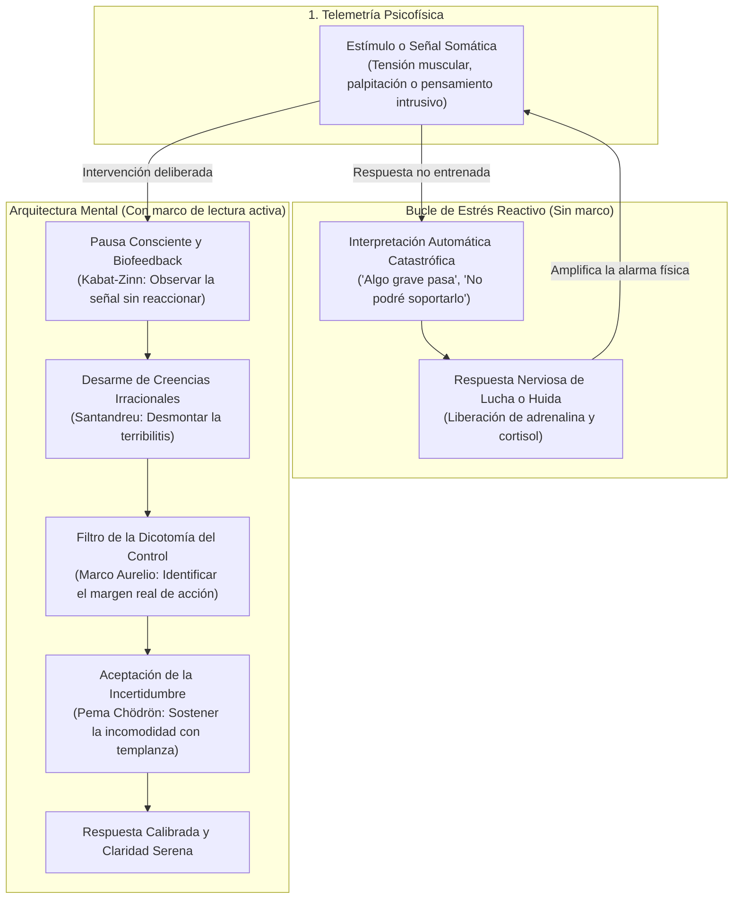

## El síntoma real: operar sin arquitectura mental

Quizá conoces bien este escenario. Llevas varias semanas lidiando con entregas apretadas, refactorizaciones complejas que parecen no tener fin y reuniones interminables que fragmentan tu concentración. Una tarde cualquiera, mientras revisas una traza de ejecución frente a la pantalla, sientes un nudo denso en la boca del estómago, una punzada fría en el pecho y un mareo leve que te desconecta del entorno. Tu respiración se vuelve superficial y el pulso se acelera.

Preocupado, decides acudir al médico. Te toman la presión arterial, solicitan análisis de sangre, realizan un electrocardiograma y revisan tus signos vitales. Días después, el doctor revisa los resultados, sonríe con tranquilidad y concluye: *"Físicamente estás bien. No hay ninguna patología aguda; es solo estrés"*.

Esa respuesta suele dejar un sabor amargo. Que no exista una afección cardíaca inminente ni un daño orgánico visible es una excelente noticia, pero no elimina la sensación física que experimentaste. La frustración surge porque nadie te enseña a decodificar qué significa *"es solo estrés"*. No significa que tu mente esté dañada ni que te estés inventando los síntomas. Tu sistema nervioso simplemente está emitiendo telemetría a máxima potencia.

> "El sufrimiento no proviene de las cosas que nos suceden, sino del juicio y la interpretación que construimos sobre ellas."

El verdadero problema radica en operar en el día a día sin un marco conceptual para interpretar las señales físicas y mentales. Cuando careces de un modelo mental para entender lo que tu organismo expresa, caes de inmediato en el **modo reacción**. Cada señal de tensión la interpretas como una catástrofe inminente, lo que dispara una descarga adicional de adrenalina y consolida un bucle de estrés crónico.

La literatura no es una cura médica milagrosa ni sustituye a los profesionales de la salud, pero sí ofrece algo indispensable: **arquitectura mental**. Proporciona estructuras cognitivas rigurosas y procesos reproducibles para traducir el ruido interior en comprensión práctica.

---

## La biblioteca práctica: 4 obras para construir tu modelo mental

Existe una saturación evidente de publicaciones de autoayuda superficial, repletas de frases motivacionales vacías y promesas de felicidad instantánea. Esos enfoques no sirven cuando tu sistema nervioso está saturado. Para lidiar con la presión y el agotamiento, necesitas procesos cognitivos aplicables, modelos conceptuales sólidos y herramientas de observación precisas.

A continuación, comparto cuatro libros disponibles en español que utilizo de forma recurrente para calibrar mi propio criterio, entender la vida y depurar pensamientos desbordados.

### 1. “Meditaciones” — Marco Aurelio

Considerar las *Meditaciones* de Marco Aurelio como un simple texto histórico es un error de perspectiva: se trata, en su núcleo más puro, de terapia cognitivo-conductual antigua. Escritas por el emperador romano durante sus campañas militares en el Danubio, estas notas personales nunca fueron redactadas para convencer a una audiencia externa, sino como un diálogo privado y honesto para recordar sus propios principios.

La gran aportación de Marco Aurelio es la **dicotomía del control**. El autor te obliga a desmontar los eventos externos y reducirlos a sus hechos objetivos, despojándolos del dramatismo que tu mente suele añadirles. Ante una caída de un servidor crítico, una discusión áspera con un colega o una incertidumbre personal, la obra te interroga de inmediato: ¿está esto bajo tu control directo o depende de circunstancias ajenas?

Si depende de factores ajenos, preocuparte no altera el desenlace; si depende de tus acciones, la angustia sobra porque lo único que cuenta es ejecutar tu labor con excelencia y templanza. Las traducciones al español de [Editorial Gredos](https://www.editorialgredos.com/) o [Alianza Editorial](https://www.alianzaeditorial.es/) conservan con fidelidad esa sobriedad intelectual que enseña a distinguir entre lo que ocurre y lo que tú decides opinar al respecto.

### 2. “El arte de no amargarse la vida” — Rafael Santandreu

Si Marco Aurelio te entrega la base filosófica, Rafael Santandreu aporta la psicoeducación clínica moderna. Apoyándose en la Terapia Racional Emotiva Conductual (TREC) fundada por Albert Ellis, Santandreu escribe con un estilo llano, directo y sin rodeos académicos.

El valor diferencial de [El arte de no amargarse la vida](https://www.planetadelibros.com/libro-el-arte-de-no-amargarse-la-vida/296711) consiste en proporcionar un léxico técnico para detectar y desactivar pensamientos irracionales. Santandreu identifica dos grandes trampas de nuestra mente cotidiana:

- La **terribilitis**: la tendencia automática a calificar cualquier tropiezo cotidiano (un retraso en un proyecto, una crítica laboral, un error en producción) como una tragedia insoportable.
- La **necesititis**: la falsa creencia de que requerimos aprobación externa constante, éxito ininterrumpido o certezas absolutas para sentirnos tranquilos.

A través de ejercicios prácticos de diálogo socrático interno, el libro te entrena para graduar la adversidad en una escala realista del 0 al 100. Cuando evalúas con rigor un fallo técnico o una diferencia de opiniones, descubres que casi ningún evento laboral o personal supera el nivel 10 o 15 de gravedad real. Aprender a clasificar con precisión las anomalías mentales te evita activar respuestas fisiológicas de emergencia frente a problemas triviales.

### 3. “La práctica de la atención plena” — Jon Kabat-Zinn

Muchas personas rechazan la meditación porque la asocian erróneamente con posturas esotéricas o silencios místicos desconectados de la realidad. La obra del biólogo molecular Jon Kabat-Zinn, creador del programa de Reducción del Estrés Basado en la Atención Plena (MBSR) en la Escuela de Medicina de la Universidad de Massachusetts, demuele ese prejuicio.

Tanto en [La práctica de la atención plena](https://editorialkairos.com/) como en sus diversas guías sobre mindfulness en la vida cotidiana, Kabat-Zinn enseña a observar sensaciones físicas, dolores difusos y patrones de pensamiento sin emitir un juicio inmediato ni precipitarse a una reacción reactiva.

Esta práctica resulta determinante para gestionar el **biofeedback corporal**. Cuando experimentas una punzada de tensión en la espalda o un latido irregular, tu inclinación instintiva es tensarte más para resistir la incomodidad, alimentando la señal de alarma. Kabat-Zinn propone el movimiento opuesto: prestar atención curiosa y ecuánime a la sensación, respirar en ella y notar cómo evoluciona sin forzar su desaparición. Al eliminar la resistencia psicológica, permites que tu sistema parasimpático recupere el equilibrio natural.

### 4. “Cuando todo se derrumba” — Pema Chödrön

Hay periodos donde las estrategias de organización y la lógica cognitiva tocan su límite: crisis personales profundas, pérdidas afectivas o giros inesperados que desmantelan por completo tus planes. En esos instantes, buscar soluciones rápidas suele intensificar el sufrimiento.

En [Cuando todo se derrumba](https://www.alfaomega.es/autores/pema-chodron/), la maestra budista Pema Chödrön ofrece una perspectiva complementaria para navegar el dolor y la incertidumbre. Su tesis central es aprender a permanecer presentes frente a la sensación de que el suelo desaparece bajo nuestros pies, en lugar de recurrir de forma compulsiva a distracciones, negaciones o quejas.

Chödrön no ofrece consuelos ingenuos; propone una amistad incondicional con uno mismo en momentos de vulnerabilidad. Si los libros previos te ayudan a depurar pensamientos y observar sensaciones, esta lectura te proporciona el temple necesario para aceptar que la incertidumbre y el error forman parte del tejido natural de la existencia humana.

---

## Del estímulo a la respuesta: el ciclo de depuración cognitiva

Para comprender cómo interactúan estos modelos en la práctica, resulta útil visualizar el circuito mediante el cual procesamos las señales psicofísicas. Cuando carecemos de un marco estructurado, el estímulo detona una interpretación automática de alarma que retroalimenta la tensión. Con una arquitectura mental entrenada, interponemos una pausa consciente que desactiva el catastrofismo antes de que colonice tu sistema nervioso.

Como ilustra el diagrama, la diferencia entre quedar atrapado en el desgaste crónico o recuperar la compostura no radica en suprimir las señales de tu cuerpo, sino en el procesamiento que aplicas sobre ellas. La arquitectura mental funciona como una capa intermedia de validación: intercepta el estímulo crudo y lo depura antes de que desate una tormenta fisiológica.

---

## Protocolo de lectura activa: cómo evitar que los libros se queden en teoría

Comprar libros de psicología o filosofía y acumularlos en la mesilla de noche produce un peligroso alivio ilusorio. La mente confunde el acto de comprar o leer pasivamente una idea con la adquisición real de un hábito. Si únicamente subrayas párrafos brillantes sin alterar tu conducta cotidiana, el estrés continuará intacto cuando surja el siguiente problema.

> "Entrenar la mente exige la misma disciplina que optimizar un sistema: pequeñas iteraciones constantes, métricas claras y depuración continua de patrones obsoletos."

Para convertir estas lecturas en herramientas operativas, te propongo un protocolo estructurado en tres pasos:

### Paso 1: La regla de las tres líneas por capítulo

Cada vez que finalices la lectura de un capítulo, cierra el libro, toma un cuaderno físico y redacta únicamente tres líneas respondiendo a una pregunta concisa: *¿Qué concepto específico de estas páginas voy a aplicar a mi rutina hoy y en qué circunstancia concreta?*. Si no puedes resumir la idea en tres oraciones directas, significa que el concepto sigue siendo una abstracción etérea y no una herramienta lista para usar.

### Paso 2: El contraste de interpretaciones

Durante la jornada, identifica una señal psicofísica que haya llamado tu atención (una punzada cervical, una oleada de impaciencia al recibir un correo, un bloqueo mental). En tu cuaderno, divide una hoja en dos columnas:

1. **Interpretación automática:** Escribe con total crudeza lo que tu mente dictó en el primer segundo (*"esto va a salir mal", "voy a quedar en ridículo", "mi cuerpo va a colapsar"*).
2. **Interpretación basada en el marco:** Reformula el suceso utilizando los principios de las lecturas (*"mi cuerpo está fatigado tras cuatro horas continuas de trabajo; el proyecto tiene un retraso manejable y mi valor personal no depende de una aprobación unánime"*).

Este ejercicio entrena a tu corteza prefrontal para disputar la validez de los pensamientos intrusivos en tiempo real.

### Paso 3: Diez minutos de atención plena cronometrada

No necesitas retiros prolongados ni indumentarias especiales. Ajusta un cronómetro en diez minutos cada mañana o al concluir tu jornada laboral. Siéntate con la espalda erguida, cierra los ojos o mantén la mirada desenfocada en el suelo, y focaliza toda tu atención en la entrada y salida del aire por tu abdomen.

Cada vez que adviertas que tu atención fue secuestrada por una preocupación sobre el futuro o un reproche del pasado, no te enojes ni te frustres: reconoce la distracción con amabilidad y regresa la concentración al flujo respiratorio. Ese acto exacto de regresar es el levantamiento de peso que fortalece tu estabilidad atencional.

---

## Biofeedback y medicina: escuchar al cuerpo con rigor

Al abordar la relación entre mente y cuerpo, es indispensable mantener una prudencia. No debes, ni puedes autodiagnosticar anomalías en tu presión arterial, arritmias complejas o desequilibrios metabólicos mediante la simple introspección filosófica.

Los chequeos médicos periódicos y la consulta con especialistas certificados no son opcionales. Cuando un médico descarta patologías agudas tras examinar tus biomarcadores, no está minimizando tu malestar: está confirmando que tus órganos operan dentro de parámetros seguros y que la sintomatología responde a la hipersensibilidad de tu sistema nervioso ante la sobrecarga acumulada.

> "Aprender a escuchar a tu cuerpo no reemplaza la medicina; te proporciona la lucidez necesaria para no transformar una señal física pasajera en una catástrofe psicológica."

Los mareos tensionales, la rigidez muscular en el cuello y las palpitaciones ocasionales son manifestaciones de biofeedback. Indican que tus demandas cognitivas han superado temporalmente tu capacidad de recuperación. Atender este biofeedback implica también revisar los cimientos biológicos: reducir el sedentarismo con caminatas diarias, incorporar ejercicio de fuerza progresivo, cuidar la higiene del sueño y dosificar la ingesta de cafeína. La arquitectura mental florece con mayor solidez cuando el soporte biológico sobre el que opera recibe el mantenimiento adecuado.

---

## Conclusión

Enfrentar el estrés crónico y cultivar una relación lúcida con la propia vida no depende de consumir citas motivacionales ni de esperar a que las circunstancias externas sean perfectas. Es una labor de artesanía interior: consiste en examinar con honestidad los estímulos que permites ingresar, reconocer los sesgos de tus interpretaciones automáticas y desplegar una arquitectura mental capaz de mantener la estabilidad cuando el entorno se torna exigente.

Al igual que ningún desarrollador experimentado dejaría un sistema crítico en producción sin mecanismos de observabilidad ni manejo de excepciones, no tiene sentido transitar la vida profesional y personal en modo puramente reactivo. Trata este aprendizaje como tu próximo sprint de desarrollo personal: avanza en pequeñas iteraciones, mide tus respuestas con objetividad y mantén una depuración paciente de tus hábitos mentales.

¿Ya estás implementando un enfoque similar? Me encantaría conocer tu experiencia y los desafíos que has enfrentado. ¡Hasta la próxima línea de código! 🚀

Deja tus comentarios en el [repositorio](https://github.com/lgzarturo/arthurolg-blog-posts/issues) o en mi perfil de [X@algforge](https://x.com/algforge). Si te es de utilidad, una estrella en [GitHub](https://github.com/lgzarturo) es de gran ayuda o no dudes en compartir este artículo con tus colegas y amigos. ¡Gracias por leer!

## Referencias

- [Marco Aurelio: Meditaciones (Editorial Gredos)](https://www.editorialgredos.com/)
- [Rafael Santandreu: El arte de no amargarse la vida (Ediciones Paidós / Grupo Planeta)](https://www.planetadelibros.com/libro-el-arte-de-no-amargarse-la-vida/296711)
- [Jon Kabat-Zinn: La práctica de la atención plena (Editorial Kairós)](https://editorialkairos.com/)
- [Pema Chödrön: Cuando todo se derrumba (Gaia Ediciones)](https://www.alfaomega.es/autores/pema-chodron/)
- [Repositorio oficial de artículos de Arturo López](https://github.com/lgzarturo/arthurolg-blog-posts)
