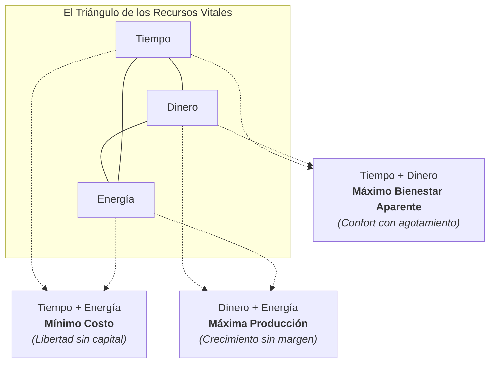

Eran cerca de las dos de la madrugada cuando cerré la tapa de mi portátil tras resolver una incidencia crítica en producción. En la pantalla del teléfono brillaba una notificación bancaria con el pago de un proyecto exitoso, pero al levantarme de la silla sentí un mareo leve, los ojos secos y la espalda completamente rígida. En ese instante me di cuenta de una verdad amarga: tenía dinero en la cuenta y había cumplido mis plazos laborales, pero mi energía vital estaba en cero absoluto.

Poco a poco fui notando que mi energía vital se veía mermada, solo que no era tan obvia, era como un ruido de fondo que cada vez se hacía más fuerte, fue insostenible y me llevó a replantearme toda mi vida. Me diagnosticaron con varias molestias y síntomas producto del agotamiento, los cuales me orillaron a tomar cartas en el asunto y replantearme el cómo llevaba mi vida.

Durante años nos han vendido un relato seductor y peligroso: la promesa de que podemos tenerlo absolutamente todo de forma simultánea. Nos dicen que es posible construir una carrera profesional deslumbrante, acumular ahorros sustanciales, entrenar dos horas al día, mantener una vida social radiante, dormir ocho horas y cultivar tres pasatiempos creativos.

La realidad, sin embargo, no atiende fantasías de autoayuda ni discursos de productividad tóxica. La física de la vida opera bajo reglas mucho más sobrias y estrictas.

## La Fantasía del "Todo al Mismo Tiempo"

El sufrimiento de muchos profesionales no proviene de la falta de ambición, sino de la negativa a aceptar los límites de la propia finitud. Vivimos comparando nuestro detrás de escena cotidiano con los escaparates pulidos de redes sociales, donde cada creador parece haber hackeado el día para disfrutar de abundancia financiera, plenitud física y tiempo de ocio infinito.

Cuando intentas maximizar cada aspecto de tu rutina al mismo tiempo, el resultado casi nunca es la excelencia; suele ser la parálisis por sobrecarga o el colapso silencioso.

> "Creer que podemos optimizar todas las variables de nuestra existencia al mismo tiempo no es optimismo; es una negación infantil de la realidad que pagamos con ansiedad."

En cualquier disciplina seria de ingeniería aprendes temprano que los recursos son finitos. Si diseñas un motor, equilibras peso, potencia y consumo de combustible. Si diseñas una arquitectura de software, sopesas latencia, consistencia y costos de infraestructura. Con la existencia humana ocurre exactamente lo mismo: cada decisión implica una renuncia.

## Los Tres Vértices

Para entender este dilema con claridad, me gusta visualizar el llamado triángulo de la felicidad. Este modelo se compone de tres variables fundamentales que interactúan entre sí de manera implacable:

1. **Tiempo:** Las horas no renovables del reloj, la disponibilidad de agenda, el margen para descansar, convivir y contemplar.
2. **Dinero:** El capital material, los ingresos, los ahorros y la capacidad de adquirir bienes, servicios o seguridad financiera.
3. **Energía:** La vitalidad biológica, la claridad mental, el entusiasmo y la capacidad física para involucrarte con el mundo.

A lo largo de nuestras vidas, la distribución de estos tres recursos cambia drásticamente según la etapa en la que nos encontremos:

* **En la juventud:** Tienes abundante tiempo y energía desbordante, pero rara vez tienes suficiente dinero.
* **En la adultez productiva:** Generas ingresos y conservas energía, pero el tiempo disponible se vuelve el bien más escaso de tu día.
* **En la vejez:** Cuentas con tiempo libre y estabilidad económica acumulada, pero la energía biológica disminuye inevitablemente.

El error fundamental radica en suponer que existe un punto mágico de equilibrio donde los tres vértices convergen en su valor máximo. La verdad es más cruda: solo puedes optimizar dos a la vez, nunca los tres.

## El Teorema de la Cobija Corta

En México hay un dicho que dice que la vida es como una cobija corta: si te tapas el pecho, te destapas los pies; si te cubres los pies, se te enfría el cuello. No existe una manta milagrosa que crezca por arte de magia para arroparte por completo en cualquier posición.

Si solo puedes elegir dos lados del triángulo a la vez, surgen tres combinaciones reales, cada una con un propósito legítimo y un costo ineludible:

Analicemos qué ocurre en cada uno de estos escenarios:

### 1. Tiempo y Energía (Sacrificas Dinero: Mínimo Costo)

Es el estado de la exploración libre, los viajes con mochila al hombro o los proyectos personales austeros. Tienes todo el día disponible y la vitalidad para caminar kilómetros, leer o experimentar sin presiones de reloj.

El costo evidente es la precariedad financiera: cualquier imprevisto médico o económico pone en riesgo tu tranquilidad. Es una configuración valiosa para aprender y descubrir vocaciones, pero difícil de sostener a largo plazo.

### 2. Dinero y Energía (Sacrificas Tiempo: Máxima Producción)

Es la fase típica del arranque profesional acelerado, el lanzamiento de una empresa o la absorción de proyectos de alta demanda. Tu capacidad de trabajo es implacable y tus ingresos aumentan con rapidez.

El costo aquí es la renuncia al tiempo personal: postergas comidas familiares, cancelas reuniones con amigos y sacrificas momentos de soledad. Si mantienes esta postura durante una temporada acotada, puedes construir un colchón financiero sólido; si la conviertes en tu identidad permanente, terminarás viviendo como un extraño en tu propia casa.

### 3. Tiempo y Dinero (Sacrificas Energía: Máximo Bienestar Aparente)

Ocurre cuando dispones de capital y una agenda despejada, pero tu cuerpo o tu mente han quedado exhaustos. Es la situación común de quien toma vacaciones tras meses de sobrecarga extrema y pasa la primera semana en cama con migraña o gripe, incapaz de disfrutar la playa o el hotel que pagó.

Tener los recursos económicos y las horas libres no sirve de mucho cuando te falta la chispa anímica para salir a caminar o concentrarte en una buena conversación.

## El Teorema de la Vida

En el diseño de sistemas distribuidos existe un principio formulado por Eric Brewer conocido como el **Teorema CAP**. Este teorema establece que cualquier base de datos distribuida solo puede garantizar de manera simultánea dos de tres propiedades: Consistencia (Consistency), Disponibilidad (Availability) y Tolerancia a Particiones (Partition Tolerance). Si intentas forzar a tu sistema a cumplir las tres bajo una red imperfecta, el clúster entero se corrompe y colapsa.

En la vida diaria enfrentamos un principio equivalente. Cada vez que intentas forzar el triángulo vital para obtener máxima producción (dinero), máxima disponibilidad personal (tiempo) y máximo rendimiento físico (energía), provocas un cortocircuito interno.

> "Cuando intentas burlar la física de tus recursos personales, el sistema no se vuelve más productivo; simplemente traslada la deuda técnica a tu salud mental."

El cuerpo humano no es una máquina abstracta a la que puedas exigirle horas extras indefinidas mediante cafeína y fuerza de voluntad. Tarde o temprano, la biología cobra intereses con sobregiro. El cansancio crónico, la irritabilidad y el desgaste emocional son las alertas de monitoreo que ignoramos hasta que el servicio se cae por completo.

## Madurar es Elegir el Sacrificio sin Traicionarte

Durante la juventud solemos creer que madurar significa acumular logros: más títulos, más responsabilidades, mayores ingresos, más propiedades. Con el paso de los años descubres que la verdadera madurez consiste en algo muy distinto: **el arte de saber renunciar con serenidad**.

Madurar es comprender que la cobija es corta y dejar de pelear contra esa condición. Implica mirar el tablero de tu vida, evaluar en qué temporada te encuentras y decidir deliberadamente qué parte del cuerpo vas a dejar descubierta por un tiempo.

Los filósofos estoicos hablaban con frecuencia de la dicotomía del control. No puedes controlar la duración del día ni la necesidad biológica de descanso, pero sí puedes elegir dónde inviertes tu atención y qué costos estás dispuesto a pagar.

Para tomar estas decisiones sin amargura ni autocompasión, te sugiero considerar tres criterios prácticos:

* **Define tus no-negociables:** Hay áreas que jamás deben sacrificarse por completo. Dormir seis o siete horas de calidad, comer comida real y cuidar los vínculos afectivos más cercanos no son lujos intercambiables por horas de código o dinero extra.
* **Elige sacrificios por temporadas, no de por vida:** Sacrificar tiempo durante tres meses para entregar un proyecto clave o aprender una tecnología exigente es una estrategia legítima. Sacrificarlo durante diez años consecutivos es una condena silenciosa.
* **Asume el costo de oportunidad con orgullo:** Cuando decidas no aceptar un cliente adicional para poder cenar con tu familia, no mires con envidia al colega que duplicó su facturación a costa de trabajar fines de semana. Cada quien eligió qué lados del triángulo optimizar.

> "La paz interior no nace de tenerlo todo resuelto, sino de aceptar con sobriedad el precio de lo que decidiste cuidar."

Si hoy te toca cuidar tu energía porque vienes saliendo de una temporada dura, hazlo con la cabeza en alto, aun si eso implica posponer compras materiales. Si hoy te toca apretar el paso para consolidar tu patrimonio, hazlo con disciplina sabiendo que tu tiempo libre se verá reducido de manera temporal. Lo crucial es que la elección sea consciente y no una inercia ciega que te arrastre hacia el desgaste.

## Conclusión

En mi experiencia la búsqueda de la felicidad no consiste en encontrar una fórmula mágica que estire la cobija corta hasta cubrirlo todo. Consiste en aprender a convivir en paz con la incomodidad de los límites humanos.

Cuando dejas de perseguir la ilusión de ser un superhéroe invulnerable que nunca se agota ni renuncia a nada, te liberas de una carga pesada e innecesaria. Reconocer que solo puedes cuidar dos vértices con excelencia te devuelve la claridad para concentrarte en lo que de verdad importa en este momento de tu camino.

¿Ya estás implementando este enfoque en tu entorno de desarrollo? Me encantaría conocer tu experiencia y los desafíos que has enfrentado. ¡Hasta la próxima línea de código! 🚀

Deja tus comentarios en el [repositorio](https://github.com/lgzarturo/arthurolg-blog-posts/issues) o en mi perfil de [X@algforge](https://x.com/algforge). Si te es de utilidad, una estrella en [GitHub](https://github.com/lgzarturo) es de gran ayuda o no dudes en compartir este artículo con tus colegas y amigos. ¡Gracias por leer!

## Referencias

* [Brewer's CAP Theorem - Towards Robust Distributed Systems](https://www.infoq.com/articles/cap-twelve-years-later-how-the-rules-have-changed/)
* [Meditaciones de Marco Aurelio - Filosofía Estoica Práctica](https://es.wikipedia.org/wiki/Meditaciones)
* [Repositorio de Artículos y Ensayos de Arturo López](https://github.com/lgzarturo/arthurolg-blog-posts)
