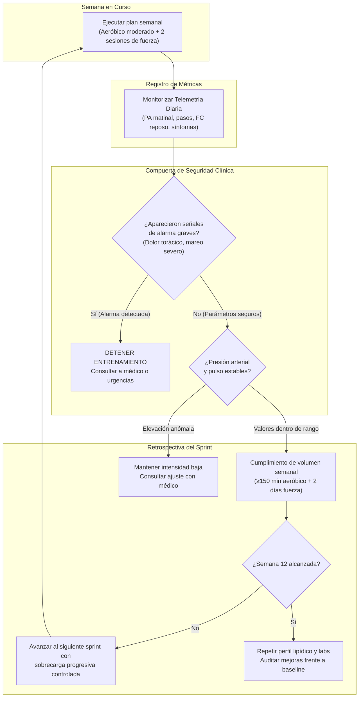

## ¿Por qué fracasa la motivación épica?

Existe un patrón recurrente entre quienes pasamos más de diez horas al día frente a un teclado resolviendo problemas complejos. Un día recibes los resultados de tu chequeo de sangre rutinario y descubres que tus triglicéridos están por encima de los 250 mg/dL, tu glucosa en ayunas coquetea con valores prediabéticos y el tensiómetro de la farmacia marca 138/88 mmHg.

Como no experimentas un dolor incapacitante inmediato, la primera reacción suele ser postergar el problema. La segunda, cuando el susto cala hondo tras una noche de palpitaciones o fatiga difusa, es el intento de un *"refactor total de vida"*.

Decides que el próximo lunes transformarás tu existencia: compras tennis de alta gama, te inscribes a un gimnasio para entrenar dos horas diarias y eliminas de golpe todos los carbohidratos de tu dieta. El desenlace es predecible. Para el jueves tienes las rodillas inflamadas, una contractura lumbar que apenas te permite sentarte en tu silla ergonómica y un agotamiento mental que destruye tu productividad. Para el domingo, has abandonado el experimento y te convences de que *"no tienes fuerza de voluntad"*.

> "Nadie intentaría reescribir un monolito legacy de diez años en un solo fin de semana sin pruebas automatizadas. Intentar reparar diez años de sedentarismo en cuatro días es cometer exactamente el mismo error de arquitectura."

Tu cuerpo no necesita discursos motivacionales vacíos ni transformaciones mágicas. Tu cuerpo es un sistema dinámico gobernado por leyes biológicas, bucles de retroalimentación y límites de tolerancia física. Para salir del sedentarismo y estabilizar tus biomarcadores necesitas **ingeniería de hábitos**: definir una línea base objetiva, elegir métricas con telemetría verificable, iterar en sprints pequeños y respetar compuertas de seguridad sin caer en imprudencias.

---

## Telemetría clínica: qué medir, con qué frecuencia y qué herramientas usar

Para depurar un fallo, lo primero que haces es encender el registro de eventos y recopilar métricas concretas. En tu salud ocurre exactamente lo mismo. No puedes gestionar lo que no estás midiendo de forma sistemática.

A continuación, resumo los instrumentos mínimos viables y los biomarcadores prioritarios que uso para monitorizar mi salud:

| Biomarcador / Variable | Instrumento Recomendado | Frecuencia de Medición | Umbral Objetivo Orientativo |
| :--- | :--- | :--- | :--- |
| **Presión Arterial (PA)** | Tensiómetro digital de brazo validado | Diario la 1.ª semana; luego 3 días/sem | **<130/80 mmHg** (según guías [AHA/ACC](https://www.ahajournals.org/doi/10.1161/hyp.0000000000000065)) |
| **Triglicéridos y Perfil Lipídico** | Análisis clínico en laboratorio | Semana 0 (línea base) y Semana 12 | **<150 mg/dL** (según [National Lipid Association](https://www.lipid.org/)) |
| **Glucosa en ayunas / HbA1c** | Análisis clínico en laboratorio | Semana 0 (línea base) y Semana 12 | Glucosa **<100 mg/dL**; HbA1c **<5.7%** |
| **Peso y Circunferencia de Cintura** | Báscula digital y cinta métrica | 1 vez por semana (mismo día y hora) | Cintura <94 cm en hombres / <80 cm en mujeres |
| **Volumen de Actividad Moderada** | Reloj con pulsómetro o podómetro | Diario (acumulado semanal) | Mínimo **≥150 min/semana** ([Guía WHO/CDC](https://www.who.int/initiatives/behealthy/physical-activity)) |
| **Pasos Diarios** | Podómetro o aplicación de móvil | Registro continuo diario | Progresión: 5,000 → 8,000 → 10,000 |
| **Frecuencia Cardíaca en Reposo (FCR)** | Reloj inteligente o toma matinal manual | Diaria al despertar | Tendencia descendente (mejora de eficiencia cardíaca) |

### Protocolo de toma de presión arterial en casa

El uso descuidado del tensiómetro genera lecturas erráticas que disparan ansiedad innecesaria. En mi caso sigo este protocolo estandarizado:

1. Permanece sentado en reposo durante cinco minutos en un entorno silencioso antes de pulsar el botón de inicio.
2. Apoya la espalda contra el respaldo y coloca ambos pies planos sobre el piso, sin cruzar las piernas.
3. Reposa el brazo sobre una mesa a la altura del corazón.
4. No tomes lecturas inmediatamente después de consumir café, comer o realizar actividad física.
5. Realiza tres tomas separadas por dos minutos y registra el promedio en tu hoja de datos.

---

## El protocolo progresivo de 12 semanas

Este protocolo está diseñado para un perfil adulto sedentario que necesita reactivar su capacidad cardiovascular y muscular minimizando el riesgo de lesiones o sobreentrenamiento. Cada fase opera como un sprint de desarrollo: no avanzas de nivel hasta que el anterior esté estabilizado y testeado.

**Nota**: No son recomendaciones médicas, es un proceso para afianzar un rutina. En mi caso este fue el procedimiento que segui para establecer una rutina base que me ayude a mejorar mi estado de ánimo, cada mes voy al doctor para el seguimiento y control, porque no hay receta medica, ni medicamentos mágicos, es un enfoque práctico para generar hábitos saludables.

### Sprint 0: Línea base y diagnóstico (Semana 0)

El objetivo de este sprint preparatorio no es agotar tus energías, sino auditar tu estado actual:
- **Pruebas clínicas:** Acude a tu médico y solicita una química sanguínea completa (perfil lipídico detallado, glucosa en ayunas, hemoglobina glucosilada y panel tiroideo básico). Si experimentas molestias al subir escaleras o fatiga súbita, solicita un electrocardiograma antes de iniciar ejercicio regular.
- **Instrumentación:** Configura tu tensiómetro y registra dos lecturas al día durante tres días para conocer tu cifra basal real.
- **Micro-hábito:** Camina diez minutos al día durante cuatro jornadas a un ritmo cómodo. Introduce pausas de movilidad de cinco minutos por cada 45 minutos continuos de trabajo en el escritorio.

### Sprint 1: Habituación y acumulación de movimiento (Semanas 1 y 2)

El foco de estas dos semanas es vencer la inercia:
- **Actividad aeróbica moderada:** Camina entre 15 y 20 minutos al día durante cinco días a la semana. Utiliza la regla del habla: camina a un ritmo que te permita mantener una conversación sin jadear, pero que no te permita cantar con soltura. Acumularás alrededor de 100 minutos semanales.
- **Fuerza básica con peso corporal:** Dos sesiones semanales de 20 minutos. Realiza movimientos sencillos para grandes grupos musculares: sentadillas asistidas en una silla (3 series de 8 a 10 repeticiones), flexiones inclinadas apoyando las manos en una pared o mesa robusta (3 series de 8 repeticiones) y elevaciones de talones para gemelos.
- **Regulación del sistema nervioso:** Integra entre 5 y 10 minutos de respiración profunda pausada al terminar tu jornada para atenuar la descarga simpática.

### Sprint 2: Consistencia y alcance de metas mínimas (Semanas 3 a 6)

En esta fase el objetivo es alcanzar los estándares mínimos recomendados por las guías internacionales de salud ([CDC](https://www.cdc.gov/physical-activity-basics/guidelines/adults.html)):
- **Actividad aeróbica:** Aumenta a 30 minutos diarios durante cinco días (o tres sesiones de 45 a 50 minutos). Tu meta innegociable es consolidar **≥150 minutos semanales**. En una de las sesiones semanales, introduce cinco intervalos de un minuto a ritmo algo más vivo intercalados con dos minutos de caminata suave.
- **Sobrecarga de fuerza:** Mantén dos sesiones semanales de 25 minutos. Incorpora bandas elásticas de resistencia para remos de espalda y añade peso ligero a tus sentadillas (por ejemplo, sosteniendo una mochila con libros).
- **Control de pasos:** Apunta a un rango sostenido de 7,000 a 8,500 pasos diarios. Ajusta alarmas para romper bloques sedentarios cada 45 minutos.

### Sprint 3: Intensificación segura y movilidad (Semanas 7 a 10)

Con articulaciones y tendones adaptados a la carga mecánica, podemos refinar la capacidad aeróbica:
- **Cardio avanzado:** Si tus registros de presión arterial son estables y tu médico validó tu progresión, puedes incluir una sesión semanal de intervalos cortos (ej. diez minutos de alternancia entre 30 segundos de paso rápido y 60 segundos de recuperación) o mantener un volumen constante de 200 a 250 minutos semanales de caminata enérgica o bicicleta estática.
- **Entrenamiento de fuerza y core:** Incorpora ejercicios para el cinturón abdominal (planchas frontales de 20 a 30 segundos) y trabajo de movilidad escapular y de cadera para contrarrestar la postura encorvada del programador.
- **Revisión de mitad de trayecto:** Audita tus mediciones de presión arterial y pulso en reposo. Deberías notar una tendencia de disminución de dos a cuatro pulsaciones por minuto en tu frecuencia cardíaca basal matinal.

### Sprint 4: Consolidación y test de integración (Semanas 11 y 12)

El cierre del ciclo de 12 semanas evalúa los resultados objetivos de la intervención:
- **Consolidación operativa:** Mantener de forma automática el hábito de ≥150 minutos aeróbicos y las dos sesiones de fuerza semanales.
- **Repetición de análisis de laboratorio:** Realiza la segunda extracción de sangre en las mismas condiciones que la semana 0. Compara tu perfil lipídico: el objetivo prioritario es observar una reducción apreciable en los triglicéridos hacia el umbral de **<150 mg/dL** y una mejora en la sensibilidad a la insulina.
- **Auditoría retrospectiva:** Si los triglicéridos no descendieron lo esperado pese a cumplir los minutos de ejercicio, examina con lupa las variables nutricionales (consumo de azúcares simples o alcohol oculto) y la calidad de tu descanso nocturno.

---

## Diagrama de flujo: el ciclo de iteración y compuertas de seguridad

El siguiente diagrama me ayudo a modelar la lógica secuencial que se tiene aplicar cada semana. Observa cómo las decisiones no se toman por entusiasmo subjetivo:



---

## Señales de alarma: cuándo detenerte y acudir a urgencias

En el desarrollo de software, un error crítico detiene la tubería de despliegue de inmediato. Con tu salud cardiovascular, esa regla debe ser aún más tajante. Es prioritario desterrar cualquier manifestación de *"heroísmo de programador"*: apretar los dientes y continuar entrenando cuando tu cuerpo emite señales de peligro no demuestra disciplina, demuestra ignorancia.

> "El verdadero temple atlético y técnico no consiste en ignorar el dolor del cuerpo, sino en saber distinguir con precisión entre la fatiga muscular adaptativa y una señal de emergencia médica."

Detén la actividad física de inmediato y solicita atención médica de urgencia si experimentas cualquiera de estos síntomas señalados por cardiólogos y servicios de emergencia ([Woodlands Heart Institute](https://www.woodlandsheartinstitute.com/blog/chest-pain-during-exertion-is-it-dangerous)):
- **Dolor torácico opresivo:** Sensación de pesadez, compresión o ardor en el centro del pecho que irradia hacia el brazo izquierdo, cuello, mandíbula o espalda.
- **Falta de aire desproporcionada (disnea severa):** Incapacidad repentina para respirar que no corresponde con la intensidad del esfuerzo realizado.
- **Síncope, mareo incapacitante o pérdida de equilibrio:** Sensación inminente de desmayo durante o inmediatamente después del ejercicio.
- **Palpitaciones rápidas y sostenidas:** Sensación de que el corazón late desbocado de manera irregular y no desacelera tras varios minutos de reposo absoluto.
- **Cifras de presión en crisis:** Una lectura hogareña superior a **180/120 mmHg** acompañada de cefalea punzante, alteraciones visuales o debilidad motriz exige evaluación hospitalaria inmediata.

Si los síntomas que experimentas son difusos (pequeños mareos posturales al levantarte rápido de la silla o molestias musculares leves), documenta cada episodio en tu registro de datos y preséntaselo a tu médico con números claros para que ordene las exploraciones pertinentes.

---

## Nutrición, descanso y micro-sprints pomodoro

El ejercicio es solo una de las variables del sistema. Si entrenas 150 minutos a la semana pero duermes cinco horas por noche y bebes refrescos durante el horario de oficina, tus triglicéridos permanecerán elevados.

Las intervenciones nutricionales que provocan el mayor impacto en el perfil lipídico según la [Asociación Estadounidense del Corazón](https://www.cardiosmart.org/news/2021/7/healthy-diet-physical-activity-are-first-line-of-treatment-for-high-triglycerides) son:
1. **Eliminación de azúcares simples y bebidas azucaradas:** La fructosa líquida y los refrescos son transformados rápidamente por el hígado en triglicéridos. Sustituir bebidas azucaradas por agua o infusiones produce caídas notables en los triglicéridos en pocas semanas.
2. **Moderación estricta del alcohol:** Incluso consumos moderados de cerveza o licores elevan sensiblemente la síntesis hepática de lípidos en personas con predisposición metabólica.
3. **Prioridad al sueño profundo (7 a 8 horas):** La privación crónica de sueño incrementa los niveles de cortisol matinal, eleva la resistencia a la insulina y dificulta el control tensional diurno.

### El protocolo pomodoro 50/10 para el trabajo de escritorio

Para combatir el sedentarismo durante tu jornada laboral sin arruinar tu concentración, implementa micro-sprints estructurados:
- Trabaja 50 minutos enfocado en una sola tarea, con notificaciones silenciadas.
- Al sonar el temporizador de 50 minutos, levántate obligatoriamente durante 10 minutos.
- Dedica los primeros cinco minutos a movilidad activa: camina por la estancia, realiza diez sentadillas suaves y estira los flexores de la cadera.
- Utiliza los restantes cinco minutos para hidratarte con agua fresca antes de iniciar el siguiente bloque técnico.

---

## Tu dashboard personal: plantilla CSV para registro diario

Para que este proceso sea medible, he preparado una estructura de datos en formato CSV que puedes pegar directamente en una hoja de cálculo (Google Sheets, Excel o un simple archivo de texto procesado con scripts en Python).

```csv
fecha,pasos,min_aerobico,sesion_fuerza,pa_sistolica,pa_diastolica,fc_reposo,peso_kg,horas_sueno,sintomas_notas
2026-09-19,5200,15,si,126,82,68,84.5,7.5,ligera tension cervical; buena energia
2026-09-20,6100,20,no,124,80,67,,7.0,sin sintomas; caminata fluida
2026-09-21,4800,15,si,128,83,69,,6.5,fatiga leve tras jornada laboral
2026-09-22,7200,30,no,122,79,66,,8.0,descanso reparador; caminata matinal
```

Mantener este registro diario toma menos de dos minutos cada mañana y te aporta una base empírica irrebatible para verificar tus tendencias a lo largo de las 12 semanas.

---

## Conclusión

La salud de un desarrollador no es un estado místico concedido por la buena suerte, sino el resultado directo del mantenimiento que le otorgas a tu hardware biológico. Puedes diseñar arquitecturas de software intachables y escribir código elegante, pero si la infraestructura física que sostiene tu cerebro colapsa por negligencia metabólica o hipertensión desatendida, ningún logro profesional tendrá valor duradero.

Afronta estas 12 semanas con la misma disciplina serena con la que construyes software de calidad: huye de las promesas de soluciones milagrosas, establece tu línea base hoy mismo, mide tu telemetría con objetividad y permite que el efecto compuesto de pequeños hábitos bien ejecutados transforme tu energía y tu bienestar.

Me encantaría conocer tu experiencia y los desafíos que has enfrentado. ¡Hasta la próxima línea de código! 🚀

Deja tus comentarios en el [repositorio](https://github.com/lgzarturo/arthurolg-blog-posts/issues) o en mi perfil de [X@algforge](https://x.com/algforge). Si te es de utilidad, una estrella en [GitHub](https://github.com/lgzarturo) es de gran ayuda o no dudes en compartir este artículo con tus colegas y amigos. ¡Gracias por leer!

## Referencias

- [WHO: Physical Activity Guidelines for Adults](https://www.who.int/initiatives/behealthy/physical-activity)
- [CDC: Adult Physical Activity Guidelines](https://www.cdc.gov/physical-activity-basics/guidelines/adults.html)
- [AHA/ACC: 2017 Guideline for the Prevention, Detection, Evaluation, and Management of High Blood Pressure](https://www.ahajournals.org/doi/10.1161/hyp.0000000000000065)
- [National Lipid Association: Lifestyle Changes to Reduce Triglycerides](https://www.lipid.org/)
- [Cleveland Clinic: Exercise Intolerance, Symptoms and Causes](https://my.clevelandclinic.org/health/diseases/exercise-intolerance)
- [Woodlands Heart Institute: Chest Pain During Exertion](https://www.woodlandsheartinstitute.com/blog/chest-pain-during-exertion-is-it-dangerous)
- [CardioSmart (ACC): Healthy Diet and Physical Activity for Triglycerides](https://www.cardiosmart.org/news/2021/7/healthy-diet-physical-activity-are-first-line-of-treatment-for-high-triglycerides)
