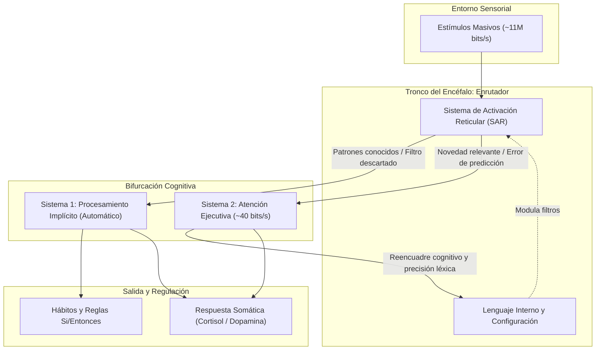

Conviene dejar de lado por un momento la literatura de autoayuda ligera y las promesas místicas sobre el poder oculto de la mente. Durante mucho tiempo he leído sobre el tema y he concluido que el concepto de subconsciente ha sido secuestrado por narrativas esotéricas que sugieren la existencia de una fuerza casi mágica lista para concedernos deseos si repetimos afirmaciones frente al espejo. Pero la realidad biológica es bastante más fascinante, rigurosa y, sobre todo, accionable.

Yo ahora entiendo que lo que popularmente llamamos subconsciente no es otra cosa que el procesamiento implícito de nuestro cerebro: la red de cómputo que Daniel Kahneman bautizó como el Sistema 1. Se trata de una maquinaria biológica ejecutando patrones automatizados, heurísticas evolutivas, modelos mentales consolidados y respuestas somáticas sin requerir la intervención deliberada de nuestra consciencia.

Esta asimetría entre estos dos modos de operación es colosal. El sistema sensorial y nervioso humano recibe y procesa cerca de once millones de bits de información por segundo. De todo ese caudal abrumador, la atención consciente —gestionada por la corteza prefrontal a través del Sistema 2— apenas puede procesar entre cuarenta y cincuenta bits por segundo.

> "El rendimiento cognitivo no se mide por la cantidad de datos que intentas forzar en tu memoria de trabajo, sino por la precisión de los filtros con los que descartas el ruido."

En temas de sistemas, nuestra consciencia equivale a un único hilo de ejecución mononúcleo intentando supervisar una red masiva de cómputo distribuido. Una mente de alto rendimiento no es aquella que pretende empujar más datos a través de ese cuello de botella de cuarenta bits, sino la que aprende a configurar con precisión los filtros que determinan qué información merece cruzar el umbral consciente.

## La arquitectura subyacente

Haciendo analogías con sistemas de cómputo, podríamos decir que el Sistema de Activación Reticular (SAR) es el cortafuegos de nuestra atención. Esta densa red de neuronas, ubicada en el tronco del encéfalo, funciona exactamente como el enrutador de paquetes de tu atención. Conecta la médula espinal con la corteza cerebral y decide qué estímulos sensoriales son descartados y cuáles son promovidos a la atención consciente.

En este momento, mientras estás leyendo estas líneas en una cafetería o en una oficina compartida, tu cerebro está ignorando el zumbido del aire acondicionado, el roce de tu camiseta contra los hombros y las conversaciones de fondo. El SAR decidió que esos estímulos no representan una amenaza ni una oportunidad relevante, por lo que silenció su procesamiento consciente para proteger tus escasos cincuenta bits de atención.

Aquí radica el papel central de las palabras: el lenguaje interno que utilizas a diario funciona como el archivo de configuración del SAR. La autoconversación no es un simple comentario pasivo sobre lo que vives; es código de instrucción directo.

Cuando sostienes de manera recurrente pensamientos como *"este problema de arquitectura es demasiado complejo para mí"* o *"nunca tengo tiempo para terminar lo prioritario"*, le estás entregando al SAR una regla de búsqueda activa. Al recibir esa directiva, el enrutador neuronal prioriza selectivamente cualquier dato del entorno que confirme la hipótesis: interrupciones menores, fallos en la consola, señales de cansancio o imprevistos de agenda. Al mismo tiempo, vuelve invisibles las posibles soluciones y los espacios libres de trabajo.

El impacto no se queda en el terreno abstracto de los pensamientos. El lenguaje condiciona de forma directa las respuestas neuroquímicas antes de que puedas analizar conscientemente la situación: frases cargadas de amenaza difusa elevan el cortisol y la noradrenalina, mientras que formulaciones basadas en agencia y descomposición modular activan la dopamina tónica, favoreciendo la exploración y el enfoque.

## Tres protocolos empíricos

Las intenciones ambiguas no alteran los patrones automáticos del cerebro. Decirte a ti mismo *"quiero ser más disciplinado"* o *"voy a concentrarme mejor"* produce el mismo efecto que escribir un comentario sin código ejecutable. Para reprogramar el procesamiento implícito se requiere sintaxis condicional rígida, validación empírica y precisión lingüística.

### 1. Planes Si/Entonces

Hay que poner en claro que la fuerza de voluntad consciente es un recurso metabólico finito. Cada vez que tienes que debatir contigo mismo si abres una red social o continúas depurando un test que falla, consumes glucosa y energía en la corteza prefrontal, este es un proceso biológico que consume recursos valiosos.

El psicólogo Peter Gollwitzer demostró en la Universidad de Nueva York que formular intenciones de implementación (*Implementation Intentions*) transfiere el control de la conducta desde el esfuerzo consciente hacia una señal ambiental externa. La clave consiste en redactar la instrucción en formato condicional estricto: **Si ocurre [Disparador X], entonces ejecutaré inmediatamente [Acción Y]**.

| Deseo Vago (Ineficaz)                 | Protocolo Si/Entonces (Ejecutable)                                                                                                            |
| :------------------------------------ | :-------------------------------------------------------------------------------------------------------------------------------------------- |
| "No me voy a distraer en el trabajo." | *"Si abro una pestaña de YouTube mientras compilo el código, entonces cerraré el navegador de inmediato y tomaré un sorbo de agua."*          |
| "Voy a hacer pausas activas."         | *"Si suena la alarma de las 12:00, entonces me pondré de pie y caminaré dos minutos por el pasillo."*                                         |
| "No me frustraré con el legacy code." | *"Si encuentro una función sin tests de más de 100 líneas, entonces escribiré un test unitario de caracterización antes de tocar la lógica."* |

Al definir la respuesta con antelación, el Sistema 1 ejecuta la acción de forma casi refleja cuando se presenta el desencadenante, eliminando el desgaste de la deliberación interna.

La lógica booleana aplicada en esta técnica, conocida como **Implementación de intenciones**, es una forma de programar el comportamiento humano. Al aplicarla en mis decisiones diarias, he notado una reducción significativa en la procrastinación y un aumento en la productividad.

> Mis analogías sobre la implementación de intenciones se basan en mi experiencia como programador. Es por ello que suelo expresar estas ideas en términos de código y sistemas de computación.

### 2. Depuración cognitiva en caliente

En mi experiencia las afirmaciones genéricas de la autoayuda convencional (*"soy capaz de lograr cualquier cosa"*, *"todo saldrá bien"*) suelen fracasar porque la mente analítica las detecta de inmediato como inconsistentes con la realidad fáctica. Cuando intentas engañar a tu cerebro con optimismo vacío, el Sistema 2 genera un rechazo automático que suele intensificar el malestar.

El proceso cognitivo efectivo funciona como un depurador (*debugger*) en caliente. Cuando detectes una rumiación limitante o una oleada de tensión, descompón el pensamiento en tres componentes objetivos:

1. **Hecho neutro:** Aislar los datos observables y despojados de adjetivos emocionales.
2. **Sesgo o juicio a descartar:** Identificar la distorsión cognitiva automática (catastrofismo, generalización excesiva, lectura de mente).
3. **Reconstrucción empírica:** Redactar una instrucción basada en evidencia histórica comprobable y un siguiente paso accionable.

Por ejemplo, frente al pensamiento: *"No voy a llegar a la entrega del sprint y el equipo pensará que soy un incompetente"*:

* **Hecho neutro:** Faltan 48 horas para el cierre y quedan tres historias de usuario en la columna de progreso.
* **Sesgo a descartar:** Asumir que un retraso define mi competencia global y adivinar el juicio de los demás.
* **Reconstrucción empírica:** He gestionado entregas ajustadas previamente renegociando el alcance con el Product Owner. Desglosaré la historia más compleja en dos tareas independientes ahora mismo.

### 3. Nomenclatura de alta granularidad

En las investigaciones de neurociencia afectiva lideradas por Lisa Feldman Barrett y Matthew Lieberman revelan un fenómeno decisivo: el cerebro utiliza el vocabulario disponible para interpretar las señales físicas difusas que provienen del cuerpo (interocepción).

Si utilizas etiquetas ambiguas y genéricas como *"estoy sumamente estresado"* o *"tengo una ansiedad inmensa"*, la amígdala interpreta esa etiqueta como una señal de amenaza sistémica inminente, desatando una cascada de taquicardia, vasoconstricción y bloqueo cognitivo.

> "Nombrar con precisión quirúrgica lo que sientes en el cuerpo no es un ejercicio literario; es un comando biológico que apaga la alarma de la amígdala y devuelve el control a tu corteza prefrontal."

El etiquetado afectivo consiste en sustituir términos genéricos por descripciones anatómicas y contextuales exactas. En lugar de decir *"estoy ansioso"*, describe la realidad interna: *"registro una ligera aceleración en el pulso y tensión debido a que no tengo claras las variables de este despliegue"*.

La neuroimagen demuestra que el acto de buscar la palabra exacta para describir un estado corporal desactiva la reactividad de la amígdala y activa la corteza prefrontal dorsolateral en cuestión de segundos. La precisión léxica es una herramienta de regulación fisiológica.

## La arquitectura neurocognitiva del filtro mental

Podemos visualizar cómo interactúan estas capas a través del siguiente diagrama de flujo de datos y control:

Cuando el SAR está calibrado con un lenguaje interno riguroso, la mayor parte de las contingencias cotidianas es absorbida por el Sistema 1 mediante reglas conductuales preprogramadas, liberando al Sistema 2 para resolver tareas complejas de diseño, creatividad y toma de decisiones.

## Mindfulness operativo

En el contexto profesional, el mindfulness a menudo se confunde con una práctica contemplativa pasiva que requiere aislarse del entorno. En la práctica de un artesano del software o de un líder técnico, el mindfulness útil es estrictamente operativo: consiste en la habilidad de conmutar deliberadamente entre dos redes neuronales.

* **La Red por Defecto (DMN - Default Mode Network):** Se activa cuando la mente no está concentrada en una tarea orientada a objetivos. Es el territorio de la rumiación sobre el pasado, la ansiedad por el futuro, la comparación social y el piloto automático.
* **La Red de Atención Ejecutiva (CEN - Central Executive Network):** Se activa durante el trabajo profundo, la resolución lógica de problemas y la presencia consciente en el momento presente.

> "La atención ejecutiva no se recupera luchando contra la distracción con culpa, sino diseñando reglas claras de retorno al momento presente."

Para recuperar la gobernanza sobre estas redes en medio de una jornada laboral intensa, existen dos protocolos con respaldo experimental.

### El suspiro fisiológico

Documentado extensamente por el laboratorio de neurobiología del doctor Andrew Huberman en la Universidad de Stanford, el suspiro fisiológico es el mecanismo biológico más rápido para frenar una respuesta autonómica de estrés sin necesidad de farmacología ni aislamiento.

El ejercicio se compone de tres pasos simples:

1. Realiza una **inhalación profunda y continua por la nariz**.
2. Al llegar al tope de la capacidad pulmonar, realiza una **segunda inhalación corta y brusca por la nariz** para forzar la reapertura de los alvéolos colapsados en la base de los pulmones.
3. **Exhala lentamente por la boca** con un suspiro largo y relajado hasta vaciar por completo el aire.

Repetir esta secuencia dos o tres veces activa el nervio vago y estimula el sistema nervioso parasimpático. La exhalación prolongada aumenta la presión intratorácica, enviando una señal al nodo sinoauricular del corazón que reduce la frecuencia cardíaca de forma inmediata mediante arritmia sinusal respiratoria. Es un reseteo de hardware en tiempo real.

### La auditoría de presencia de sesenta segundos

Para evitar que la Red por Defecto secuestre tu atención durante horas enteras de navegación sin rumbo o trabajo reactivo, implementa una auditoría breve de presencia. Configura dos o tres recordatorios discretos a lo largo de tu día. Al activarse, detén cualquier actividad durante exactamente un minuto y responde mentalmente a tres preguntas de diagnóstico:

1. **¿Qué sensaciones físicas detecto ahora mismo?** (Verifica si hay tensión en la mandíbula, rigidez en los hombros, postura encorvada o respiración torácica superficial).
2. **¿Qué insumo externo tiene capturado mi foco en este instante?** (Distingue si estás atendiendo un problema real o respondiendo a una notificación que acaba de interrumpirte).
3. **¿Esta tarea responde a mi prioridad estratégica o estoy operando por inercia?**

Este microchequeo interrumpe el bucle de rumiación de la Red por Defecto y reinstala la Atención en el presente con un costo temporal insignificante.

## La mente del artesano

Quienes nos dedicamos al desarrollo de software y a la arquitectura técnica entendemos bien el valor del diseño de sistemas: sabemos que una base de datos mal indexada o un servicio sin límites de concurrencia colapsará bajo presión, sin importar las buenas intenciones de los operadores. Con nuestro cerebro ocurre exactamente lo mismo.

En sus *Meditaciones*, el emperador filósofo Marco Aurelio insistía en la noción de la ciudadela interior: esa fortaleza mental donde ningún agente externo puede irrumpir a menos que nosotros mismos le abramos la puerta. El filósofo recordaba que nuestra alma toma el tinte de las impresiones que albergamos con mayor frecuencia.

La atención y la energía biológica son recursos escasos; desperdiciarlos en la rumiación de escenarios que escapan a tu control directo es una mala gestión de inventario mental.

El cultivo de una mente lúcida no depende de dones excepcionales ni de fórmulas milagrosas. Es un trabajo disciplinado de ingeniería cotidiana: limpiar los filtros de entrada del SAR, sustituir la queja pasiva por sintaxis condicional ejecutable, llamar a las cosas por su nombre anatómico y recordar que la maestría técnica nace de una mente serena y bien administrada.

## Conclusión

Desmitificar el subconsciente es el primer paso para dejar de ser rehenes de nuestros automatismos biológicos. Cuando comprendes que tu mente automática responde a reglas de enrutamiento, a la sintaxis de tu lenguaje y a la química de tus hábitos, dejas de esperar revelaciones mágicas y comienzas a actuar como un verdadero artesano de tu propia cognición.

La próxima vez que sientas que la dispersión o el agobio amenazan con descarrilar tu jornada, no recurras a la culpa ni a la fuerza bruta. Aplica ingeniería: detén la inercia con un suspiro fisiológico, audita el código de tu autoconversación y define una regla condicional clara para el siguiente paso.

¿Ya estás implementando este enfoque en tu entorno de desarrollo? Me encantaría conocer tu experiencia y los desafíos que has enfrentado. ¡Hasta la próxima línea de código! 🚀

Deja tus comentarios en el [repositorio](https://github.com/lgzarturo/arthurolg-blog-posts/issues) o en mi perfil de [X@algforge](https://x.com/algforge). Si te es de utilidad, una estrella en [GitHub](https://github.com/lgzarturo) es de gran ayuda o no dudes en compartir este artículo con tus colegas y amigos. ¡Gracias por leer!

## Referencias

* [Thinking, Fast and Slow (Daniel Kahneman)](https://en.wikipedia.org/wiki/Thinking,_Fast_and_Slow)
* [Implementation Intentions: Strong Effects of Simple Plans (Peter M. Gollwitzer)](https://kops.uni-konstanz.de/handle/123456789/10101)
* [Putting Feelings Into Words: Affect Labeling Disrupts Amygdala Activity (Matthew D. Lieberman et al.)](https://pubmed.ncbi.nlm.nih.gov/17576282/)
* [Brief Structured Respiration Practices Enhance Mood and Reduce Physiological Arousal (Andrew D. Huberman, David Spiegel et al.)](https://www.cell.com/cell-reports-medicine/fulltext/S2666-3791(22)00474-8)
* [Meditaciones (Marco Aurelio - Filosofía Estoica)](https://es.wikipedia.org/wiki/Meditaciones)
