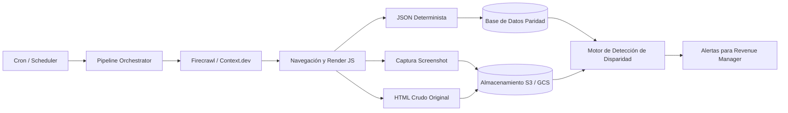

Si abres una pestaña en modo incógnito, entras a la página de cualquier hotel y seleccionas una fecha para el próximo fin de semana, el precio de la habitación aparece de inmediato en tu pantalla. No necesitas usuario, contraseña ni tarjeta de crédito para consultarlo. Ese valor es público. Sin embargo, en el instante en que intentas leer ese mismo número mediante un script automatizado para auditar si una agencia online está respetando tus acuerdos de distribución, el discurso de la industria cambia drásticamente. Lo que para un usuario corriente es navegar, para el área de sistemas de muchos intermediarios se convierte de pronto en un "ataque", una "mala práctica" o un presunto "abuso de recursos".

Existe una evidente doble moral alrededor del scraping. Empresas de la magnitud de Google, Microsoft o los laboratorios de inteligencia artificial han cimentado modelos de negocio billonarios rastreando e indexando terabytes de contenido abierto en la red sin pedir permiso a nadie. Pero en sectores como la hotelería y los viajes, los motores de reserva y las grandes agencias de viajes online (OTAs) contratan costosas soluciones de mitigación de bots para blindar esas mismas tarifas que exhiben abiertamente en el navegador.

Como ingenieros de software y constructores de tecnología para la hospitalidad, nos enfrentamos a un dilema diario: el hotel necesita monitorear la paridad tarifaria para tomar decisiones comerciales informadas, pero la falta de estándares abiertos lo obliga a construir herramientas de recolección complejas. Es hora de hablar sobre por qué los datos públicos deben ser accesibles, cómo dejar atrás el scraping artesanal frágil y qué arquitectura nos permite auditar precios de forma determinista y ética.

## Cuando Google indexa es progreso, cuando tú vigilas tarifas es "abuso"

El argumento habitual de quienes bloquean el acceso automatizado es la protección de su infraestructura contra la denegación de servicio o la saturación de tráfico. Si bien el tráfico basura de bots descontrolados es un problema técnico real, en la práctica el bloqueo indiscriminado cumple otra función: dificultar la comparación de precios y restringir la visibilidad sobre las tácticas comerciales de los distribuidores.

El marco legal internacional ha sido contundente al respecto. Decisiones judiciales emblemáticas en los tribunales estadounidenses, como el caso [hiQ Labs v. LinkedIn](https://en.wikipedia.org/wiki/HiQ_Labs_v._LinkedIn), ratificaron que la ley de fraude y abuso informático (CFAA) no puede utilizarse para prohibir la recolección de información que está expuesta libremente al público. Si no existe una barrera de autenticación previa, no hay acceso no autorizado. Esta doctrina sobre la recolección legítima en la web abierta, documentada en los principios jurídicos del [web scraping](https://en.wikipedia.org/wiki/Web_scraping), establece una distinción clara entre vulnerar la seguridad de un sistema y procesar datos que el propio propietario decidió publicar en la vitrina digital.

> "Pretender que un precio es público para el consumidor pero privado frente a la auditoría técnica de quien produce el inventario es una contradicción comercial insostenible."

Imagina una tienda departamental en una avenida transitada. El comerciante coloca un cartel con el precio de un abrigo en el escaparate para que cualquier persona que camine por la banqueta pueda leerlo. Lo que no puede hacer ese comerciante es llamar a la policía porque el sastre de la cuadra de enfrente se detuvo en la acera a anotar el número con lápiz y papel. Si el precio está a la vista de todos, el dato es público. La doble moral aparece cuando los mismos intermediarios que construyeron su dominio tecnológico leyendo y agregando información ajena levantan muros artificiales cuando el hotelero busca vigilar su propio canal.

## Paridad tarifaria y disparidades encubiertas

Para entender por qué un hotel necesita recolectar tarifas, hay que mirar el día a día del Revenue Manager. En la distribución hotelera tradicional, la paridad tarifaria exige que el hotel venda su inventario al mismo precio base tanto en su sitio oficial como en los canales indirectos. Sin embargo, en el análisis continuo sobre [la gestión y distribución de canales hoteleros](https://www.revenatium.com/productos/channel-manager) se observa con frecuencia cómo las OTAs aplican descuentos no consensuados recortando parte de su comisión o alterando la tarifa según la geolocalización del visitante o el sistema operativo del teléfono móvil.

Cuando una OTA vende una habitación cinco o diez dólares por debajo de la tarifa del sitio web oficial, destruye la credibilidad del canal directo. En artículos anteriores sobre cómo [Reinventando el canal directo en la hotelería: Arquitectura, IA y el ecosistema Revenatium](https://www.arthurolg.com/article/marketing_reinventando-canal-directo-hoteleria-ia-revenatium) y las claves para entender [Cómo Dominar el Canal Directo en Hoteles](https://www.arthurolg.com/article/marketing_domina-el-canal-directo-de-tu-hotel), insisto en que la independencia comercial del hotelero se desmorona si este pierde el control de sus precios. De nada sirve diseñar atractivos [Planes de Lealtad en el Canal Directo Hotelero](https://www.arthurolg.com/article/marketing_planes-lealtad-canal-directo-hoteles) si en una búsqueda rápida el huésped encuentra tarifas desautorizadas más baratas en un intermediario.

El Revenue Manager no hace scraping por pasatiempo ni por curiosidad académica: lo hace para defender su margen operativo. Sin herramientas de monitoreo, detectar estas disparidades requeriría revisiones manuales extenuantes y propensas a errores humanos. Pero como el mercado no ofrece interfaces estandarizadas de consulta, los hoteles y las empresas de software terminan asumiendo un sobrecosto operativo (OpEx) considerable para construir y mantener servicios de extracción solo para saber a qué precio se ofrece su propio producto.

## Por qué los scrapers caseros mueren

Muchos equipos de desarrollo cometen el error de iniciar este camino con scripts caseros basados en Puppeteer, Playwright o Selenium corriendo en servidores propios (*En mi caso ya pase por ese camino hace algún tiempo y es un dolor de cabeza*). Al principio todo parece sencillo: navegas a la URL, seleccionas un `div` con un selector CSS, extraes el texto y lo guardas en una base de datos relacional.

A las dos semanas, el sistema colapsa. El intermediario cambia una clase en el código HTML, activa un captcha de Cloudflare o bloquea el rango de direcciones IP del proveedor de nube. El equipo de ingeniería termina dedicando mucho de su tiempo a reparar selectores rotos y lidiar con proxies residenciales en lugar de perfeccionar el producto principal.

En lugar de mantener esa deuda técnica, la arquitectura moderna exige delegar la infraestructura de navegación en plataformas especializadas y enfocarse en la extracción determinista. Herramientas como [Firecrawl](https://docs.firecrawl.dev/features/scrape), cuyo motor de extracción en [código abierto](https://github.com/mendableai/firecrawl) ha madurado sustancialmente, permiten orquestar la resolución de páginas dinámicas pesadas y recibir directamente estructuras de datos limpias y tipadas mediante esquemas estrictos de validación.

```python
from firecrawl import Firecrawl
from pydantic import BaseModel, Field

class HotelRateExtraction(BaseModel):
    hotel_name: str = Field(description="Nombre comercial del hotel")
    room_type: str = Field(description="Tipo o categoría de la habitación")
    currency: str = Field(description="Código ISO de la moneda (USD, MXN, EUR)")
    total_price: float = Field(description="Precio total final con impuestos incluidos")
    rate_policy: str = Field(description="Política de cancelación: reembolsable o no reembolsable")

app = Firecrawl(api_key="fc-produccion-key")

# Extracción estructurada, captura de código HTML y evidencia visual
resultado = app.scrape(
    url="https://ejemplo-ota.com/hotel/mar-del-sur?checkin=2026-11-01&checkout=2026-11-03",
    formats=[
        "markdown",
        "screenshot",
        {
            "type": "json",
            "schema": HotelRateExtraction.model_json_schema(),
            "prompt": "Extrae los datos exactos de la primera tarifa disponible según el esquema."
        }
    ],
    actions=[
        {"type": "wait", "milliseconds": 1500},
        {"type": "screenshot", "full_page": True}
    ]
)

print(f"Tarifa detectada: {resultado['json']['total_price']} {resultado['json']['currency']}")
print(f"Evidencia visual guardada: {resultado['screenshot']}")
```

La clave para que este proceso sea defendible y útil para el Revenue Manager descansa en tres principios irrenunciables:

1. **Determinismo:** No puedes permitir que un modelo de lenguaje alucine o varíe el formato del precio en cada ejecución. El uso de esquemas de Pydantic o JSON Schema obliga a que el dato sea un número flotante con moneda explícita y política definida.
2. **Respeto de límites y cuotas:** Las consultas deben programarse con frecuencias sensatas, evitando saturar la infraestructura destino. No se trata de ametrallar un servidor con peticiones innecesarias, sino de muestrear puntos clave de la curva de ocupación.
3. **Auditoría inmutable con captura fotográfica y código fuente:** Cuando detectas una disparidad tarifaria y reclamas a la agencia online, la respuesta habitual es negar la discrepancia. Si tu pipeline almacena el código HTML crudo junto con la captura de pantalla completa (*screenshot*) con marca de tiempo, entregas una prueba incontestable para exigir el cumplimiento del contrato.



## APIs públicas y democratización del dato

El estado actual del mercado es ineficiente para todos los actores involucrados. Las OTAs y los motores de reservas gastan fortunas en licencias de software anti-bot para frenar peticiones; los hoteles y las empresas de software gastan fortunas en servicios de scraping y proxies para eludirlas; y los servidores de ambas partes procesan kilobytes innecesarios de hojas de estilo, scripts de seguimiento y recursos visuales pesados que nadie necesita para consultar un número.

La solución sensata no es la guerra de trincheras, sino la estandarización. Las empresas que comercializan tarifas hoteleras al público deberían ofrecer esas mismas tarifas a través de una API pública y abierta, con esquemas de autenticación ligera y límites de tasa (*rate limits*) bien definidos.

Si un distribuidor permite consultar diez o veinte peticiones por minuto bajo una clave gratuita, la carga computacional en sus centros de datos disminuye drásticamente en comparación con obligar a un clúster de navegadores headless a renderizar una aplicación de página única completa. Las APIs consumen una fracción mínima del ancho de banda y garantizan que los datos entregados sean confiables y consistentes.

Democratizar el acceso a la información no es promover el abuso de recursos: es permitir que las reglas del juego sean claras y equitativas. Cuando un hotel cuenta con herramientas efectivas para supervisar sus canales, puede corregir distorsiones en tiempo real, evitar el canibalismo de precios entre intermediarios y diseñar ofertas genuinamente competitivas para el huésped en su canal directo. Al final del día, una industria más transparente beneficia siempre al consumidor final.

## Conclusión

El scraping de tarifas no debe entenderse como un acto de rebeldía clandestina, sino como una respuesta técnica pragmática ante la ausencia de un estándar abierto en el sector de la hospitalidad. Mientras persista la doble moral de exhibir precios al público pero blindar su lectura automatizada, los constructores de software tenemos la responsabilidad de diseñar sistemas profesionales: dejando atrás los scripts improvisados, adoptando arquitecturas deterministas y respaldando cada dato con evidencia auditable que le devuelva al hotelero la soberanía sobre sus precios.

¿Cómo gestionas actualmente la auditoría de paridad tarifaria en tu estrategia de distribución y qué obstáculos técnicos has encontrado al monitorear canales de terceros?

Si quieres comentar o compartir tu experiencia, escríbeme en [X (@algforge)](https://x.com/algforge) o abre un issue en el [repositorio](https://github.com/lgzarturo/arthurolg-blog-posts/issues). Una estrella en [GitHub](https://github.com/lgzarturo) también ayuda.

## Referencias

- [HiQ Labs, Inc. v. LinkedIn Corp., 31 F.4th 1180, U.S. Court of Appeals for the Ninth Circuit](https://en.wikipedia.org/wiki/HiQ_Labs_v._LinkedIn)
- [Web Scraping: Legal and Technical Framework, Wikipedia Foundation](https://en.wikipedia.org/wiki/Web_scraping)
- [Estrategias de distribución y control de precios en hotelería, Revenatium](https://www.revenatium.com/productos/channel-manager)
- [Firecrawl Scrape API and Deterministic Extraction Documentation, Mendable AI](https://docs.firecrawl.dev/features/scrape)
- [Firecrawl Open Source Web Scraping Engine Repository, GitHub](https://github.com/mendableai/firecrawl)
