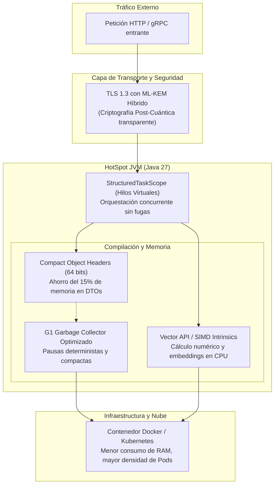

## La evolución continua de Java

Si llevas algunos años en la industria del software, seguro recuerdas la pesadilla que representaba actualizar de Java 8 a Java 11. Eran proyectos de meses enteros: módulos rotos por la introducción del Project Jigsaw, dependencias internas de la JVM que desaparecían sin aviso, scripts de construcción incompatibles y comités de arquitectura postergando la decisión durante semestres enteros por puro miedo a romper producción.

Esa época quedó en el pasado. La decisión adoptada de establecer un ciclo de lanzamientos estricto cada seis meses transformó radicalmente la relación de los equipos con el lenguaje. En lugar de soportar saltos abismales cada tres o cuatro años donde todo cambiaba a la vez, Java adoptó la disciplina de la entrega continua: pequeños cambios incrementales, APIs en fase de incubación o previsualización (*preview features*) y una estabilidad de retrocompatibilidad casi quirúrgica.

> "El verdadero mérito de la ingeniería de software moderna no es rediseñar un sistema desde cero en un arranque de vanidad, sino refactorizar el motor en pleno vuelo mientras procesa millones de transacciones por segundo."

Con la llegada de **Java 27**, la tentación inmediata de muchos desarrolladores es revisar qué novedades sintácticas trae el compilador: si hay una nueva palabra clave, un operador más conciso o una simplificación en la declaración de clases. Sin embargo, en esta entrega, la verdadera revolución no ocurre en la superficie de la sintaxis. La evolución más profunda y rentable ocurre varios niveles por debajo: en el diseño de la **JVM**, la densidad de la memoria, el compilador JIT, la concurrencia y la criptografía de red.

---

## La verdadera revolución ocurre bajo el capó

Cuando diseñas arquitecturas para la nube, el costo de infraestructura no depende únicamente de la elegancia de tus patrones de diseño; depende de la densidad de tus contenedores, la latencia de recolección de basura (*Garbage Collection*) y la eficiencia con la que tus procesos aprovechan el hardware subyacente.

Java 27 concentra sus mayores fortalezas en componentes que benefician a cualquier aplicación corporativa con cambios mínimos o nulos en su lógica de negocio:

1. CAPA DE APLICACIÓN: Lógica de Dominio, APIs REST, Microservicios
2. CONCURRENCIA Y OPTIMIZACIÓN
    - Structured Concurrency (Loom): Lazy Constants
    - Vector API (Panama): JFR Telemetría Nube
3. MEMORIA Y RUNTIME (HOTSPOT JVM)
    - Compact Object Headers (Lilliput: cabecera de 64 bits)
    - G1 Garbage Collector optimizado para baja latencia
4. SEGURIDAD Y RED DE BAJO NIVEL: TLS 1.3 con Intercambio Híbrido Post-Cuántico (ML-KEM)

A continuación, vamos a ver en detalle los avances técnicos que justifican poner a Java 27 en el radar de tu próximo ciclo de actualización técnica.

---

## Las novedades de Java 27 que impactan tu infraestructura

### 1. Compact Object Headers (Project Lilliput)

En cualquier arquitectura de 64 bits tradicional, cada objeto instanciado en el *heap* de la JVM carga con una cabecera (*object header*) de 96 o 128 bits (entre 12 y 16 bytes), compuesta por la palabra de marca (*mark word*) y el puntero a la clase (*klass pointer*).

En aplicaciones orientadas a microservicios que procesan millones de pequeños objetos (DTOs, tuplas, registros de bases de datos, nodos de colecciones o cadenas de texto), esa cabecera representaba entre el 20% y el 35% del consumo total de memoria viva.

Project Lilliput, integrado de forma madura en Java 27, consolida la cabecera del objeto en **64 bits (8 bytes)** exactos:

```
Diseño clásico (96 / 128 bits):
┌─────────────────────────┬─────────────────────────┐
│     Mark Word (64 bits) │  Klass Word (32/64 bits)│
└─────────────────────────┴─────────────────────────┘

Diseño compacto en Java 27 (64 bits):
┌───────────────────────────────────────────────────┐
│       Compact Header Unificado (64 bits)          │
└───────────────────────────────────────────────────┘
```

El impacto operativo es directo: al recortar el tamaño de la cabecera, la huella de memoria del *heap* se reduce entre un **10% y un 20% de forma inmediata**. En Kubernetes, esto permite ajustar a la baja los límites de memoria de tus pods (`resources.limits.memory`), aumentando la densidad de contenedores por nodo y reduciendo la factura mensual de computación en la nube sin tocar una sola línea de código.

### 2. G1 GC evolucionado como estándar indiscutible

El recolector G1 (*Garbage-First*) consolida su posición como recolector por defecto gracias a algoritmos de compactación más inteligentes adaptados al nuevo diseño de cabeceras compactas. Las pausas de limpieza son más cortas y predecibles, evitando las degradaciones de rendimiento que solían presentarse cuando el *heap* se fragmentaba bajo ráfagas intensas de peticiones concurrentes.

### 3. Structured Concurrency (Project Loom)

La llegada de los *Virtual Threads* en versiones previas resolvió el problema del consumo excesivo de memoria en operaciones de entrada/salida bloqueantes. Sin embargo, lanzar hilos virtuales sin control puede derivar en hilos huérfanos, cancelaciones desatendidas y depuraciones complejas.

La concurrencia estructurada (*Structured Concurrency*) introduce el concepto de coordinar tareas concurrentes divididas en subtareas dentro de un único bloque léxico: si una subtarea falla, las demás se cancelan automáticamente de forma coordinada.

```java
// Ejemplo de concurrencia estructurada en Java 27
public OrderResponse processOrder(OrderRequest request) throws InterruptedException, ExecutionException {
    try (var scope = new StructuredTaskScope.ShutdownOnFailure()) {
        // Despachamos sub-tareas concurrentes sobre hilos virtuales
        Supplier<CustomerProfile> customerTask = scope.fork(() -> fetchCustomer(request.customerId()));
        Supplier<InventoryStatus> inventoryTask = scope.fork(() -> verifyInventory(request.items()));
        Supplier<PaymentResult>   paymentTask   = scope.fork(() -> preAuthorizePayment(request.paymentInfo()));

        // Esperamos a que todas completen o a que la primera falle
        scope.join();
        scope.throwIfFailed();

        // Si ninguna falló, combinamos los resultados de forma segura
        return new OrderResponse(customerTask.get(), inventoryTask.get(), paymentTask.get());
    } // Al cerrar el scope, cualquier hilo remanente se limpia automáticamente
}
```

La ventaja de este patrón es la **observabilidad y seguridad**: los hilos virtuales no escapan del bloque de ejecución, los volcados de memoria (*thread dumps*) reflejan la jerarquía exacta de llamadas y se eliminan las fugas de recursos por excepciones no capturadas.

### 4. Vector API: cómputo SIMD para IA y analítica

Con el auge de modelos de lenguaje pequeños en local, búsqueda vectorial por similitud de coseno y procesamiento numérico, las aplicaciones Java requerían tradicionalmente bibliotecas nativas compiladas en C o C++ mediante JNI para lograr rendimiento aceptable.

La Vector API (perfeccionada en el marco de Project Panama) permite escribir operaciones vectoriales portables que el compilador HotSpot C2 traduce directamente a instrucciones de hardware SIMD (*Single Instruction, Multiple Data*), como AVX-512 en arquitecturas x86 o SVE en ARM64.

```java
// Operación vectorial: suma de dos arreglos en paralelo a nivel de hardware
static void vectorAdd(float[] a, float[] b, float[] result) {
    var species = FloatVector.SPECIES_PREFERRED;
    int i = 0;
    int upperBound = species.loopBound(a.length);

    for (; i < upperBound; i += species.length()) {
        var va = FloatVector.fromArray(species, a, i);
        var vb = FloatVector.fromArray(species, b, i);
        var vc = va.add(vb);
        vc.intoArray(result, i);
    }

    // Procesamos elementos remanentes de forma escalar
    for (; i < a.length; i++) {
        result[i] = a[i] + b[i];
    }
}
```

Esto habilita pipelines de cálculo masivo dentro del propio ecosistema de la JVM, reduciendo la fricción de mantenimiento y evitando la inestabilidad de vincular código nativo externo.

### 5. Lazy Constants

¿Cuántas veces has implementado patrones de inicialización perezosa con bloques `synchronized`, variables `volatile` o el truco de la clase interna para evitar inicializar un recurso pesado hasta que sea realmente necesario?

Java 27 introduce primitivas nativas de constantes perezosas (*Lazy Constants*). Permiten posponer la computación de un valor constante hasta su primer acceso efectivo, garantizando seguridad entre hilos y optimizaciones directas por parte del compilador JIT sin incurrir en penalizaciones continuas de sincronización.

### 6. Criptografía Post-Cuántica Híbrida en TLS 1.3

Una de las amenazas más serias en la seguridad contemporánea es la estrategia conocida como *"cosechar ahora, descifrar después"* (*harvest now, decrypt later*). Actores maliciosos capturan y almacenan tráfico cifrado en tránsito hoy con la intención de descifrarlo en el futuro cuando los ordenadores cuánticos rompan el intercambio de claves basado en curvas elípticas clásicas (como ECDH).

Java 27 incorpora de forma nativa esquemas híbridos de intercambio de claves para TLS 1.3 (combinando algoritmos tradicionales como X25519 con estándares post-cuánticos como ML-KEM). Tus microservicios quedan protegidos contra ataques presentes y futuros sin alterar el código de tus clientes HTTP o tus controladores web.

---

## El flujo de ejecución en Java 27

Para visualizar cómo interactúan estas piezas en una petición web típica dentro de un microservicio moderno, examinemos el flujo de datos:



---

## ¿Aprovechas la JVM o solo ejecutas sobre una versión nueva?

Muchos equipos caen en una paradoja técnica habitual: actualizan la versión del JDK en su archivo `pom.xml` o `build.gradle.kts`, verifican que el proyecto compile y dan por concluida la migración.

Si te limitas a hacer eso, estás desaprovechando gran parte del retorno de inversión que Java 27 pone sobre la mesa. Para capitalizar estas innovaciones en tu entorno de desarrollo y producción, propón a tu equipo las siguientes verificaciones:

1. **Audita la huella de memoria con Compact Headers:** Compara el consumo de memoria residente (*Resident Set Size*, RSS) de tus contenedores antes y después de la migración utilizando herramientas como `jcmd <pid> VM.native_memory baseline`. Si el ahorro en *heap* es notable, reajusta las solicitudes (`resources.requests.memory`) en tus manifiestos de Kubernetes para reducir los nodos de tus clústeres.
2. **Reemplaza hilos manuales por concurrencia estructurada:** Revisa aquellos servicios que aún coordinan llamadas asíncronas con `CompletableFuture.allOf()` o primitivas dispersas de `ExecutorService`. Adopta `StructuredTaskScope` para dotar a tu código de cancelaciones atómicas y diagnósticos limpios.
3. **Monitorea la JVM con Java Flight Recorder (JFR):** Java 27 refina los eventos de telemetría para contenedores. Habilitar perfiles de JFR en producción con bajo impacto permite diagnosticar bloqueos de red, comportamiento del recolector G1 y uso de memoria nativa sin necesidad de agentes externos invasivos.

> "El verdadero salto de nivel de un desarrollador senior no está en memorizar la última sintaxis de moda, sino en comprender cómo su software interactúa con la memoria, los hilos y los recursos del sistema."

---

## Conclusión

La continua evolución de Java cada seis meses demuestra que una plataforma madura no necesita reinventar su identidad para mantenerse a la vanguardia. Mientras otros ecosistemas sufren por fragmentaciones de dependencias o reescrituras apresuradas, Java avanza con un rigor: optimiza la ingeniería interna de la máquina virtual, reduce la fricción de recursos en entornos de nube y blinda la seguridad contra los desafíos computacionales de las próximas décadas.

Actualizar a Java 27 no es un capricho técnico ni una simple tarea de mantenimiento en el backlog. Es una oportunidad concreta para entregar sistemas más rápidos, seguros y económicos en infraestructura con el mínimo esfuerzo de refactorización. La plataforma sigue haciendo el trabajo pesado por nosotros; solo tenemos que atrevernos a aprovecharlo.

¿Ya estás evaluando Java 27 o explorando estas capacidades de la JVM en tu entorno de desarrollo? Me encantaría conocer tu experiencia y los desafíos que has enfrentado. ¡Hasta la próxima línea de código! 🚀

Deja tus comentarios en el [repositorio](https://github.com/lgzarturo/arthurolg-blog-posts/issues) o en mi perfil de [X@algforge](https://x.com/algforge). Si te es de utilidad, una estrella en [GitHub](https://github.com/lgzarturo) es de gran ayuda o no dudes en compartir este artículo con tus colegas y amigos. ¡Gracias por leer!

## Referencias

- [OpenJDK Project Lilliput (Compact Object Headers)](https://openjdk.org/projects/lilliput/)
- [JEP: Structured Concurrency (Project Loom)](https://openjdk.org/projects/loom/)
- [JEP: Vector API (Project Panama)](https://openjdk.org/projects/panama/)
- [JEP: Post-Quantum Hybrid Key Exchange in TLS 1.3](https://openjdk.org/jeps/527)
- [Documentación oficial de OpenJDK](https://openjdk.org/)
