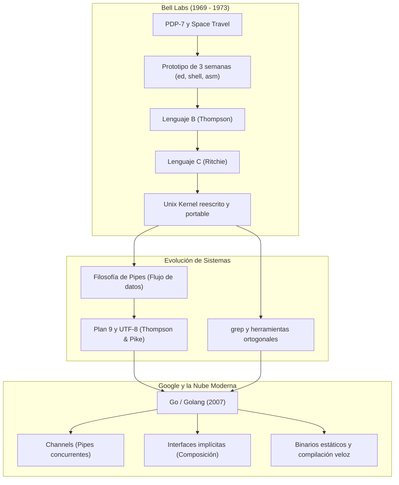

Corre una anécdota recurrente en foros y conversaciones de café técnico: un solo desarrollador se encerró tres semanas durante el verano y escribió un sistema operativo completo. Quienes repiten esta historia suelen hacerlo desde dos extremos opuestos. Por un lado están los que buscan alimentar el mito del programador unicornio, esa figura casi mitológica capaz de parir arquitecturas perfectas de la noche a la mañana sin ayuda de nadie. Por el otro están los escépticos que desprecian el relato, argumentando que nadie puede crear un kernel serio en menos de un mes y que todo se reduce a una exageración folclórica.

Ambas posturas cometen el mismo error de juicio: confunden un producto mínimo viable con un sistema de grado de producción.

La anécdota de agosto de 1969 es completamente real, pero omitir su contexto técnico distorsiona la realidad. Aquel verano, mientras su esposa Bonnie y su hijo estaban de vacaciones en California, Ken Thompson aprovechó tres semanas de silencio en los laboratorios Bell para escribir un núcleo básico, un intérprete de comandos elemental, un ensamblador rudimentario y un editor de líneas llamado `ed`. No era un sistema operativo comercial ni el Unix que conocemos hoy. Se trataba de un prototipo desarrollado en lenguaje ensamblador para una computadora PDP-7 que estaba prácticamente arrumbada en el laboratorio.

> "Un prototipo brillante resuelve la fricción del presente; la ingeniería de software disciplinada es la que transforma esa chispa inicial en una infraestructura perdurable."

La motivación detrás de aquel esfuerzo no fue conquistar la industria ni sentar las bases de internet. Thompson simplemente quería un entorno ágil y económico para ejecutar un videojuego que él mismo había programado tiempo atrás: *Space Travel*. Ejecutarlo en el sistema central GE-645 bajo Multics costaba cerca de 75 dólares por sesión en tiempo de máquina y el movimiento visual era tosco. Thompson buscó una máquina ociosa, entendió sus límites de memoria y resolvió su problema inmediato con las herramientas más primitivas posibles.

Ese prototipo de tres semanas no fue el software que inspiró a Linux. Fue apenas el punto de partida que él y Dennis Ritchie tardaron años en refactorizar, portar a la PDP-11, reescribir por completo tras inventar el lenguaje B y posteriormente el lenguaje C.

## Confundir un MVP con un coloso de producción

Comparar el código que Thompson escribió en agosto de 1969 con un sistema moderno como el kernel de Linux es un desacierto arquitectónico. Linux es un sistema operativo monolítico masivo, con soporte para multiprocesamiento simétrico, una pila de red que procesa millones de paquetes por segundo, subsistemas de virtualización y controladores para una diversidad casi infinita de hardware.

El núcleo original de la PDP-7 apenas gestionaba interrupciones elementales para un teclado de teletipo, un disco rígido rudimentario y ocho kilopalabras de memoria (equivalentes a unos escasos dieciocho kilobytes). No existía la concurrencia compleja ni la seguridad multiusuario que hoy damos por sentada. Podemos decir que fue una proeza de ingeniería, pero no podemos compararlo con un sistema de grado de producción.

Cuando un desarrollador novato o un líder técnico escucha la historia de las tres semanas sin este filtro, corre el riesgo de caer en dos trampas peligrosas. La primera es la frustración: creer que si su equipo tarda meses en poner a punto un servicio distribuido es porque carecen de talento. La segunda es la soberbia: asumir que entregar un prototipo frágil que corre en una máquina local equivale a tener un producto listo para producción.

Thompson no era un hechicero inmune a la fatiga. Era un artesano excepcional que aplicó ingeniería de primeros principios: desarmó una necesidad técnica concreta en sus partes fundamentales y construyó bloques pequeños y cohesivos para resolverla. El ocio relativo, la práctica activa y la capacidad de construir prototipos rápidamente fue fundamental para su desarrollo.

## La huella indeleble de Ken Thompson

Quienes cuestionan la productividad o la vigencia de Thompson olvidan que las bases de la computación moderna siguen apoyadas sobre sus decisiones de diseño. Cuando examinamos su trayectoria, encontramos un patrón constante: la búsqueda obsesiva de la simplicidad y el rechazo frontal a la complejidad innecesaria.

Podemos constatar esta filosofía en varias de sus contribuciones más trascendentales:

* **UTF-8:** Durante una cena en un restaurante de Nueva Jersey en 1992, Ken Thompson y Rob Pike diseñaron en una servilleta la codificación de caracteres que gobierna hoy la web global. Crearon un formato de longitud variable compatible con ASCII que resolvió la internacionalización del texto sin romper las herramientas de procesamiento existentes.
* **grep:** Surgió como una necesidad puntual al trabajar con su editor `ed`. Thompson tomó el algoritmo de búsqueda de expresiones regulares basado en autómatas finitos deterministas y creó un binario autónomo para ejecutar la secuencia global regular expression print (`g/re/p`). El resultado se convirtió en el estándar indiscutible de búsqueda en texto.
* **El lenguaje B:** Thompson tomó el lenguaje BCPL, descartó todo lo que no cabía en las restricciones de memoria de una minicomputadora y concibió B. Sin la existencia de B, Dennis Ritchie jamás habría formulado el lenguaje C, el cimiento sobre el cual descansa el software de sistemas actual.
* **Plan 9 from Bell Labs:** Un sistema operativo distribuido que llevó la máxima clásica de Unix ("todo es un archivo") a su consecuencia lógica más pura mediante el protocolo 9P y espacios de nombres independientes por proceso, corrigiendo varias de las fricciones arquitectónicas del Unix temprano.
* **Go (Golang):** Diseñado en 2007 dentro de Google junto a Rob Pike y Robert Griesemer. Su objetivo era solucionar de raíz los problemas de lentitud de compilación, sobreingeniería sintáctica y concurrencia caótica que azotaban a los grandes sistemas desarrollados en C++ y Java.

> "La genialidad técnica no radica en acumular capas de abstracción para impresionar a un comité, sino en encontrar la combinación exacta de primitivas simples que hagan innecesario todo artificio."

## La filosofía Unix viva en el diseño de Go

La arquitectura de Go representa el triunfo de la filosofía Unix trasladada a la infraestructura de servidores de nuestro siglo. Thompson y Pike llevaron las lecciones acumuladas durante cuatro décadas de ingeniería de sistemas al diseño de un lenguaje moderno, despojándolo de los adornos barrocos que dominaron la industria en los años noventa.

Para comprender esto, analicemos cómo los principios fundacionales de Unix se convirtieron en las decisiones estructurales que definen a Go.

### 1. De los pipes de Unix a los channels de Go

Los pipes en Linux son una obra de arte de la simplicidad y una fuente inagotable de productividad. Conectar múltiples programas en una sola línea es una de las operaciones más comunes y poderosas en el ecosistema Unix.

En el ecosistema Unix, el flujo de trabajo se construye conectando programas pequeños de propósito específico a través de tuberías (*pipes*). La salida estándar de un proceso alimenta directamente la entrada estándar del siguiente, sin que ninguno deba conocer los detalles internos de su contraparte.

Go toma este mismo principio de flujo unidireccional y lo traslada a su modelo de concurrencia mediante goroutines y canales, fundamentado en el álgebra CSP (*Communicating Sequential Processes*) de Tony Hoare. En lugar de lidiar con regiones de memoria compartida protegidas por semáforos y bloqueos manuales, los hilos ligeros de Go se comunican transfiriendo la propiedad de los datos a través de canales tipados.

El lema distintivo de Go resume esta postura con claridad:

> "No te comuniques compartiendo memoria; comparte memoria comunicándote."

### 2. Composición sobre jerarquías rígidas

Unix siempre ha preferido herramientas ortogonales y modulares en lugar de programas monolíticos que intenten resolver todas las tareas imaginables. Go traduce este rechazo al descartar por completo la herencia de clases tradicional, suprimiendo las palabras clave `extends` o `implements`.

En su lugar, Go propone interfaces implícitas y composición estructural. Si una estructura implementa un método con la firma `Read(p []byte) (n int, err error)`, esa estructura satisface automáticamente la interfaz `io.Reader`. No hay necesidad de crear árboles taxonómicos forzados ni contratos artificiales. La funcionalidad se compone agrupando comportamientos pequeños, tal como se encadenan filtros en una consola de comandos.

### 3. Simplicidad radical y compilación en milisegundos

La sobrecarga mental de C++ y sus tiempos de compilación exasperantes fueron el detonante que llevó a Thompson, Pike y Griesemer a sentarse en una oficina a diseñar una alternativa. Thompson siempre prefirió herramientas austeras y legibles antes que lenguajes con gramáticas gigantescas.

Go refleja esa austeridad limitándose a veinticinco palabras reservadas. Además, impone una regla estricta en su sistema de dependencias: el grafo de paquetes debe ser acíclico. Si el paquete A depende de B y B depende de C, el compilador procesa las dependencias en orden lineal estricto sin volver a evaluar ramas ya analizadas. Esta decisión arquitectónica permite compilar proyectos masivos con millones de líneas en cuestión de milisegundos.

### 4. El binario estático

Uno de los pilares de Unix fue la autonomía operativa de sus componentes. En la era de los microservicios y la computación en la nube, Go recupera este principio generando binarios enlazados estáticamente por defecto.

El ejecutable resultante contiene el código compilado, todas sus dependencias y el propio runtime del lenguaje, incluyendo el recolector de basura y el planificador concurrente. No se requiere instalar entornos de ejecución externos de cientos de megabytes ni verificar versiones de librerías dinámicas en el servidor de destino. Se traslada un único archivo ejecutable al contenedor o servidor remoto y funciona de manera inmediata y consistente.

## Linaje arquitectónico

Para visualizar con claridad cómo las ideas nacidas en 1969 llegaron a transformar los servicios en la nube de hoy, observemos el siguiente flujo de descendencia técnica:



Podemos observar la similitud conceptual al comparar el procesamiento clásico en una terminal con una canalización concurrente idiomática en Go.

En la consola de Unix, procesar un archivo de registros para contabilizar errores se resuelve combinando comandos elementales mediante tuberías:

```bash
# Pipeline clásico de Unix en terminal
cat access.log | grep "STATUS_500" | wc -l
```

En Go, aplicamos exactamente la misma mentalidad conectando funciones concurrentes a través de canales sin necesidad de bloqueos manuales:

```go
package main

import (
 "bufio"
 "fmt"
 "strings"
)

// Emisor: lee líneas de datos y las envía al canal de salida
func leerLineas(datos string) <-chan string {
 salida := make(chan string)
 go func() {
  defer close(salida)
  scanner := bufio.NewScanner(strings.NewReader(datos))
  for scanner.Scan() {
   salida <- scanner.Text()
  }
 }()
 return salida
}

// Filtro: procesa el flujo y solo transmite las líneas que coinciden
func filtrarErrores(entrada <-chan string, coincidencia string) <-chan string {
 salida := make(chan string)
 go func() {
  defer close(salida)
  for linea := range entrada {
   if strings.Contains(linea, coincidencia) {
    salida <- linea
   }
  }
 }()
 return salida
}

// Consumidor final: contabiliza los elementos recibidos
func contarResultados(entrada <-chan string) int {
 total := 0
 for range entrada {
  total++
 }
 return total
}

func main() {
 registros := "INFO: Inicio\nERROR: STATUS_500 en pago\nINFO: Ping\nERROR: STATUS_500 en auth\n"

 // Composición idéntica a una tubería de Unix
 flujo := leerLineas(registros)
 filtrado := filtrarErrores(flujo, "STATUS_500")
 total := contarResultados(filtrado)

 fmt.Printf("Total de errores detectados: %d\n", total)
}
```

Cada etapa del código anterior opera de manera independiente. El emisor no sabe quién consume los datos; el filtro no sabe de dónde provienen las líneas ni cómo se almacenarán al final. La memoria no se comparte: fluye.

## El programador solitario no es un unicornio

Existe una tendencia humana a romantizar las historias de éxito técnico. Nos fascina imaginar al programador prodigio que entra en trance durante un fin de semana y resuelve lo que un departamento entero no pudo descifrar en meses. Esta fantasía distorsiona la realidad y perjudica a la industria, alimentando expectativas irreales en los líderes de negocio y sembrando el síndrome del impostor en los desarrolladores que se inician en el oficio.

Ken Thompson no era un unicornio mitológico. Era un profesional riguroso trabajando con paciencia en su taller. La figura del programador que resuelve problemas complejos en solitario no surge de un don sobrenatural, sino de una combinación de factores que cualquiera de nosotros puede cultivar en su propia práctica profesional:

1. **Aislamiento deliberado de distracciones:** Thompson aprovechó tres semanas libres de reuniones, correos burocráticos e interrupciones constantes para sumergirse en un estado de concentración profunda (*deep work*).
2. **Claridad meridiana del alcance:** No intentó construir un sistema para millones de usuarios. Se limitó a lo indispensable para cargar y ejecutar un programa en un hardware específico.
3. **Dominio absoluto de las primitivas:** Conocía las instrucciones de la máquina, los registros y el almacenamiento a nivel de bytes. Cuando dominas las piezas básicas, el costo cognitivo de ensamblarlas se reduce drásticamente.
4. **Respeto por el proceso iterativo:** El trabajo de agosto de 1969 no fue la línea de meta; fue el primer borrador de una obra que demandó una década de refinamiento continuo junto a colegas extraordinarios.

Esta realidad conecta directamente con la labor del artesano, donde no consiste en buscar los aplausos del público ni en lamentar la imperfección de las herramientas, sino en aplicar la razón a la tarea presente con honestidad y constancia.

Desde mi punto de vista el verdadero valor del desarrollador no reside en aparentar genialidad construyendo arquitecturas sobrecargadas, sino en la disciplina diaria de sentarse frente al editor, eliminar el ruido y resolver problemas reales con la mayor elegancia y sencillez posible.

## Conclusión

El homenaje genuino que podemos rendir a pioneros como Ken Thompson no consiste en erigirles estatuas de bronce ni en repetir anécdotas descontextualizadas. El mejor tributo es adoptar su mentalidad en nuestro trabajo cotidiano: abrazar la simplicidad frente a la tentación de la sobreingeniería, preferir herramientas pequeñas que cumplan una única función con maestría y recordar que todo gran sistema comenzó siendo un prototipo humilde y funcional.

Cuando enfrentes un problema aparentemente inabarcable en tu arquitectura, vuelve a los primeros principios. Desarma el problema, descarta lo accesorio y construye piezas pequeñas que puedas ensamblar con confianza.

¿Ya estás implementando este enfoque en tu entorno de desarrollo? Me encantaría conocer tu experiencia y los desafíos que has enfrentado. ¡Hasta la próxima línea de código! 🚀

Deja tus comentarios en el [repositorio](https://github.com/lgzarturo/arthurolg-blog-posts/issues) o en mi perfil de [X@algforge](https://x.com/algforge). Si te es de utilidad, una estrella en [GitHub](https://github.com/lgzarturo) es de gran ayuda o no dudes en compartir este artículo con tus colegas y amigos. ¡Gracias por leer!

## Referencias

* [The Evolution of the Unix Time-sharing System (Dennis M. Ritchie)](https://www.read.seas.harvard.edu/~kohler/class/aosref/ritchie84evolution.pdf)
* [Go: Design Principles and Philosophy (Rob Pike)](https://go.dev/talks/2012/splash.article)
* [UTF-8 History and Creation by Rob Pike](https://www.cl.cam.ac.uk/~mgk25/ucs/utf-8-history.txt)
* [The Unix Philosophy (Mike Gancarz)](https://en.wikipedia.org/wiki/Unix_philosophy)
* [Space Travel Game on PDP-7 (Ken Thompson Interview)](https://www.computerhistory.org/collections/catalog/102657921)
