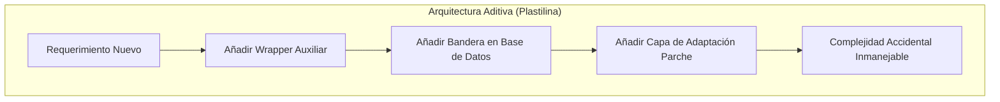
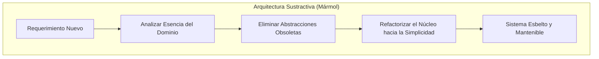

Existe una tentación casi irresistible en atribuir intenciones ocultas, complejidades místicas y patrones esotéricos a obras de arte que simplemente fueron construidas por personas reales bajo restricciones materiales severas.

Nos fascina imaginar que los grandes artistas del pasado operaron con un plan maestro indescifrable. Creemos que cada pincelada, cada trazo, cada técnica responde a una sabiduría hermética que los mortales apenas alcanzamos a intuir. Nos seduce tanto el misterio que preferimos inventar conspiraciones antes que aceptar una verdad mucho más sobria: la maestría genuina no se esconde detrás de trucos esotéricos, sino en el dominio brutal de los fundamentos.

Esto mismo ocurre desde hace siglos con Miguel Ángel Buonarroti.

A menudo escuchamos teorías que afirman que el genio renacentista ocultaba mensajes subversivos en su arte, códigos anatómicos cifrados en los techos papales o simbolismos alquímicos en esculturas inacabadas. Sin embargo, cuando revisamos la documentación histórica —sus cartas, contratos, poemas, dibujos preparatorios y los testimonios directos de contemporáneos como Ascanio Condivi y Giorgio Vasari—, el mito se desmorona para dar paso a algo infinitamente más valioso: un artesano riguroso, obsesionado con la anatomía, pragmático con sus recursos, que batallaba a diario contra presupuestos cambiantes y resolvía problemas espaciales milímetro a milímetro.

Si Miguel Ángel fuera transportado al siglo XXI y contratado como arquitecto de software para liderar el diseño de una plataforma crítica, ¿qué patrones seguiría? ¿Cómo modelaría el dominio? ¿Qué pensaría de nuestras ceremonias, capas innecesarias y modas tecnológicas?

Me gustaría pensar, que su respuesta no sería inventar un framework nuevo ni esconder microservicios crípticos. Su filosofía técnica sería un golpe directo al mentón de nuestra industria: **diseñar por sustracción, gobernar el dominio desde sus huesos y erradicar la pareidolia arquitectónica**, dominando los fundamentos del negocio, no solo de la tecnología.

---

## La Pareidolia del Arquitecto

En octubre de 1990, el médico Frank Lynn Meshberger publicó un artículo en la revista científica JAMA titulado [*An Interpretation of Michelangelo's Creation of Adam Based on Neuroanatomy*](https://doi.org/10.1001/jama.1990.03450140059034). En su estudio, Meshberger postuló que el manto rojo que envuelve a Dios y a su corte celestial en la bóveda de la Capilla Sixtina dibuja con precisión milimétrica un corte sagital del cerebro humano: el cerebelo, el tronco encefálico, la arteria basilar y la glándula pituitaria. La tesis sedujo a millones: Miguel Ángel no solo pintaba la creación física del hombre, sino la infusión divina del intelecto humano mediante un mensaje neuroanatómico secreto.

La teoría es elegante, poética y atractiva. Pero tiene un problema fundamental: carece de respaldo documental.

Veinticinco años más tarde, en 2015, Stefano Di Bella y un equipo de investigadores publicaron en [*Mayo Clinic Proceedings*](https://doi.org/10.1016/j.mayocp.2015.02.007) una interpretación anatómica radicalmente opuesta sobre la misma obra: el manto no era un cerebro, sino un útero posparto y el fular verde representaba un cordón umbilical recién cortado, simbolizando el nacimiento biológico de la humanidad. Dos análisis clínicos rigurosos mirando exactamente la misma composición pictórica y encontrando dos órganos vitales completamente diferentes.

¿Ocultó Miguel Ángel un encéfalo o un útero? La historia del arte moderna y los estudios neurocientíficos sobre percepción visual apuntan a una respuesta más honesta: **pareidolia**. Nuestro cerebro está cableado para reconocer patrones familiares donde solo hay pliegues de tela, sombras dinámicas y armonía compositiva renacentista.

> "Hay una diferencia fundamental entre conocer el propósito de una obra y demostrar que cada detalle contiene un significado deliberado. La semejanza visual no demuestra la intención del creador."

En la ingeniería de software sufrimos con frecuencia de este mismo sesgo perceptivo: la **pareidolia arquitectónica**.

Llega un desarrollador a un proyecto mediano, observa tres flujos de negocio sencillos y de inmediato "ve" la necesidad imperiosa de implementar Command Query Responsibility Segregation (CQRS), Event Sourcing, sagas distribuidas y siete capas de indirección. No lo hace porque el problema de negocio lo exija; lo hace porque leyó sobre esos patrones el fin de semana y su mente proyecta una arquitectura monumental sobre un problema que solo requería un modelo transaccional limpio.

Lo mismo pasa con las modas del Monolito o los Microservicios. El debate suele ser más apasionado que razonado. Es como si el ruido de fondo nos obligara a escoger una trinchera ideológica antes de entender el problema real. Cuando el verdadero patrón a implementar es crear mejores productos para tus clientes, es decir, no volver loco a tus compañeros, no complicar las cosas innecesariamente y no gastar tiempo en cosas que realmente no aportan valor al usuario final. Pero para eso se necesita tiempo para pensar, para entender el problema real y para diseñar la mejor solución.

Me queda claro, que un Miguel Ángel como arquitecto de software rechazaría de plano esta ceremonia gratuita. Para él, un patrón no es un talismán que confiere estatus a quien lo implementa, sino una solución geométrica a una restricción física. Si intentas meter con calzador un patrón complejo sin justificación de carga, latencia o límites de contexto, te señalaría con el dedo y te diría que estás viendo cerebros donde solo hay tela. En su momento ya reflexionamos sobre este peligro en [`Arquitectura Hexagonal vs. MVC`](https://www.arthurolg.com/article/programming_arquitectura-hexagonal-vs-mvc-spring-boot-pragmatico): llenar el código de puertos, adaptadores y envoltorios vacíos no te convierte en un arquitecto sofisticado; solo convierte tu proyecto en un laberinto estéril.

---

## El Verdadero Domain-Driven Design

Existe un hecho histórico plenamente documentado por Vasari y Condivi: en su juventud, Miguel Ángel pasó meses en el convento del Santo Spirito en Florencia realizando disecciones clandestinas de cadáveres humanos con el permiso del prior. No buscaba metáforas esotéricas; necesitaba entender cómo se insertan los tendones en el hueso, cómo se contrae el bíceps femoral bajo tensión y cómo responde la caja torácica al girar el tronco.

Comprendía la estructura interna antes de atreverse a labrar la piel sobre el mármol. Sabía que si la estructura ósea está rota por dentro, ninguna capa superficial de barniz o pulido salvará la figura.

En el desarrollo de software moderno ocurre con frecuencia lo contrario. Nos llenamos la boca discutiendo sobre el último framework reactivo, el bundler de moda o la librería de moda para inyección de dependencias, mientras desconocemos por completo cómo funciona el recolector de basura de la máquina virtual, cómo gestiona el kernel los descriptores de archivos o cómo se indexan las páginas de un árbol B+ en PostgreSQL.

Ahora más que nunca esas conversaciones triviales carecen de sentido, ahora la mayor parte de esas tareas son realizadas por IA, solo necesitamos un arquitecto que sepa pedirle lo que se necesita. El arquitecto de software ahora es un arquitecto de prompts. Un arquitecto de IA como lo quieran llamar. Pero con la diferencia de que ahora lo que menos importa es si sabe implementar con patrones complejos, sino si sabe identificar la mejor arquitectura para un problema dado.

Si Miguel Ángel diseñara software, pienso que su patrón madre sería el **Domain-Driven Design (DDD)** táctico y estratégico. Es decir, el dominio del negocio es la anatomía del sistema. No puedes sentarte a diseñar la arquitectura sin antes haber disecado el negocio hasta sus ligamentos esenciales:

```
┌────────────────────────────────────────────────────────┐
│               ANATOMÍA DEL DOMINIO                     │
│  (Entidades, Invariantes de Negocio, Reglas Puras)     │
└──────────────────────────┬─────────────────────────────┘
                           │ gobierna
                           ▼
┌────────────────────────────────────────────────────────┐
│             ESTRUCTURA Y SISTEMA ÓSEO                  │
│       (Límites de Contexto, Casos de Uso)              │
└──────────────────────────┬─────────────────────────────┘
                           │ sostiene
                           ▼
┌────────────────────────────────────────────────────────┐
│              PIEL EXTERNA Y ACCESORIOS                 │
│      (Frameworks, Controladores HTTP, Motores SQL)     │
└────────────────────────────────────────────────────────┘
```

Un arquitecto con esta mentalidad no permite que los detalles de infraestructura contaminen la pureza del modelo. Las entidades no son simples contenedores anémicos de datos con getters y setters públicos; son organismos vivos que defienden sus propias invariantes. Tal como lo planteó en [`Fundamentos y Mentalidad`](https://www.arthurolg.com/article/programming_fundamentos-y-mentalidad-sabiduria-tecnica-desarrollo-software), la maestría técnica que sobrevive a las décadas no se construye memorizando la sintaxis efímera de librerías externas, sino dominando los conceptos estructurales que permanecen invariables sin importar el lenguaje.

```java
// Lo que un aficionado cree que es arquitectura limpia:
// Indirección vacía, pareidolia de patrones y anemia estructural
public class UserRegistrationService {
    private final UserEntityRepository repository;
    private final UserMapper mapper;

    public UserResponseDTO execute(UserRequestDTO dto) {
        UserEntity entity = mapper.toEntity(dto);
        entity.setStatus("PENDING"); // Invariante violada sin validación real
        repository.save(entity);
        return mapper.toResponse(entity);
    }
}

// Lo que Miguel Ángel esculpiría:
// El dominio defiende su anatomía interna antes de tocar la base de datos
public final class CuentaUsuario {
    private final IdentificadorUsuario id;
    private final CorreoElectronico correo;
    private EstadoCuenta estado;

    public CuentaUsuario(IdentificadorUsuario id, CorreoElectronico correo) {
        this.id = Objects.requireNonNull(id, "El identificador óseo no puede ser nulo");
        this.correo = Objects.requireNonNull(correo, "El correo debe ser anatómicamente válido");
        this.estado = EstadoCuenta.CREADA;
    }

    public void activarBajoNorma(TokenActivacion token, InstanteTiempo ahora) {
        if (!token.esValidoPara(this.id, ahora)) {
            throw new ViolacionAnatomicaException("No es posible activar una cuenta con un token caducado");
        }
        this.estado = EstadoCuenta.ACTIVA;
    }
}
```

El software de Miguel Ángel tendría un **Screaming Architecture** implacable: al abrir la raíz del repositorio, las carpetas no gritarían "Spring Boot", "JPA" o "FastAPI"; gritarían "Logística de Puertos", "Liquidación de Pagos" o "Gestión de Pacientes". La infraestructura sería un detalle secundario, la piel que envuelve un esqueleto perfectamente articulado.

---

## El Principio Radical de Diseñar Quitando Mármol

En su célebre Soneto 151, Miguel Ángel plasmó su manifiesto artístico definitivo:

> "Non ha l'ottimo artista alcun concepto / ch'un marmo solo in sé non circonscriva / col suo superchio, e solo a quello arriva / la man che ubbidisce all'intelletto."
> *(El mejor artista no tiene concepto alguno que un único bloque de mármol no contenga ya en su interior con su materia sobrante, y a él solo llega la mano que obedece al intelecto).*

Para Buonarroti, pintar al fresco era una tarea que toleraba con resignación, pero la escultura era la reina de las artes porque se ejecutaba *per forza di levare* (por fuerza de quitar), en contraste con el modelado en arcilla o yeso que se hace *per via di porre* (por vía de poner).

La mayoría de los programadores y arquitectos modernos actuamos como modeladores de plastilina: cuando un requerimiento cambia o una funcionalidad se vuelve confusa, su primer instinto es **añadir**. Añaden una bandera booleana más, agregan un middleware intermedio, crean una clase abstracta auxiliar, envuelven el objeto en un decorador y suman dependencias al archivo de configuración. El resultado inevitable es una masa viscosa, hinchada de complejidad accidental, donde nadie se atreve a tocar nada por temor a que todo el edificio colapse.

Miguel Ángel como arquitecto de software trabajaría exclusivamente por **sustracción**.

### Arquitectura Aditiva



### Arquitectura Sustractiva



Su principio operativo fundamental sería el principio [YAGNI](https://martinfowler.com/bliki/Yagni.html) (*You Aren't Gonna Need It*) llevado a sus últimas consecuencias. Cuando un desarrollador propusiera: *"Hagamos esta interfaz genérica con soporte para cinco motores de bases de datos por si en cinco años migramos de PostgreSQL a Cassandra"*, Miguel Ángel tomaría el cincel para golpear la mesa:

—*El bloque de mármol de hoy es PostgreSQL. Quita esa interfaz espuria, elimina esas tres factorías vacías y escribe la consulta SQL directa contra el motor real. Si algún día el Papa nos pide otra piedra, ya tallaremos esa piedra. Hoy, todo lo que no resuelve el problema presente es material sobrante que estorba la visión del intelecto.*

Diseñar por sustracción significa que una jornada de trabajo exitosa no se mide por la cantidad de líneas de código añadidas al pull request, sino por la cantidad neta de líneas eliminadas. Un pull request con `-850` líneas que deja el sistema haciendo exactamente lo mismo, pero con mayor claridad y menor fricción operativa, es la definición más alta de artesanía técnica. Esta es la esencia misma que exploramos en [`Claves para Crear Sistemas Sostenibles y Escalables`](https://www.arthurolg.com/article/programming_calidad-en-el-desarrollo-de-software): el código no es un activo que debamos acumular con orgullo; el código es un pasivo de mantenimiento que debemos minimizar con disciplina implacable.

---

## Iteración, Prototipos Descartables y Deuda Material

Uno de los argumentos favoritos de quienes sostienen que Miguel Ángel escondía mensajes secretos es la reutilización constante de sus materiales. Decían que reciclaba superficies para ocultar símbolos ocultos bajo nuevas pinturas.

La realidad material documentada es mucho más fascinante y terrenal.

En el British Museum se conserva la hoja de estudios preparatorios para *El Juicio Final*, inventariada bajo el registro [1895,0915.518](https://www.britishmuseum.org/collection/object/P_1895-0915-518). Al examinar el papel con microscopía óptica y luz rasante, los conservadores observan un palimpsesto evidente: figuras humanas superpuestas, bocetos trazados con distinta orientación y correcciones vigorosas sobre estudios previos.

Aún más revelador es el estudio para la figura de Adán, registrado como [1926,1009.1](https://www.britishmuseum.org/collection/object/P_1926-1009-1). En él se aprecia cómo Miguel Ángel llegó a sacrificar y dibujar encima de estudios anteriores con tiza roja para aprovechar el papel en una fase más avanzada de la preparación de los frescos.

¿Estaba ocultando la cábala renacentista? No. El papel de trapo italiano del siglo XVI era un bien costoso y escaso. Pero más allá de la economía material, esos dibujos revelan el **método de trabajo iterativo del maestro**. Miguel Ángel no nacía con la obra terminada en la cabeza para volcarla de un solo trazo perfecto sobre el muro. Experimentaba, medía proporciones con compás, fallaba, descartaba, giraba la hoja noventa grados y volvía a trazar sobre los restos de su intento anterior.

En la arquitectura de software contemporánea, este proceso tiene nombres muy concretos:
1. **Spikes técnicos desechables:** prototipos rápidos construidos para explorar una hipótesis de rendimiento o integración, destinados a ser eliminados una vez obtenido el aprendizaje.
2. **Refactorización implacable:** no tener miedo a sacrificar código que escribiste ayer si el nuevo aprendizaje del dominio demuestra que la abstracción elegida era defectuosa.
3. **Respeto a las restricciones materiales:** el hardware, la memoria y el presupuesto de computación no son infinitos.

| Práctica de Taller Renacentista | Equivalente en Arquitectura de Software |
| :--- | :--- |
| **Palimpsesto de bocetos** (reutilizar hojas) | **Spike descartable** en rama aislada para validar viabilidad |
| **Cartón preparatorio a escala 1:1** | **Pruebas de aceptación y contratos de API** antes de implementar |
| **Corrección con sanguina sobre carboncillo** | **Refactor continuo en verde** guiado por suite de pruebas |
| **Elección del bloque en la cantera de Carrara** | **Selección pragmática de infraestructura** según carga real |

Muchos equipos caen en la trampa del perfeccionismo paralizante: pasan tres meses diseñando diagramas en herramientas de modelado sin escribir una sola línea de código, esperando parir la arquitectura perfecta al primer intento. Otros caen en el extremo opuesto del *vibecoding*: acumulan capas de código sin reflexionar sobre las tensiones estructurales.

Miguel Ángel nos enseña que el diseño arquitectónico es un diálogo constante con el material. Haces un boceto, lo pones a prueba contra los límites del sistema, descubres dónde cruje la estructura y vuelves a trazar. La hoja del British Museum nos recuerda que sacrificar tus propias ideas iniciales para dar paso a una solución más sólida no es un fracaso; es el único camino documentado hacia la excelencia.

---

## Pragmatismo Frente a Stakeholders Cambiantes

Ningún análisis de Miguel Ángel estaría completo sin abordar su más amarga lección profesional: lo que sus biógrafos llamaron *la tragedia della sepoltura*.

En 1505, el papa Julio II le encargó un mausoleo colosal de tres pisos con más de cuarenta estatuas de mármol que debía ubicarse en la Basílica de San Pedro. Miguel Ángel pasó ocho meses en las canteras de Carrara seleccionando los bloques de piedra con sus propias manos. Sin embargo, el proyecto sufrió interrupciones sistemáticas: el Papa desvió los fondos para financiar la reconstrucción de San Pedro y las campañas militares, le ordenó pintar la bóveda de la Sixtina contra su voluntad y renegoció los términos una y otra vez.

El proyecto se prolongó durante **cuarenta años** a lo largo de cinco contratos distintos con herederos papales en disputa, terminando en 1545 como un monumento adosado en San Pietro in Vincoli con una fracción mínima de las esculturas originales. De ese largo calvario nacieron los famosos *Esclavos* o *Prisioneros* inacabados que hoy se exhiben en la Galería de la Academia de Florencia: figuras musculosas emergiendo con violencia de la piedra rugosa, cuyos rostros y extremidades permanecen atrapados para siempre en el bloque bruto.

Durante siglos, la crítica romántica interpretó el *non finito* como una metáfora neoplatónica deliberada: el alma humana luchando por liberarse de las ataduras de la materia terrenal.

Pero los documentos notariales y la correspondencia de Miguel Ángel revelan la causa real: **scope creep devastador, recortes de presupuesto y fatiga de mantenimiento**.

Cualquier líder técnico o arquitecto que haya sobrevivido a proyectos corporativos de gran escala reconoce de inmediato esta situación:
- El cliente o Product Owner encarga un palacio arquitectónico monumental para conquistar el mercado.
- A mitad de camino, las prioridades de la junta directiva cambian y los presupuestos se congelan.
- El equipo debe adaptarse a contratos renegociados, recortar alcance y aprender a vivir con partes del sistema que nunca alcanzarán la forma idealizada con la que fueron soñadas en el pizarrón.
- El problema de las estimaciones, el alcance cambiante y la deuda técnica es algo que no ha cambiado en siglos.

¿Cómo gestionaría Miguel Ángel la deuda técnica y el alcance cambiante en un entorno de ingeniería moderno?

No con cinismo, sino con un feroz **sentido de la prioridad y la vulnerabilidad**. En [*El Juicio Final*](https://www.museivaticani.va/content/museivaticani/es/collezioni/musei/cappella-sistina/giudizio-universale.html), cuando pintó a San Bartolomé sosteniendo la piel desollada de su propio martirio, los historiadores y los Museos Vaticanos coinciden en reconocer en esa piel vacía un autorretrato del propio Miguel Ángel: el rostro de un maestro exhausto, consciente de su propia fragilidad frente a las demandas descomunales de su época.

Un verdadero arquitecto no finge que sus sistemas son fortalezas celestiales inmunes al tiempo. Sabe que todo software en producción convive con compromisos materiales, funciones inacabadas y decisiones tomadas bajo presión. La diferencia entre un chapucero y un maestro es que el maestro se asegura de que lo que quede en pie —aunque sea un subconjunto del plano original— posea una dignidad estructural inquebrantable, como el *Moisés* que finalmente presidió la tumba reducida.

---

## Conclusión

Despojar a Miguel Ángel de los mitos esotéricos y de los supuestos códigos secretos no disminuye su grandeza; la multiplica por diez. Comprender que no era un mago ocultista, sino un trabajador incansable que diseccionaba cuerpos en la penumbra, que reutilizaba el papel para exprimir cada centavo y que luchaba contra el mármol defectuoso para extraer la figura exacta, nos acerca mucho más a la verdadera naturaleza de la creación humana.

Si hoy tuviéramos a Miguel Ángel en nuestro equipo de arquitectura, no nos pediría que leamos tratados herméticos de computación teórica.

Nos pediría que apaguemos el ruido de las modas, que dejemos de proyectar pareidolias sobre requerimientos sencillos y que tomemos el martillo para hacer lo que verdaderamente importa: entender el dominio del negocio hasta el tuétano, eliminar cada línea de código accidental que asfixia al sistema y tener la valentía de esculpir solo aquello que responde a una necesidad real.

¿Cuántas clases, capas intermedias y microservicios sobran hoy en tu arquitectura esperando que alguien tenga el coraje de quitarlos?

Si quieres comentar o compartir tu experiencia, escríbeme en [X (@algforge)](https://x.com/algforge) o abre un issue en el [repositorio](https://github.com/lgzarturo/arthurolg-blog-posts/issues). Una estrella en [GitHub](https://github.com/lgzarturo) también ayuda.

## Referencias

- [An Interpretation of Michelangelo's Creation of Adam Based on Neuroanatomy, JAMA Network](https://doi.org/10.1001/jama.1990.03450140059034)
- [The 'delivery' of Adam: A Medical Interpretation of Michelangelo, Mayo Clinic Proceedings](https://doi.org/10.1016/j.mayocp.2015.02.007)
- [Studies for the Last Judgement (1895,0915.518), The British Museum](https://www.britishmuseum.org/collection/object/P_1895-0915-518)
- [Study for Adam (1926,1009.1), The British Museum](https://www.britishmuseum.org/collection/object/P_1926-1009-1)
- [Cappella Sistina: Il Giudizio Universale, Musei Vaticani](https://www.museivaticani.va/content/museivaticani/es/collezioni/musei/cappella-sistina/giudizio-universale.html)
- [Yagni, Martin Fowler](https://martinfowler.com/bliki/Yagni.html)
