Cuando escuché por primera vez que un ingeniero afirmaba haber recreado siete herramientas fundamentales de Adobe en Rust utilizando modelos de lenguaje, sentí esa mezcla de fascinación y escepticismo que nos invade a quienes llevamos años en las trincheras del desarrollo. Y ahora la noticia es que solo le faltan quinientas setenta horas de inferencia para tener un producto viable. Si pones tres o cuatro agentes a trabajar en paralelo día y noche, esa cifra se encoge a poco más de una semana de calendario.

La noticia corrió como pólvora. Para algunos entusiastas, representa la prueba definitiva de que cualquier fortaleza de software privativo puede ser demolida en un fin de semana largo. Para otros, representa simplemente la enésima exageración de marketing montada sobre la moda del *vibecoding*.

Sin embargo, reducir esta conversación al aplauso ingenuo o al desdén automático es un error. El proyecto existe, compila y abre ventanas. Plantea interrogantes muy incómodas para nuestra profesión: ¿hemos encontrado una nueva unidad para presupuestar sistemas? ¿Qué ocurre cuando las barreras de entrada para clonar interfaces complejas caen a cero? ¿Cómo sobrevive la propiedad intelectual cuando el código se sintetiza a la velocidad de la luz y qué demonios pasará con quienes nos dedicamos a construir software para vivir?

Hoy quiero invitarte a desarmar este fenómeno pieza por pieza. Sin fanatismos, con la lupa puesta en la ingeniería de sistemas, los límites de la ley y el verdadero significado de crear tecnología sostenible.

---

## El caso ArtCraft

El epicentro de este terremoto se llama [ArtCraft, un proyecto de código abierto liderado por Brandon Thomas](https://github.com/storytold/artcraft). Thomas, un ingeniero con más de quince años de trayectoria en la industria tecnológica, decidió canalizar su hastío contra el ecosistema de Adobe en una hazaña técnica: construir desde cero alternativas nativas, libres de suscripción y programadas en Rust para Photoshop (*PhotoCraft*), Illustrator (*VectorCraft*), Premiere Pro (*FilmCraft*), Lightroom (*LightCraft*), After Effects (*EffectCraft*), InDesign (*DesignCraft*) y Acrobat (*PdfCraft*).

Lo llamativo no fue únicamente la ambición de abarcar siete disciplinas creativas en un solo repositorio, sino la metodología empleada. Thomas delegó gran parte de la generación de código en modelos avanzados de lenguaje (particularmente Claude Opus 5.5), operando como un arquitecto en jefe que orquesta agentes, define especificaciones y valida compilaciones. Según sus propias estimaciones, al proyecto le faltan alrededor de quinientas setenta horas de cómputo de IA, un volumen que actualmente logró con al menos doscientas horas de trabajo real gracias a la ejecución paralela de tareas.

> "La velocidad para generar sintaxis no equivale a la madurez de un producto; un lienzo en blanco que responde rápido impresiona en un video corto, pero el software profesional se forja en el tratamiento silencioso de miles de casos borde."

Hay que ser honestos con el estado actual de las cosas. Quien descargue los binarios de ArtCraft no encontrará un reemplazo inmediato para Premiere o Photoshop en una productora de cine. Las aplicaciones están en una fase alfa temprana. Muchos botones son esqueletos, la aceleración por hardware apenas gatea y la gestión de memoria bajo cargas extremas todavía tiene un largo camino por recorrer.

Pero ignorar el salto cualitativo sería taparse los ojos. Hace apenas tres años, levantar la estructura base, los analizadores sintácticos de formatos complejos y los pipelines gráficos de siete aplicaciones de escritorio en Rust le habría tomado a un equipo de ingenieros senior con años de experiencia y muchos meses de esfuerzo continuo. Hoy, una persona con criterio técnico y un enjambre de agentes bien coordinados lo deja operativo en semanas. La verdadera disrupción no es que el clon sea perfecto hoy; es la velocidad con la que ahora podemos llegar al punto de partida.

---

## ¿Son las «horas de IA» la nueva métrica para estimar proyectos?

En mi experiencia la estimación de tiempos de desarrollo ante problemas ambiguos y con muchas aristas siempre ha sido un tema complejo. Pienso que es una de las disciplinas más complejas, porque terminabas midiendo muchas cosas, que al final terminas subestimando de manera importante. Y la aparición de agentes de IA está cambiando esa dinámica. No sé si para bien o para mal, pero está cambiando. Y me preocupa.

Durante décadas, la ingeniería de software ha librado una batalla interminable contra la estimación de esfuerzo. Hemos pasado por las líneas de código fuente del [modelo constructivo de costos COCOMO formulado por Barry Boehm](https://en.wikipedia.org/wiki/COCOMO), los puntos de función de los años noventa y la abstracción relativa de los *story points* en los tableros ágiles. Todas esas métricas compartían un supuesto común: el tiempo humano de mecanografía y diseño era el factor limitante del presupuesto.

La aparición de métricas como "570 horas de IA" introduce una distorsión seductora. Es tentador pensar que a partir de ahora cotizaremos software sumando tokens de entrada, tokens de salida y minutos de GPU alquilada. Pero calcular el valor de un sistema mediante horas de inferencia es tan absurdo como tasar una catedral por la cantidad de mezcla que arrojó la hormigonera.

Las llamadas leyes de evolución del software planteadas por [Manny Lehman en el Imperial College](https://en.wikipedia.org/wiki/Lehman%27s_laws_of_software_evolution) demostraron hace tiempo que la escritura inicial del código representa apenas entre el veinte y el treinta por ciento del costo total de un sistema a lo largo de su ciclo de vida. El restante setenta u ochenta por ciento se consume en mantenimiento correctivo, adaptación a nuevos entornos, refactorización de deuda técnica y compatibilidad regresiva.

Cuando generas diez mil líneas de Rust en cuarenta minutos mediante un agente, no has eliminado el costo del ciclo de vida; únicamente has adelantado la fecha en la que tendrás que pagar la factura de su mantenimiento. Como ya analizamos al reflexionar sobre [el valor del tiempo en la creación de software de calidad](https://www.arthurolg.com/article/el-valor-del-tiempo-en-programacion-software-de-calidad), la verdadera maestría técnica no radica en la rapidez con la que volcamos instrucciones sobre un archivo, sino en la claridad arquitectónica que permite que ese código siga siendo comprensible y maleable cuando el creador original ya no esté presente.

Las horas de IA miden el consumo de cómputo en la fase más barata del desarrollo: la generación de borradores. No miden el tiempo de depuración bajo condiciones de carrera imprevistas, no miden el análisis de vulnerabilidades en dependencias anidadas ni miden la empatía cognitiva necesaria para entender lo que un usuario final realmente necesita hacer en su pantalla.

---

## Vibecoding vs. Ingeniería

El término *vibecoding*, acuñado a inicios de 2025 por [Andrej Karpathy en su conocida publicación sobre programar por sensaciones](https://twitter.com/karpathy), describía con humor esa experiencia liberadora de construir prototipos rápidos aceptando ciegamente las sugerencias de un modelo sin detenerse a leer cada línea de código. Para un proyecto personal de fin de semana o un experimento conceptual, esa ligereza es fantástica.

Sin embargo, el propio Karpathy tuvo que salir un año más tarde a enterrar el término y reivindicar la ingeniería agéntica rigurosa. ¿Por qué? Porque el *vibecoding* choca de frente contra la realidad cuando el sistema supera cierto umbral de complejidad.

El siguiente diagrama ilustra con claridad la diferencia entre dejarse llevar por la inercia del prompt y liderar un proceso de desarrollo determinista asistido por agentes:

```mermaid
graph TD
    subgraph Vibecoding [Enfoque Vibecoding - Frágil]
        V1[Idea abstracta en lenguaje natural] --> V2[Generación masiva de código sin pruebas]
        V2 --> V3[Aceptar sugerencias sin inspección de diffs]
        V3 --> V4[Error en tiempo de ejecución]
        V4 -->|Pegar error en el chat| V2
        V4 --> V5[Deuda técnica acumulada e inmanejable]
    end

    subgraph Ingenieria [Ingeniería Agéntica - Sostenible]
        I1[Diseño de arquitectura y contratos claros] --> I2[Definición de especificaciones y tests de fallo]
        I2 --> I3[Enjambre de agentes especializados]
        I3 --> I4[Revisión determinista y validación estricta]
        I4 --> I5[Código modular, auditable y en producción]
    end
```

Construir una herramienta como Photoshop exige interactuar con formatos binarios opacos como PSD, gestionar matrices de color con perfiles ICC heterogéneos, orquestar sincronización de audio en tiempo real con latencias inferiores a diez milisegundos y lidiar con controladores gráficos temperamentales de NVIDIA, AMD y Apple Silicon. Esas áreas no perdonan la falta de estructura.

Si intentas resolver esos desafíos mediante *vibecoding* puro, copiando y pegando excepciones en la ventana de chat esperando que el modelo adivine la solución, terminarás con un monolito espagueti lleno de parches inconexos. Para sostener un desarrollo asistido por IA a gran escala necesitas exactamente lo contrario: modularidad quirúrgica, contratos de tipos estrictos, pruebas automatizadas implacables y una dirección humana que entienda a fondo los fundamentos de la computación.

Ahora nuestro trabajo es demostrar que la ingeniería agéntica es más eficiente que el *vibecoding* puro. Y para eso necesitamos usar un modelo de evaluación que nos permita evaluar si realmente lo estamos logrando. Las empresas estarán cegadas a que aprovechemos mejor esta tecnología si no demostramos que realmente somos capaces de crear software de calidad de manera más eficiente. Nuestro trabajo como ingenieros es regresar a los fundamentos, evaluar nuestros conocimientos y aplicarlos en esta nueva era de desarrollo de software. No se trata solo de tener conocimientos sobre como utilizar la tecnología, sino de cómo aplicarla de manera correcta y eficiente.

En mi artículo sobre [cómo definir un workflow determinista con agentes en lugar de depender del chat](https://www.arthurolg.com/article/technology_mas-alla-del-chat-por-que-definir-un-workflow-con-ia-es-la-mejor-inversion), remarcó una verdad ineludible: **los modelos de lenguaje no son oráculos que reemplazan tu pensamiento**; son amplificadores de tu claridad metodológica. Si le das a un agente una arquitectura desordenada, te devolverá miles de líneas de desorden multiplicado por diez.

---

## El laberinto legal

Cuando un proyecto anuncia que clonará una suite comercial, los abogados corporativos no tardan en afilar sus argumentos. Thomas ha defendido su iniciativa bajo el principio de reimplementación *clean-room* (ingeniería de sala limpia): no tomó el código desensamblado de Adobe ni violó acuerdos de confidencialidad; simplemente observó las entradas, las salidas y los comportamientos de las herramientas para reescribirlas desde cero en Rust.

En el derecho del software estadounidense existe un precedente legendario: el fallo del caso [Lotus Development Corp. v. Borland International, Inc. dictado por el Tribunal de Apelaciones del Primer Circuito](https://en.wikipedia.org/wiki/Lotus_Development_Corp._v._Borland_International,_Inc.). En aquel litigio, Lotus demandó a Borland por copiar la jerarquía de menús y comandos de la hoja de cálculo Lotus 1-2-3 en su programa Quattro Pro. El tribunal determinó que la estructura de menús era un "método de operación" utilitario, y que conforme a la sección 102(b) de la Ley de Derechos de Autor de los Estados Unidos, las ideas, métodos y sistemas funcionales no pueden monopolizarse bajo copyright.

> "La ley protege la forma concreta en que se expresa un algoritmo en código fuente, pero no puede adueñarse de la función abstracta de recortar una imagen o invertir una capa."

Años más tarde, la Corte Suprema de los Estados Unidos reafirmó este espíritu en el célebre fallo de [Google LLC v. Oracle America, Inc. sobre las interfaces de programación de Java](https://en.wikipedia.org/wiki/Google_LLC_v._Oracle_America,_Inc.), reconociendo que la interoperabilidad y la reimplementación de interfaces declarativas constituyen un uso legítimo fundamental para el progreso tecnológico.

Esas batallas ya se ganaron hace años, pero ahora con la IA nuevas batallas podrían gestarse, ya que la IA permite clonar software de manera mucho más eficiente.

Sin embargo, el escudo de la sala limpia no es infalible cuando entramos en el terreno de las patentes y la apariencia comercial (*trade dress*). Adobe posee cientos de patentes activas sobre técnicas algorítmicas específicas: métodos de rasterización, trazado de vectores con curvas Bézier optimizadas y algoritmos de interpolación predictiva. Si un agente de IA, entrenado con literatura técnica abierta o repositorios públicos, genera una implementación que replica la mecánica exacta de una patente registrada, el autor del proyecto puede enfrentar demandas por infracción de patentes, donde la ignorancia o la creación independiente no sirven como defensa legal.

Porque hay algo muy cierto, la IA no genera código de la nada, no tiene poder para imaginar, esta basada en código existente y por lo tanto, si el agente de IA reproduce código que esta patentado o protegido por derechos de autor, esto podria traer graves consecuencias legales.

Asimismo, la Ley Lanham protege el *trade dress*: si la disposición visual de los paneles, la paleta de colores de la interfaz y la iconografía resultan tan idénticas que inducen a confusión al usuario sobre el origen del producto, los tribunales pueden intervenir. Clonar software con IA es técnicamente accesible; esquivar las minas terrestres de la propiedad intelectual industrial sigue requiriendo una estrategia legal sumamente sofisticada.

---

## El trabajo del desarrollador en la era del token

La pregunta inevitable que resuena en cada rincón de la comunidad es directa: si un solo programador puede levantar suites enteras coordinando modelos, ¿qué pasará con nuestros empleos?

Para responder a esto con honestidad, debemos desprendernos del romanticismo corporativo. El trabajo de redactar código boilerplate, crear controladores REST repetitivos y ensamblar formularios rutinarios está sufriendo una devaluación brutal. Quien concebía su valor profesional exclusivamente en función de cuántas líneas de sintaxis era capaz de entregar en un sprint se encuentra en una posición sumamente frágil.

Pero pienso que la programación nunca fue únicamente escribir sintaxis. La programación siempre ha consistido en comprender un problema ambiguo de la realidad, traducirlo a restricciones computacionales lógicas y diseñar una estructura que no colapse ante el cambio. De hecho el paradigma de la Orientación a Objetos surgió justo por eso, para evitar el spaghetti de los programas estructurados y pensar en objetos y sus interacciones, como si estuviéramos modelando el mundo real. Pienso que ahora estamos ante un cambio de paradigma similar, donde la IA nos permite enfocarnos de nuevo en el diseño de soluciones y no tanto en la implementación de las mismas.

En [el análisis sobre la administración de la atención humana frente al paralelismo de los agentes](https://www.arthurolg.com/article/technology_nuevo-cuello-de-botella-atencion-agentes-ia), se señala que la escasez crítica del presente ya no es la capacidad de cómputo, sino el criterio para auditar lo que las máquinas generan. Cuando puedes tener a cinco agentes escupiendo miles de líneas simultáneamente, tu rol muta de albañil de código a director de obra.

Aprender a "ordeñar tokens" no significa aprender trucos de redacción de prompts para redes sociales. Significa dominar las interfaces formales, estructurar pruebas de integración que no dejen pasar alucinaciones lógicas, entender los perfiles de rendimiento de la memoria y saber exactamente cuándo decir "no" a una solución propuesta por un modelo que parece elegante pero introduce una vulnerabilidad catastrófica. Los programadores que entiendan la arquitectura de sistemas, el dominio del negocio y la orquestación sistemática serán más valiosos que nunca; los intermediarios mecánicos de código verán su espacio reducido al mínimo.

---

## La rebelión Open Source

Hay un contexto económico y social que no podemos ignorar detrás del nacimiento de proyectos como ArtCraft. Durante la última década, la industria del software creativo ha sufrido una captura sistemática por parte de modelos de suscripción coercitivos. Los usuarios dejaron de ser dueños de sus herramientas para convertirse en arrendatarios perpetuos. Lo vemos en productos como Netflix, Youtube, ahora con las redes sociales y hasta en los servicios de IA, donde prácticamente cada producto que consumimos digitalmente esta bajo un modelo de suscripción.

Esta situación alcanzó un punto crítico en junio de 2024, cuando la [Comisión Federal de Comercio (FTC) de Estados Unidos demandó a Adobe por prácticas engañosas de suscripción](https://www.ftc.gov/news-events/news/press-releases/2024/06/ftc-takes-action-against-adobe-executives-hiding-fees-deterring-cancellations). La demanda federal acusó a la compañía de ocultar tarifas abusivas por terminación anticipada de contratos anuales y de diseñar laberintos digitales para impedir que los clientes cancelaran sus servicios.

Cuando una corporación abusa de su posición dominante mediante barreras artificiales y peajes recurrentes, el descontento comunitario se convierte en combustible para la innovación abierta. Históricamente, el software libre tardaba décadas en ofrecer alternativas viables frente a los monopolios comerciales debido a la asimetría de recursos: mientras Adobe contaba con miles de ingenieros en nómina, proyectos ejemplares como GIMP, Krita, Inkscape o Blender dependían de donaciones y del esfuerzo voluntario en horas libres.

La aceleración agéntica cambia las reglas de este tablero. Si la barrera para escribir millones de líneas de código especializado disminuye drásticamente, las comunidades de código abierto obtienen una palanca multiplicadora sin precedentes. Un grupo reducido de desarrolladores apasionados, respaldados por agentes de código y arquitecturas modernas como Rust, puede desafiar monopolios centenarios no porque tengan más dinero, sino porque no cargan con treinta años de deuda técnica acumulada ni con la obligación de maximizar dividendos trimestrales.

Abrazar el código abierto en esta nueva era no es un acto de ingenuidad idealista; es una necesidad estratégica para evitar que los medios de producción digital queden concentrados en un puñado de gigantes tecnológicos que cobran peaje por cada píxel procesado. Democratizar el código significa devolverle a los creadores la soberanía sobre sus herramientas de trabajo.

---

## Conclusión

Las quinientas setenta horas de inteligencia artificial de ArtCraft no representan el fin del desarrollo de software ni demuestran que construir productos de calidad sea un juego de niños. Representan un aviso sísmico: el costo de sintetizar código ha colapsado, y con él se desmorona la creencia de que el valor de una empresa tecnológica reside en la cantidad de líneas que guardan celosamente sus repositorios privados.

El software del futuro no se medirá por cuántos años-hombre tomó escribirlo, sino por la solidez de sus cimientos arquitectónicos, la libertad que otorga a sus usuarios y la capacidad de sus mantenedores para orquestar la inteligencia artificial con rigor, ética y propósito. La herramienta para construir catedrales de código abierto está en nuestras manos; la responsabilidad de asegurarnos de que no sean castillos de arena sigue siendo, hoy más que nunca, enteramente nuestra.

¿Qué software que hoy consideras un monopolio intocable te atreverías a deconstruir y reconstruir con tus propios agentes?

Si quieres comentar o compartir tu experiencia, escríbeme en [X (@algforge)](https://x.com/algforge) o abre un issue en el [repositorio](https://github.com/lgzarturo/arthurolg-blog-posts/issues). Una estrella en [GitHub](https://github.com/lgzarturo) también ayuda.

## Referencias

- [ArtCraft: Open Source Creative Suite in Rust, Brandon Thomas](https://github.com/storytold/artcraft)
- [Software Engineering Economics and COCOMO Model, Barry Boehm](https://en.wikipedia.org/wiki/COCOMO)
- [Programs, Life Cycles, and Laws of Software Evolution, M. M. Lehman (IEEE)](https://en.wikipedia.org/wiki/Lehman%27s_laws_of_software_evolution)
- [Lotus Development Corp. v. Borland International, Inc., 49 F.3d 807 (1st Cir. 1995)](https://en.wikipedia.org/wiki/Lotus_Development_Corp._v._Borland_International,_Inc.)
- [Google LLC v. Oracle America, Inc., 593 U.S. (2021)](https://en.wikipedia.org/wiki/Google_LLC_v._Oracle_America,_Inc.)
- [FTC Takes Action Against Adobe and Executives for Deceptive Subscription Practices, Federal Trade Commission (2024)](https://www.ftc.gov/news-events/news/press-releases/2024/06/ftc-takes-action-against-adobe-executives-hiding-fees-preventing-consumers-easily-cancelling)
