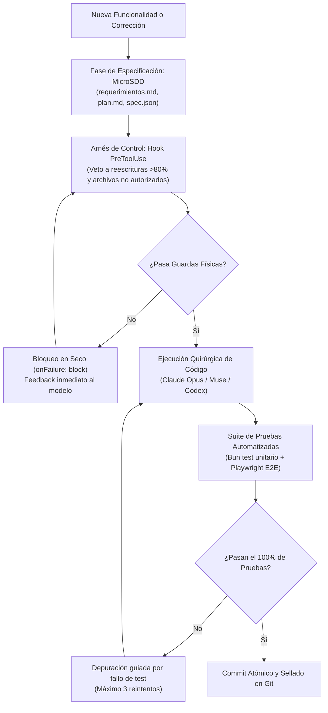

Si le pides a un modelo de lenguaje de última generación que te programe un videojuego desde cero en un único prompt, el resultado inicial casi siempre parece un milagro: un archivo HTML de ochocientas líneas que dibuja un cuadro verde saltando sobre plataformas rojas. El desastre comienza cuando intentas dar el segundo paso. Pides añadir inercia, un sistema de partículas o una máquina de estados para los enemigos, y la ilusión colapsa. El agente reescribe medio archivo, rompe las colisiones, introduce retardos imperceptibles en la animación y te deja con un espagueti intratable que nadie puede depurar.

Terminas iterando sobre el mismo problema durante horas, reescribiendo prompts, explicando de nuevo la arquitectura, o peor, aceptando un resultado incorrecto porque ya no tienes tiempo para corregirlo.

En el mejor de los casos un prompt one shot, es la ruleta rusa de la ingeniería, puedes pasarte afinando prompts durante días o semanas sin ver resultados reales, hasta tener un tiro de suerte, o peor aún, crear un sistema que funciona en el mejor de los casos pero que es incapaz de mantener la consistencia a lo largo del tiempo.

Construir software interactivo con inteligencia artificial requiere abandonar la fantasía del *vibecoding* descuidado. Necesitaba un banco de pruebas severo para validar una hipótesis de trabajo: que los agentes autónomos solo rinden al nivel de un ingeniero senior cuando operan encerrados dentro de un arnés riguroso de ingeniería. Así nació [Agent Zero](https://agentzero.miraeljuego.com/), un juego de plataformas y acción retro en dos dimensiones con motor gráfico propio, levantado paso a paso mediante una metodología que llamé [**MicroSDD**](https://github.com/lgzarturo/microsdd) (Specification-Driven Development en dosis mínimas).

Lo que empezó como un experimento centrado en Claude Code y el modelo Opus 5.5 terminó convirtiéndose en una travesía orquestada a través de distintos modelos y agentes como Muse y Codex. El resultado no solo es un juego jugable y exigente en producción web, sino una demostración práctica de cómo el sellado de pruebas y los contratos explícitos permiten llevar un desarrollo agéntico de 0 a 100 sin perder el control de la arquitectura.

---

## El banco de pruebas: por qué un juego y no otro CRUD

La mayoría de los ejemplos que inundan las redes sobre desarrollo con agentes se limitan a aplicaciones de gestión de tareas, clones de interfaces populares o servicios REST convencionales. El problema de los CRUDs es que perdonan demasiado. Si un agente genera una consulta ineficiente o duplica un componente en React, el sistema suele seguir respondiendo; los defectos de diseño quedan amortiguados por la tolerancia del entorno.

Un motor de videojuego en el navegador web no perdona nada. Exige responder a sesenta cuadros por segundo, calcular colisiones al milímetro, gestionar audio sintético y mantener la simulación sincronizada con las entradas del usuario. Si un agente rompe una ecuación de integración o altera el orden en que se limpian los lienzos de renderizado, el juego se congela o el personaje atraviesa el suelo.

Para Agent Zero descarté deliberadamente motores comerciales como Phaser o Godot. Quería evaluar la capacidad de los agentes para concebir y mantener una arquitectura desde cero. Es por eso que termine diseñando un motor gráfico desacoplado que opera sobre tres lienzos Canvas superpuestos en proporción 16:9 (960×540 píxeles), siguiendo las recomendaciones de Mozilla en [Optimizing canvas](https://developer.mozilla.org/en-US/docs/Web/API/Canvas_API/Tutorial/Optimizing_canvas):

1. **`#game` (Canvas 2D):** renderiza la geometría del nivel, entidades y animaciones con estética pixel art nítida, leyendo un único atlas procedural empaquetado en memoria sin depender de descargas de red externas.
2. **`#fx3` (WebGL Three.js):** una capa intermedia dedicada con exclusividad a efectos visuales, iluminación dinámica y partículas.
3. **`#hud` (Canvas 2D):** una capa estática superior para la interfaz de usuario, marcadores y controles táctiles, evitando llamadas innecesarias de repintado en la simulación física.

El corazón del motor es su bucle principal. En lugar de atar la lógica del juego al refresco arbitrario de la pantalla mediante `requestAnimationFrame`, implemente un acumulador de tiempo a 120 Hz fijos, una técnica clásica formalizada por Glenn Fiedler en [*Fix Your Timestep!*](https://gafferongames.com/post/fix_your_timestep/). Este mecanismo garantiza que la física sea determinista en cualquier dispositivo y limita el avance a un máximo de seis pasos por ciclo de renderizado, evitando que la CPU caiga en la temida "espiral de la muerte" cuando el navegador sufre una pausa momentánea.

---

## MicroSDD: la especificación como contrato infranqueable

El mayor enemigo al trabajar con agentes de código es la ambigüedad. Cuando el contexto se ensucia con instrucciones contradictorias, el modelo empieza a inventar soluciones que violan principios básicos del proyecto. Para resolver esto recurrí a los fundamentos de [Specification by Example](https://martinfowler.com/bliki/SpecificationByExample.html) descritos por Martin Fowler: convertir cada requisito en un documento ejecutable y acotado antes de autorizar cualquier modificación en el código.

MicroSDD estructura el trabajo en carpetas independientes (`spec/<slug-de-la-tarea>/`) que contienen cuatro artefactos indispensables:

* `requerimientos.md`: definición funcional del cambio y criterios de aceptación específicos.
* `plan.md`: análisis arquitectónico, archivos involucrados e impacto previsto.
* `tareas.md`: desglose atómico de pasos que el agente debe completar de forma secuencial.
* `spec.json`: manifiesto legible por máquina que declara los archivos permitidos (`allowed_paths`), las precondiciones del entorno y los comandos de prueba obligatorios.

La clave para que este sistema funcione no es pedirle amablemente al modelo en su system prompt que respete las reglas. Como ya exploramos al analizar [por qué tu flujo con agentes necesita un arnés](https://www.arthurolg.com/article/technology_mas-ingenieria-menos-prompting-codeconductor), la disciplina debe ser programática.

MicroSDD implementa un gancho `PreToolUse` en el entorno CLI con la directiva bloqueante `onFailure: block`. Si el modelo intenta editar un archivo que no está explícitamente listado en el `spec.json`, la herramienta rechaza la llamada antes de tocar el disco. Si el agente intenta reescribir más del 80% de un archivo existente (`odd_rewrite_percent: 80`) o genera un lote superior a 500 líneas en una sola sesión, el arnés veta la acción. Estas guardas físicas transforman lo que suele ser un diálogo difuso en una jaula de seguridad donde el agente solo puede realizar intervenciones quirúrgicas.

---

## De Claude Opus a Muse y Codex: la ventaja del arnés agnóstico

Mi plan original era desarrollar todo Agent Zero empleando exclusivamente Claude Code con el modelo Opus 5.5. Su capacidad de razonamiento contextual lo convierte en un arquitecto sobresaliente para plantear la estructura base y diseñar abstracciones limpias. Sin embargo, a medida que el proyecto ganaba complejidad y acumulaba cientos de pruebas, surgieron diferentes necesidades operativas.

Al contar con un arnés agnóstico desacoplado del modelo, pude alternar entre diferentes agentes y configuraciones especializadas:

* **Claude Code con Opus:** asumió el papel de arquitecto principal, definiendo los sistemas de colisiones por cajas alineadas al eje (AABB), el diseño del bucle de juego y las interfaces de los subsistemas.
* **Codex:** configurado como un comité de revisión técnica con roles predefinidos (arquitectura, rendimiento, seguridad de tipos), ideal para auditar cambios y proponer optimizaciones algorítmicas sin sesgos.
* **Muse:** actuando como compuerta de aseguramiento y formateo automatizado mediante hooks de validación local antes de sellar cada entrega.

Esta versatilidad confirmó una de las conclusiones más lúcidas del ensayo de Anthropic sobre [Building Effective Agents](https://www.anthropic.com/research/building-effective-agents): los flujos agénticos exitosos no dependen de agentes sobrecargados de autonomía mágica, sino de patrones composables, predecibles y modulares.

> El arnés desacopla la inteligencia de la verificación. No importa qué modelo genere la propuesta: el arnés somete el cambio a las mismas leyes deterministas.

Ahora bien, un arnés de ingeniería no es gratis. En un revelador estudio sobre la rentabilidad de los arneses de software, [*Are Harnesses Worth the Cost?*](https://martinfowler.com/articles/are-harnesses-worth-the-cost.html), Naresh Jain habla de que un arnés conductual bien diseñado puede elevar la tasa de éxito de un modelo económico de un 30% a un 100% en pruebas complejas, reduciendo el costo total un 33% respecto a un modelo de frontera sin arnés. Sin embargo, el mismo estudio advierte que un arnés hiper-invasivo en modelos sumamente avanzados puede multiplicar el consumo de tokens y el tiempo de respuesta sin agregar valor perceptible.

Aprender a dosificar la rigidez del arnés es crucial. Como hice mención sobre [el nuevo cuello de botella y la administración de nuestra atención](https://www.arthurolg.com/article/technology_nuevo-cuello-de-botella-atencion-agentes-ia), el objetivo no es ahogarnos en bucles de validación interminables, sino contar con la telemetría justa para intervenir solo cuando las pruebas alertan de una desviación real.

Es real que un arnés, termina siendo una solución elegante al problema de la interacción con modelos de lenguaje. Piénsalo, estamos diseñando un sistema para que colabore con nosotros, pero no siempre hace lo que queremos. El arnés actúa como un mediador, garantizando que el modelo se adhiera a las reglas que hemos establecido, sin coartar su creatividad.

Sin embargo, también es real que se puede caer en sobre ingeniería, donde el arnés se convierte en un sistema tan complejo que termina siendo más difícil de mantener y entender que el propio sistema que se supone debe proteger. Y termina siendo contraproducente, consumiendo más recursos y tiempo del que ahorra, lo que contradice el propósito original de optimizar el flujo de trabajo.

---

## Sellado de pruebas y refactorización

Durante las semanas de construcción de Agent Zero ocurrieron eventos hilarantes que dejaron lecciones imborrables. En una de las primeras iteraciones sobre el salto del personaje, un ajuste menor en la gravedad provocó que el agente saliera despedido hacia el techo infinito cada vez que rozaba una esquina. En otra ocasión, el sistema generó miles de enemigos por segundo que devoraron la memoria del navegador porque el agente olvidó incluir la condición de destrucción fuera de los límites de la pantalla.

Estos desvíos son inevitables. Lo que me impidió que el proyecto se convirtiera en un fracaso fue el sellado de pruebas. En lugar de confiar en la inspección humana tras cada prompt, apliqué los principios de [Test-Driven Development](https://martinfowler.com/bliki/TestDrivenDevelopment.html) formalizados por Kent Beck: escribir la prueba que define el comportamiento esperado antes de autorizar la implementación.

Entonces decidí implementar mutation tests, sellado de pruebas, guardrails para evitar ediciones masivas de código, commits atómicos y revisiones programáticas antes de fusionar cualquier cambio. Como explica Jason Roberts, losMutation Tests son una técnica que consiste en modificar ligeramente el código fuente para generar mutaciones, que son cambios aleatorios en el código, y luego ejecutar las pruebas para ver si detectan las mutaciones. Si las pruebas no detectan las mutaciones, significa que las pruebas no son lo suficientemente buenas y necesitan ser mejoradas.

Hoy la base de código de Agent Zero cuenta con **1,636 pruebas unitarias** ejecutadas a través de Bun (`bun test src`), complementadas con una batería de pruebas de extremo a extremo automatizadas con Playwright (`@playwright/test`).

| Nivel de Prueba      | Herramienta           | Objetivo de Blindaje                                                                                                      |
| :------------------- | :-------------------- | :------------------------------------------------------------------------------------------------------------------------ |
| **Unitarias**        | Bun Test runner       | Matemáticas de vectores, colisiones AABB, acumulación de tiempo a 120 Hz y estado de entidades.                           |
| **Integración**      | Bun + Mocks de Canvas | Carga del atlas de sprites procedural (512×512 px) y síntesis de audio con Web Audio API.                                 |
| **End-to-End (E2E)** | Playwright            | Simulación de entradas de teclado y táctiles, cambios de estado en el HUD y ciclo de vida de juego en navegadores reales. |

Tener una suite de más de mil seiscientas pruebas que se ejecuta en milisegundos cambia por completo la psicología del desarrollo asistido por IA. Te permite exigirle a un modelo como Claude Code refactorizaciones profundas sin el pánico habitual a que rompa tres subsistemas adyacentes. Si el agente introduce una regresión, el arnés detiene el flujo de inmediato, alimenta el mensaje de error directamente en la ventana de contexto y fuerza una corrección antes de continuar. Tal como explicamos en la guía para [configurar Claude Code para trabajo serio](https://www.arthurolg.com/article/programming_configurar-claude-code-para-trabajo-serio), el contexto limpio y la retroalimentación inmediata marcan la diferencia entre un asistente útil y una máquina de generar deuda técnica.

---

## Conclusión

Llevar [Agent Zero](https://agentzero.miraeljuego.com/) desde un lienzo en blanco hasta un videojuego completo y desplegado en producción web demostró que los agentes de inteligencia artificial no son un atajo para saltarse la ingeniería de software: son un amplificador que exige el doble de rigor técnico.

Cuando reemplazas las peticiones informales por especificaciones estructuradas con MicroSDD, limitas las modificaciones mediante ganchos físicos de ejecución y sellas cada avance con una red tupida de pruebas automatizadas, los modelos de lenguaje dejan de ser cajas negras impredecibles y se convierten en colaboradores extraordinariamente precisos. El secreto nunca estuvo en afinar el prompt perfecto, sino en construir el arnés de ingeniería adecuado para gobernar la ejecución.

Si quieres comentar o compartir tu experiencia, escríbeme en [X (@algforge)](https://x.com/algforge) o abre un issue en el [repositorio](https://github.com/lgzarturo/arthurolg-blog-posts/issues). Una estrella en [GitHub](https://github.com/lgzarturo) también ayuda.

## Referencias

* [Building Effective Agents, Anthropic Research](https://www.anthropic.com/research/building-effective-agents)
* [Are Harnesses Worth the Cost?, Naresh Jain (Martin Fowler Bliki)](https://martinfowler.com/articles/are-harnesses-worth-the-cost.html)
* [Specification by Example, Martin Fowler](https://martinfowler.com/bliki/SpecificationByExample.html)
* [Test-Driven Development, Martin Fowler](https://martinfowler.com/bliki/TestDrivenDevelopment.html)
* [Fix Your Timestep!, Glenn Fiedler](https://gafferongames.com/post/fix_your_timestep/)
* [Optimizing canvas, MDN Web Docs](https://developer.mozilla.org/en-US/docs/Web/API/Canvas_API/Tutorial/Optimizing_canvas)
