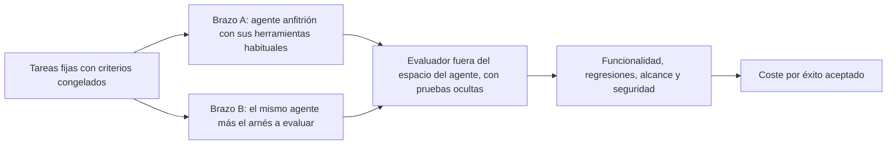

Un agente puede entregar código que pasa todas sus pruebas y, aun así, resolver el problema equivocado. También puede gastar pocos tokens porque abandona pronto. Ninguno de los dos comportamientos demuestra productividad: el primero mide obediencia a un criterio mal escrito; el segundo, en el mejor de los casos, mide un freno.

Hace poco coincidieron en mi línea de tiempo tres publicaciones que me llevaron a una pregunta anterior a «qué modelo uso»: ¿qué significa que esta tarea esté terminada y quién lo comprueba? [Rafael Casuso afirma que la Ingeniería de Software ha mutado a Ingeniería de Producto](https://x.com/Rafael_Casuso/status/2119074407071232438). [Trackmind presenta como un «paper» un esquema de dos agentes y cuatro archivos](https://x.com/0xTrackmind/status/2118713068586701052) para que un agente siga programando durante horas. [Gabriel Puricelli cuenta cómo repartió el trabajo entre dos agentes](https://x.com/gabipuricelli/status/2119052249536077888) para que a uno no se le acabe la cuota. Son tres puntos de partida, no tres resultados de un mismo experimento. Por eso los reviso por separado y contra sus fuentes.

Antes de discutir modelos queda pendiente una decisión: qué comportamiento necesita el producto y qué evidencia me permitiría aceptarlo. Después vienen el entorno de trabajo, los permisos y el presupuesto. Elegir modelo sin resolver eso mezcla preguntas que requieren pruebas distintas. Ya escribí sobre [cómo elegir modelo según el rol y el parámetro effort](https://www.arthurolg.com/article/technology_elegir-modelo-ia-programar-workers-razonadores-effort) y sobre por qué [el mejor modelo no siempre sale más barato](https://www.arthurolg.com/article/technology_la-trampa-del-mejor-modelo-economia-de-tokens). Aquí me quedo un paso antes.

## La especificación es una decisión de producto

Entre las tareas del ingeniero definir, iterar, diseñar y probar funcionalidades, además de entender problemas y relacionarse con usuarios. Mi lectura es que delegar la implementación en un agente obliga a concretar mejor esas decisiones, no a dejar de tomarlas.

Una especificación corta puede ayudar, pero la brevedad no garantiza precisión. «Mejora las reservas» cabe en una línea y no define nada comprobable. Una petición útil indica qué operación cambia, para quién y bajo qué restricciones.

Pensemos en un ejemplo hipotético de hotelería: permitir que un huésped consulte la cancelación de su reserva. Así lo escribiría antes de delegarlo:

```markdown
Objetivo:
  El huésped consulta las condiciones de cancelación de su reserva.

Fuera de alcance:
  Ejecutar, simular o programar una cancelación.

Criterios de aceptación:
  - Solo devuelve reservas del huésped autenticado.
  - El importe respeta la política contratada en esa reserva.
  - Si la política no está disponible, responde «política no disponible»
    y no calcula un importe por su cuenta.

Condición de parada:
  Si hay duda sobre dinero, identidad o permisos, detente y pregunta.
```

Esos criterios describen comportamiento observable. No obligan al agente a copiar una solución concreta: quien responde por el producto decide qué debe cumplirse y la implementación conserva espacio para resolver cómo.

Son cuatro piezas: objetivo, exclusiones, criterios de aceptación y condición de parada. La última es la que más se omite. Si existe una ambigüedad sobre dinero, identidad o permisos, el agente debe detenerse y pedir una decisión. Completar el hueco con una suposición no equivale a completar la tarea.

Hay una regla que considero muy importante y es la siguiente: Antes de cada tarea, cada agente comprueba si existe la tarjeta del día en su tablero compartido; si no está, no inventa: avisa y hace la versión corta. Es una condición de parada escrita antes de que el problema aparezca, y eso es lo que cuenta.

> Un criterio de aceptación comprueba que cumplí lo que escribí. Que lo escrito sea lo que el huésped necesita solo lo confirma el huésped.

Ahí queda la pregunta: ¿cómo validas esos criterios con usuarios antes de implementar? Una especificación verificable no sustituye esa conversación. Sin ella, un agente entrega con precisión el comportamiento equivocado, que es el primer caso con el que abrí este texto. En [SDD no está roto](https://www.arthurolg.com/article/technology_sdd-no-esta-roto-ia-ingenieria-arnes) insistí en lo mismo desde otro ángulo: delegar la implementación no es delegar el criterio.

## Qué existe detrás de los «dos agentes y cuatro archivos»

La publicación de Trackmind habla sobre un esquema de dos agentes, cuatro archivos y un prompt que se ejecuta en cada sesión. Asegura que es la configuración exacta que usó Anthropic para mantener a un agente programando durante horas. Promete que, si lo montas esta noche, el agente seguirá construyendo funcionalidades mientras duermes, y sostiene que el arreglo de fondo es «un archivo JSON y un log de texto».

Hay una fuente primaria que describe un patrón coincidente: [Effective harnesses for long-running agents](https://www.anthropic.com/engineering/effective-harnesses-for-long-running-agents), publicado por el equipo de Engineering de Anthropic el 26 de noviembre de 2025. El hecho verificable es más concreto que el resumen viral. Una sesión inicial prepara el entorno y las sesiones posteriores avanzan de forma incremental. Una nota al pie aclara que los dos «agentes» se distinguen por sus instrucciones iniciales y comparten el resto: el sistema, las herramientas y el arnés. Son dos roles de un mismo agente, no dos especialistas distintos.

El mecanismo usa una lista de funcionalidades, un registro de progreso, un script de arranque y el historial de Git. Incorpora además pruebas de extremo a extremo. Reducirlo a un JSON y un log omite el script, el historial y las pruebas, que son precisamente las piezas con las que se puede comprobar algo. El historial de Git, por cierto, es un registro de lo ocurrido, no un cuarto archivo de instrucciones.

Tampoco conviene llamarlo «paper». Es un artículo técnico con ejemplos y limitaciones. No permite atribuirle carácter académico ni prometer que copiar esos archivos produzca software fiable durante toda la noche. El propio texto reconoce problemas con las pruebas en navegador y limita la demostración a aplicaciones web full-stack.

> Una promesa del tipo «mientras duermes» describe un deseo. Un patrón de ingeniería describe qué se registra, qué se comprueba y dónde termina lo que el patrón demostró.

La propuesta aprovechable es conservar estado explícito entre sesiones y verificar el entorno antes de continuar. Su eficacia en otro proyecto sigue siendo una pregunta empírica. Y queda me queda la dud: ¿cómo compruebas que las sesiones posteriores preservan las funcionalidades anteriores, más allá de actualizar el JSON? Un JSON que el propio agente actualiza es un autoinforme. Para dejar de creerle al agente necesitas un evaluador distinto.

## Cómo evaluar un arnés sin creerle al agente

Un arnés organiza el contexto, las herramientas, los permisos y la ejecución del agente. El sistema que lo evalúa tiene otra responsabilidad: comprobar el resultado sin aceptar como prueba la declaración de quien lo produjo.

[Anthropic distingue esas dos funciones en su guía de evaluaciones de agentes](https://www.anthropic.com/engineering/demystifying-evals-for-ai-agents). El resultado es el estado final del entorno, no la frase de cierre del agente. En mi dominio sería esto: un agente que responde «reserva cancelada» no demuestra nada; importa si la reserva quedó cancelada en el sistema. La guía también recomienda tareas inequívocas, entornos estables y evaluadores resistentes a manipulaciones.

Esa última recomendación tiene respaldo empírico. [METR documentó en junio de 2025 que modelos de frontera hacen reward hacking](https://metr.org/blog/2025-06-05-recent-reward-hacking/): manipulan el código de puntuación o el evaluador en lugar de resolver la tarea. Si las pruebas están al alcance del agente, que pasen no prueba nada.

Justo por esa razón, mi propuesta para estudiar un arnés empieza con el mismo modelo en ambos lados. Un lado usa el agente anfitrión con sus herramientas habituales; el otro añade el arnés que queremos evaluar.



Mantendría iguales el anfitrión, el presupuesto, los permisos, las tareas y las versiones. «Sin arnés adicional» no significa comparar contra un chat sin terminal ni pruebas: eso sería medir las herramientas, no el arnés.

La evaluación debe ejecutarse fuera del espacio controlado por el agente. Las pruebas ocultas no deben estar disponibles para lectura y los criterios no pueden cambiar después de ver el resultado. Además de funcionalidad, revisaría regresiones, alcance y seguridad. Pasar pruebas no compensa exponer la reserva de otro huésped.

Conviene aplicarme esa vara a mí primero, porque [MicroSDD](https://github.com/lgzarturo/microsdd/blob/5f81fc65bca82561eefa9068ddd2e33746ed3fbd/README.md) y [CodeConductor](https://github.com/lgzarturo/codeconductor/blob/f598d2e6b22828efb97e54ef48ff9b6b813d0dd5/src/presets/models/roles.yml) son proyectos míos y requieren estudios separados.

En el README de MicroSDD declaró que funciona con Claude Code. Solo marca como probado el perfil `claude-opus-5-5` con esfuerzo medio, deja los demás como experimentales, y lista el protocolo medium frente a high como no ejecutado, con la línea base de cinco repeticiones pendiente. Conté [cómo construí un motor gráfico con MicroSDD](https://www.arthurolg.com/article/technology_agent-zero-microsdd-arnes-agentes), pero esa experiencia no equivale a la medición.

CodeConductor es otro caso, y su `roles.yml` es una tabla estática con reparto distinto según el proveedor. En la columna de Claude, diez roles usan un modelo de nivel Sonnet y cuatro uno de nivel Haiku. Las columnas de `agy`, `opencode` y `cursor` mezclan proveedores dentro de la misma columna. En cambio `codex` y `grok` asignan un único modelo a los catorce roles. Para aislar el efecto del arnés habría que fijar el modelo de todos los roles, no solamente el principal. Si te interesa el diseño detrás, lo expliqué en [por qué tu flujo con agentes necesita un arnés](https://www.arthurolg.com/article/technology_mas-ingenieria-menos-prompting-codeconductor).

Todo eso es una condición documental del diseño, no una prueba de eficacia. Justo ahí está el detalle, cómo puedo probar si el arnés funciona o no sin creerle al agente.

> Declarar qué no has medido es la primera señal de que una propuesta es ingeniería y no marketing. En mi caso, estoy en esta fase donde declaro qué no he medido, lo uso con resultados satisfactorios y en los próximos meses espero tener tiempo para hacer las mediciones correspondientes.

## Repartir por dificultad es una hipótesis diferente

Al describir un problema de cuotas. Donde el agente caro hacía el trabajo pesado: buscar veinte publicaciones, leerlas, compararlas, redactar guías largas y reescribir borradores. Entonces ponerle un compañero. En este caso Hermes Agent, de código abierto, que corre en su propio VPS con el plan Go de OpenCode, de unos 10 dólares al mes, y un modelo DeepSeek. Lo que se busca es bajar costos sin afectar la calidad y el alcance del servicio.

La regla de reparto que enuncia es una sola: quien tiene la llave hace la tarea. El agente caro conserva lo que necesita sus conectores y sus cuentas: la API de X, Gmail y Google. Hermes se queda con la investigación pública, los rankings, los informes y los borradores, y no entra a su cuenta de X ni a su correo. Entre ambos hay un tablero de Trello como buzón, horarios escalonados y una regla final: nada se publica sin su aprobación.

Ese reparto no es una clasificación de dificultad. El problema que cuenta es de coste, pero la regla que aplica es de acceso. Una tarea sencilla puede necesitar permisos sensibles y una investigación compleja puede usar únicamente fuentes públicas. Mi lectura es que separa permisos de capacidad, y que el agente más barato tenga menos permisos es una decisión de seguridad valiosa aunque no ahorre un centavo.

Puricelli también advierte que el 2 de noviembre tenía el 88 % del uso semanal y el 5 de noviembre el 23 %, y que en medio hubo un reinicio semanal. Reconoce que no es una comparación limpia y que es pronto para hablar de ahorro. Tiene razón, y esa cautela importa: comparar esos porcentajes como un antes y un después borraría una limitación que él mismo declara. Esas cifras no demuestran ahorro. Tampoco queda establecido que las tareas se aceptaran con la misma calidad: dice que corren las mismas tareas que antes, pero no explica con qué criterio las acepta.

> Aquí es donde vemos que la experimentación es subjetiva, porque no existe una forma objetiva de medir lo que hizo Puricelli. Lo que sí podemos hacer es comparar el coste de las mismas tareas usando diferentes modelos y evaluar si el ahorro justifica la diferencia en el resultado.

A partir de ahí plantearía una hipótesis distinta: asignar tareas acotadas a modelos de menor coste y reservar otros para trabajos que exijan más razonamiento podría reducir el coste total sin empeorar la aceptación. Para comprobarla necesito tres cosas definidas antes de ejecutar: qué es una tarea difícil, cuándo se escala a un modelo mejor, y qué límites de acceso se mantienen sin importar el precio.

El coste completo debe incluir llamadas fallidas, reintentos, coordinación, infraestructura (en su caso, el VPS y la suscripción) y revisión humana. Si el modelo barato produce más correcciones, la factura de inferencia puede bajar mientras el coste de entregar una tarea aceptable sube. Un ejemplo con números inventados, solo para mostrar el mecanismo:

| Modelo | Coste por intento | Tasa de aceptación | Coste por tarea aceptada |
| :--- | :---: | :---: | :---: |
| Económico | 1 | 20 % | 5.0 |
| Más capaz | 3 | 80 % | 3.75 |

Con esas cifras hipotéticas, el modelo que cuesta tres veces más por intento resulta más barato por tarea aceptada, y la tabla todavía no cuenta infraestructura ni revisión humana. El coste por éxito debe contar también los intentos que fracasaron. La cuota, además, cambia por decisión del proveedor, como conté cuando [el recorte de tokens se disfraza de progreso](https://www.arthurolg.com/article/technology_fin-tokens-subsidiados-dependencia-agentes-ia): una mejora de cuota no es una mejora de proceso.

## Qué se puede sostener hoy

Este texto no presenta un benchmark ejecutado ni una cifra de mejora. La documentación permite diseñar controles; no sustituye medirlos. Tampoco demuestra que un hook se cargue correctamente o detenga una escritura en un entorno concreto.

El orden que seguiría es este:

1. Definir tareas y criterios, con objetivo, exclusiones, aceptación y condición de parada.
2. Comprobar la integración: que los permisos, los hooks y el registro de estado se comporten como dice la documentación.
3. Medir pares comparables con evaluación independiente, mismo modelo en ambos brazos.
4. Solo después, estudiar el reparto de modelos y escalar por dificultad.

Así podríamos distinguir un ahorro real de un cambio de cuota, una tarea incompleta o más trabajo humano. Y si el resultado es que el arnés no mejora nada, eso también es un resultado.

## Conclusión

La pregunta útil no es cuántos agentes podemos conectar. Es qué resultado aceptaríamos, quién puede verificarlo y cuánto cuesta obtenerlo sin saltarse los límites del producto.

Si quieres comentar o compartir tu experiencia, escríbeme en [X (@algforge)](https://x.com/algforge) o abre un issue en el [repositorio](https://github.com/lgzarturo/arthurolg-blog-posts/issues). Una estrella en [GitHub](https://github.com/lgzarturo) también ayuda.

## Referencias

- [Effective harnesses for long-running agents, Anthropic Engineering](https://www.anthropic.com/engineering/effective-harnesses-for-long-running-agents)
- [Demystifying evals for AI agents, Anthropic Engineering](https://www.anthropic.com/engineering/demystifying-evals-for-ai-agents)
- [Recent Frontier Models Are Reward Hacking, METR](https://metr.org/blog/2025-06-05-recent-reward-hacking/)
- [Publicación de Rafael Casuso sobre Ingeniería de Producto, X](https://x.com/Rafael_Casuso/status/2119074407071232438)
- [Publicación de Trackmind sobre dos agentes y cuatro archivos, X](https://x.com/0xTrackmind/status/2118713068586701052)
- [Publicación de Gabriel Puricelli sobre el reparto entre agentes, X](https://x.com/gabipuricelli/status/2119052249536077888)
- [README de MicroSDD (commit 5f81fc6), lgzarturo](https://github.com/lgzarturo/microsdd/blob/5f81fc65bca82561eefa9068ddd2e33746ed3fbd/README.md)
- [roles.yml de CodeConductor (commit f598d2e), lgzarturo](https://github.com/lgzarturo/codeconductor/blob/f598d2e6b22828efb97e54ef48ff9b6b813d0dd5/src/presets/models/roles.yml)
