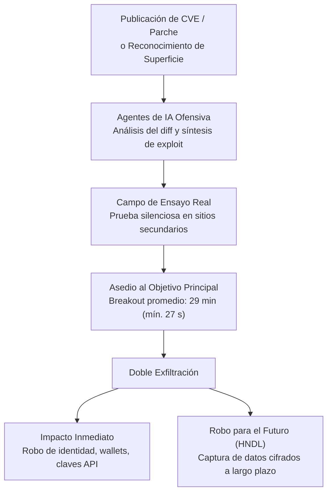

Durante mucho tiempo vi las grandes brechas de seguridad como tormentas que ocurrían en otro continente. Cada semana leíamos titulares sobre bancos vulnerados, redes sociales masivas expuestas o corporaciones multinacionales secuestradas por grupos de extorsión, pero desde nuestra trinchera cotidiana esa amenaza se sentía lejana. Existía un pacto implícito de tranquilidad para quienes construíamos software a escala media o pequeña: si manteníamos un ecosistema ordenado, aplicábamos buenas prácticas de arquitectura, cuidábamos las dependencias y actualizábamos los servidores apenas aparecía un aviso crítico de día cero, no éramos un blanco rentable para nadie.

Esa tranquilidad partía de una premisa económica muy simple. Atacar costaba tiempo humano calificado. Un intruso tenía que estudiar tu infraestructura, entender qué servicios habías expuesto, buscar manualmente un descuido de configuración y adaptar su ataque a las particularidades de tu sistema. Como el tiempo de los atacantes era finito, dirigían su artillería hacia donde el botín justificara semanas de reconocimiento manual.

Hoy esa ecuación económica se rompió por completo. La inteligencia artificial llegó para quedarse y, así como nos ayuda a diseñar mejores productos, refinar arquitecturas y depurar problemas complejos en minutos, también les otorgó a los delincuentes una capacidad industrial para vulnerar sistemas sin importar su tamaño.

En los últimos meses he visto cómo proyectos medianos, plataformas regionales y servicios internos enfrentan oleadas de sondeo quirúrgico que antes solo sufrían las entidades financieras de primer nivel. Ya no existe el refugio de pasar desapercibido en la multitud. Cuando el costo marginal de analizar un perímetro, probar miles de variaciones de ataque y exfiltrar activos cae prácticamente a cero, cualquier servidor conectado a la red entra en la línea de tiro.

## Por qué me niego a llamarlos hackers

Antes de entrar en la mecánica técnica de esta nueva ola de ataques, quiero hacer una pausa en el lenguaje que utilizamos. Cada vez que la prensa o la industria habla de robo de billeteras digitales, secuestro de bases de datos o suplantación de identidad, repite por inercia la palabra *hacker*. Personalmente, me niego a llamarlos así.

Siento un profundo respeto por la figura auténtica del *hacker*: esa mente curiosa que, a base de ingenio, estudio obsesivo y paciencia artesanal, logra comprender hasta el último rincón de un sistema operativo, un compilador o un protocolo de red. De hecho, esa distinción quedó grabada desde los cimientos mismos de la red en el [RFC 1392 del Internet Users' Glossary publicado por la IETF](https://datatracker.ietf.org/doc/html/rfc1392), donde se define al *hacker* como una persona que disfruta de alcanzar una comprensión íntima del funcionamiento interno de las computadoras y las redes, diferenciándolo de quien intenta vulnerar accesos sin autorización.

Quienes hoy automatizan el saqueo de cuentas, drenan ahorros ajenos, secuestran historiales clínicos de hospitales o trafican con identidades robadas no están movidos por la curiosidad intelectual ni por el amor a la ingeniería. Son, sencilla y llanamente, **delincuentes informáticos** o **cibercriminales**.

Si en el mundo físico abundan las personas sin escrúpulos dispuestas a estafar o robar cuando creen que nadie las observa, bajo el supuesto anonimato de la red esa conducta se multiplica a una escala brutal. Y el incentivo financiero explica por qué la actividad está más explotada que nunca: en cuestión de minutos, vulnerar una credencial administrativa, vaciar una *wallet* corporativa o comprometer un nodo de producción se traduce en pérdidas multimillonarias para una organización y en dinero líquido difícil de rastrear para las bandas criminales.

> Llamar hacker a un extorsionador digital es confundir al relojero que comprende cada engranaje de un mecanismo con el ladrón que revienta la vitrina de la joyería usando un mazo hidráulico.

Nombrar las cosas con precisión cambia nuestra postura técnica. No nos enfrentamos a románticos rebeldes del código que buscan demostrar un punto intelectual en un foro; nos enfrentamos a sindicatos del crimen organizado que operan con métricas de retorno de inversión, cadenas de suministro especializadas y presupuestos dedicados a explotar la mínima fisura de nuestra infraestructura.

## Laboratorios de ensayo y asedio a velocidad de máquina

El cambio más peligroso que ha traído la inteligencia artificial al terreno del cibercrimen no es que los modelos inventen vulnerabilidades mágicas de la nada, sino la forma en que han industrializado la preparación y la velocidad del ataque.

Antes, un delincuente que quería atacar un objetivo importante corría el riesgo de hacer ruido en el primer intento: si lanzaba una carga maliciosa mal calibrada contra el servidor principal, las alarmas del cortafuegos o los sistemas de detección bloqueaban su dirección IP y alertaban al equipo de guardia. Hoy el modo de operar es mucho más frío y metódico. Los delincuentes utilizan la inteligencia artificial para entrenar, practicar y perfeccionar sus vectores de intrusión sobre víctimas secundarias o entornos replicados antes de golpear a sus verdaderos objetivos.

Como documenta el equipo de inteligencia de amenazas en el informe [Adversarial Misuse of Generative AI de Google Threat Intelligence Group](https://cloud.google.com/blog/topics/threat-intelligence/adversarial-misuse-generative-ai), los grupos criminales emplean modelos generativos como un multiplicador de fuerza en todas las fases previas al impacto: automatizan el reconocimiento de superficies expuestas, depuran scripts de explotación a medida, traducen señuelos de ingeniería social con modismos locales impecables y desarrollan malware dinámico capaz de consultar una API de lenguaje en tiempo de ejecución para reescribir sus propias rutinas y evadir las firmas estáticas de seguridad.

Todavía más inquietante es lo que ocurre apenas se publica un aviso de seguridad o un parche oficial. Un equipo de investigadores de la Universidad de Illinois demostró en el estudio [LLM Agents can Autonomously Exploit One-day Vulnerabilities en arXiv](https://arxiv.org/abs/2404.08144) que agentes autónomos impulsados por modelos de lenguaje lograron explotar con éxito el 87% de un conjunto de vulnerabilidades reales recién documentadas cuando se les proporcionaba la descripción del boletín CVE, mientras que los escáneres tradicionales como OWASP ZAP o Metasploit obtuvieron un 0% en esas mismas pruebas.

Ese hallazgo explica por qué internet entero se ha convertido en un campo de tiro automatizado. En cuanto un proyecto de código abierto o un proveedor comercial publica una nota de versión corrigiendo un fallo crítico, los delincuentes alimentan a sus agentes con la descripción del parche y el diferencial del código. En cuestión de minutos generan un exploit funcional, lo prueban contra cientos de sitios web pequeños para pulir la ejecución sin levantar sospechas en su blanco principal y, cuando el arma está calibrada, lanzan el ataque definitivo.



Las cifras de telemetría global confirman que la ventana de reacción humana se está evaporando. De acuerdo con los datos del [CrowdStrike 2026 Global Threat Report](https://www.crowdstrike.com/en-us/global-threat-report/), las operaciones de adversarios potenciados por inteligencia artificial crecieron un 89% interanual, y el tiempo promedio de *breakout* en intrusiones criminales —el intervalo que tarda un atacante desde que compromete la primera máquina hasta que se mueve lateralmente hacia otros servidores de la red— cayó a apenas **29 minutos**, con el caso más veloz registrado en tan solo **27 segundos**. Además, el 82% de esas detecciones no involucraron malware tradicional: los intrusos entraron caminando por la puerta principal mediante sesiones robadas, tokens de API comprometidos y credenciales válidas.

Ahora cruza esos 29 minutos de los atacantes con la velocidad real a la que responden las empresas. Según el [Verizon 2025 Data Breach Investigations Report (DBIR)](https://www.verizon.com/business/resources/reports/dbir/), la explotación de vulnerabilidades como vector de acceso inicial creció un 34% interanual hasta representar el 20% de todas las brechas confirmadas, impulsada por un aumento de casi ocho veces en los ataques contra dispositivos de borde y pasarelas VPN. ¿Y cuánto tardaron las organizaciones en aplicar los parches de esas vulnerabilidades críticas de borde? Una mediana de **32 días**, dejando casi la mitad sin remediar durante todo el año.

| Dimensión del Conflicto | Capacidad del Ciberdelincuente con IA | Realidad Promedio en Equipos de Ingeniería | Brecha Operativa |
| :--- | :--- | :--- | :--- |
| **Tiempo de movimiento lateral (*Breakout*)** | Promedio de **29 minutos**; récord mínimo de **27 segundos** (CrowdStrike 2026). | Detección manual dependiente de alertas dispersas o guardias humanas. | Asimetría de minutos contra horas o días. |
| **Armado de exploits tras un CVE (*One-day*)** | **87% de éxito autónomo** en laboratorio al leer la descripción del CVE (UIUC). | Mediana de **32 días** para parchear servicios de borde expuestos (Verizon DBIR). | Un mes entero de exposición tras el anuncio público. |
| **Naturaleza del vector de intrusión** | **82% libre de malware**; abuso de sesiones, identidades y claves API internas. | Perímetros enfocados solo en antivirus clásicos y firmas estáticas de archivos. | Invisibilidad ante controles que no auditan identidad. |
| **Horizonte temporal del botín** | Exfiltración de blobs cifrados hoy para descifrado futuro (*HNDL*). | Asumir que si la base de datos está cifrada en reposo el incidente no es grave. | Pérdida diferida de secretos con vida útil larga. |

Treinta y dos días para poner un parche frente a veintisiete segundos para saltar de un servidor a otro. Esa es la verdadera dimensión de la asimetría que enfrentamos. Cuando hablamos de proteger la paridad y la disponibilidad de nuestros servicios —algo que ya he vivido de cerca al combatir el [scraping automatizado de tarifas hoteleras en el canal directo](https://www.arthurolg.com/article/marketing_scraping-tarifas-hoteleras-paridad-canal-directo)—, el tráfico hostil ya no proviene de un script torpe que lanza peticiones secuenciales fáciles de filtrar, sino de enjambres coordinados que imitan el comportamiento humano, aprenden de las respuestas del servidor y ajustan su cadencia en tiempo real.

## Cosechar hoy, desencriptar mañana

Si el uso de inteligencia artificial para ensayar ataques y vulnerar perímetros en segundos ya resulta alarmante, existe una segunda tendencia criminal que me parece todavía más fría y calculadora: el robo masivo de información cifrada que los delincuentes ni siquiera pueden leer hoy.

En la comunidad de seguridad e inteligencia criptográfica esta estrategia se conoce como **Harvest Now, Decrypt Later (HNDL)** —cosechar ahora, desencriptar después—. La lógica detrás de esta práctica demuestra hasta qué punto las bandas criminales y los actores estatales operan con visión de largo plazo: interceptan tráfico de red, copian respaldos completos de bases de datos, clonan repositorios privados y sustraen contenedores cifrados sin importarles que estén protegidos por algoritmos que hoy resultan matemáticamente inquebrantables.

¿Por qué alguien gastaría ancho de banda y terabytes de almacenamiento en robar bloques de bytes ilegibles? Porque están apostando a la curva de aceleración tecnológica. Saben que el almacenamiento en frío cuesta centavos de dólar por gigabyte y que la capacidad de cómputo —impulsada tanto por el avance hacia computadoras cuánticas criptográficamente relevantes como por nuevas técnicas asistidas de criptoanálisis— avanza cada año.

> El delincuente moderno ya no necesita romper la cerradura frente a tus ojos; le basta con llevarse la bóveda cerrada en silencio, sabiendo que el tiempo y la física le entregarán la llave más adelante.

Muchos equipos de ingeniería caen aquí en una falsa sensación de inmunidad. Piensan que porque sus comunicaciones viajan sobre TLS o sus respaldos tienen cifrado activado, una exfiltración de datos cifrados es un incidente menor. Pero conviene entender con rigor técnico qué está en riesgo y qué no.

Los algoritmos simétricos bien implementados con llaves largas, como `AES-256`, o las funciones hash como `SHA-384` y `SHA-512`, resisten razonablemente bien incluso frente al algoritmo cuántico de Grover, que solo reduce su seguridad efectiva a la mitad cuadrática. El verdadero talón de Aquiles del tráfico y los paquetes que los delincuentes están cosechando hoy reside en la **criptografía asimétrica de llave pública** (`RSA`, `Diffie-Hellman`, curvas elípticas `ECDSA` y `ECDH`), que es exactamente la que utilizamos todos los días para negociar las llaves de sesión en conexiones HTTPS, túneles VPN, firmas de artefactos de software y esquemas de autenticación.

Cuando un atacante captura y archiva el apretón de manos (*handshake*) TLS de tus servicios o se lleva un respaldo cuya llave maestra fue envuelta mediante criptografía asimétrica tradicional, solo necesita esperar a que el algoritmo sea ejecutable a escala para reconstruir la llave privada, desencapsular la llave de sesión y abrir toda la conversación histórica como si estuviera en texto plano.

En criptografía existe una formulación conocida como el teorema de Michele Mosca que todo arquitecto de software debería tener grabada en su tablero de diseño:

$$X + Y > Z$$

En esta desigualdad, $X$ representa los años durante los cuales tus datos necesitan mantenerse confidenciales (piensa en secretos industriales, historiales médicos, documentos de identidad, claves maestras o *seeds* de billeteras patrimoniales); $Y$ es el tiempo en años que te tomará migrar toda tu arquitectura, librerías e integraciones hacia estándares resistentes; y $Z$ es el tiempo que falta para que la tecnología de descifrado esté disponible. Si la suma de $X + Y$ es mayor que $Z$, entonces **los datos cifrados que te roben hoy ya están comprometidos en el futuro**.

Esta amenaza dejó de ser ciencia ficción teórica. Por esa razón, en agosto de 2024 el Instituto Nacional de Estándares y Tecnología de Estados Unidos publicó los primeros estándares definitivos de criptografía poscuántica encabezados por el [estándar FIPS 203 basado en ML-KEM para encapsulación de llaves en el NIST](https://csrc.nist.gov/pubs/fips/203/final), junto con `FIPS 204` (`ML-DSA` para firmas digitales) y `FIPS 205` (`SLH-DSA` para firmas basadas en hash). Y apenas tres meses después, en el reporte [NIST IR 8547 sobre la transición a estándares de criptografía poscuántica](https://csrc.nist.gov/pubs/ir/8547/ipd), el organismo trazó una fecha de caducidad tajante: los esquemas clásicos vulnerables como RSA y curvas elípticas de 112 bits de seguridad quedarán oficialmente **deprecados después de 2030** y **prohibidos por completo después de 2035**.

En la misma línea, agencias de defensa de infraestructura mantienen activa la [iniciativa de criptografía poscuántica y el catálogo KEV de CISA](https://www.cisa.gov/quantum), instando a todas las organizaciones a levantar inventarios criptográficos inmediatos para identificar qué datos tienen una vida útil prolongada antes de que sigan siendo recolectados en silencio.

## Usar la IA en defensa no es un lujo, es supervivencia

Ante este panorama, seguir defendiendo nuestras aplicaciones con revisiones manuales esporádicas, contraseñas estáticas y auditorías que ocurren una vez al año equivale a intentar detener un enjambre de drones con una honda de piedra. Si los delincuentes informáticos utilizan la inteligencia artificial para practicar, descubrir grietas, cruzar datos robados y automatizar la exfiltración, incorporar inteligencia artificial y automatización estricta en nuestra defensa deja de ser un lujo de empresas ricas para convertirse en una necesidad básica de supervivencia.

El primer frente de defensa comienza dentro de casa, en el momento mismo en que escribimos y revisamos nuestro código. Como reflexioné hace poco al analizar por qué [el verdadero riesgo del código generado por IA es la falta de criterio técnico para auditarlo](https://www.arthurolg.com/article/technology_codigo-ia-desconfianza-criterio-tecnico-ingenieria), un equipo que acepta bloques de código sugeridos por un asistente sin entender qué dependencias introduce, cómo valida las entradas del usuario o cómo gestiona las sesiones está abriendo puertas traseras a velocidad industrial.

La única respuesta viable en una carrera contra el tiempo es combatir la automatización ofensiva con **ingeniería defensiva automatizada**. En lugar de usar los modelos de lenguaje únicamente para escupir funcionalidades nuevas más rápido, debemos integrarlos como sabuesos permanentes dentro de nuestros *pipelines* de integración continua y en la observabilidad de nuestros sistemas.

En la práctica, reforzar nuestros perímetros con lo que hoy tenemos al alcance exige actuar sobre cuatro pilares concretos que cualquier equipo de desarrollo puede implementar desde hoy:

### 1. Agilidad criptográfica e intercambio híbrido

No esperes a 2030 para descubrir que tu sistema tiene algoritmos criptográficos acoplados a fuego en veinte microservicios distintos. Diseña tu arquitectura con **agilidad criptográfica** (*crypto-agility*): abstrae los proveedores de cifrado, evita exponer respaldos en canales cuyo intercambio de llaves dependa exclusivamente de RSA clásico y activa desde ahora esquemas híbridos en tu capa de transporte (combinando curvas elípticas clásicas como `X25519` con encapsulación poscuántica `ML-KEM-768` en TLS 1.3). Además, aplica una higiene implacable sobre tus secretos: en mis [lecciones prácticas sobre desarrollo backend con Java y Spring Boot](https://www.arthurolg.com/article/programming_backend-java-spring-boot-lecciones-curso) siempre insisto en que jamás debe existir una llave, token o credencial en texto plano dentro de un archivo de propiedades, porque hoy lo primero que buscan los agentes de exfiltración al pisar un servidor son las variables de entorno y las claves de tus propias APIs de IA.

### 2. Reducción del tiempo de exposición y rotación continua

Si un agente ofensivo tarda minutos en convertir un boletín CVE en un exploit funcional y el promedio de intrusión lateral ronda los 29 minutos, nuestras credenciales y sesiones no pueden durar meses. Cuando diseñamos servicios expuestos a internet —tal como revise al [construir APIs REST escalables con rotación de llaves y tokens de vida corta](https://www.arthurolg.com/article/programming_aprende-a-construir-apis-rest-escalables)—, la defensa asume que cualquier token en tránsito puede ser interceptado. Utiliza tiempos de expiración breves, revocación inmediata ante anomalías de origen o cadencia, y rotación automatizada de llaves criptográficas para que un bloque de datos robado hoy no comparta la misma llave maestra que los datos del mes pasado.

### 3. Arneses agénticos de auditoría antes del despliegue

De la misma manera en que los delincuentes usan entornos aislados para probar cómo romper un sistema, nosotros debemos usar agentes defensivos en nuestras ramas de trabajo para atacar nuestro propio código antes de fusionarlo a producción. Integrar pruebas de mutación, análisis estático asistido por modelos y compuertas de validación deterministas —siguiendo la filosofía de [construir un arnés de ingeniería que limite el alcance de los agentes](https://www.arthurolg.com/article/technology_sdd-no-esta-roto-ia-ingenieria-arnes)— permite detectar inyecciones, fugas de datos sensibles en bitácoras y permisos excesivos cuando corregirlos cuesta cinco minutos en local, no millones en producción.

Veamos cómo se traduce esta mentalidad defensiva en un componente real de verificación y agilidad criptográfica en Kotlin para auditar configuraciones de transporte y sellado de datos sensibles antes de permitir que un servicio arranque en producción:

```kotlin
package com.arthurolg.security.crypto

import java.time.Duration
import java.time.Instant

/**
 * Política de agilidad criptográfica y defensa activa contra recolección HNDL.
 * Verifica que los canales y almacenes de datos con vida útil larga utilicen
 * intercambio híbrido poscuántico (ML-KEM) y rotación estricta de llaves.
 */
data class PoliticaCriptografica(
    val algoritmoIntercambioTls: String,
    val algoritmoCifradoReposo: String,
    val rotacionMaximaLlave: Duration,
    val ultimaRotacion: Instant,
    val retencionConfidencialidadAnios: Int
)

class GuardiaPerimetroCriptografico {

    companion object {
        // Estándares híbridos con FIPS 203 (ML-KEM) para mitigar Harvest Now, Decrypt Later
        private val INTERCAMBIOS_RESISTENTES_HNDL = setOf(
            "X25519MLKEM768",
            "SecP256r1MLKEM768",
            "ML-KEM-1024"
        )
        private val CIFRADOS_SIMETRICOS_APROBADOS = setOf(
            "AES-256-GCM",
            "ChaCha20-Poly1305"
        )
        private const val UMBRAL_VIDA_UTIL_HNDL_ANIOS = 3
    }

    fun auditarConfiguracion(politica: PoliticaCriptografica, ahora: Instant = Instant.now()): List<String> {
        val hallazgosCriticos = mutableListOf<String>()

        // 1. Verificar resistencia poscuántica si los datos tienen vida útil prolongada (Mosca X + Y > Z)
        if (politica.retencionConfidencialidadAnios >= UMBRAL_VIDA_UTIL_HNDL_ANIOS &&
            politica.algoritmoIntercambioTls !in INTERCAMBIOS_RESISTENTES_HNDL
        ) {
            hallazgosCriticos.add(
                "Riesgo HNDL: Los datos requieren ${politica.retencionConfidencialidadAnios} años de " +
                    "confidencialidad, pero el canal usa '${politica.algoritmoIntercambioTls}'. " +
                    "Migra a un esquema híbrido FIPS 203 (ej. X25519MLKEM768)."
            )
        }

        // 2. Validar fortaleza simétrica en reposo (resistencia ante algoritmo de Grover)
        if (politica.algoritmoCifradoReposo !in CIFRADOS_SIMETRICOS_APROBADOS) {
            hallazgosCriticos.add(
                "Cifrado en reposo insuficiente: '${politica.algoritmoCifradoReposo}'. " +
                    "Exige autenticidad y llaves de 256 bits (AES-256-GCM o ChaCha20-Poly1305)."
            )
        }

        // 3. Auditar ventana de rotación de llaves para limitar el radio de impacto
        val antiguedadLlave = Duration.between(politica.ultimaRotacion, ahora)
        if (antiguedadLlave > politica.rotacionMaximaLlave) {
            hallazgosCriticos.add(
                "Llave criptográfica expirada hace ${antiguedadLlave.toHours()} horas. " +
                    "Fuerza la rotación automática para acotar la ventana de exfiltración."
            )
        }

        return hallazgosCriticos
    }
}
```

### 4. Asumir la brecha y proteger el dato como última frontera

La lección más dura de esta época es aceptar que ningún muro perimetral es impenetrable cuando el adversario dispone de automatización infinita. Estar a la defensiva hoy significa diseñar bajo el principio de confianza cero (*Zero Trust*): asumir que en algún momento un atacante logrará colarse en un contenedor o robar un token de sesión, y garantizar que cuando eso ocurra se encuentre con compartimentos estancos, privilegios mínimos, telemetría que corte la sesión en segundos y datos que ni siquiera el robo silencioso pueda capitalizar.

> En una guerra asimétrica donde el atacante automatiza el golpe y archiva lo robado para el futuro, la única victoria posible del ingeniero es diseñar sistemas donde el botín caduque antes de que puedan abrirlo.

## Conclusión

La sensación de lejanía con la que mirábamos las grandes brechas de seguridad ha terminado para siempre. Ya no importa si administras la infraestructura de un banco internacional, el motor de reservaciones de un grupo hotelero o una plataforma independiente en crecimiento: para un enjambre de agentes controlados por delincuentes informáticos, tu perímetro es simplemente una dirección más en su cola de ejecución.

Reconocer esta realidad no es una invitación a la paranoia ni al pesimismo, sino un llamado urgente a la madurez profesional. Nos toca dejar atrás la ingenuidad de creer que basta con cumplir una lista de verificación estática o aplicar parches un mes después de su anuncio. Necesitamos usar la inteligencia artificial a nuestro favor para auditar cada cambio, acortar nuestras ventanas de remediación, rotar nuestras credenciales sin descanso y preparar nuestra criptografía para que la información que custodiamos hoy siga siendo indescifrable dentro de diez años.

Si hoy mismo un grupo criminal copiara en silencio el tráfico cifrado y los respaldos de tu sistema principal para intentar abrirlos dentro de cinco años, ¿qué tan tranquilo dormirías con la arquitectura que tienes en producción?

Si quieres comentar o compartir tu experiencia, escríbeme en [X (@algforge)](https://x.com/algforge) o abre un issue en el [repositorio](https://github.com/lgzarturo/arthurolg-blog-posts/issues). Una estrella en [GitHub](https://github.com/lgzarturo) también ayuda.

## Referencias

- [RFC 1392: Internet Users' Glossary, Gary Malkin & Tracy LaQuey Parker (IETF)](https://datatracker.ietf.org/doc/html/rfc1392)
- [Adversarial Misuse of Generative AI, Google Threat Intelligence Group (Google Cloud)](https://cloud.google.com/blog/topics/threat-intelligence/adversarial-misuse-generative-ai)
- [LLM Agents can Autonomously Exploit One-day Vulnerabilities, Richard Fang et al. (UIUC / arXiv)](https://arxiv.org/abs/2404.08144)
- [CrowdStrike 2026 Global Threat Report, CrowdStrike](https://www.crowdstrike.com/en-us/global-threat-report/)
- [Verizon 2025 Data Breach Investigations Report (DBIR), Verizon Business](https://www.verizon.com/business/resources/reports/dbir/)
- [FIPS 203: Module-Lattice-Based Key-Encapsulation Mechanism Standard (ML-KEM), NIST](https://csrc.nist.gov/pubs/fips/203/final)
- [NIST IR 8547: Transition to Post-Quantum Cryptography Standards, NIST](https://csrc.nist.gov/pubs/ir/8547/ipd)
- [Post-Quantum Cryptography Initiative & Known Exploited Vulnerabilities, CISA](https://www.cisa.gov/quantum)

