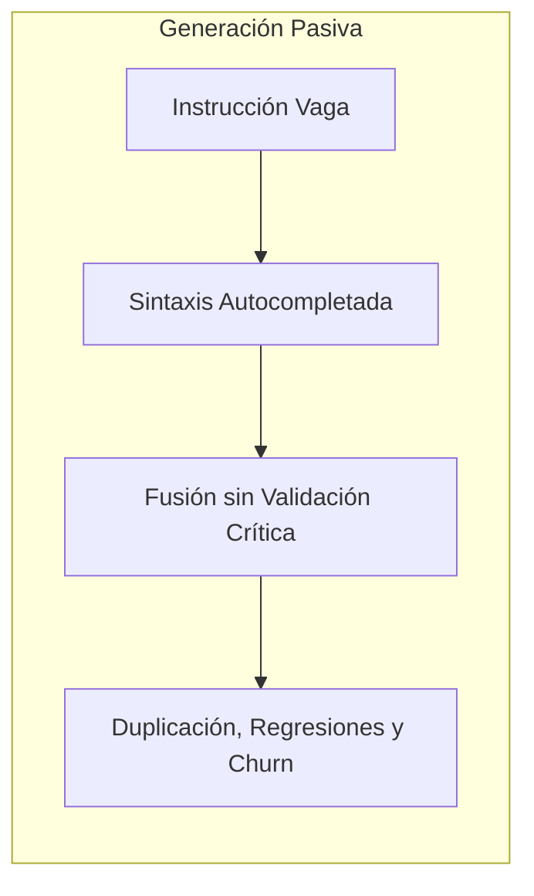
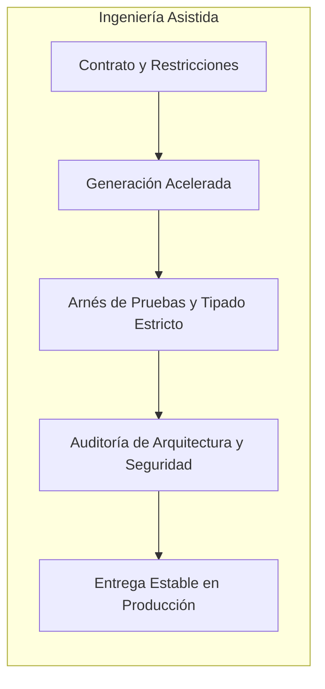

En las últimas semanas he escuchado con insistencia una queja recurrente en redes sociales y foros de debate: desarrolladores que rechazan de plano el código generado por modelos de inteligencia artificial argumentando que comete errores, introduce vulnerabilidades o inventa librerías inexistentes. Afirman no confiar en la herramienta y, desde esa postura, descartan cualquier integración con sus flujos de trabajo cotidianos.

La paradoja es evidente. Me da la impresión de que muchos de los que hoy desconfían del código de la IA generativa son los mismos que despliegan a producción servicios enteros sin pruebas unitarias, ignoran el análisis estático en sus *pipelines* de integración continua y jamás han auditado el árbol de dependencias de un paquete que importaron con prisa.

> El problema no es que la inteligencia artificial genere código incorrecto. El verdadero problema es no tener el criterio técnico suficiente para identificarlo.

Si no entiendes la arquitectura del sistema, no sabes evaluar la superficie de ataque, desconoces el costo algorítmico de una decisión o eres incapaz de determinar si una implementación resuelve el problema de fondo, entonces tienes toda la razón en desconfiar de la máquina. Pero, con esa misma lógica, deberías sentir pánico cada vez que tú mismo escribes una línea de código.

## El síndrome del oráculo

Gran parte de esta desconfianza nace de una confusión conceptual profunda: tratar a los modelos de lenguaje como si fueran entes conscientes, programadores subordinados o fuentes de verdad infalibles. Cuando alguien espera que una red neuronal razone como un arquitecto sénior y asuma la responsabilidad de un diseño distribuido, la frustración es inevitable.

Yo lo veo de forma muy similar a cuando escribíamos scripts para generar código repetitivo, configurábamos herramientas de *scaffolding* o utilizábamos generadores de código para esquemas SOAP y entidades relacionales. Ninguna de esas utilidades garantizaba jamás que el resultado fuera perfecto ni libre de errores para nuestro dominio de negocio. Nuestra labor como ingenieros consistía precisamente en inspeccionar la salida, entender qué estructuras había creado, verificar que cumpliera las restricciones del sistema y corregir lo que fuera necesario.

La inteligencia artificial opera bajo esa misma premisa, aunque a una escala infinitamente más potente. No es un oráculo ni un colega de guardia; es un generador probabilístico de texto sumamente eficiente. Hace casi cuatro décadas, en su clásico ensayo [No Silver Bullet de Frederick Brooks (IEEE, 1987)](https://ieeexplore.ieee.org/document/1663532), se trazó con precisión la frontera entre las dificultades accidentales del software (la sintaxis, los lenguajes, el tecleo de estructuras repetitivas) y la dificultad esencial (conceptualizar entidades abstractas, modelar restricciones y definir contratos coherentes).

La IA ha pulverizado gran parte de la dificultad accidental. Producir sintaxis válida nunca fue tan barato ni tan rápido. Sin embargo, la dificultad esencial sigue intacta, descansando exclusivamente sobre los hombros del ingeniero.

## La deuda de verificación

Cuando un equipo adopta herramientas de autocompletado y generación acelerada sin fortalecer sus mecanismos de revisión, ocurre un fenómeno peligroso: la acumulación silenciosa de lo que me gusta llamar *deuda de verificación*.

Como la barrera de entrada para producir texto ejecutable se reduce a cero, los desarrolladores que carecen de criterio tienden a aceptar sugerencias de forma pasiva, incorporando bloques extensos que apenas leyeron superficialmente. Las consecuencias de esta práctica ya no son anécdotas aisladas; la industria cuenta con evidencia tangible de su impacto en la calidad del software.

El estudio de [GitClear sobre 211 millones de líneas de código (2024)](https://www.gitclear.com/recent_ai_developer_productivity_code_quality_research) reveló que la duplicación de código en repositorios alcanzó máximos históricos, mientras que la refactorización profunda cayó por debajo del 10%. Peor aún: el *code churn* (el porcentaje de código modificado, revertido o reemplazado en menos de dos semanas) se duplicó respecto a las medias históricas anteriores al auge de los asistentes inteligentes.

Estos hallazgos coinciden con las conclusiones del [reporte Accelerate State of DevOps de DORA (Google Cloud, 2024)](https://dora.dev/research/2024/), donde se observó una correlación inquietante: cada 25% de incremento en la adopción de IA sin prácticas maduras de entrega se tradujo en una caída estimada del 7.2% en la estabilidad de entrega del software. Generar código a mayor velocidad sin un filtro riguroso satura el *pipeline* de producción con artefactos frágiles.

### Generación Pasiva (Sin Criterio)

### Ingeniería Asistida (Con Criterio)

El gráfico ilustra el dilema con claridad. La herramienta es neutra: si la alimentas con vaguedad y aceptas su resultado a ciegas, multiplicas tus errores a escala industrial. Por eso resulta indispensable [trascender el código y cultivar habilidades de arquitectura y criterio de negocio](https://www.arthurolg.com/article/technology_trascender-el-codigo-habilidades-era-ia); escribir sintaxis dejó de ser la ventaja competitiva del programador.

## Transformar la desconfianza en pruebas y contratos

La diferencia entre el *vibe coder* y el profesional no radica en si confía o no en una herramienta, sino en qué hace con esa desconfianza.

Un desarrollador sin fundamentos técnicos experimenta la desconfianza como un freno paralizante: teme al código de la IA porque es incapaz de juzgarlo con objetividad, aunque en el fondo tampoco cuenta con las herramientas metodológicas para defender la robustez del código que escribe por su cuenta.

En cambio, un ingeniero de software transforma el escepticismo en un método riguroso. No espera que un compilador, una biblioteca externa o un modelo de lenguaje sean infalibles. Construye un arnés sistemático diseñado para detectar fallas antes de que lleguen a los usuarios:

1. **Pruebas automatizadas con intención:** Diseñar pruebas unitarias, de integración y de mutación que desafíen los casos límite, la concurrencia y las condiciones de carrera del componente.
2. **Contratos tipados y arquitectura explícita:** Delimitar fronteras claras entre módulos para asegurar que el código generado respete la inversión de dependencias y el encapsulamiento del dominio.
3. **Auditoría de seguridad y análisis estático:** Revisar las consultas a base de datos, validar entradas contra inyecciones y auditar la superficie de memoria sin dar nada por sentado.
4. **Evaluación de complejidad algorítmica:** Comprobar si una solución aparentemente elegante introduce problemas de rendimiento en colecciones con alto volumen de datos.

> La inteligencia artificial no elimina la responsabilidad del desarrollador sobre el producto final. La hace todavía más evidente y necesaria.

Como analicé al abordar la transición de [escribir código a hacer ingeniería de sistemas y reglas de negocio](https://www.arthurolg.com/article/programming_de-escribir-codigo-a-hacer-ingenieria-algoritmos-estructuras-de-datos-y-productos), nuestro rol nunca consistió en mecanografiar símbolos, sino en garantizar que el sistema funcione bajo presión. Cuando despliegas una función en producción, a los usuarios y al negocio no les importa si la escribió un modelo generativo o un humano tras diez horas de desvelo; tú eres quien firma el cambio y [asume la responsabilidad ética y técnica de su comportamiento](https://www.arthurolg.com/article/technology_firma-ia-procedencia-responsabilidad).

## Conclusión

Desconfiar por defecto es una reacción natural y saludable en cualquier disciplina técnica. Lo absurdo es culpar al martillo porque la pared quedó torcida. La inteligencia artificial acelera la construcción, pero no sustituye la plomada ni el nivel de quien dirige la obra.

Si sientes temor ante el código que te devuelve la máquina, no apagues el monitor para esconderte en la nostalgia: regresa a los fundamentos. Domina las estructuras de datos, profundiza en los patrones arquitectónicos, escribe pruebas implacables y fortalece tu criterio. Cuando sabes exactamente qué necesitas y cómo debe comportarse un sistema, cualquier herramienta se convierte en una aliada extraordinaria.

¿Utilizas la inteligencia artificial como un atajo para no pensar, o como un acelerador sometido a tu propio arnés de ingeniería?

Si quieres comentar o compartir tu experiencia, escríbeme en [X (@algforge)](https://x.com/algforge) o abre un issue en el [repositorio](https://github.com/lgzarturo/arthurolg-blog-posts/issues). Una estrella en [GitHub](https://github.com/lgzarturo) también ayuda.

## Referencias

- [Coding on Copilot: AI Developer Productivity & Code Quality Research, GitClear](https://www.gitclear.com/recent_ai_developer_productivity_code_quality_research)
- [Accelerate State of DevOps Report 2024, DORA (Google Cloud)](https://dora.dev/research/2024/)
- [No Silver Bullet: Essence and Accidents of Software Engineering, Frederick P. Brooks Jr. (IEEE)](https://ieeexplore.ieee.org/document/1663532)
