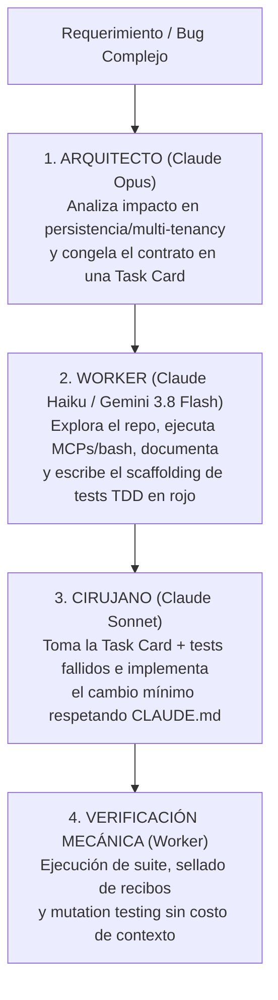

Hace unos días estaba comparando modelos de IA para desarrollo de software, intentando construir un criterio propio sobre cuáles utilizar según el contexto. El proceso habitual es consultar Google, revisar benchmarks y, por supuesto, terminar leyendo las recomendaciones de supuestos expertos en redes sociales. El problema aparece cuando todas esas fuentes parecen contradecirse.

En una de las consultas, el entorno agéntico de Google recomendaba `Claude Sonnet 4.6` frente a `Gemini 3.8 Flash` para desarrollo interactivo y refactorizaciones críticas, destacando su menor varianza y mayor adherencia a restricciones sutiles.

Al consultar al propio Claude, la respuesta era prácticamente la contraria. Los números favorecían a `Gemini 3.8 Flash`: 80.0% en `SWE-bench`, 89.5% en `LiveCodeBench`, un millón de tokens de contexto frente a doscientos mil y un coste considerablemente menor por token.

Mientras tanto, en redes sociales seguían circulando afirmaciones categóricas de divulgadores que aseguraban que Gemini sencillamente no sirve para programar.

**¿A quién creerle?**

La respuesta que he ido construyendo es bastante sencilla: a ninguno de ellos por defecto.

Los benchmarks sirven para orientar, las opiniones para descubrir posibilidades y las búsquedas para conocer el estado del arte. Pero ninguna de esas fuentes sustituye la experimentación con nuestros propios proyectos, herramientas, restricciones y flujos de trabajo.

Al final, el modelo que mejor funciona no necesariamente es el que encabeza una clasificación, el que recomienda su fabricante o el que más promociona un divulgador. Es el que demuestra resultados consistentes en nuestro contexto.

**La mejor forma de construir criterio sobre IA no es acumular opiniones, sino experimentar, contrastar y aprender a distinguir lo que funciona de lo que simplemente se dice que funciona.**

> Y esa experimentación se vuelve subjetiva si no puedes medirla correctamente. Entonces es complicado, por que por un lado quieres saber si funciona o no, por otro lado quieres saber que tan eficiente es, para saber si vale la pena el costo beneficio. Pero no siempre es fácil medirlo, de hecho, la mayoría de las veces es subjetivo.

Incluso podemos pensar que el asistente de Google sufría del síndrome del impostor por recomendar a su competidor directo, o si simplemente tenía su base de conocimientos desactualizada. Pero cuando limpias el ruido de las redes y analizas cómo operan realmente estos modelos bajo el capó, descubres que ninguno de los dos mentía. El problema no está en las respuestas de los modelos, sino en hacerles una pregunta que parte de una premisa falsa: asumir que todos los modelos de lenguaje compiten por hacer el mismo trabajo dentro de un repositorio y aquí es donde entra en juego el factor `effort` y la forma en como decidimos orquestar las inteligencias artificiales para resolver problemas complejos de manera efectiva y eficiente.

## El sesgo del "one-shot"

Antes de comparar tablas de rendimiento, conviene desmontar el origen de muchos prejuicios populares en nuestra industria. Cuando escucho a creadores de contenido o ponentes de conferencias afirmar categóricamente que tal familia de modelos "no sirve para programar", casi siempre encuentro el mismo sesgo metodológico detrás: el sesgo del *vibecoding* y de las demostraciones de un solo disparo (*one-shot*) diseñadas para brillar en un escenario o en un curso introductorio.

Pedirle a un modelo que genere un producto mínimo viable desde cero con un único prompt de tres líneas —un juego en el navegador, un clon visual de una aplicación famosa o un tablero con gráficas animadas— es un truco de feria entretenido. En ese terreno de espectáculo, los modelos gigantescos de frontera suelen deslumbrar porque rellenan los huecos de una instrucción ambigua con decisiones estéticas vistosas. Además, muchas críticas públicas hacia el ecosistema de Google se quedaron congeladas en el tropiezo que sufrieron versiones intermedias de hace meses, sin evaluar la madurez actual de su arquitectura.

Sin embargo, evaluar un modelo por cómo construye un juguete desde cero en un solo intento no sirve absolutamente para nada cuando quieres medir cómo responderá en ingeniería de software real.

En un proyecto productivo con historia, deuda técnica y reglas de negocio complejas, jamás le pides a la inteligencia artificial que invente un sistema de la nada. Le pides que entre a un repositorio donde conviven módulos escritos en distintas épocas —por ejemplo, servicios heredados en Groovy coexistiendo con código moderno en Kotlin—, que distinga entre dos entidades de dominio que se llaman parecido pero representan contratos distintos, y que corrija un defecto sin alterar el `FetchType` de las relaciones en base de datos ni formatear archivos que nadie le pidió tocar.

Eso es exactamente lo que las tablas comparativas tradicionales no logran capturar. Pensemos en el estándar de oro que toda la industria cita en sus lanzamientos: el estudio fundacional [SWE-bench: Can Language Models Resolve Real-World GitHub Issues? publicado en ICLR 2024](https://arxiv.org/abs/2310.06770). Aunque representó un avance enorme frente a los ejercicios sintéticos de antaño, el conjunto original de `SWE-bench` se construyó extrayendo 2,294 problemas reales de apenas doce repositorios de código abierto escritos exclusivamente en Python, como `django`, `sympy` o `scikit-learn`.

De manera similar, al revisar la metodología de [LiveCodeBench para evaluación libre de contaminación en modelos de código](https://arxiv.org/abs/2403.07974), vemos que mide con gran rigor la capacidad de resolver acertijos algorítmicos aislados extraídos de plataformas competitivas como LeetCode, AtCoder y CodeForces. Ganar en ese marcador demuestra destreza matemática y algorítmica en funciones sueltas, pero no te dice si el modelo respetará las reglas declaradas en tu archivo `CLAUDE.md` o `AGENTS.md`, si será honesto cuando falle una prueba de integración o si evitará introducir efectos secundarios en una capa de persistencia multi-inquilino (*multi-tenant*).

> Un benchmark mide qué tan bien resuelve un modelo un acertijo aislado en un laboratorio limpio; la ingeniería diaria mide cuántas veces tienes que corregirle la plana para que no rompa las convenciones de tu repositorio.

Ya he escrito antes sobre cómo [la guerra de la IA se gana en el producto y la economía de tokens, no en el trofeo del mejor modelo](https://www.arthurolg.com/article/technology_la-trampa-del-mejor-modelo-economia-de-tokens). Cuando entiendes que los porcentajes de una tabla pública son apenas una señal parcial, dejas de buscar un "ganador absoluto" y empiezas a observar la arquitectura operativa de cada herramienta.

## Razonadores quirúrgicos frente a workers de alta velocidad

Volvamos a la comparación concreta: `Claude Sonnet 4.6` frente a `Gemini 3.8 Flash`. El primer matiz evidente es generacional, pues en muchas cuentas empresariales conviven versiones de la serie 4.6 de Anthropic frente a iteraciones más recientes de la línea Flash de Google. Pero incluso dejando de lado las fechas de lanzamiento, compararlos cara a cara como si fueran sustitutos directos es profundamente injusto porque fueron concebidos bajo dos paradigmas de ingeniería distintos.

Por un lado, la línea **Flash** de Google (al igual que **Haiku** en el ecosistema de Anthropic) está diseñada desde sus cimientos como un **worker de alta velocidad, baja latencia e ingesta masiva**. Si revisas las especificaciones técnicas en la [documentación oficial de modelos y pensamiento de Gemini API en Google AI](https://ai.google.dev/gemini-api/docs/thinking), verás una arquitectura pensada para devorar contextos nativos de un millón de tokens, emitir salidas extensas de hasta 64,000 tokens de una sola vez y ejecutar bucles continuos de llamadas a herramientas (*tool-calling loops*) a una fracción del costo. Su terreno natural es el movimiento constante: leer cientos de archivos, cruzar bitácoras gigantescas, ejecutar comandos en terminal, observar el fallo y volver a iterar sin que el desarrollador sienta que el reloj se detuvo.

Por otro lado, modelos como **Claude Sonnet** y **Claude Opus** están diseñados bajo el paradigma del **razonamiento quirúrgico y la adherencia estricta a restricciones sutiles**. No son los más baratos ni tienen la ventana de salida más grande en una sola llamada, pero destacan por su baja varianza. Cuando les entregas un contexto acotado con diez restricciones negativas (*«no cambies la firma pública, no modifiques las migraciones previas, usa solo la librería estándar, mantén los comentarios en español y el código en inglés»*), mantienen la atención fija en cada límite sin ponerse creativos ni "mejorar" código adyacente que funcionaba bien.

| Criterio en Ingeniería Real | Paradigma Worker (`Gemini 3.8 Flash` / `Claude Haiku`) | Paradigma Razonador Quirúrgico (`Claude Sonnet 4.6` / `Opus`) |
| :--- | :--- | :--- |
| **Propósito arquitectónico** | Ejecución continua de agentes en bucle, exploración masiva y tareas mecánicas. | Diseño de contratos, cirugía de código en capas críticas y baja varianza. |
| **Ventana de contexto y salida** | Hasta **1M de tokens** de entrada y **64k de salida** (ideal para repositorios enteros o artefactos largos). | Ventana más acotada (200k), optimizada para precisión densa en contextos seleccionados. |
| **Comportamiento en bucles de herramientas** | Latencia mínima; ideal para correr suites de tests, linters, MCPs y búsquedas repetitivas. | Mayor deliberación por turno; excelente cuando el cambio debe quedar limpio en pocos intentos. |
| **Adherencia a restricciones sutiles** | Requiere contratos muy explícitos y ajuste de esfuerzo alto para no saltar reglas implícitas. | Sobresaliente respetando reglas negativas, convenciones de `CLAUDE.md` y límites de alcance (*scope*). |
| **Riesgo principal si se usa mal** | Modificar de más o pasar por alto un efecto colateral sutil si se le suelta sin plan previo. | Quemar cuota rápidamente y sufrir de sobre-ingeniería (*overthinking*) en tareas rutinarias. |

> Entonces mi respuesta ante ese escenario es: no elijas uno sobre el otro porque creas que es "más inteligente"; asígnales trabajo según su naturaleza.

Si necesito analizar el repositorio completo, redactar o actualizar documentación técnica, barrer bitácoras o correr ciclos rápidos de agentes y pruebas, pongo a trabajar a `Gemini 3.8 Flash`. En cambio, si tengo frente a mí un defecto ya acotado donde sé exactamente qué componente falla, o si voy a ejecutar una refactorización crítica donde un efecto secundario en la capa de persistencia o en el manejo transaccional sale carísimo, entro directamente con `Sonnet 4.6`. Uno actúa como el operador incansable que prepara el terreno y verifica el entorno; el otro entra con el bisturí cuando el paciente ya está diagnosticado.

## Mi arquitectura de orquestación

Esta división entre *workers* y modelos de razonamiento no es solo un criterio para elegir manualmente qué pestaña abrir por la mañana; es el principio rector con el que he estructurado mi propio arnés agéntico de desarrollo.

En lugar de usar un solo modelo monolítico para todo el ciclo de vida de una funcionalidad, la arquitectura más sólida consiste en enrutar cada fase del flujo hacia el modelo cuyo perfil cognitivo y económico encaje mejor. Este enfoque coincide plenamente con el patrón **Orchestrator-Workers** documentado por Erik Schluntz y Barry Zhang en la guía [Building Effective Agents de Anthropic Research](https://www.anthropic.com/research/building-effective-agents), donde un modelo central descompone problemas complejos cuyo alcance en archivos no puede predecirse de antemano y delega subtareas acotadas a trabajadores especializados.

De hecho, el impacto de separar responsabilidades está medido a escala industrial. Al detallar la arquitectura de sus propios agentes en [How we built our multi-agent research system de Anthropic Engineering](https://www.anthropic.com/engineering/built-multi-agent-research-system), los ingenieros demostraron que un sistema coordinado por `Claude Opus` como agente líder y múltiples sub-agentes especializados superó en un **90.2%** el rendimiento de un agente único de `Opus` trabajando en solitario. La razón técnica es fascinante: los sub-agentes funcionan como **compresores de contexto**. Exploran miles de líneas de ruido en ventanas aisladas y le devuelven al orquestador únicamente la síntesis limpia, evitando que la memoria de trabajo del modelo principal se contamine.

En mi flujo diario —apoyado en la disciplina de [construir contratos explícitos con CodeConductor antes de escribir código](https://www.arthurolg.com/article/technology_mas-ingenieria-menos-prompting-codeconductor)—, cuando opero dentro del ecosistema de Claude divido el trabajo en tres roles innegociables:



### 1. Opus para planear y acotar la arquitectura (El Cerebro)

Antes de permitir que ningún agente modifique un archivo del repositorio, entra `Opus`. Su responsabilidad es leer el problema, analizar el contexto arquitectónico complejo y evaluar el radio de impacto en capas sensibles: persistencia, fronteras transaccionales, seguridad o aislamiento *multi-tenant*. El entregable de `Opus` no es código de producción; es un plan de implementación riguroso junto con contratos estrictos que los demás modelos deberán obedecer sin adivinar. A ese artefacto lo llamo **Task Card**: define qué archivos están dentro del alcance, qué archivos está prohibido tocar y qué criterios verificables determinan el éxito.

### 2. Haiku (o Gemini Flash) para exploración, documentación y pruebas TDD (El Worker)

Una vez que la *Task Card* está congelada, sería un desperdicio financiero y de latencia usar a `Opus` o a `Sonnet` para tareas mecánicas e iterativas. Aquí el arnés le delega el control al *worker* de alta velocidad y bajo costo (`Haiku` cuando corro el flujo puro en Claude, o `Gemini 3.8 Flash` en entornos híbridos).

El *worker* se encarga del trabajo pesado de trinchera: barrer directorios para extraer mapas del repositorio, ejecutar comandos de terminal, consultar servidores MCP, actualizar la documentación y, sobre todo, construir el *scaffolding* de pruebas en **TDD**. Basándose estrictamente en la especificación que dejó `Opus`, el *worker* redacta los *mocks*, los casos borde y las pruebas unitarias que deben fallar inicialmente (*TDD Red*). Incluso al final del ciclo, cuando toca ejecutar la suite completa, correr pruebas de mutación (*mutation testing*) o sellar los recibos criptográficos de verificación —siguiendo la práctica de [someter a la IA a un arnés determinista de ingeniería](https://www.arthurolg.com/article/technology_sdd-no-esta-roto-ia-ingenieria-arnes)—, todo ese cómputo iterativo recae en el *worker*, porque son operaciones que exigen velocidad de ejecución y no razonamiento arquitectónico profundo.

### 3. Sonnet para el desarrollo principal y cirugía en código (El Ejecutor)

Con el plan de `Opus` en una mano y las pruebas fallidas del *worker* en la otra, entra `Sonnet`. Como recibe el problema completamente acotado dentro de una *Task Card*, no tiene que especular sobre la arquitectura general ni gastar tokens explorando el proyecto a ciegas. Entra al quirófano a hacer lo que mejor sabe hacer: implementar la lógica de negocio exacta para pasar los tests a verde (*TDD Green*) y ejecutar refactorizaciones críticas respetando al pie de la letra las convenciones del archivo `CLAUDE.md`, sin sobre-escribir una sola línea de código adyacente.

## La física asimétrica del parámetro effort

Tener clara la topología de modelos es la mitad de la ecuación; la otra mitad, de la que casi nadie habla con honestidad práctica, es cómo calibrar el nivel de esfuerzo de razonamiento (`effort` o *thinking budget*) en cada plataforma. Muchos desarrolladores asumen por intuición que poner todos los controles al máximo (`high` o `max`) siempre producirá mejor código. En mi experiencia probando módulos reales, esa suposición es una trampa costosa.

Cuando trabajo con mi arnés en Claude (`Opus`, `Sonnet` y `Haiku`), **los configuro todos en `effort: medium`**.

¿Por qué no subirlos a `high`? Porque en mi flujo el rigor ya vive en la estructura del arnés y en haber dividido el problema por etapas con contratos claros. Como explica la [documentación oficial de Extended Thinking y el parámetro effort de Anthropic](https://docs.anthropic.com/en/docs/build-with-claude/extended-thinking), cada token de deliberación interna se factura como token de salida y se suma a la latencia total de cada turno. Cuando el propio equipo de Anthropic presentó sus métricas en el anuncio [Introducing Claude Opus 4.5 de Anthropic](https://www.anthropic.com/news/claude-opus-4-5), demostró un dato revelador: configurado en `effort: medium`, el modelo igualaba el puntaje máximo de `Sonnet` en `SWE-bench Verified` consumiendo un **76% menos de tokens de salida**.

Pero el problema de subir a `high` dentro de un bucle de agentes bien especificado no es solo que multiplique la latencia y queme tu cuota diaria a velocidad de vértigo: el verdadero peligro técnico es la **sobre-ingeniería** (*overthinking*).

Esto ya está demostrado empíricamente en la literatura científica reciente. En el estudio [Do NOT Think That Much for 2+3=? On the Overthinking of o1-Like LLMs en arXiv](https://arxiv.org/abs/2412.21187), investigadores documentaron cómo los modelos de razonamiento obligados a deliberar en exceso sobre tareas ya acotadas generan cadenas redundantes que desperdician cómputo sin mejorar el resultado. Más aún, un análisis exhaustivo de más de 4,000 trayectorias de agentes en [The Danger of Overthinking: Examining the Reasoning-Action Dilemma in Agentic Tasks (UC Berkeley, ETH Zurich, UIUC y CMU)](https://arxiv.org/abs/2502.08235) demostró que el exceso de pensamiento interno en agentes de programación provoca parálisis por análisis y acciones fuera de alcance (*rogue actions*): el modelo empieza a inventar casos hipotéticos que no existen en la especificación, crea abstracciones innecesarias y modifica archivos que no debía tocar. Al mitigar ese sobre-razonamiento, los investigadores mejoraron la resolución de problemas en casi un 30% reduciendo el costo computacional en un 43%.

Por el contrario, bajar a Claude a `effort: low` degrada notablemente su adherencia a restricciones sutiles. Por eso, `medium` —combinado con las buenas prácticas que compartí al explicar cómo [configurar Claude Code para trabajo serio y controlar el gasto de tokens](https://www.arthurolg.com/article/programming_configurar-claude-code-para-trabajo-serio)— entrega el punto de equilibrio perfecto entre razonamiento previo y velocidad cuando el arnés corre herramientas y pruebas en bucle.

Ahora bien, **esta regla se invierte por completo cuando uso a `Gemini 3.8 Flash` dentro de Agy**: ahí sí lo configuro siempre en **`effort: high`**.

¿Por qué la misma perilla exige valores opuestos según el modelo? Porque el parámetro de esfuerzo actúa sobre arquitecturas con inercias por defecto contrarias:

1. **Compensación del sesgo de velocidad de la línea Flash:** Por diseño de fábrica, la familia Flash de Google prioriza responder a la velocidad del rayo. Si lo dejas en niveles bajos o predeterminados, tiende a disparar la primera edición de archivo o llamada a herramienta antes de verificar todas las aristas del contrato. Al forzarlo a `high`, obligas al modelo a agotar su cadena de pensamiento interna antes de tocar el disco, verificando impactos colaterales, tipos de datos y casos borde antes de emitir una sola línea de código.
2. **Impacto mínimo en latencia y cuota generosa:** A diferencia de Claude —donde subir el `effort` infla la verbosidad y enlentece drásticamente cada vuelta del ciclo agéntico—, `Gemini 3.8 Flash` posee una velocidad de generación por segundo tan alta y unos límites de cuota tan holgados en la cuenta de Google que esos segundos adicionales de análisis previo apenas se perciben en el reloj, pero reducen drásticamente las iteraciones de corrección posteriores.
3. **Neutralización del desfase de versiones:** Cuando trabajas en un entorno corporativo donde la alternativa es una versión anterior de `Sonnet`, exprimir al máximo el presupuesto de pensamiento de `Gemini Flash` equilibra la balanza de precisión sin sacrificar su ventaja en ventana de contexto.

Así luce en la práctica una matriz declarativa de enrutamiento y esfuerzo dentro de la configuración de un arnés multi-modelo:

```yaml
# Configuración de enrutamiento por rol y calibración asimétrica de effort
harness_routing:
  # Fase 1: Diseño arquitectónico, análisis de impacto y creación de Task Card
  architect:
    provider: anthropic
    model: claude-opus-4-6
    effort: medium # El rigor vive en el contrato; evita overthinking y quema de cuota
    outputs:
      - task_card.md
      - impact_radius_report.md

  # Fase 2: Exploración masiva, MCPs, documentación y scaffolding TDD (Red)
  worker_claude_stack:
    provider: anthropic
    model: claude-haiku-4-5
    effort: medium
    allowed_tasks:
      - repo_exploration
      - tdd_scaffolding_red
      - mutation_testing_execution
      - docs_sync

  # Alternativa Worker / Agente en entorno Google (Agy)
  worker_google_stack:
    provider: google
    model: gemini-3.8-flash
    effort: high # Fuerza cadena de pensamiento completa antes de llamar herramientas
    context_window: 1000000
    allowed_tasks:
      - full_repo_ingestion
      - continuous_tool_loops
      - tdd_scaffolding_red
      - implementation_from_task_card

  # Fase 3: Cirugía de código en capas críticas (Persistencia, Multi-tenancy)
  surgical_implementer:
    provider: anthropic
    model: claude-sonnet-4-6
    effort: medium # Balance ideal entre adherencia a CLAUDE.md y velocidad en el loop
    constraints:
      enforce_task_card_scope: true
      forbid_adjacent_refactors: true
```

## Conclusión

La próxima vez que veas dos tablas de benchmarks contradiciéndose o escuches a alguien sentenciar en un video corto que un modelo "no sirve para programar", recuerda que ningún artesano serio evalúa sus herramientas lanzándolas al aire para ver cuál brilla más. Las evalúa en el banco de trabajo, frente a una pieza real y conociendo exactamente para qué operación fue forjada cada una.

Dejemos de pedirles a los modelos rápidos de ingesta masiva que adivinen decisiones arquitectónicas a ciegas, y dejemos de desperdiciar el presupuesto de nuestros modelos quirúrgicos poniéndolos a barrer bitácoras o correr comandos repetitivos en la terminal. Cuando separas el cerebro que planea en una *Task Card*, el *worker* que explora y prepara las pruebas TDD, y el cirujano que ejecuta el cambio con precisión, la falsa guerra entre marcas desaparece y empieza la verdadera ingeniería de flujos.

Y si todavía tienes dudas entre dos modelos disponibles en tu cuenta, haz el único experimento que importa: toma tres tareas reales de tu propio repositorio —un ajuste delicado en un servicio heredado, una prueba unitaria con *mocks* complejos y una consulta sobre *multi-tenancy*—, entrégaselas bajo el mismo contrato y cuenta cuántas correcciones tuviste que hacerle a cada uno.

¿Sigues buscando un modelo único que lo haga todo por arte de magia, o ya estás diseñando tu flujo para que cada modelo juegue en la posición donde es imbatible?

Si quieres comentar o compartir tu experiencia, escríbeme en [X (@algforge)](https://x.com/algforge) o abre un issue en el [repositorio](https://github.com/lgzarturo/arthurolg-blog-posts/issues). Una estrella en [GitHub](https://github.com/lgzarturo) también ayuda.

## Referencias

- [SWE-bench: Can Language Models Resolve Real-World GitHub Issues?, Carlos E. Jimenez et al. (Princeton NLP / ICLR 2024)](https://arxiv.org/abs/2310.06770)
- [LiveCodeBench: Holistic and Contamination Free Evaluation of Large Language Models for Code, Naman Jain et al. (arXiv)](https://arxiv.org/abs/2403.07974)
- [Gemini Thinking & Models Documentation, Google AI for Developers](https://ai.google.dev/gemini-api/docs/thinking)
- [Building Effective Agents, Erik Schluntz & Barry Zhang (Anthropic Research)](https://www.anthropic.com/research/building-effective-agents)
- [How we built our multi-agent research system, Anthropic Engineering](https://www.anthropic.com/engineering/built-multi-agent-research-system)
- [Building with Extended Thinking & Effort Controls, Anthropic Documentation](https://docs.anthropic.com/en/docs/build-with-claude/extended-thinking)
- [Introducing Claude Opus 4.5: Effort Parameter and SWE-bench Efficiency, Anthropic](https://www.anthropic.com/news/claude-opus-4-5)
- [Do NOT Think That Much for 2+3=? On the Overthinking of o1-Like LLMs, Xingyu Chen et al. (arXiv)](https://arxiv.org/abs/2412.21187)
- [The Danger of Overthinking: Examining the Reasoning-Action Dilemma in Agentic Tasks, Alejandro Cuadron et al. (UC Berkeley / ETH Zurich / UIUC / CMU)](https://arxiv.org/abs/2502.08235)
- [CodeConductor is an AI-assisted software engineering framework designed to turn chaotic prompting into a reproducible engineering system.](https://github.com/lgzarturo/codeconductor)
- [Microarnés SDD para Claude Code: un líder y tres agentes coordinan especificación, implementación y revisión, con pruebas verificadas, trazabilidad y aprobación humana.](https://github.com/lgzarturo/microsdd)
