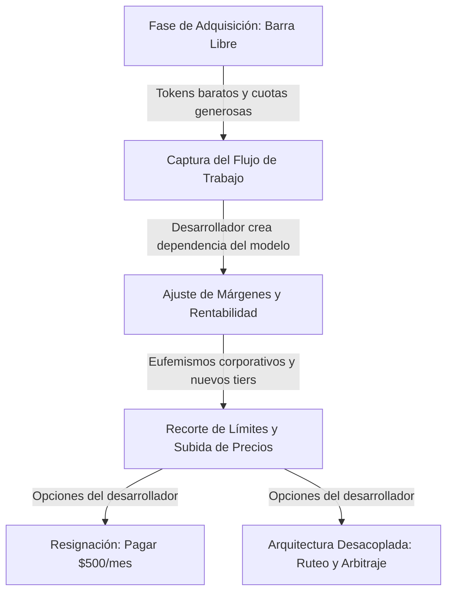

La semana pasada me llegó un correo de OpenAI que sintetiza el momento exacto en el que nos encontramos con las herramientas de inteligencia artificial.

El mensaje respiraba el habitual entusiasmo corporativo: presentaban un nuevo modelo para clientes Pro y un flamante plan bautizado como Pro 500. Quinientos dólares al mes por usuario. A cambio, prometen límites más generosos y acceso a Ultrafast, un modo diseñado para alcanzar hasta trescientos tokens por segundo, ocho veces más rápido que la tasa habitual.

Sin embargo, la noticia real venía tres párrafos más abajo, redactada con esa serenidad calculada que las tecnológicas reservan para las malas noticias.

A partir del 30 de octubre, el plan de 200 dólares pasa de otorgar veinte veces el uso del nivel Plus a solo diez veces. La mitad de capacidad operativa por exactamente el mismo precio.

Lo fascinante es que la palabra "recorte" no aparece ni una sola vez en el texto. En su lugar, el comunicado recurre a una gimnasia verbal admirable: te explican que están "cambiando la forma de calcular el uso", que su compromiso es que "la suscripción siga ayudándote a sacar adelante más trabajo", y que, como el nuevo modelo razona mejor, vas a "perder menos tiempo en idas y vueltas".

Traducido: te damos la mitad de tokens, pero confía en que la inteligencia añadida lo compensa.

Son sus costumbres de plataforma dominante y hay que entenderlas como lo que son. Tampoco es un caso aislado. En septiembre vimos a Anthropic retirar su bonificación promocional del cincuenta por ciento en los límites semanales de Claude Code, camuflándolo como un aumento permanente. Y a principios de octubre, Google reorganizó los escalones de Gemini, retirando modelos avanzados de sus planes más accesibles.

La barra libre de tokens subvencionados se está cerrando. La pregunta no es cuánto te van a recortar el mes que viene, sino cuánto depende tu forma de trabajar de que mantengan esa subvención encendida.

## El correo donde "recorte" es una mala palabra

El manual corporativo en Silicon Valley tiene una regla no escrita: cuando aumentas el valor de un servicio, publicas números gigantescos; cuando reduces las condiciones, hablas de "eficiencia holística" y "simplificación de la experiencia".

La maniobra de OpenAI con el escalón de 200 dólares responde a este libreto. Para consolidar el uso de agentes, necesitaban que pasáramos horas alimentando sus modelos con repositorios enteros, probando bucles en terminal y normalizando el consumo de millones de tokens diarios. Para lograrlo, fijaron tarifas planas muy baratas frente al coste real de los centros de datos.

> Cuando una empresa te dice que vas a recibir menos cómputo porque su nuevo algoritmo es más inteligente, no te está vendiendo rendimiento: te está cobrando el costo de adquisición que antes pagaba su fondo de inversión.

El problema surge cuando la masa crítica ya está cautiva. Si tu rutina diaria asume que puedes lanzar agentes en paralelo sin vigilar el consumo, un tijeretazo del cincuenta por ciento en tu cuota rompe la jornada. Te ves forzado a racionar llamadas a mitad de semana o a dar el salto forzado al escalón de 500 dólares.

El lenguaje edulcorado no engaña al desarrollador; busca desactivar la queja formal. Si el proveedor insiste en que el modelo es dos veces más eficiente, la reducción numérica se presenta como una equivalencia de productividad. Pero en desarrollo asistido los agentes no consumen tokens de forma lineal: exploran ramas fallidas, inspeccionan directorios y queman contexto en lecturas que no entienden de mejoras teóricas de razonamiento.

## Nadie regala cómputo para siempre

Para entender por qué se repite este patrón entre todos los proveedores, conviene recordar cómo funciona la economía de la nube. Lo analizamos a fondo al hablar de [la trampa del mejor modelo y la economía de tokens](https://www.arthurolg.com/article/technology_la-trampa-del-mejor-modelo-economia-de-tokens): la verdadera competencia de la inteligencia artificial nunca se ha librado en la tabla de benchmarks, sino en la resistencia financiera para sostener la inferencia a gran escala.

Durante los dos últimos años, hemos vivido en una luna de miel artificial. Los proveedores de modelos de frontera absorbieron márgenes negativos brutales con tal de capturar desarrolladores. Cada vez que ejecutabas un agente autónomo durante media hora para refactorizar un módulo, el costo de cómputo en clústeres de GPUs de última generación superaba con holgura los centavos que representaba en tu cuota mensual.

Esa fase de captura ha terminado. La industria entra en una etapa de disciplina financiera donde cada llamada a la API debe justificarse en la cuenta de resultados del proveedor. De ahí la sincronía casi matemática entre las decisiones recientes de los gigantes del sector:

1. **Anthropic** dejó vencer a mediados de septiembre su impulso promocional del cincuenta por ciento en Claude Code. Aunque fijaron un incremento permanente del veinticinco por ciento sobre la base anterior, en la práctica significó una caída neta cercana al diecisiete por ciento de la capacidad a la que los usuarios se habían acostumbrado durante el verano.
2. **Google** reorganizó en octubre el acceso a sus modelos dentro del ecosistema Gemini, empujando los límites del tier gratuito hacia variantes más ligeras y retirando sus modelos estrella de las suscripciones económicas para proteger la capacidad de sus clústeres.
3. **OpenAI** coronó el movimiento con el anuncio de su plan Pro 500 y la rebaja a la mitad del multiplicador en el plan Pro convencional, según documenta en su propio soporte sobre suscripciones avanzadas.

Cuando los tres grandes actores del mercado mueven ficha en la misma dirección en cuatro semanas, no estamos ante una coincidencia de marketing: estamos ante el fin oficial del subsidio masivo de cómputo para desarrollo.

## La trampa no es el precio, es tu dependencia

El verdadero riesgo para los equipos no es pagar trescientos dólares más por una suscripción. Si una herramienta te ahorra decenas de horas de trabajo al mes, quinientos dólares pueden ser una inversión perfectamente rentable para una empresa o un consultor independiente.

El problema de fondo es la fragilidad arquitectónica. Durante meses, muchos profesionales abrazaron el llamado *vibecoding*: delegar el contexto completo en un agente, dejar que pruebe soluciones por ensayo y error, y esperar que el código compile mediante fuerza bruta de tokens. Ya advertí sobre los peligros de esta dinámica cuando exploramos [el nuevo cuello de botella de la atención en agentes de IA](https://www.arthurolg.com/article/technology_nuevo-cuello-de-botella-atencion-agentes-ia). La dependencia no solo fragmenta tu concentración; destruye tu criterio técnico cuando las reglas comerciales cambian.

Si tu flujo de trabajo exige medio millón de tokens para resolver un bug que un desarrollador experimentado diagnostica leyendo quince líneas de traza, no tienes un proceso de desarrollo asistido: tienes una adicción subvencionada. Cuando el proveedor te reduce los límites a la mitad o duplica el costo de la suscripción, tu flujo colapsa.

La dependencia técnica más peligrosa de esta década no es el bloqueo a un proveedor de base de datos o a una nube pública; es el acoplamiento ciego a las cuotas y caprichos comerciales de una única API de inferencia.

## Cómo desacoplar tu stack antes del próximo aviso

Prepararse para este escenario no significa renunciar a los agentes de inteligencia artificial ni volver a escribir todo el código. Significa aplicar los principios elementales de la ingeniería de software a nuestra propia caja de herramientas: desacoplamiento, redundancia y análisis de costos.

### 1. Separa el arnés del modelo subyacente

Tu entorno de desarrollo nunca debe depender de las extensiones propietarias o de los clientes cerrados que distribuye un único laboratorio. Si tu flujo solo funciona dentro de la interfaz oficial de un proveedor específico, estás a merced de su política de precios.

Tal como propuse al abordar [más ingeniería y menos prompting con arneses de software](https://www.arthurolg.com/article/technology_mas-ingenieria-menos-prompting-codeconductor), el verdadero valor reside en la infraestructura que gobierna a los agentes: la gestión de memoria, la validación sintáctica mediante linters, la ejecución determinista de tests y la preparación quirúrgica del contexto. Cuando el arnés es tuyo, el modelo de lenguaje se convierte en una pieza intercambiable que puedes sustituir con una variable de entorno.

Esto ya lo he probado durante mucho tiempo en [CodeConductor](https://github.com/lgzarturo/codeconductor), la experiencia me llevó a entender que no podemos atarnos a una herramienta, por muy buena que parezca, si esta no tiene los mecanismos que permitan esa adaptabilidad. Parte de este razonamiento me llevó a crear mi propio arnés agnóstico al modelo de IA, permitiendo que pueda cambiar el modelo de IA sin afectar el flujo de trabajo. Y, de hecho, esto es algo que recomiendo encarecidamente a todos los equipos de desarrollo.

### 2. Implementa arbitraje y ruteo según la complejidad

No todas las tareas requieren un modelo de frontera con razonamiento profundo. Tratar cada interacción con el editor como si fuera el diseño de un algoritmo distribuido es la vía más rápida para evaporar cualquier cuota mensual.

| Nivel de Tarea | Tipo de Operación | Modelo Recomendado | Estrategia de Costo |
| :--- | :--- | :--- | :--- |
| **Mecánica** | Generación de boilerplate, tipado, refactorización local | Modelos locales o ligeros (Flash / Haiku) | Costo marginal por token |
| **Exploratoria** | Búsqueda semántica, mapeo de repositorios, lectura de logs | Modelos intermedios optimizados | Cuota plana o API por consumo directo |
| **Estratégica** | Decisiones arquitectónicas, depuración compleja, planes SDD | Modelos de frontera con razonamiento | Invocación deliberada y quirúrgica |

### 3. Mantén una línea de defensa local

Tener modelos abiertos ejecutándose localmente en tu propia máquina mediante herramientas optimizadas ya no es un pasatiempo para entusiastas del hardware; es una póliza de seguro operativo. Un modelo compacto de pocos miles de millones de parámetros configurado para autocompletado y transformaciones de sintaxis no tiene límites de uso por hora, no envía tus datos a servidores ajenos y funciona con la misma velocidad cuando tu cuota comercial se agota.

Si tu entorno está preparado para alternar con fluidez entre proveedores comerciales según la oferta disponible en cada momento y apoyarse en inferencia local para tareas mecánicas, el próximo correo anunciando cambios en las tarifas dejará de ser una crisis para convertirse en una simple anécdota de oficina.

## Conclusión

El correo de OpenAI no debería sorprendernos. Las empresas de tecnología siempre han seguido la misma trayectoria histórica: primero regalan el servicio para instalarse en el centro de tu rutina, luego introducen barreras de salida sutiles y, finalmente, ajustan los precios para capturar el valor que ayudaron a generar.

Lo que sí está bajo tu control es la arquitectura de tu trabajo diario. Puedes seguir confiando en que una suscripción mensual de tarifa fija te garantizará cómputo ilimitado para siempre, o puedes empezar a construir un flujo desacoplado, consciente del costo real de cada token y capaz de cambiar de proveedor en cuestión de minutos.

La barra libre ya se terminó. La única duda pendiente es si vas a diseñar tu propia salida o vas a esperar a que te llegue el próximo correo de quinientos dólares para reaccionar.

Si quieres comentar o compartir tu experiencia, escríbeme en [X (@algforge)](https://x.com/algforge) o abre un issue en el [repositorio](https://github.com/lgzarturo/arthurolg-blog-posts/issues). Una estrella en [GitHub](https://github.com/lgzarturo) también ayuda.

## Referencias

- [ChatGPT Pro Subscriptions and Usage Tiers, OpenAI Help Center](https://help.openai.com/en/articles/9793128-about-chatgpt-pro-tiers)
- [Claude Code - How do usage and length limits work?](https://support.claude.com/en/articles/11647753-how-do-usage-and-length-limits-work)
- [Google One AI Premium and Gemini Model Restructuring, Google Blog](https://blog.google/products-and-platforms/products/google-one/google-ai-subscriptions/)
- [The Economics of Large Language Model Inference, SemiAnalysis](https://newsletter.semianalysis.com/p/the-inference-cost-of-search-disruption)
