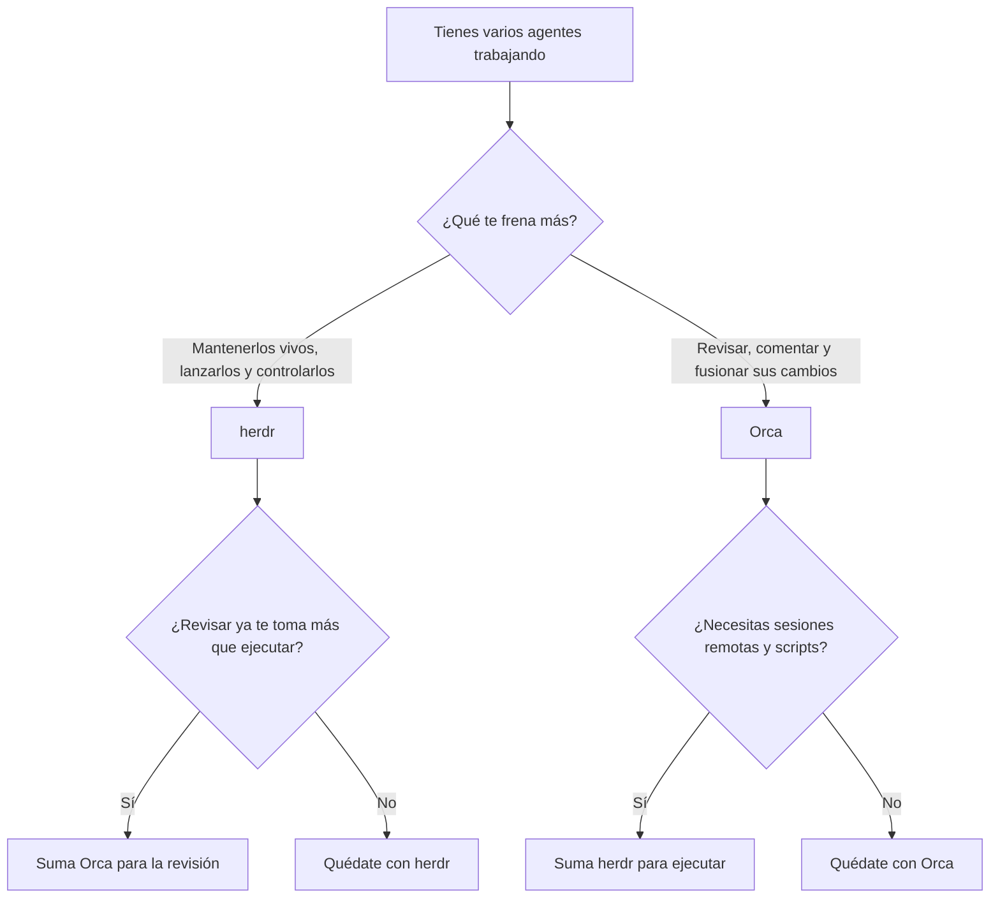

Cuando trabajas con varios agentes de código al mismo tiempo, aparecen dos problemas distintos que casi siempre se mezclan en la cabeza. El primero es mantenerlos vivos: lanzarlos, verlos, reconectarte desde otra máquina y poder hablarles desde un script. El segundo es creerles: leer lo que cambiaron, comentarlo, pedir ajustes y decidir qué se fusiona.

Herdr y Orca se parecen tanto desde fuera que es fácil tratarlas como la misma herramienta con distinto envoltorio. No lo son. Y elegir mal no sale caro en dinero, porque las dos son gratuitas, sino en tiempo, que es peor: terminas resolviendo con mucho esfuerzo el problema que no era el tuyo.

Uso las dos. Herdr en mi Fedora para orquestar varios agentes en mis proyectos; Orca en el trabajo, solo con Claude. Esa mezcla me obligó a ponerle nombre a la diferencia, y de eso va este artículo.

## Dos herramientas gratuitas que parecen la misma

Empecemos por lo que comparten, que es bastante. Las dos son de código abierto: [herdr usa Apache-2.0](https://github.com/herdrdev/herdr) y [Orca usa MIT](https://github.com/stablyai/orca). Ninguna es un modelo ni un agente; ambas orquestan los CLIs que ya usas, como Claude Code o Codex. Las dos entienden git worktrees, las dos trabajan por SSH y las dos exponen un CLI para que otro proceso las controle.

Con tantas coincidencias, la pregunta honesta es por qué compararlas. La respuesta es el énfasis. Piensa en una cocina de restaurante. Herdr es la línea de fuego: el lugar donde se cocina sin parar, donde ves qué plato está listo, cuál se quemó y cuál espera a que alguien decida algo. Orca es el pase: el punto donde alguien revisa cada plato antes de que salga a la mesa. Una cocina necesita las dos cosas, pero casi nunca te falta ambas al mismo tiempo.

Conviene aclarar un punto de licencias, porque cambió hace poco. Herdr era AGPL y su fundador explicó en el [anuncio de su entrada a Y Combinator](https://herdr.dev/blog/herdr-is-joining-y-combinator/) que la cambió a Apache-2.0 para que cualquiera pueda usarla libremente, y prometió que el runtime sigue siendo gratuito. Es una declaración de intenciones del fundador, no un contrato, pero es la que hay hoy. Tenlo presente al decidir cuánto de tu flujo apoyas en una herramienta de esta edad.

## Herdr: dónde viven tus agentes

El lema oficial de herdr es "the runtime your coding agents live on", y describe bien lo que hace. Es [un solo binario en Rust](https://github.com/herdrdev/herdr) que corre como servidor en segundo plano y administra tus terminales. Cierras el cliente, o se cae tu conexión SSH, y los agentes siguen trabajando. Vuelves a escribir `herdr` y estás de regreso.

> Si lo comparas con tmux, la diferencia está en que cada panel sabe qué hace su agente.

Los [estados que documenta](https://herdr.dev/docs/concepts/) son `blocked` (necesita una decisión o aprobación), `working`, `done` (terminó y aún no lo has visto), `idle`, y `unknown` cuando no puede clasificarlo. Parece un detalle menor hasta que tienes cuatro paneles abiertos y necesitas saber en cuál te toca intervenir. Es exactamente el problema del que hablé en el artículo sobre [la espera activa y el cambio de contexto](https://www.arthurolg.com/article/technology_la-ia-destroza-tu-concentracion-espera-activa): mirar cada terminal para averiguar si ya terminó es un impuesto de atención que no deberías pagar a mano.

Para varias máquinas, las [docs de conexión](https://herdr.dev/docs/connecting-machines/) piden un comando como `herdr machine add workbox`. Cada máquina conserva su propio servidor, sus sesiones y sus procesos, de modo que perder la conexión con una no desconecta las demás.

### Controlarlo desde un script

Lo que más me convenció es que el CLI y la API por socket son la misma superficie que usan los propios agentes. Este es el ejemplo de receta de la [documentación de automatización](https://herdr.dev/docs/agent-automation/), que abre un panel, arranca un revisor y espera su resultado:

```bash
# Divide el panel actual y arranca un agente revisor en el nuevo panel
split=$(herdr pane split --current --direction right --no-focus)
review_pane=$(printf '%s\n' "$split" | jq -r '.result.pane.pane_id')
herdr agent start reviewer --kind codex --pane "$review_pane" -- -m gpt-5.4

# Manda el prompt y espera hasta que el agente termine (máximo 120 s)
herdr agent prompt reviewer "Review the current diff" --wait --timeout 120000

# Lee lo que respondió
herdr agent read reviewer --source recent-unwrapped --lines 120
```

La API por socket resuelve en una sola petición el envío del prompt y el inicio de la espera, para evitar una condición de carrera entre dos llamadas separadas. Ese cuidado dice más de la madurez del diseño que cualquier lista de funciones.

### El límite que conviene conocer

"Sobreviven aunque te desconectes" es cierto, pero no equivale a "sobreviven a todo". El README es claro:

> "after a server or machine restart, herdr restores the saved layout and can resume supported agent sessions; the original processes do not survive."

Desconectar el cliente no detiene nada, porque el proceso nunca se detuvo. Reiniciar la máquina sí lo mata todo: herdr reabre el diseño de paneles y, para los agentes que lo soportan, retoma la sesión, pero tus servidores y pruebas en ejecución no vuelven. Según la [documentación de estado de sesión](https://herdr.dev/docs/session-state/), la restauración no conserva shells, servidores ni procesos arbitrarios.

También tiene aristas. En el hilo de lanzamiento de [Hacker News](https://news.ycombinator.com/item?id=48756578) hubo quien dijo que otra capa de atajos de teclado sobre su terminal no le convencía (el [comentario](https://news.ycombinator.com/item?id=49208385) es del 7 de agosto). Y existió un [issue de lentitud](https://github.com/herdrdev/herdr/issues/4252) al hablar con máquinas remotas en la v0.9.1, que se cerró el mismo día en que se abrió. Herdr va por la v0.9.3 mientras escribo esto: es una herramienta joven y se nota en el ritmo de cambios.

Por último, la documentación no describe un visor de diffs ni un editor integrado. Tiene comandos de worktree (`herdr worktree create`, `list`, `open`, `remove`), pero ningún flujo de revisión. Si quieres leer cambios, lo haces en otra herramienta.

### Mi propio ajuste

Como pasé bastante tiempo dentro de herdr, terminé personalizándolo. Publiqué [codeconductor-herdr](https://github.com/lgzarturo/codeconductor-herdr), que agrupa un tema oscuro con verdes neón (`matrix-neon`) y un plugin, `agent-tokens`, que muestra en un popup el consumo de tokens de entrada y salida por panel. Se instala con `herdr plugin install lgzarturo/codeconductor-herdr/matrix-neon`. Es mío y lo conozco, así que lo cuento como lo que es: un ajuste de comodidad, no una pieza de infraestructura.

## Orca: cómo revisas lo que hicieron

Aquí cambia el foco. [Git define un worktree](https://git-scm.com/docs/git-worktree) como una forma de "manage multiple working trees attached to the same repository", lo que permite tener más de una rama abierta a la vez. Orca lleva esa idea al centro: [cada tarea tiene su propia copia del repositorio](https://www.onorca.dev/docs/model/worktrees) en disco, con su rama, y borrarla elimina directorio y rama (con confirmación). Es el mismo aislamiento que defendí en el artículo sobre [flujos agénticos con CodeConductor y Cursor](https://www.arthurolg.com/article/programming_codeconductor-cursor-flujo-agentico), pero con una interfaz para gestionarlo.

El detalle que de verdad cambia el trabajo es cómo se revisa. Según la [documentación sobre anotar diffs](https://www.onorca.dev/docs/review/annotate-ai-diff), pasas el cursor sobre una línea del diff, comentas, y al terminar pulsas "Send to agent": Orca compone un solo prompt con todos tus comentarios anclados a sus líneas y te deja elegir a qué agente enviarlo. Revisar en lote y devolver el lote es mucho más natural que ir corrigiendo por chat con frases como "en el segundo método, la tercera condición".

Alrededor de eso hay un conjunto de integraciones que importan cuando el trabajo viene de un tablero: GitHub y Linear de forma nativa, y también [Jira](https://www.onorca.dev/docs/review/jira), con autenticación por token que se guarda cifrada con el llavero del sistema. Hay un navegador integrado para mandar al agente HTML, CSS y capturas de un elemento de interfaz, y una app móvil que es, según su documentación, "a remote control for the desktop you already have running" y no un editor.

Hay otra función que aprecio en el trabajo, donde solo uso Claude: el [seguimiento de uso](https://www.onorca.dev/docs/agents/usage-tracking) muestra el consumo de Claude y Codex y cuánto falta para que se reinicien los límites, con un aviso al cruzar el 80 %. Un matiz honesto: el costo que muestra se calcula con una tabla de precios local, no con la factura real del proveedor.

### Orca también sabe de remoto

Aquí corrijo una idea común: que Orca es solo para escritorio local. No lo es. Sus [worktrees por SSH](https://www.onorca.dev/docs/ssh) instalan un pequeño relay en la máquina remota, y las sesiones de terminal sobreviven al cierre de la aplicación. En palabras de su documentación, "Disconnects don't kill running agents; Orca reconnects and re-attaches". Por eso no te propongo una frontera de capacidades, sino de énfasis: herdr nació para mantener y controlar agentes, y Orca para revisarlos, aunque cada una invade un poco el territorio de la otra.

### El editor no es un IDE

El editor integrado es Monaco, y el proyecto lo dice sin rodeos:

> "Orca is intentionally editor-first, not IDE-first — run type-checkers and linters in a terminal pane."

La [documentación del editor](https://www.onorca.dev/docs/editing/monaco) no menciona servidores de lenguaje ni Java ni Kotlin. En una [discusión del repositorio](https://github.com/stablyai/orca/discussions/16993), un usuario enumera entre lo que le falta el soporte de LSP, y cuenta que sigue usando Zed para editar. Que no encontremos Java o Kotlin en la documentación no prueba que no funcionen; prueba que nadie lo promete.

## Elegir por cuello de botella

La pregunta útil no es cuál herramienta tiene más funciones, sino qué te está frenando hoy:



Y así se ve la comparación, con el énfasis de cada una y sin pretender que son excluyentes:

| | herdr | Orca |
| :--- | :--- | :--- |
| Foco | Dónde viven y cómo se controlan los agentes | Cómo se revisan y se fusionan sus cambios |
| Formato | Un binario en Rust dentro de tu terminal | Aplicación de escritorio, con app móvil |
| Licencia | Apache-2.0 (antes AGPL) | MIT |
| Remoto | Servidor por máquina, `herdr machine add` | Worktrees por SSH con relay |
| Revisión | Sin visor de diffs documentado | Comentarios en diffs enviados al agente |
| Scripts | `herdr agent prompt --wait` | CLI `orca`, por ejemplo `orca worktree create` |
| Madurez | v0.9.3, anterior a la 1.0 | Cambios a diario (v1.4.221 el 5 de octubre) |

Si tienes que ponerle un número, yo lo usaría solo como pista: cuando empiezas a tener tres o más agentes en paralelo y notas que lo lento ya no es lanzarlos, sino revisar y fusionar lo que producen, es momento de probar Orca. Con uno o dos agentes casi nunca ocurre. No es una regla, es una señal.

## El riesgo que no aparece en el README

Hay un asunto de seguridad abierto en Orca que merece más atención de la que recibe. El [issue #23835](https://github.com/stablyai/orca/issues/23835), abierto el 29 de septiembre de 2026 y todavía sin cerrar al momento de escribir esto, se titula "orca CLI running on SSH remote has full access to local environment and other SSH hosts, is not isolated". El autor lo describe así:

> "the `orca` CLI running in the VM/sandbox/container can list, manipulate and generally control 100% of my client-side Orca IDE, including listing terminals, seeing their contents and running commands, including local projects and projects on other SSH hosts."

Traducido a un escenario concreto: ejecutas un agente dentro de una máquina virtual para aislarlo, y ese agente puede usar el CLI de Orca para leer terminales y ejecutar comandos en tu equipo y en otros hosts. Si un prompt malicioso compromete al agente, la máquina "aislada" deja de ser una frontera. Un colaborador del proyecto respondió que es una preocupación válida y otro dijo que lo revisaría. El autor del reporte concluyó que, por ahora, se queda con tmux, y sospecha que VS Code se comporta de forma parecida: es su impresión y no la comprobé, pero sugiere que el problema de fondo es más amplio que una sola herramienta.

Dos precisiones para no exagerar. Primero, no encontré un parche vinculado al issue. Segundo, la documentación de herdr no discute este escenario, así que no puedo decirte que herdr sea más seguro; solo que este reporte concreto es sobre Orca. Mientras se resuelve, no trates un host con agentes como una barrera de aislamiento solo porque esté en otra máquina. Los permisos en capas y el aislamiento de procesos y red que describí en [configurar Claude Code para trabajo serio](https://www.arthurolg.com/article/programming_configurar-claude-code-para-trabajo-serio) siguen siendo tu verdadera defensa.

## Qué haría con IntelliJ y mis side projects

Para Java y Kotlin, mi editor sigue siendo IntelliJ, y ninguna de las dos herramientas cambia eso. Orca declara que no es un IDE; herdr ni siquiera tiene editor. Las dos viven alrededor del IDE, no en su lugar.

Para proyectos personales, donde yo soy el único cuello de botella y a veces trabajo en una máquina remota, empezaría por herdr. Es ligera, vive en tu terminal, no te obliga a cambiar de editor y te quita la tarea de vigilar paneles. Es lo que uso en Fedora. Para equipos o para trabajo con tablero y revisión de pull requests, Orca encaja mejor, y es lo que uso en el trabajo con Claude.

No las uso juntas en el mismo proyecto. Ambas operan sobre CLIs y worktrees de git, así que en principio deberían convivir, pero no lo he probado y prefiero no prometerlo. Lo que sí te recomiendo es revisarlas con calendario: herdr está en la 0.9 y Orca publica cambios a diario. Lo que hoy es una aspereza puede estar resuelto en un mes, y lo que hoy parece estable puede cambiar.

## Conclusión

Hay una forma incómoda de usar estas herramientas, que es elegir la que tiene la lista de funciones más larga. Hay otra más útil, que es aprender a ver dónde se te acumula el trabajo. Mientras lanzar y vigilar agentes sea lo que te frena, necesitas un lugar donde vivan. Cuando lo que se acumula es el código que aún no has leído, necesitas un lugar donde revisarlo. Casi todo lo demás es ruido.

Eso conecta con una idea que aparece en [más ingeniería y menos prompting](https://www.arthurolg.com/article/technology_mas-ingenieria-menos-prompting-codeconductor): lo que cambia con los agentes es dónde está el esfuerzo, no cuánto hay. Dime, ¿qué te cuesta más hoy: lanzar a tus agentes o creerles?

Si quieres comentar o compartir tu experiencia, escríbeme en [X (@algforge)](https://x.com/algforge) o abre un issue en el [repositorio](https://github.com/lgzarturo/arthurolg-blog-posts/issues). Una estrella en [GitHub](https://github.com/lgzarturo) también ayuda.

## Referencias

- [herdr: repositorio y README, herdr](https://github.com/herdrdev/herdr)
- [Concepts: estados de los agentes, documentación de herdr](https://herdr.dev/docs/concepts/)
- [Connecting machines, documentación de herdr](https://herdr.dev/docs/connecting-machines/)
- [Agent automation, documentación de herdr](https://herdr.dev/docs/agent-automation/)
- [Session state, documentación de herdr](https://herdr.dev/docs/session-state/)
- [Herdr is joining Y Combinator. The runtime stays open, blog de herdr](https://herdr.dev/blog/herdr-is-joining-y-combinator/)
- [Herdr: One terminal to rule them all, hilo en Hacker News](https://news.ycombinator.com/item?id=48756578)
- [Orca: repositorio y README, Stably AI](https://github.com/stablyai/orca)
- [Worktrees, documentación de Orca](https://www.onorca.dev/docs/model/worktrees)
- [Annotate AI diff, documentación de Orca](https://www.onorca.dev/docs/review/annotate-ai-diff)
- [SSH, documentación de Orca](https://www.onorca.dev/docs/ssh)
- [Monaco editor & autosave, documentación de Orca](https://www.onorca.dev/docs/editing/monaco)
- [Issue #23835: orca CLI en un host SSH remoto no está aislado, Stably AI](https://github.com/stablyai/orca/issues/23835)
- [git-worktree, documentación de Git](https://git-scm.com/docs/git-worktree)
- [codeconductor-herdr, repositorio de Arturo López](https://github.com/lgzarturo/codeconductor-herdr)
