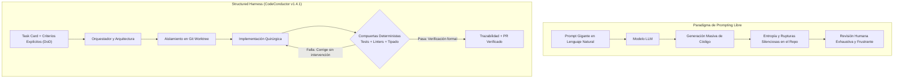

¿Cuántas horas has invertido puliendo un prompt de ochenta líneas en lenguaje natural solo para descubrir que el modelo modificó un archivo secundario sin avisarte o dio por resuelta una tarea que ni siquiera compila?

La escena se repite una y otra vez todos los días. Al principio, la velocidad de los modelos de lenguaje deslumbra. Ver aparecer funciones completas en segundos produce euforia y es algo mágico. Sin embargo, en cuanto el proyecto crece y los requerimientos exigen precisión de producción, esa fascinación inicial suele transformarse en frustración. Intentamos corregir el comportamiento agregando más párrafos de instrucciones, más adjetivos enfáticos y más súplicas de *"por favor no toques este módulo"*.

Caemos en la trampa del prompting infinito cuando lo que en realidad nos falta es ingeniería de software básica.

Ese momento donde peleamos con el modelo, para que nos pueda entender de forma correcta, es algo que nos desgasta emocional y mentalmente, además de que nos hace perder mucho tiempo, en lugar de usar ese tiempo para mejorar la ingeniería, es un círculo vicioso.

El problema es que cada instrucción que le damos al modelo, puede ensuciar o alterar el resultado final, el contexto se vuelve cada vez más grande y es más fácil que el modelo cometa errores. La velocidad de generación no se traduce en velocidad de entrega si cada generación requiere una revisión exhaustiva y corregir errores se convierte en una tarea cada vez más compleja.

Un tip sería volver a empezar, ya que es mas económico en términos de tiempo y recursos, que intentar corregir el código generado. Al principio creía que la solución era mejorar el prompting, pero me di cuenta que el problema no es el prompting, sino la falta de estructura y control sobre el proceso de generación.

Por esta razón he centrado mis esfuerzos recientes en la evolución de [**CodeConductor**](https://www.npmjs.com/package/cc-codeconductor), que alcanza su versión **v1.4.X** bajo una premisa transparente: construir un arnés estructurado de desarrollo agéntico (*Structured Agentic Development Harness*). Este flujo me ha devuelto el control sobre el proceso de construcción, introduciendo tres propiedades que el prompting libre destruye por completo: estructura, trazabilidad y criterios explícitos para determinar si el trabajo realmente ha terminado.

## La Trampa de la Velocidad

El cuello de botella de la industria tecnológica ya no es la velocidad de escritura. La inteligencia artificial genera líneas de código a un costo marginal cercano a cero y a un ritmo que ningún equipo humano puede igualar.

El problema interesante hoy no es cómo generar más volumen de código, sino cómo mantener el control estricto sobre lo que se genera.

Cuando interactúas con un agente sin barreras de contención, el resultado suele ser una ilusión de productividad. El modelo responde con tono asertivo, muestra un diff aparentemente impecable y asegura que todo funciona a la perfección. Pero cuando ejecutas la suite de pruebas local o analizas los contratos de tu arquitectura, descubres efectos secundarios inesperados: dependencias circulares, regresiones en esquemas de base de datos o lógica de negocio que ignora casos de borde elementales.

> "Generar código a gran velocidad sin un marco de verificación determinista no es acelerar el desarrollo; es simplemente acumular deuda técnica a la velocidad de la luz."

Si la respuesta ante cada fallo consiste en escribir un prompt más largo y elaborado, estás intentando resolver un problema de sistemas mediante psicología estocástica. Los modelos de lenguaje son motores probabilísticos extraordinarios, pero carecen de memoria arquitectónica persistente y de sentido de responsabilidad. Esperar que un texto descriptivo garantice por sí solo la integridad de un repositorio complejo es delegar la gobernanza de tu software al azar.

Son herramientas y como toda herramienta, hay que saber utilizarlas. El problema es que tratarlas como un programador humano es un error de principiante, ya que no tienen el mismo nivel de comprensión y razonamiento. No tienen memoria persistente, no tienen sentido de responsabilidad, no tienen capacidad de crítica, etc. Son modelos estocásticos y como tales, debemos tratarlos con respeto pero con firmeza y estructura.

## El Mito del Arnés como Freno

En los últimos meses ha cobrado fuerza una narrativa particular en la comunidad: la idea de que los arneses, los linters estrictos y los flujos guiados representan un freno innecesario para los modelos frontera contemporáneos. Quienes defienden esta postura argumentan que las redes neuronales actuales son ya suficientemente capaces de razonar por su cuenta y que encasillarlas en reglas rígidas limita su creatividad y su autonomía.

Considero que esta visión confunde potencia con gobernabilidad.

Imagina instalar un motor de competición de mil caballos de fuerza sobre un chasis endeble de hojalata, sin frenos cerámicos ni telemetría. El vehículo acelerará en línea recta de forma impresionante, pero se estrellará inevitablemente al negociar la primera curva cerrada. El chasis y el sistema de frenado no existen para restarle potencia al motor; existen precisamente para que esa potencia pueda aprovecharse sobre la pista sin destruir el automóvil.

Lo mismo sucede en la estrategia. En partidas intensas de *Age of Mythology*, enviar a tus unidades más poderosas a cargar en solitario y dispersas por el mapa sin formación ni líneas de suministros solo garantiza emboscadas y bajas innecesarias. La victoria exige campamentos de apoyo, armaduras calibradas y formaciones tácticas que canalicen la fuerza del ejército.

> "Un arnés de desarrollo no es una celda que encierra al modelo; es el andamiaje de ingeniería que le permite operar con máxima contundencia sin derribar el edificio."

Cuando proporcionas a un agente un arnés riguroso, no estás mermando su capacidad de razonamiento. Le estás otorgando un entorno determinista donde puede contrastar sus hipótesis con la realidad tangible del compilador y de las pruebas unitarias.

## Anatomía de un Structured Harness

La versión **v1.4.1 de CodeConductor** materializa esta filosofía a través de tres componentes innegociables que transforman el caos del chat en un flujo de ingeniería gobernable:

### 1. Estructura y Aislamiento Físico con Git Worktrees

Un agente nunca debe operar directamente sobre tu directorio de trabajo principal. CodeConductor aísla cada tarea en un *worktree* independiente de Git. Esto garantiza que el agente disponga de un espacio limpio y hermético donde compilar, ejecutar pruebas y modificar archivos sin poner en riesgo tu entorno local ni tus cambios no guardados.

### 2. Trazabilidad Completa y Desacoplamiento de Roles

El trabajo no se delega en una sola entidad omnisciente. Se divide entre roles especializados con contratos claros: el arquitecto evalúa el impacto, el implementador realiza modificaciones mínimas y el tester valida de forma independiente. Cada comando, cada archivo tocado y cada razonamiento queda registrado en una bitácora auditable. Sabes con exactitud qué se cambió, por qué motivo y bajo qué parámetros.

### 3. Criterios Explícitos de Término (*Definition of Done*)

El mayor peligro del desarrollo agéntico tradicional es el cierre prematuro. Un agente suele asumir que su trabajo terminó porque generó un archivo sintácticamente válido. En CodeConductor, una tarea solo se considera concluida cuando satisface compuertas deterministas no negociables: validación de tipos, paso limpio del linter y ejecución exitosa de pruebas de regresión.



Para ilustrar cómo se define este contrato en la práctica, observa cómo estructuramos una tarjeta de tarea verificable antes de autorizar la intervención de los agentes:

```json
{
  "task": "TASK-204-auth-token-rotation",
  "description": "Implementar rotación atómica de tokens de refresco en el servicio de autenticación",
  "harnessConfig": {
    "isolation": "git-worktree",
    "branch": "feature/auth-token-rotation",
    "maxIterations": 4
  },
  "definitionOfDone": {
    "testSuite": "npm run test:auth",
    "lintCheck": "npm run lint",
    "typeCheck": "npm run typecheck",
    "coverageThreshold": 90,
    "mutationTesting": true
  },
  "forbiddenFiles": [
    "src/config/database.ts",
    "migrations/*"
  ]
}
```

Al formalizar este contrato, el agente ya no necesita adivinar si ha terminado. El arnés ejecuta el ciclo, evalúa las compuertas y, si una prueba de concurrencia falla, entrega el volcado de error al implementador para que ajuste su solución de forma autónoma dentro del contenedor aislado.

## De Prompt Engineering a Harness Engineering

Existen cosas que dependen enteramente de nosotros y cosas que escapan a nuestro control. Nuestra paz mental y nuestra efectividad práctica radican en concentrar toda nuestra energía en las primeras.

En el desarrollo de software asistido por inteligencia artificial, esta lección cobra una vigencia extraordinaria:

* **Lo que no controlas:** El muestreo estocástico de la red neuronal, las variaciones térmicas entre generaciones o la tendencia ocasional del modelo a alucinar una biblioteca inexistente.
* **Lo que sí controlas:** La arquitectura del repositorio, los contratos de tus interfaces, los entornos aislados de ejecución, los pipelines de pruebas automatizadas y las condiciones que autorizan la fusión de una rama.

El *prompt engineering* intenta infructuosamente controlar lo incontrolable: redactar conjuros verbales cada vez más rebuscados para convencer a una distribución estadística de que no cometa errores. Por el contrario, el *harness engineering* se enfoca con serenidad en lo que sí está bajo nuestro dominio directo: construir sistemas de verificación tan sólidos que cualquier anomalía generada sea interceptada y corregida antes de llegar a la rama principal.

> "No le pidas al modelo que sea infalible por favor; constrúyele un arnés que vuelva inofensivos sus tropiezos y verificables sus aciertos."

Adoptar esta mentalidad transforma tu relación con la tecnología. Dejas de actuar como un evaluador fatigado que lee cientos de líneas de diff con la vista cansada y pasas a actuar como un verdadero director de orquesta que diseña las partituras, asigna los instrumentos y establece los estándares acústicos del auditorio.

En mi caso, para proyectos "one shoot", me enfoco en el prompt engineering y en la revisión manual del código generado. Sin embargo, para proyectos de mayor envergadura, recomiendo encarecidamente el uso de un arnés como CodeConductor. Te lo dejo aquí para que lo explores [CodeConductor](https://www.npmjs.com/package/cc-codeconductor).

## Conclusión

La madurez en el desarrollo de software no se mide por la novedad de las herramientas que adoptamos, sino por la disciplina con la que gobernamos sus resultados. La inteligencia artificial ha transformado para siempre nuestra capacidad de iterar ideas y materializar prototipos, pero la responsabilidad sobre la resiliencia y la claridad del código continúa siendo enteramente nuestra.

Convertir el desarrollo asistido por agentes en un proceso reproducible, verificable y gobernable no significa restarle magia a los modelos; significa dotarlos de la ingeniería necesaria para que puedan integrarse con éxito en sistemas de misión crítica. Ese es el camino que seguimos transitando con CodeConductor, y el que considero indispensable para cualquier equipo que busque construir software duradero en esta nueva etapa de nuestra profesión.

¿Ya estás implementando este enfoque en tu entorno de desarrollo? Me encantaría conocer tu experiencia y los desafíos que has enfrentado. ¡Hasta la próxima línea de código! 🚀

Deja tus comentarios en el [repositorio](https://github.com/lgzarturo/arthurolg-blog-posts/issues) o en mi perfil de [X@algforge](https://x.com/algforge). Si te es de utilidad, una estrella en [GitHub](https://github.com/lgzarturo) es de gran ayuda o no dudes en compartir este artículo con tus colegas y amigos. ¡Gracias por leer!

## Referencias

* [CodeConductor en npm (v1.4.1)](https://www.npmjs.com/package/cc-codeconductor)
* [Repositorio de CodeConductor en GitHub](https://github.com/lgzarturo/codeconductor)
