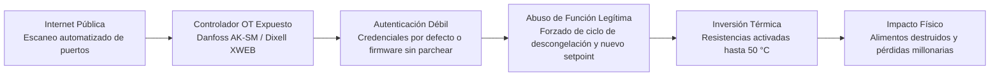

En mi artículo anterior sobre [Cibercrimen en la Era de la IA: Del Asedio Automatizado al Robo de Datos para el Futuro](https://www.arthurolg.com/article/technology_cibercrimen-era-ia-asedio-automatizado-robo-datos-futuro) sostuve una idea incómoda para quienes construimos y mantenemos sistemas: la inteligencia artificial rompió la economía tradicional del ataque. Ya nadie te ataca porque tu empresa sea un gigante financiero o guarde secretos de estado; te atacan porque existes, porque estás conectado a internet y porque un delincuente informático puede automatizar el camino hacia tu infraestructura a costo marginal cero.

Los números de ese análisis siguen sobre la mesa con una frialdad demoledora: un tiempo promedio de movimiento lateral de apenas 29 minutos con un récord mínimo de 27 segundos según datos de CrowdStrike, una mediana de 32 días para que las organizaciones apliquen parches críticos en dispositivos de borde de acuerdo con Verizon, y un 82% de intrusiones confirmadas donde los atacantes ni siquiera necesitaron compilar una sola línea de malware. Entraron caminando por la puerta principal usando sesiones legítimas, credenciales por defecto o configuraciones descuidadas.

Esta semana, esa tesis abandonó los informes de telemetría y las discusiones teóricas de oficina. Se materializó de golpe en los pasillos de un supermercado.

No ocurrió dentro de un centro de datos hiperseguro en Frankfurt. No comprometió la base de datos de un banco de inversión. Ocurrió en la cadena de frío de la comida que compras todos los días para cenar con tu familia.

## Qué pasó: la doble oleada sobre la cadena de frío europea

El incidente no fue un accidente fortuito ni un lote defectuoso de compresores mecánicos. Fue una campaña coordinada que se ejecutó en dos oleadas masivas con semanas de diferencia.

La primera oleada estalló entre el 11 y el 12 de octubre de 2026 en Francia. Cerca de 700 tiendas sobre un parque total aproximado de diez mil establecimientos sufrieron caídas simultáneas de sus sistemas de refrigeración. Cadenas de primer nivel como Intermarché, Netto, Coopérative U, Carrefour y Monoprix vieron cómo los termómetros de sus cámaras frigoríficas y congeladores de venta al público comenzaron a subir sin control hasta alcanzar entre 50 °C y 55 °C. En varios locales, el esfuerzo térmico forzado de la maquinaria provocó conatos de incendio. Directivos de Intermarché reportaron pérdidas inmediatas estimadas en decenas de millones de euros en una sola jornada laboral debido a toneladas de carne, lácteos y productos congelados que tuvieron que ser destruidos por romper la cadena sanitaria de frío.

La segunda oleada llegó el lunes 2 de noviembre de 2026, confirmando que el ensayo francés había sido solo el preludio de un despliegue regional mucho más amplio, tal como reportó [The Register en su investigación sobre el sabotaje](https://www.theregister.com/cyber-crime/2026/11/02/frozen-part-ii-hackers-remotely-defrost-produce-in-euro-supermarkets-again/5306924). El ataque cruzó fronteras en cuestión de horas afectando establecimientos en Suecia, Bélgica, Luxemburgo, Irlanda, Países Bajos, Estonia, Finlandia, Portugal e Italia.

En Suecia, los gigantes ICA y Coop registraron decenas de islas frigoríficas convertidas en hornos improvisados. En Bélgica y Luxemburgo, el impacto golpeó almacenes de Ahold Delhaize, Colruyt y quince sucursales de Carrefour Bélgica. En Irlanda, la cadena SuperValu confirmó trece supermercados inutilizados durante la madrugada. Una cobertura de [The Tribune sobre los ataques a supermercados en Europa](https://tribune.com.pk/story/2638292/new-cyberattack-on-supermarket-fridges-sweeps-across-europe) constató cómo los clientes encontraban estantes precintados y carros llenos de alimentos estropeados listos para el vertedero.

Lo alarmante del patrón no fue únicamente el volumen de tiendas afectadas en una sola noche, sino la naturaleza idéntica del fallo: equipos industriales que debían operar a -20 °C amanecían hirviendo a 50 °C sin ninguna alarma física disparada a tiempo en el local.

## Por qué fue posible: la anatomía del panel y el ciclo revertido

Cuando los primeros titulares de prensa generalista salieron a la luz, hablaron con ligereza de congeladores hackeados. Pero la realidad técnica es mucho más reveladora: nadie hackeó el compresor, las válvulas de expansión ni el gas refrigerante. Hackearon el panel digital de control que expone la gestión térmica directamente hacia internet.

En una gran superficie comercial contemporánea, ningún empleado recorre los pasillos ajustando manualmente diales mecánicos según la temporada o la tarifa eléctrica horaria. Esa labor la gestionan controladores de tecnología operacional (OT) y sistemas de supervisión centralizada. De acuerdo con la alerta oficial [CERTFR-2026-ALE-012 publicada por el CERT-FR](https://hard2bit.com/blog/ciberataque-supermercados-francia-refrigeracion-danfoss/), los vectores comprometidos fueron controladores ampliamente extendidos en el sector industrial: las gamas Danfoss AK-SM y AK-SC, los sistemas Dixell XWEB y equipos de supervisión de Copeland.

Muchos de estos dispositivos contaban con interfaces web expuestas de forma directa a la red pública sin firewalls intermedios, protegidas únicamente por contraseñas de fábrica como las combinaciones estándar de usuario administrador, o ejecutando versiones de firmware con vulnerabilidades conocidas hace meses para las cuales los fabricantes ya habían publicado actualizaciones que nadie se tomó la molestia de instalar.

Aquí entra en juego un principio de ingeniería que suele pasar desapercibido fuera de los especialistas en climatización: un congelador comercial tiene la capacidad intrínseca de calentar. Para evitar que la escarcha y el hielo bloqueen los evaporadores e impidan la circulación del aire, los sistemas incorporan ciclos de descongelación periódicos mediante resistencias eléctricas de alta potencia o la inversión temporal de las válvulas del circuito térmico. Si un operador legítimo —o un intruso con credenciales administrativas— cambia el *setpoint* de temperatura objetivo o fuerza el modo de descongelación continua, el congelador activa sus elementos calefactores a máxima potencia y transforma una cámara frigorífica en un horno térmico.

Los delincuentes informáticos no necesitaron inyectar código malicioso en el microcontrolador. No hubo virus ni exploits de memoria de ejecución remota. Utilizaron comandos estándar provistos por el propio fabricante para operar el equipo, ejecutando un ataque de *Living off the Land* en el mundo físico.

La magnitud de este descuido quedó registrada en el informe [Cold Chain, Open Control de Forescout Vedere Labs](https://www.forescout.com/blog/cold-chain-open-control-exposed-refrigeration-systems-reveal-global-risk/): los investigadores localizaron 6.017 direcciones IP públicas con 12.976 servicios de refrigeración y climatización expuestos a internet en 99 países. Más de siete mil correspondían a paneles Dixell/Copeland XWEB y más de cuatro mil seiscientas a Danfoss StoreView. Una superficie de ataque planetaria esperando a que un escáner automatizado la recorriera de principio a fin.

| Dimensión Operativa | Servidor Tradicional de IT | Controlador de Refrigeración OT |
| :--- | :--- | :--- |
| **Exposición perimetral** | Protegido tras balanceadores, WAF y subredes privadas. | Conectado frecuentemente con IP pública directa por instaladores externos. |
| **Gestión de credenciales** | Autenticación federada (SSO), MFA y rotación obligatoria. | Contraseñas maestras de fábrica (`admin/admin`) sin modificar durante años. |
| **Ciclo de actualización** | Despliegue continuo de parches mensuales o semanales. | Firmware estático sin actualizar desde el día de la instalación física. |
| **Consecuencia del compromiso** | Exfiltración de datos, caída de servicios web o ransomware. | Pérdida física de inventario perecedero, daños mecánicos y riesgo de incendio. |

Esta comparación evidencia cómo la complacencia técnica que denuncié en [Tu agente de código guarda tus secretos en texto plano: 1,379 ya están en GitHub](https://www.arthurolg.com/article/technology_agente-codigo-secretos-texto-plano-settings-local-json) se replica de forma idéntica en el mundo físico: preferimos la comodidad de una conexión sin fricción antes que la disciplina elemental de la seguridad perimetral.

## Por qué importa: disrupción pura y la evaporación de la ventana de defensa

Este incidente rompe con el molde financiero clásico del cibercrimen y exige recalibrar las prioridades defensivas.

Cuando una banda criminal compromete una infraestructura, su meta habitual es monetizar: cifrar discos con ransomware, exigir rescates millonarios o exfiltrar bases de datos corporativas. En este sabotaje europeo no hubo rescate, ni robo de propiedad intelectual, ni extorsión financiera.

El objetivo fue la disrupción pura y dura. Crear caos operativo, destruir comida a escala masiva, golpear la rentabilidad del sector y sembrar una duda profunda en la sociedad: si un atacante anónimo calienta un congelador desde el otro lado del mundo, ¿qué le impide manipular bombas de agua, calderas o la climatización de un hospital?

La cadena alimentaria es infraestructura crítica, aunque rara vez se gestione con el celo reservado a los clústeres de Kubernetes. Como analicé en [El Tablero Real de la IA: Cómputo, Integración Vertical y la Batalla que el Marketing no Puede Ganar](https://www.arthurolg.com/article/technology_tablero-real-ia-computo-integracion-vertical-distribucion), la soberanía técnica se juega en el control de las capas base. Si delegas la operación física en dispositivos ciegos y desatendidos, pierdes el control del sistema completo. Cuando la cadena de frío colapsa, no se cae una API durante treinta minutos: se destruye la confianza civil en suministros esenciales.

Aquí converge mi tesis sobre la automatización. Coordinar un asedio contra cientos de comercios en diez países antes exigía semanas de reconocimiento manual. Hoy, agentes y scripts automatizados barren en minutos miles de interfaces detectadas en Shodan o Censys, discriminan versiones vulnerables y ejecutan órdenes térmicas a costo marginal cero.

El tiempo de *breakout* de 29 minutos registrado por el [CrowdStrike 2026 Global Threat Report](https://www.crowdstrike.com/en-us/global-threat-report/) mide la rapidez con que un script abusa de una sesión administrativa antes de que intervenga un humano. Frente a ello, los 32 días de mediana para parchear que documenta el [Verizon 2025 Data Breach Investigations Report](https://www.verizon.com/business/resources/reports/dbir/) son la medida exacta de nuestra pasividad.

Por eso me niego a llamarlos hackers. No hay curiosidad intelectual ni proeza técnica aquí. Son delincuentes informáticos aprovechando la asimetría entre la automatización del ataque y la negligencia de la defensa.

## Qué hacer: cinco mandamientos para defender OT e IoT antes del próximo incidente

Si en tu organización administras tecnología operacional, sensores industriales, sistemas de climatización o cualquier dispositivo conectado que escape a la categoría de servidor tradicional de cómputo, este caso de estudio es una advertencia directa. El próximo objetivo no tiene por qué ser un congelador de supermercado; puede ser una caldera de vapor, una bomba de presión de agua, un sistema de control de accesos físico o la ventilación de una sala limpia de fabricación.

Para blindar estos entornos antes de que un escáner hostil los descubra, sugiero implementar de inmediato cinco medidas técnicas elementales:

1. **Inventario continuo y exhaustivo de activos expuestos.** No confíes en la base de datos de configuración de tu departamento de sistemas. Los técnicos de campo y proveedores externos suelen instalar pasarelas 4G o conectar paneles auxiliares a la red para facilitar su trabajo diario de mantenimiento sin avisar a nadie. Realiza escaneos periódicos desde el exterior utilizando herramientas como Shodan, Censys o motores propios para descubrir qué interfaces de tu empresa están respondiendo hacia la red pública sin autorización formal.
2. **Aislamiento perimetral y segmentación estricta de red.** Ningún controlador de refrigeración, bomba hidráulica ni panel de climatización debe tener jamás una dirección IP pública directa. El acceso administrativo remoto debe canalizarse exclusivamente a través de redes privadas virtuales (VPN) con autenticación multifactor (MFA), o mediante puertas de enlace de confianza cero (*Zero Trust Network Access*). Además, la red de OT debe estar aislada de la red corporativa de oficina mediante reglas estrictas de cortafuegos para evitar saltos laterales.
3. **Parcheo de firmware con la misma disciplina que en IT.** Existe la mala costumbre de considerar que el firmware de un controlador industrial se programa una vez y funciona eternamente. Los fabricantes de hardware corrigen fallos de seguridad continuamente. Si Danfoss o Copeland lanzan un boletín crítico y tu equipo tarda seis meses en programar la actualización de campo, la puerta trasera la estás dejando abierta tú por negligencia operativa.
4. **Monitorización de anomalías físicas y cambios de setpoint.** La mayoría de los centros de control monitorizan únicamente si el equipo está encendido o apagado. Necesitas telemetría activa sobre los parámetros funcionales: si un congelador cambia repentinamente su consigna de temperatura de -20 °C a 20 °C a las tres de la madrugada, o si el ciclo de descongelación permanece activo durante más de noventa minutos consecutivos, debe dispararse una alerta de alta prioridad a la guardia operativa con la misma urgencia que una intrusión en una base de datos principal.
5. **Planes de contingencia física y conmutación de emergencia.** Diseña un protocolo claro para cuando la capa digital falle o sea secuestrada: ¿sabe el personal de planta cómo aislar físicamente el controlador de la red y pasar los compresores a control electromecánico manual en menos de diez minutos? Si la respuesta es no, tu operación depende por completo de la buena voluntad de quien esté escaneando internet en ese momento.

La seguridad en la era moderna ya no se limita a cuidar bases de datos relacionales y tokens JWT; exige gobernar con el mismo celo cualquier cable de red conectado a un termostato.

## Conclusión

El ataque coordinado contra los supermercados europeos no fue una anécdota curiosa de la prensa tecnológica; fue una demostración de fuerza sobre cómo el cibercrimen sin malware y la automatización del reconocimiento pueden golpear la vida cotidiana de millones de personas a través de los sistemas más mundanos. Los delincuentes informáticos no buscaron vulnerar el hardware: se limitaron a explotar la brecha entre la facilidad de conectar un panel a internet y la desidia de dejarlo desprotegido durante meses.

Cuando un dispositivo conectado carece de inventario, de segmentación y de parches de seguridad, deja de ser una herramienta de trabajo para convertirse en un arma esperando a ser detonada por quien primero la encuentre. La pregunta que todo equipo de ingeniería y operaciones debe responderse hoy no es si alguien intentará entrar a su red, sino cuántos controladores, sensores o paneles de su empresa están ahora mismo conectados a internet sin que nadie los esté vigilando.

Si quieres comentar o compartir tu experiencia, escríbeme en [X (@algforge)](https://x.com/algforge) o abre un issue en el [repositorio](https://github.com/lgzarturo/arthurolg-blog-posts/issues). Una estrella en [GitHub](https://github.com/lgzarturo) también ayuda.

## Referencias

- [Cold Chain, Open Control: Exposed Refrigeration Systems Reveal Global Risk, Forescout Vedere Labs](https://www.forescout.com/blog/cold-chain-open-control-exposed-refrigeration-systems-reveal-global-risk/)
- [Frozen part II: Hackers remotely defrost produce in Euro supermarkets again, The Register](https://www.theregister.com/cyber-crime/2026/11/02/frozen-part-ii-hackers-remotely-defrost-produce-in-euro-supermarkets-again/5306924)
- [New cyberattack on supermarket fridges sweeps across Europe, The Tribune](https://tribune.com.pk/story/2638292/new-cyberattack-on-supermarket-fridges-sweeps-across-europe)
- [2026 Global Threat Report, CrowdStrike](https://www.crowdstrike.com/en-us/global-threat-report/)
- [2025 Data Breach Investigations Report (DBIR), Verizon](https://www.verizon.com/business/resources/reports/dbir/)
