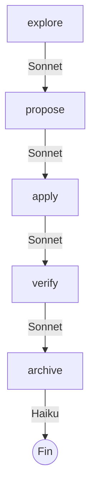
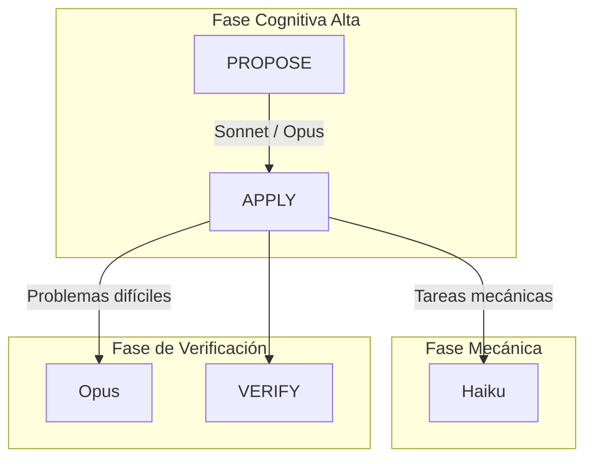

Durante años optimizamos el desarrollo de software alrededor de una premisa simple: el programador escribe el código y la computadora responde casi inmediatamente ya sea compilando o ejecutando dicho código.

Los agentes de IA están cambiando esa relación, al menos para mí.

Hoy puedo pedirle a Claude que explore un repositorio, ejecute pruebas, modifique varios archivos, revise una implementación o investigue por qué una decisión arquitectónica no funciona. El problema es que esas tareas ya no siempre tardan segundos. Pueden tardar varios minutos.

Y aparece una situación extraña: el agente está trabajando, pero yo estoy esperando.

La reacción natural es abrir otra tarea. Revisar otro bug. Contestar Slack. Entrar a otro repositorio. Cinco minutos después Claude termina, vuelvo a la tarea original y descubro que el problema real no era esperar esos cinco minutos: era reconstruir todo el contexto mental que acababa de perder.

Esta empieza a ser una nueva normalidad del desarrollo asistido por agentes.

## El costo invisible ya no está solamente en los tokens

Cuando trabajamos con agentes solemos hablar de costo por token, benchmarks, *context windows*, límites de uso y velocidad. Pero hay otro recurso que empieza a ser igual de importante: nuestra atención.

Un agente puede trabajar en paralelo. Nosotros no tenemos la misma capacidad.

Esto me lo enseño el libro de [Deep Work de Cal Newport](https://www.gandhi.com.mx/centrate--deep-work--9788411000611/p), el cual justo habla de la capacidad que tenemos los seres humanos de concentrarnos en una sola cosa y cómo esto puede ser potenciado si entrenamos nuestro cerebro para hacerlo. Sin embargo, cuando entramos en la trampa de trabajar con multiples tareas al mismo tiempo, caemos en un error, ya que cambiamos constantemente de contexto, lo cual nos hace perder tiempo valioso y concentración, para finalmente aumentar nuestro estrés y disminuir nuestra calidad de trabajo.

Podemos cambiar rápidamente entre tareas, pero cada cambio tiene un costo. Hay que recordar qué estábamos intentando resolver, qué hipótesis habíamos descartado, qué parte del código estábamos observando, cuáles eran los riesgos y qué esperábamos validar cuando el agente terminara.

Por eso no considero que la solución sea simplemente: *"Claude está tardando cinco minutos; trabajaré cinco minutos en otra feature"*. Ya hablé antes de [cómo evitar que la IA destroce tu concentración](https://www.arthurolg.com/article/technology_la-ia-destroza-tu-concentracion-espera-activa), pero el punto clave aquí es que intentar saltar de tarea puede parecer eficiente y terminar siendo exactamente lo contrario.

El desarrollo con agentes introduce una diferencia importante entre **paralelismo computacional** y **paralelismo cognitivo**. Podemos ejecutar cuatro agentes simultáneamente; eso no significa que podamos mantener cuatro problemas complejos en nuestra cabeza con la misma calidad.

El nuevo cuello de botella empieza a desplazarse desde escribir código hacia mantener contexto, revisar resultados y tomar buenas decisiones.

## La espera no debe convertirse automáticamente en otra tarea

He empezado a tratar esos minutos de espera como un tipo diferente de tiempo.

No intento llenarlos con otra tarea que requiera entrar en un problema complejo. Busco trabajo de baja carga cognitiva: contestar un mensaje sencillo, revisar una notificación, actualizar documentación, ordenar pendientes, verificar un dato o hacer alguna operación mecánica.

La regla que estoy adoptando es sencilla:

> Si la actividad requiere reconstruir otro modelo mental, probablemente no es una buena tarea para hacer mientras espero al agente.

Esto parece un detalle menor, pero cambia bastante el flujo. Hay una diferencia enorme entre esperar tres minutos mientras reviso un comentario de documentación y esperar tres minutos mientras empiezo a investigar un problema de concurrencia en otro módulo. El primero ocupa tiempo. El segundo reemplaza contexto.

Claude Code incluso ha incorporado mecanismos que reconocen esta nueva dinámica. Por ejemplo, `/btw` permite hacer una [pregunta rápida mientras Claude está trabajando](https://support.claude.com/es/articles/14554000-consejos-de-usuario-avanzado-de-claude-code?utm_source=arthurolg.com) sin interrumpir la tarea principal; es una interacción de un solo turno, sin herramientas, pero conserva el contexto de la conversación.

No elimina el problema, pero revela algo interesante: las herramientas también están empezando a adaptarse a un desarrollador que ahora espera a sus agentes.

## No todas las tareas necesitan el modelo más inteligente

El segundo cambio importante tiene que ver con los modelos.

Usar siempre el modelo más capaz parece una buena estrategia hasta que empiezas a trabajar varias horas con agentes. Entonces aparecen latencia, consumo de cuota y tareas donde gran parte de esa capacidad simplemente no era necesaria. Ya vimos que [configurar Claude Code para trabajo serio](https://www.arthurolg.com/article/programming_configurar-claude-code-para-trabajo-serio) requiere un arnés adecuado, y la elección del modelo es parte de esa madurez.

Anthropic posiciona actualmente [Sonnet como la opción adecuada para la mayoría del trabajo cotidiano](https://support.claude.com/es/articles/14552983-modelos-uso-y-limites-en-claude-code?utm_source=arthurolg.com), Opus para problemas difíciles como arquitectura, *debugging* complejo o *refactors* amplios, y Haiku para búsquedas, ediciones sencillas y trabajo mecánico de alto volumen.

El lanzamiento de Haiku 5.5 acentúa todavía más esa posibilidad: Anthropic lo describe explícitamente como [un modelo para cargas repetitivas, de alto volumen y sensibles al costo](https://www.anthropic.com/claude-haiku-5-5?utm_source=arthurolg.com), incluyendo *compaction*, consultas, clasificación y trabajo como subagente de modelos mayores.

Mi heurística se ha reducido a esto:

| Modelo | Pregunta que me hago | Tipo de trabajo |
|---|---|---|
| **Haiku** | ¿Ya sabemos exactamente qué hacer? | Ejecución local, mecánica, repetitiva y verificable. |
| **Sonnet** | ¿Hay que entender cómo hacerlo? | Ingeniería cotidiana. |
| **Opus** | ¿Tenemos que decidir qué deberíamos hacer? | Arquitectura, riesgo y ambigüedad. |

O más corto: **Haiku ejecuta. Sonnet desarrolla. Opus decide.**

No es una clasificación por lenguaje o framework. Un DTO en Kotlin no necesita Opus porque sea backend. Un cambio de Tailwind no necesita Sonnet porque sea frontend. Y decidir los límites entre módulos de un monorepo puede justificar Opus independientemente de si estamos trabajando con Spring Boot, Astro o React.

Las variables importantes son otras: ambigüedad + riesgo + *blast radius* + dificultad de verificación.

> **Blast radius** es el alcance potencial del impacto de un cambio si algo sale mal.

## OpenSpec funciona mejor como frontera cognitiva

Aquí es donde un flujo basado en especificaciones empieza a tener todavía más valor.

OpenSpec separa actualmente el trabajo en [fases claramente delimitadas](https://openspec.dev/docs/setup?utm_source=arthurolg.com): `explore`, `propose`, `apply`, `update`, `sync` y `archive`; `verify` existe como workflow adicional y comprueba que la implementación coincida con el plan.

Su flujo fundamental también introduce algo que considero especialmente importante ahora: [revisar el plan antes de escribir código](https://openspec.dev/docs/quickstart?utm_source=arthurolg.com).

No es solamente documentación. Es una forma de externalizar contexto.

En lugar de mantener en mi cabeza qué decidimos, por qué, qué falta y qué tiene que validar el agente, eso queda materializado en archivos concretos como `proposal.md`, `specs/`, `design.md` y `tasks.md`. Y eso permite además hacer *routing* entre modelos sin perder completamente el razonamiento anterior.

Mi punto de partida actualmente sería:

Pero no lo trataría como una configuración rígida. `propose` subiría a Opus si aparecen decisiones arquitectónicas importantes. `verify` subiría a Opus si estamos verificando concurrencia, seguridad, una migración delicada, transacciones o cambios con gran *blast radius*. Y dentro de `apply` bajaría a Haiku aquellas tareas que la especificación ya convirtió en instrucciones determinísticas.

Ese último punto es especialmente importante: **cuanto mejor está definida una tarea, menos inteligencia necesita el modelo que la ejecuta.** Una buena especificación no solamente aumenta la calidad, sino que también permite usar modelos más pequeños.

## El routing debe ocurrir en fronteras, no cada dos prompts

Pero hay una trampa. Si aprendemos que Haiku es barato, Sonnet equilibrado y Opus potente, podemos caer en otro extremo: cambiar constantemente entre modelos y configuraciones.

Eso añade fricción y puede destruir parte de las optimizaciones que estamos intentando conseguir. El objetivo no debería ser saltar erráticamente de un modelo a otro a cada paso, sino trabajar en bloques coherentes.

Es decir, cambiar cuando cambia la naturaleza del trabajo, no solamente porque existe otro modelo disponible. Esto también reduce una carga cognitiva que fácilmente trasladamos de la programación a la herramienta: no quiero pasar el día pensando qué modelo debo seleccionar para cada *prompt*. El *routing* debería convertirse progresivamente en una política, no en una decisión constante.

## Model y effort son dos controles diferentes

Este punto me parece particularmente importante. Cambiar de modelo y cambiar `effort` no resuelven exactamente el mismo problema.

El modelo determina principalmente la capacidad que estamos contratando para resolver el problema. El `effort` determina cuánto razonamiento estamos dispuestos a gastar en esa ejecución.

Por eso prefiero mantener actualmente los modelos en `medium` durante una sesión normal y utilizar primero el *routing*. Si algo realmente necesita más razonamiento, entonces considero aumentar `effort`. Pero no fluctuaría constantemente entre niveles dentro de la misma tarea.

Hay una razón técnica además de la simplicidad. Anthropic documenta que cambiar la configuración de *thinking* o el *effort* puede [invalidar los prefijos almacenados mediante prompt caching](https://platform.claude.com/docs/en/about-claude/models/extended-thinking-models?utm_source=arthurolg.com). Las solicitudes consecutivas que mantienen la misma configuración conservan mejor esos *cache hits*.

El *prompt caching* no es un detalle menor. Anthropic identifica precisamente *caching* y *token hygiene* entre las optimizaciones que [reducen costos sin intercambiar directamente calidad por inteligencia](https://platform.claude.com/docs/es/about-claude/models/optimizing-for-cost-and-intelligence?utm_source=arthurolg.com).

Hay una excepción reciente que conviene conocer: Opus 5.5 y Sonnet 5.5 soportan en la API un mecanismo beta de *per-message effort* capaz de [cambiar el esfuerzo conservando el prefijo cacheado](https://platform.claude.com/docs/en/build-with-claude/effort?utm_source=arthurolg.com). Eso significa que "cambiar effort siempre destruye la caché" ya no es universalmente cierto.

Pero como regla operativa para Claude Code sigo prefiriendo mantener un `effort` estable dentro de una sesión y cambiarlo solamente cuando existe una razón clara. Menos configuración también significa menos decisiones humanas.

## Preservar la caché también es preservar contexto

Hay otro aprendizaje detrás de todo esto. Claude Code envía en cada turno la conversación anterior, el contexto del proyecto y el mensaje nuevo. A medida que una sesión crece, ese historial empieza a tener un peso importante tanto en consumo como en espacio de contexto.

Anthropic recomienda `/clear` cuando realmente estamos cambiando de tarea y `/compact` cuando queremos [continuar el mismo trabajo reduciendo el historial](https://support.claude.com/en/articles/14552983-models-usage-and-limits-in-claude-code?utm_source=arthurolg.com).

También aplica *prompt caching* sobre contenido como `CLAUDE.md`; el contenido estable puede reutilizarse mediante [cache reads más económicos](https://support.claude.com/en/articles/14553240-give-claude-context-claude-md-and-better-prompts?utm_source=arthurolg.com), aunque sigue ocupando espacio dentro de la ventana de contexto.

Esto refuerza una idea que va más allá de ahorrar tokens: **la estabilidad tiene valor**.

Un `CLAUDE.md` estable. Un `effort` estable. Una especificación estable. Una tarea por sesión. Un modelo mientras la naturaleza del problema no cambie. Menos mutaciones innecesarias significan menos trabajo para la máquina y también menos decisiones para nosotros.

## No optimizar la herramienta hasta convertirla en otro trabajo

Aquí existe otra paradoja. Los modelos mejoran rápidamente. Aparece un nuevo Haiku. Sonnet cambia. Opus mejora. Cambian precios, límites, *context windows*, *caching*, *thinking* y niveles de *effort*.

Sería fácil terminar dedicando más tiempo a optimizar el uso de los modelos que a desarrollar software. No creo que ésa sea la dirección correcta. Cada nueva generación debería llevarnos a eliminar reglas antiguas, no solamente a añadir otras nuevas.

Si Haiku empieza a resolver correctamente tareas que antes requerían Sonnet, se mueve el límite. Si Sonnet empieza a tomar decisiones que antes justificaban Opus, se mueve otra vez. Si el *caching* permite cambiar `effort` sin penalización, una regla deja de ser necesaria. El *workflow* tiene que evolucionar con los modelos. No debemos preservar rituales creados para limitaciones que ya no existen.

## Conclusión

Mi flujo actual lo terminaría reduciendo a esto: mantén una tarea cognitivamente importante a la vez; durante las esperas, haz solamente trabajo de baja carga cognitiva. Usa Sonnet como *default*, baja a Haiku cuando la tarea esté especificada, y sube a Opus cuando el riesgo lo pida. Usa fronteras como OpenSpec para externalizar las decisiones y protege tu caché manteniendo instrucciones estables.

El objetivo final no es consumir menos tokens ni ejecutar la mayor cantidad posible de agentes en paralelo; es obtener la mayor cantidad de trabajo correcto con la menor carga cognitiva posible. La IA ya puede escribir, investigar, probar y modificar código mientras esperamos. Conforme los agentes asumen más trabajo, nuestra principal optimización deja de ser escribir más rápido y pasa a ser pensar con menos interrupciones.

Si quieres comentar o compartir tu experiencia, escríbeme en [X (@algforge)](https://x.com/algforge) o abre un issue en el [repositorio](https://github.com/lgzarturo/arthurolg-blog-posts/issues). Una estrella en [GitHub](https://github.com/lgzarturo) también ayuda.

## Referencias

- [Consejos de usuario avanzado de Claude Code, Anthropic](https://support.claude.com/es/articles/14554000-consejos-de-usuario-avanzado-de-claude-code)
- [Modelos, uso y límites en Claude Code, Anthropic](https://support.claude.com/es/articles/14552983-modelos-uso-y-limites-en-claude-code)
- [Claude Haiku 5.5, Anthropic](https://www.anthropic.com/claude-haiku-5-5)
- [Configuración de OpenSpec, OpenSpec](https://openspec.dev/docs/setup)
- [Guía rápida de OpenSpec, OpenSpec](https://openspec.dev/docs/quickstart)
- [Extended thinking models, Anthropic](https://platform.claude.com/docs/en/about-claude/models/extended-thinking-models)
- [Optimizing for cost and intelligence, Anthropic](https://platform.claude.com/docs/es/about-claude/models/optimizing-for-cost-and-intelligence)
- [Effort in Claude, Anthropic](https://platform.claude.com/docs/en/build-with-claude/effort)
- [Give Claude context, Anthropic](https://support.claude.com/en/articles/14553240-give-claude-context-claude-md-and-better-prompts)
