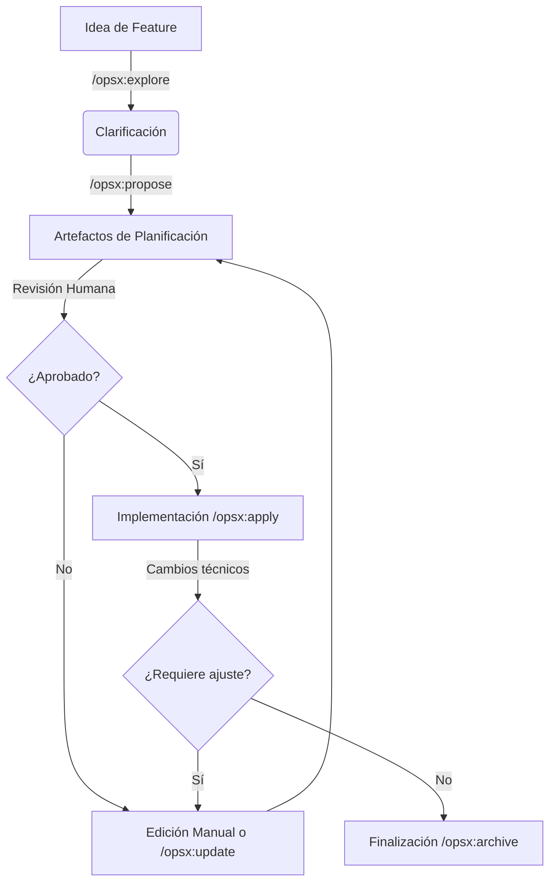
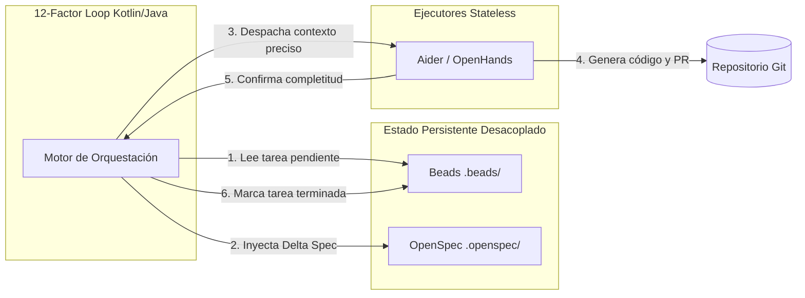

Cuando te adentras en el ecosistema de la inteligencia artificial para desarrollo de software, la promesa inicial siempre es embriagadora: un asistente autónomo que toma tus ideas vagas y las convierte en código de producción. Sin embargo, si has intentado llevar esto más allá de un pequeño script o una prueba de concepto, ya sabes que la realidad es muy distinta. El agente se pierde, olvida el contexto de la arquitectura, sobreescribe configuraciones críticas y termina sumido en una espiral de errores.

Como vimos cuando exploramos cómo [pasar del chat a un workflow determinista](https://www.arthurolg.com/article/technology_mas-alla-del-chat-por-que-definir-un-workflow-con-ia-es-la-mejor-inversion), el verdadero salto de productividad no está en tener un modelo fundacional más grande, sino en construir un andamiaje alrededor de él. En la ingeniería tradicional, no acoplamos nuestra lógica de negocio directamente al motor de base de datos. Entonces, ¿por qué insistimos en acoplar nuestros flujos de trabajo al runtime o al prompt crudo del modelo de turno?

En este artículo, vamos a explicar cómo construir un stack agéntico modular, resistente y pragmático. Dejaremos de lado el *hype* de los repositorios inflados y nos centraremos en herramientas concretas: [OpenSpec](https://github.com/Fission-AI/OpenSpec) para la capa de especificaciones, [Beads](https://github.com/steveyegge/beads) para la gestión del estado, y la filosofía de los [12-Factor Agents](https://github.com/humanlayer/12-factor-agents) para el orquestador. Todo esto enfocado en un entorno de código existente (brownfield), que es donde pasamos la mayor parte de nuestra vida profesional.

## La trampa de las estrellas en GitHub

Hoy en día, basta con añadir la palabra "Agent" a un repositorio en GitHub para recolectar miles de estrellas en cuestión de horas. El mercado está inundado de herramientas que prometen ser el "Agent OS" definitivo. Muchas de ellas sufren de lo que podríamos llamar *Agent Washing*: ocultan una simple base de datos PostgreSQL y un enrutador de prompts detrás de abstracciones pesadas e inflexibles.

Hablemos, por ejemplo, de [Superpowers](https://github.com/obra/superpowers). A primera vista, su propuesta de imponer ciclos rígidos de desarrollo guiado por pruebas (TDD) y reglas estructuradas a través de archivos `SKILL.md` parece ideal. Sin embargo, cuando lo llevas a la trinchera del día a día, te encuentras con un grave problema de fricción. Superpowers genera un fuerte exceso de consumo de tokens (*token overhead*) y una latencia paralizante para tareas rutinarias o pequeños *hotfixes*. Obligar a un agente a pasar por exhaustivas fases de planificación para corregir un simple margen en CSS es matar moscas a cañonazos.

Pero no seamos absolutos. El valor real de marcos como Superpowers brilla cuando el nivel de incertidumbre es altísimo. Para refactorizaciones complejas, esa inversión inicial de tokens en diseño y TDD previene lo que llamo el *LLM gambling*: el escenario destructivo donde el agente escribe código a ciegas, rompe una dependencia, y luego gasta cientos de miles de tokens intentando corregirse recursivamente hasta agotar el límite de contexto. En esos casos concretos, el sobrecoste arquitectónico está justificado.

El punto es que las estrellas altas no bastan. El valor de una herramienta se demuestra en los commits efectivos, en la reducción técnica de issues y en comparativas reales de tu equipo de desarrollo. Si apilas múltiples frameworks como BMAD, Spec Kit, GSD Core y Superpowers a la vez, no obtienes un súper agente; obtienes una máquina de Rube Goldberg inestable e imposible de depurar.

## El ecosistema actual: ¿Quién hace qué?

Antes de definir nuestro stack, ubiquemos las piezas del tablero. El problema de coordinar agentes ha generado distintas aproximaciones, cada una atacando un vector diferente de la complejidad:

1. **GSD Core (Get Shit Done)**: Su objetivo principal es cristalizar el ciclo iterativo de *discuss → ship*. Se enfoca en que el agente y el humano dialoguen, acuerden y ejecuten. Es útil conceptualmente, pero carece de un manejo robusto del estado a largo plazo.
2. **Task Master**: Se encarga de convertir un documento de requerimientos (PRD) en un Grafo Acíclico Dirigido (DAG) de tareas atómicas. Es una pieza de planificación, no de ejecución.
3. **BMAD Method**: Propone un esquema multi-agente muy detallado con un grafo de roles explícitos (Scrum Master, Arquitecto, QA). Si bien el *blueprint* es útil para entender cómo dividir el trabajo, adoptarlo íntegramente como *runtime* es carísimo en tokens. Lo inteligente aquí es extraer su topología de roles y descartar su costoso motor de ejecución.
4. **Spec Kitty**: Un intento prometedor de unir Spec-Driven Development (SDD), tableros Kanban y *worktrees* de Git. Su enfoque es correcto, pero la herramienta aún es inmadura para producción.
5. **OpenHands y Aider**: Estos no son orquestadores ni gestores de estado. Son ejecutores de código puros. Son el músculo, pero necesitan que alguien les dé un plano exacto y les limite el área de demolición.

La lección que extraemos de este ecosistema fragmentado es clara: no intentes buscar una sola herramienta que lo haga todo. Como argumenté en [Más Ingeniería y Menos Prompting](https://www.arthurolg.com/article/technology_mas-ingenieria-menos-prompting-codeconductor), tu flujo necesita un arnés compuesto por piezas desacopladas.

## OpenSpec vs Spec Kit

Todo trabajo agéntico exitoso empieza con una especificación clara. Si le das a un agente una instrucción ambigua, llenará los vacíos con alucinaciones. Aquí es donde entran [Spec Kit](https://github.com/github/spec-kit) y OpenSpec.

Spec Kit es un marco estructurado desarrollado en el ecosistema de GitHub que convierte el desarrollo en un flujo documental ejecutable. Es fantástico si estás empezando un proyecto desde cero (*greenfield*). Su rigidez documental asegura que la arquitectura nazca sana.

Sin embargo, en el mundo real, rara vez empezamos de cero. Tenemos bases de código heredadas de millones de líneas, deuda técnica y arquitecturas acopladas (*brownfield*). Para este escenario, **OpenSpec** es inmensamente superior.

OpenSpec actúa como una capa de especificación que define requerimientos en archivos Markdown planos y gestiona la implementación. Su brillantez radica en el patrón que podríamos denominar **Delta Spec**. En lugar de obligar al agente a leer, analizar y reescribir un archivo monolítico de requerimientos de 3,000 líneas en cada iteración, OpenSpec obliga a producir "deltas" temporales (`ADDED`, `MODIFIED`, `REMOVED`). Esto abarata drásticamente el costo de inferencia y reduce el riesgo de que el agente altere partes del sistema que no debería tocar.

### OpenSpec en la práctica

Para interactuar con OpenSpec, el flujo de trabajo moderno se ha desprendido de fases lineales rígidas para adoptar un modelo fluido basado en el sistema OPSX. Estos son los comandos clave que estructuran la conversación:

- `/opsx:explore`: El inicio del viaje. Usas este comando para pensar ideas, investigar problemas y aclarar requerimientos con tu agente antes de comprometerte a escribir código. Es tu compañero de *brainstorming*.
- `/opsx:propose <nombre>`: Una vez que la idea cristaliza, este comando genera la carpeta de la característica (por ejemplo, `openspec/changes/add-dark-mode/`). Crea automáticamente la propuesta, los escenarios de prueba, el diseño técnico y la lista de tareas. Todo esto ocurre antes de alterar tu código de producción.
- `/opsx:apply`: El motor de ejecución. El agente toma las tareas definidas en el paso anterior y comienza a escribir el código, marcando las tareas completadas.
- `/opsx:update`: La realidad del desarrollo es que los diseños cambian a mitad de camino. Este comando permite revisar los artefactos de planificación existentes para mantenerlos coherentes (por ejemplo, decidir almacenar la sesión en Redis en lugar de JWT).
- `/opsx:archive`: Cuando la característica está completada y validada, este comando empaqueta los deltas, actualiza la especificación principal del sistema y limpia el área de trabajo.

Esta separación entre planificar y ejecutar es lo que detiene el comportamiento errático de los agentes. Tú auditas los archivos Markdown en `openspec/changes/` antes de permitir que el agente toque tu código.

## El orquestador y el estado

Tener buenas especificaciones es solo la mitad del problema. ¿Cómo recuerdas qué estaba haciendo el agente si se corta la conexión? ¿Cómo evitas que la ventana de contexto colapse bajo el peso del historial de chat?

El problema endémico de la IA aplicada a repositorios masivos es el balance entre la **Amnesia Agéntica** (el agente olvida por qué estaba haciendo un cambio) y la **Pudrición del Contexto** o *Context Rot* (el agente tiene tanta información en su *prompt* que su capacidad lógica se degrada severamente).

Muchos frameworks comerciales resuelven esto inyectando gigabytes de logs en la ventana de contexto del LLM. La solución ingenieril, inspirada en la Filosofía Unix, es sacar el estado de la RAM del modelo y delegarlo al sistema de archivos o a una cola.

Aquí entra **Beads (`bd`)**. Beads es una cola de tareas nativa de Git. Almacena dependencias y tareas como un grafo acíclico dirigido (DAG) usando archivos JSONL en un directorio `.beads/` que vive en tu repositorio. Si la sesión termina abruptamente, Beads sabe exactamente qué nodos del grafo ya se ejecutaron y cuáles faltan. El estado persiste de forma determinista y ajena al LLM.

Es importante hacer un matiz técnico. Aunque Beads es brillante al usar Git nativamente, la realidad de orquestar múltiples agentes (*swarms*) concurrentes en un repositorio local suele provocar conflictos de merge dolorosos en esos archivos JSONL. Iteraciones más modernas de este concepto (como `bead-forge`) están migrando hacia el uso de SQLite local o bases de datos como Dolt (SQL versionado) para lograr bloqueos transaccionales atómicos. Si tu equipo es pequeño o eres un desarrollador en solitario, el modelo JSONL puro de Beads es suficiente.

Para unir OpenSpec y Beads, necesitamos un orquestador. Aquí aplicamos la metodología de los **12-Factor Agents**. Esta filosofía promueve que los agentes deben ser completamente *stateless* (sin estado propio). El desarrollador, a través de un servicio o script central, controla explícitamente el loop de ejecución y administra quirúrgicamente la memoria y la ventana de contexto que se le entrega al LLM en cada llamada. Es lo más cercano al diseño limpio de un backend tradicional en Java o Kotlin.

## El Spike propuesto: 1 a 2 semanas para validar el stack

No te fíes ciegamente de mi análisis. La única forma de saber si este stack resuelve tus problemas de entrega de software es probándolo en un entorno controlado. Te propongo un *spike* técnico (un esfuerzo de investigación limitado) de entre una y dos semanas con la siguiente hoja de ruta:

1. **Construye el orquestador 12-Factor (2-3 días)**: Usa un lenguaje con tipado fuerte y concurrencia madura, como Kotlin o Java. Escribe un script central que sea el único dueño del ciclo `while(true)`. Este script será el que llame a las APIs del LLM, no dejes que un framework de Python controle tu hilo principal.
2. **Implementa Beads como fuente de la verdad (2 días)**: Configura la cola de tareas. Haz que tu orquestador en Kotlin lea de Beads las tareas pendientes y actualice el estado de las mismas cuando terminen.
3. **Integra OpenSpec en un servicio de demo (3-4 días)**: Toma un repositorio existente (quizás ese microservicio Java que nadie quiere mantener). Usa el orquestador para generar un `/opsx:propose` y crear un cambio moderado. Almacena las `Delta Specs` generadas.
4. **Acopla a los obreros (3 días)**: Configura Aider u OpenHands como los ejecutores ciegos. Tu orquestador Kotlin tomará una tarea de Beads, leerá la especificación de OpenSpec, y le pasará ambos como instrucción cruda y determinista a Aider para que ejecute el cambio y genere el *commit*.

Si al final del *spike* tu orquestador logra completar una cadena de tres tareas dependientes sin que el modelo alucine, habrás construido una máquina de software verdaderamente autónoma.

## Conclusión

El mercado de la inteligencia artificial agéntica está saturado de soluciones que intentan ser mágicas. Frameworks inmensos, abstracciones opacas y sistemas que asumen el control total de tu flujo de trabajo suelen fracturarse al menor contacto con el código del mundo real.

Adoptar la Filosofía Unix para tu stack agéntico te devuelve el control. Utiliza OpenSpec para gobernar las especificaciones mediante deltas económicos; delega el estado y las tareas a Beads para sobrevivir a las desconexiones sin depender de la memoria del LLM; y diseña tu orquestador siguiendo los principios de los 12-Factor Agents para mantener a tus ejecutores como entidades intercambiables y sin estado.

Al final del día, los agentes no son ingenieros mágicos. Son simplemente compiladores no deterministas que transforman lenguaje natural en código. Tu trabajo ya no es escribir el código directamente, sino diseñar la línea de ensamblaje perfecta para que ellos no puedan equivocarse.

Si quieres comentar o compartir tu experiencia, escríbeme en [X (@algforge)](https://x.com/algforge) o abre un issue en el [repositorio](https://github.com/lgzarturo/arthurolg-blog-posts/issues). Una estrella en [GitHub](https://github.com/lgzarturo) también ayuda.

## Referencias

- [OpenSpec, Fission-AI](https://github.com/Fission-AI/OpenSpec)
- [Beads, Steve Yegge / gastownhall](https://github.com/steveyegge/beads)
- [12-Factor Agents, HumanLayer](https://github.com/humanlayer/12-factor-agents)
- [Superpowers, obra](https://github.com/obra/superpowers)
- [Spec Kit, GitHub](https://github.com/github/spec-kit)
