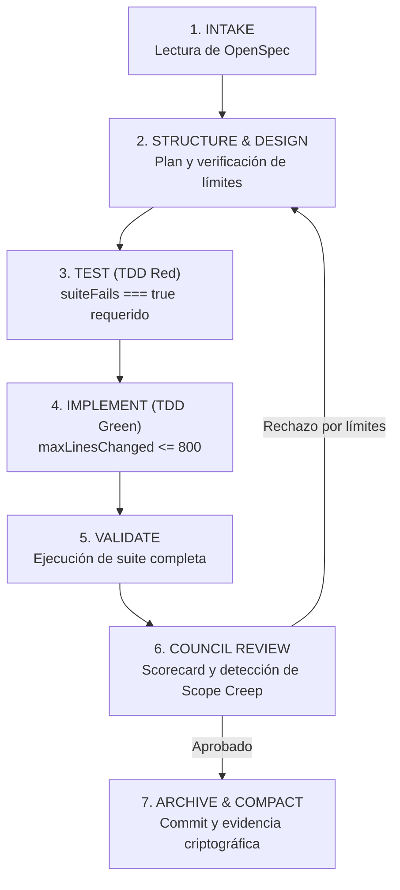

Está bien que la inteligencia artificial escriba código. Puedes utilizar Plan Mode, Spec-Driven Development (SDD) y Test-Driven Development (TDD). Pero si no revisas con detenimiento lo que genera, ese código ya no te pertenece.

Eso es *vibe coding*: jugar a la lotería del prompt. Y no tiene nada de malo si estás explorando un prototipo descartable o jugando el fin de semana. El problema surge cuando tienes una metodología formal, un arnés con habilidades curadas y controles para proteger tu base de código, pero cuando algo explota en producción, decides culpar a la IA por tus propios descuidos.

Si tienes que revisar un PR de 3,000 líneas, algo falló antes de llegar a la revisión.

> "La IA no sustituye tu criterio de ingeniería. Lo amplifica con creces o deja en dolorosa evidencia su completa ausencia."

Últimamente observo una ola constante de quejas sobre Spec-Driven Development: que si el agente tarda quince minutos en responder, que si modifica cuarenta archivos que nadie le pidió tocar, que si ignora lineamientos de arquitectura, que si entrega PRs monstruosos y que el resultado final termina a kilómetros de lo esperado.

SDD no es la solución para todos los problemas ni pretendo defenderlo como una fórmula infalible. Pero hay un patrón recurrente que me llama la atención: muchos desarrolladores parecen buscar una solución mágica donde basta escribir una especificación vaga en lenguaje natural, pulsar *Enter* y esperar código impecable listo para producción.

Como recordaba [Frederick Brooks en su clásico ensayo No Silver Bullet](https://es.wikipedia.org/wiki/No_hay_balas_de_plata), no existen atajos milagrosos en la ingeniería de software que eliminen la complejidad inherente al diseño y modelado de sistemas.

Eso no es ingeniería de software. Es abdicar del criterio técnico y esperar que la IA generativa haga el milagro.

## La ilusión del "Enter y esperar magia"

Cuando delegas una tarea a un agente y te alejas de la pantalla durante quince minutos esperando que resuelva el universo, estás apostando a que el modelo adivine el contexto implícito que tú mismo no te tomaste el tiempo de estructurar.

Si el agente tarda quince minutos en generar cambios que después nadie en el equipo puede auditar con seriedad, o si el código contradice de raíz tus convenciones internas, la pregunta inicial jamás debería ser únicamente qué hizo mal el modelo.

La pregunta que de verdad importa es: ¿qué falló en el proceso para permitir que el agente llegara hasta ahí?

¿La especificación era realmente verificable? ¿El trabajo estaba dividido en entregables atómicos? ¿Existían criterios de aceptación objetivos? ¿Se aplicó TDD para delimitar el comportamiento antes de escribir la solución? ¿Existían *guardrails* mecánicos que impidieran desbordar el alcance? ¿O simplemente dejaste al agente suelto hasta que decidió por su cuenta que había terminado?

Los modelos de lenguaje tienen alucinaciones y límites técnicos tangibles. Sin embargo, atribuirles cada fallo de arquitectura es una salida cómoda para eludir la revisión de nuestros propios hábitos de trabajo. Desde mi punto de vista, es el clásico error de capa 8, un problema humano disfrazado de limitación tecnológica.

SDD no elimina la necesidad de pensar; hace evidente en segundos cuándo no lo estás haciendo.

## Anatomía del desastre

Para entender por qué fracasa una sesión descontrolada con agentes, conviene desarmar la anatomía del desastre paso a paso.

El ciclo típico de frustración suele transcurrir así:

1. **El prompt sobrecargado:** El desarrollador redacta una especificación de alto nivel solicitando una funcionalidad completa ("agrega soporte para múltiples zonas horarias, recalcula las estadísticas semanales y actualiza la interfaz de usuario").
2. **Explosión del espacio de búsqueda:** El agente lee el repositorio sin límites de contexto. Al no contar con un contrato cerrado, asume que para resolver la zona horaria debe refactorizar los servicios centrales de persistencia, renombrar métodos auxiliares y actualizar bibliotecas secundarias.
3. **Deriva acumulativa (*scope creep*):** Cada archivo que el agente toca introduce inconsistencias menores. Al intentar corregirlas en rondas sucesivas dentro del mismo bucle, el modelo modifica diez archivos adicionales para parchar efectos colaterales de su propia intervención inicial.
4. **La entrega inmanejable:** Quince minutos después, el proceso concluye. El desarrollador abre el diff y se encuentra con 3,000 líneas repartidas en 35 archivos.

En ese punto, la fatiga cognitiva anula cualquier intento de auditoría real. El revisor humano hace *scroll* superficial, aprueba con desconfianza porque las pruebas automatizadas no existen o no fallaron de forma controlada, y el PR entra a la rama principal.

Si tienes que revisar 3,000 líneas generadas de una sola vez, la culpa no es de la capacidad generativa del modelo. La falla radica en que tu proceso permitió acumular semejante volumen sin exigir compuertas de validación intermedias.

## Vibe coding vs. ingeniería con arnés

El término *vibe coding* fue acuñado por [Andrej Karpathy en febrero de 2025](https://x.com/karpathy/status/1886192184808149383), describiendo una dinámica donde dictas código por voz, aceptas sugerencias rápidamente y casi olvidas que el código existe porque las herramientas "en su mayoría funcionan".

Para un prototipo de fin de semana, una prueba de concepto desechable o un script personal, ese enfoque es fantástico. Acelera la exploración y reduce el tiempo de arranque a cero.

Pero construir sistemas mantenibles exige otra postura. Cuando necesitas predictibilidad, mantenibilidad y estabilidad a largo plazo en un equipo, el *vibe coding* no alcanza. Como ya lo expliqué en el artículo [Más ingeniería y menos prompting en flujos con agentes](https://www.arthurolg.com/article/technology_mas-ingenieria-menos-prompting-codeconductor), la diferencia entre jugar a la lotería y hacer ingeniería reside en el **arnés**.

Un arnés de ingeniería establece límites operativos explícitos:

| Dimensión              | Vibe Coding sin Control                   | Desarrollo con SDD y Arnés                           |
| :--------------------- | :---------------------------------------- | :--------------------------------------------------- |
| **Punto de partida**   | Prompt libre en lenguaje natural          | Especificación estructurada y validada               |
| **Unidad de trabajo**  | Funcionalidad completa en un solo turno   | Tarea atómica descompuesta en backlog                |
| **Contrato de prueba** | Validación visual o manual a posteriori   | Ciclo TDD con fallo previo obligatorio (*Red-Green*) |
| **Control de alcance** | Modificación abierta de cualquier archivo | Guardrails estrictos de líneas y archivos permitidos |
| **Auditoría**          | Inspección humana superficial al final    | Compuertas automatizadas y scorecards de revisión    |

Si el modelo toma las decisiones arquitectónicas, delimita su propio alcance, inventa sus criterios de éxito y valida su propio resultado sin controles independientes, no estás automatizando la ingeniería. Estás automatizando la improvisación. Y cuando el resultado falla, enojarte con el modelo no transforma esa improvisación en metodología.

## El papel de TDD y los guardrails

En su formulación canónica sobre [Test-Driven Development](https://martinfowler.com/bliki/TestDrivenDevelopment.html), Martin Fowler subraya que el mayor beneficio del ciclo no es solo obtener pruebas de regresión, sino forzar el diseño de las interfaces antes de escribir la implementación. A su vez, al explorar [Specification by Example](https://martinfowler.com/bliki/SpecificationByExample.html), Fowler destaca el principio de doble verificación propuesto originalmente por Kent Beck: la intención se plasma en la prueba ejecutable y la solución en el código.

Cuando trabajas con agentes de inteligencia artificial, TDD funciona como un mecanismo de **inversión de control del contexto**.

Si le pides a un LLM "corrige este comportamiento", el modelo opera en un espacio de búsqueda probabilístico inmenso, susceptible a refactorizaciones innecesarias. En cambio, si primero obligas al agente a escribir una prueba unitaria que falle demostrando exactamente el defecto actual, la prueba actúa como una caja de arena matemática. El modelo ya no necesita divagar sobre la totalidad del sistema; su único objetivo algorítmico es transformar esa condición booleana de rojo a verde sin alterar el resto del entorno.

Esta es la misma disciplina que defiendo al [aplicar TDD paso a paso en arquitecturas desacopladas](https://www.arthurolg.com/article/programming_tdd-crud-spring-boot-arquitectura-hexagonal): la prueba define la frontera de lo que es aceptable.

Para que este ciclo funcione de forma autónoma, el entorno requiere **guardrails**. Un guardrail no es una sugerencia en el prompt; es una compuerta determinista que interrumpe la ejecución si se violan las reglas del sistema:

* **Límites de tiempo por turno (*wall-clock timeout*):** Evitar que un agente pase quince minutos en un bucle infinito de prueba y error sin supervisión.
* **Tope de líneas modificadas (*maxLinesChanged*):** Impedir que un cambio puntual desate una reescritura masiva de cientos de líneas.
* **Tope de archivos tocados (*maxFilesChanged*):** Detener la ejecución si el modelo intenta modificar componentes fuera del contrato acordado.
* **Verificación de suite en rojo (*suiteFails === true*):** Abortar si la fase de prueba pasa limpiamente sin haber demostrado primero el error que se pretende subsanar.

Cuando combinas especificaciones formales con TDD y guardrails mecánicos, el rol del agente cambia radicalmente: pasa de ser un oráculo impredecible a un ejecutor confinado dentro de tolerancias muy precisas.

De esta forma, puedes detener el proceso en cuanto no se cumplen las reglas del juego, y no esperar hasta que te enfrentes a un código que no entiendes y que no puedes validar.

> Es más fácil y económico detener el proceso y corregir el problema, que enfrentarse a un código que no entiendes y que no puedes validar.

## Caso real BC-007

Para apreciar cómo se traduce esta disciplina en la práctica cotidiana, analicemos un caso de estudio real implementado en el laboratorio de fundamentos con el arnés [CodeConductor](https://github.com/lgzarturo/codeconductor) y que está basado en el estándar abierto [OpenSpec](https://github.com/Fission-AI/OpenSpec).

En el repositorio [frontend-fundamentals-lab](https://github.com/lgzarturo/frontend-fundamentals-lab) el requerimiento BC-007 consistía en solucionar un desfase en el marcado de hábitos semanales ocasionado por discrepancias de zona horaria del navegador.

En lugar de lanzar al agente con un prompt genérico, el proceso se dividió en dos momentos independientes y auditables.

Primero, mediante el [commit 597a3a2 en el backlog](https://github.com/lgzarturo/frontend-fundamentals-lab/commit/597a3a2424ba9a2a1b1f412af67a3dc6cdae97c0), se definieron formalmente las especificaciones de cuatro elementos de trabajo (BC-007 a BC-010). Cada cambio quedó encapsulado de manera aislada en artefactos legibles:

* `proposal.md`: Contexto del problema y justificación del cambio.
* `spec.md`: Requisitos del sistema y criterios de aceptación verificables.
* `design.md`: Decisiones arquitectónicas, interfaces y modelos de datos afectados.
* `tasks.md`: Lista desglosada y secuencial de pasos de implementación.

```
openspec/changes/bc-007-corregir-dia-marcado-en-habitos-y-zona-horaria/
├── change.yaml
├── proposal.md
├── spec.md
├── design.md
└── tasks.md
```

Con la especificación aprobada y congelada, la fase de ejecución se realizó mediante el pipeline de ocho fases documentado en [CodeConductor SDD](https://github.com/lgzarturo/codeconductor/blob/main/docs/SDD.md):



En la fase `TEST`, el agente debió escribir las pruebas unitarias en `tests/app-core.test.js` y verificar que fallaban. Solo tras confirmar el fallo, la fase `IMPLEMENT` ejecutó las modificaciones necesarias en `assets/js/utils/date.js` y los módulos de hábitos.

La resolución quedó registrada en el [commit c1ef89e para BC-007](https://github.com/lgzarturo/frontend-fundamentals-lab/commit/c1ef89ee73a3d82fef235259bf3361a428c1c067). Aquí emerge un fenómeno revelador que desmitifica la idea del volumen de código en desarrollo agéntico.

El commit contiene más de 5,000 líneas añadidas, pero no por código de producción inflado o descontrolado. El código funcional real apenas abarca unas decenas de líneas en utilidades de fecha y componentes de interfaz. La mayoría del volumen corresponde a **infraestructura de certeza**:

1. Recibos criptográficos de evidencia (`ev-tdd-BC-007-test-...json`), sellando los hashes de los archivos y la salida exitosa de Vitest (`exitCode: 0`).
2. Scorecards automatizados de evaluación generados por agentes revisores independientes.
3. El archivo del cambio en OpenSpec pasando de estado activo a completado.

De hecho, durante la evaluación de ese mismo cambio, un modelo auditor emitió inicialmente un veredicto de rechazo en el scorecard [`sc-mvlairqs-6lp3.json`](https://raw.githubusercontent.com/lgzarturo/frontend-fundamentals-lab/c1ef89ee73a3d82fef235259bf3361a428c1c067/.codeconductor/evaluation/scorecards/sc-mvlairqs-6lp3.json) debido a una alerta de desvío:

```json
{
  "verdict": "REJECT",
  "score": 1.55,
  "criteria": {
    "acceptance_criteria": 0.85,
    "minimal_diff": 0.0,
    "clean_architecture": 0.70
  },
  "feedback": "Scope creep detected in 10 file(s). Files touched outside declared boundaries."
}
```

> El verdadero valor de un arnés agéntico no es hacer que el modelo escriba más rápido; es tener un mecanismo independiente capaz de frenarlo cuando intenta abarcar más de lo pactado.

Esta dinámica refleja los mismos principios que usé al construir [Agent Zero mediante MicroSDD y arneses multiagente](https://www.arthurolg.com/article/technology_agent-zero-microsdd-arnes-agentes): los cambios deben ser quirúrgicos, comprobables y contenidos dentro de su propia especificación. Y cuando un agente auditor detecta anomalías, el sistema se detiene antes de contaminar el árbol de Git principal.

## Si no puedes revisarlo, no es tu código

Existe una verdad elemental en la artesanía del software: el autor del código no es quien pulsa las teclas, sino quien asume la responsabilidad legal, técnica y operativa de su comportamiento cuando entra en producción.

Si un agente produce 3,000 líneas en la base del código en quince minutos y tú las envías a revisión sin haber comprendido cada bifurcación, cada manejo de error y cada decisión de estructura, ese código no es tuyo. Es un artefacto ajeno introducido en tu repositorio bajo tu firma.

Adoptar metodologías como [OpenSpec dentro de un stack agéntico pragmático](https://www.arthurolg.com/article/technology_openspec-stack-agentico-12-factor) no busca crear burocracia ni llenar el repositorio de ceremonias innecesarias. Su propósito es trazar fronteras claras:

* **Especificaciones pequeñas y verificables:** Si una tarea no puede describirse con precisión en una página y tres criterios de aceptación claros, no está lista para ser implementada por un agente. Entonces no requieres de SDD y mejor usar un modo plan o un flujo más simple para pedir al agente que te ayude a descomponer la tarea en tareas más pequeñas.
* **Validación continua en pasos cortos:** La ejecución debe descomponerse en turnos breves donde cada paso se verifique con pruebas unitarias antes de pasar al siguiente.
* **Revisión humana enfocada:** Revisar un diff quirúrgico de 120 líneas respaldado por pruebas en verde toma cinco minutos y garantiza comprensión total; revisar 3,000 líneas generadas a ciegas es un simulacro de revisión.

La inteligencia artificial es una herramienta extraordinaria de amplificación técnica. En manos de un equipo con disciplina, arquitectura y metodología, acelera la entrega de valor a ritmos impensables hace apenas un par de años. Pero en ausencia de método, solo consigue producir deuda técnica a escala industrial con una velocidad aterradora.

La máquina puede escribir la sintaxis. Tú sigues siendo el único responsable de la ingeniería y del producto final. Tu responsabilidad como ingeniero es cuidar de la calidad del código, asegurarte de que cumple con los requisitos del negocio y que no introduce riesgos técnicos en el sistema.

## Conclusión

Spec-Driven Development no está roto ni los agentes de código son un fraude tecnológico. Lo que ha colapsado es la expectativa infantil de pretender que un modelo generativo no determinista reemplace la disciplina de diseño, la descomposición de problemas y la validación rigurosa.

Cuando fijas guardrails firmes, divides el trabajo en especificaciones atómicas y exiges que cada línea responda a una prueba que falló previamente, el proceso se vuelve transparente, predecible y placentero. Dejas de cruzar los dedos frente al prompt para volver a hacer lo que siempre distinguió a los buenos artesanos del software: diseñar soluciones robustas con criterio propio.

La próxima vez que un agente te entregue un cambio incomprensible de miles de líneas, resiste la tentación de culpar al modelo en redes sociales. Abre tu flujo de trabajo, examina tus compuertas de parada y pregúntate con honestidad: ¿quién permitió que ese código se escribiera sin frenos?

Si quieres comentar o compartir tu experiencia, escríbeme en [X (@algforge)](https://x.com/algforge) o abre un issue en el [repositorio](https://github.com/lgzarturo/arthurolg-blog-posts/issues). Una estrella en [GitHub](https://github.com/lgzarturo) también ayuda.

## Referencias

* [No hay balas de plata: esencia y accidentes en la ingeniería de software, Frederick P. Brooks Jr.](https://es.wikipedia.org/wiki/No_hay_balas_de_plata)
* [CodeConductor Framework y Especificación de Pipeline SDD, Arturo López](https://github.com/lgzarturo/codeconductor/blob/main/docs/SDD.md)
* [Descomposición de Backlog BC-007 a BC-010 con OpenSpec, Arturo López en frontend-fundamentals-lab](https://github.com/lgzarturo/frontend-fundamentals-lab/commit/597a3a2424ba9a2a1b1f412af67a3dc6cdae97c0)
* [Implementación de Cambio BC-007 con TDD y Sellado de Pruebas, Arturo López en frontend-fundamentals-lab](https://github.com/lgzarturo/frontend-fundamentals-lab/commit/c1ef89ee73a3d82fef235259bf3361a428c1c067)
* [Scorecard de Evaluación Automatizada y Detección de Scope Creep, CodeConductor](https://raw.githubusercontent.com/lgzarturo/frontend-fundamentals-lab/c1ef89ee73a3d82fef235259bf3361a428c1c067/.codeconductor/evaluation/scorecards/sc-mvlairqs-6lp3.json)
* [Test-Driven Development, Martin Fowler (Thoughtworks)](https://martinfowler.com/bliki/TestDrivenDevelopment.html)
* [Specification by Example, Martin Fowler (Thoughtworks)](https://martinfowler.com/bliki/SpecificationByExample.html)
* [Reflexión sobre Vibe Coding y Programación Intuitiva, Andrej Karpathy](https://x.com/karpathy/status/1886192184808149383)
* [OpenSpec: Spec-Driven Development for AI Coding Assistants, Fission AI](https://github.com/Fission-AI/OpenSpec)
