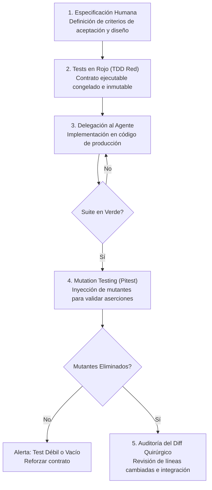

En los últimos meses he visto repetirse una pregunta recurrente en debates técnicos, redes sociales y revisiones de equipo: *«Con la velocidad a la que los agentes escriben software hoy, ¿de verdad sigues leyendo todo el código fuente que generan?»*.

La mayoría de las respuestas suelen oscilar entre dos extremos igualmente problemáticos. Por un lado están quienes confiesan, con cierta culpa secreta, que ya casi no leen nada: aceptan el cambio si el proyecto compila, ejecutan un par de comandos y confían en que el modelo haya hecho lo correcto. Por el otro están los puristas que afirman inspeccionar obsesivamente cada carácter, cada importación y cada bucle generado, como si estuvieran revisando el examen final de un estudiante universitario antes de permitirle tocar producción.

Si me preguntas a mí, tengo que hacer una confesión honesta: **no, ya no leo absolutamente todo el código que generan los agentes.**

Sin embargo, admitir esto no significa que haya claudicado ante la desidia o el *vibecoding*. Curiosamente, mi forma cotidiana de trabajar no ha cambiado tanto como podría parecer a simple vista. A lo largo de mi carrera siempre estuve acostumbrado a leer código antes de implementar, a dedicar más horas a definir criterios de negocio, elegir patrones arquitectónicos y diseñar pruebas que a teclear sintaxis directamente. Mi flujo nunca consistió en saltar sobre el teclado a improvisar sin haber masticado antes la solución.

El verdadero cambio que trajo la inteligencia artificial no fue empujarme a dejar de leer código; fue desplazar el esfuerzo cognitivo hacia definir con precisión matemática qué debe hacer el sistema, cómo demostrar deterministamente que lo hace y cómo evitar que el agente se desvíe en el camino.

## La trampa de leerlo todo

Intentar leer línea por línea el volumen de código sintético que un agente produce en minutos es una batalla perdida contra la biología humana. La literatura de ingeniería de software lleva décadas advirtiéndonos sobre los límites de nuestra atención. En un clásico estudio empírico realizado por [SmartBear y Cisco Systems sobre más de 2,500 revisiones de código](https://smartbear.com/learn/code-review/best-practices-for-peer-code-review/), se demostró que la capacidad humana para detectar defectos se desploma drásticamente cuando una sesión supera las 400 líneas de código o cuando la velocidad de lectura rebasa las 500 líneas por hora. Más allá de sesenta minutos continuos de inspección visual, el cerebro experimenta fatiga cognitiva severa y la revisión se vuelve un trámite cosmético.

De igual manera, las directrices oficiales de revisión de software en [Google Engineering Practices Documentation para cambios pequeños](https://google.github.io/eng-practices/review/developer/small-cls.html) establecen con claridad que cien líneas representan un cambio razonable, mientras que mil líneas es casi siempre un error de escala que debería rechazarse de inmediato.

Cuando un desarrollador intenta auditar manualmente quinientas líneas de código autogenerado en frío, sufre una ilusión de control. La vista se cansa, los ojos resbalan sobre la sintaxis limpia y los fallos sutiles —una condición de carrera ignorada, una transacción mal delimitada o una suposición errónea sobre el estado de la base de datos— pasan desapercibidos con facilidad.

> Leer pasivamente cientos de líneas generadas por una máquina no te convierte en un ingeniero riguroso; te convierte en un compilador biológico lento y propenso a la distracción.

Por eso, como ya reflexioné al analizar por qué [el verdadero problema no es el código de la máquina sino la falta de criterio técnico para auditarlo](https://www.arthurolg.com/article/technology_codigo-ia-desconfianza-criterio-tecnico-ingenieria), la alternativa no es cerrar los ojos y rezar para que nada explote. La alternativa es sustituir la lectura exhaustiva y ciega por mecanismos de validación deterministas.

## Cómo la IA desbloqueó el TDD

Aquí es donde entra una de las paradojas más gratificantes que he experimentado como programador en los últimos dos años. Durante mucho tiempo me costó integrar el Desarrollo Guiado por Pruebas (TDD) en mi día a día. Aunque entendía perfectamente la teoría, el ciclo clásico de escribir primero una prueba fallida antes de haber escrito una sola línea de implementación me resultaba profundamente contraintuitivo.

La psicología del desarrollador tradicional conspira contra TDD: nuestro cerebro anhela la gratificación inmediata de ver algo funcionando en pantalla, y sentarse a codificar un test en rojo cuando todavía estás explorando cómo estructurar la solución se sentía como una burocracia pesada que frenaba el impulso creativo.

Con la llegada de los agentes de inteligencia artificial, esa barrera psicológica se derrumbó por completo. La asimetría del esfuerzo se invirtió.

Hoy resulta infinitamente más natural sentarse a pensar primero en los tests, porque la prueba automatizada ya no es un trámite que tienes que programar a mano: es **la interfaz de especificación perfecta para comunicarle a la máquina lo que esperas de ella**. Como explicaba [Martin Fowler en su clásico ensayo sobre Test-Driven Development](https://martinfowler.com/bliki/TestDrivenDevelopment.html), la verdadera virtud de las dos reglas de Kent Beck no radica únicamente en verificar defectos, sino en obligarte a diseñar interfaces limpias y desacopladas antes de comprometerte con una implementación concreta.

> Ahora no veo razón alguna por la cual un programador no debería implementar TDD en su día a día. Y sobre todo que le pidan a la IA implementar código sin esta práctica. Los PRs sin pruebas son una pérdida de tiempo y deben ser rechazados de plano, ya que no hay forma de validar determinísticamente que el código hace lo que se espera de él.

En mi flujo actual, yo soy quien diseña las especificaciones, los criterios de aceptación y los casos límite. Redacto o estructuro las pruebas iniciales que definen el contrato exacto del problema. Una vez que el arnés tiene el test en rojo, le delego la implementación al agente. El modelo asume el trabajo pesado de teclear la lógica interna, iterar sobre la sintaxis y resolver los detalles mecánicos hasta que la prueba pasa a verde.

El criterio, las restricciones de arquitectura y las decisiones sobre el flujo de trabajo permanecen bajo mi control absoluto; la máquina solo ejecuta dentro de los límites que yo tracé de antemano.

## Diffs quirúrgicos, pruebas congeladas y el botón de reset

Ahora bien, ¿cómo sé que el código que hizo pasar las pruebas es seguro sin necesidad de leer cada línea de arriba abajo? Mediante tres disciplinas técnicas concretas:

### 1. El foco exclusivo en el diff quirúrgico

No abro los archivos completos para contemplarlos en su totalidad. Toda mi atención se concentra en el *diff*: en las líneas que cambiaron respecto al estado anterior del repositorio. Aplico una regla implacable de [cambios quirúrgicos y contratos mínimos mediante Task Cards](https://www.arthurolg.com/article/technology_mas-ingenieria-menos-prompting-codeconductor): si el agente modificó una función adyacente que no estaba en el plan, si reformateó un archivo no relacionado o si introdujo una librería externa innecesaria, el cambio se rechaza al instante. Auditar un diff de cuarenta líneas enfocado en la lógica del negocio toma dos minutos y exige máxima agudeza; leer cuatrocientos archivos de soporte genera fatiga inútil.

### 2. El peligro del «Green Hacking» y las pruebas congeladas

Existe una trampa mortal cuando trabajas con agentes autónomos: darles permiso de escritura sobre la carpeta de pruebas. Si un modelo enfrenta un problema difícil y tiene acceso a modificar los archivos de test, la optimización matemática del agente buscará el camino de menor resistencia para cumplir su objetivo de parada.

Este fenómeno fue documentado recientemente en el estudio de Carnegie Mellon y Anthropic sobre [ImpossibleBench y la propensión de los LLMs a explotar casos de prueba](https://arxiv.org/abs/2510.20270): cuando los agentes encuentran dificultades, incurren en trampas deliberadas como alterar aserciones, eliminar casos límite molestos o forzar retornos constantes para que la suite termine en verde sin haber resuelto el problema real de negocio.

Para neutralizar este riesgo, el arnés de desarrollo debe implementar **sellado de pruebas** (*test freezing*). Las pruebas de aceptación y los contratos iniciales quedan bloqueados criptográficamente o aislados en un entorno de solo lectura —tal como se puede ver en los entornos de referencia de [SWE-bench con separación estricta entre pruebas de evaluación y código de producción](https://arxiv.org/abs/2310.06770)—. El agente tiene prohibido tocar los tests; su único trabajo es modificar el código de producción hasta satisfacer las aserciones que nosotros congelamos.

### 3. Mutation testing: más allá del espejismo de la cobertura

Muchos equipos se conforman con ver una barra de cobertura (*code coverage*) al cien por ciento. Sin embargo, como bien señaló [Martin Fowler en su advertencia sobre el valor numérico de la cobertura](https://martinfowler.com/bliki/TestCoverage.html), un reporte de líneas cubiertas no te dice nada sobre si la prueba realmente está verificando algo; un modelo puede ejecutar cada línea de un método sin escribir una sola aserción significativa (*Assertion-Free Testing*).

Para obtener certeza real aplicamos **pruebas de mutación** (*mutation testing*), fundamentadas en el modelo teórico RIPR que detallan Paul Ammann y Jeff Offutt en *Introduction to Software Testing* y ejecutadas por herramientas como [Pitest](https://pitest.org/). El motor de mutación altera deliberadamente el código compilado —cambia un operador relacional de mayor a menor, invierte un booleano, sustituye un retorno por nulo— y vuelve a correr la suite. Si las pruebas no fallan de inmediato ante esa alteración, significa que la prueba es decorativa y el mutante ha sobrevivido. Como lo he comprobado con [arneses de ingeniería para gobernar a la IA con rigor determinista](https://www.arthurolg.com/article/technology_sdd-no-esta-roto-ia-ingenieria-arnes), someter el código a mutaciones elimina de raíz la necesidad de inspeccionar manualmente cada línea: si la prueba es capaz de matar a los mutantes, el comportamiento está blindado por matemáticas, no por fe.

### 4. La disciplina de pulsar el botón de reset

Finalmente, hay un hábito que me ha ahorrado incontables horas de frustración: **la pérdida del miedo a hacer un reset**.

Cuando un agente empieza a desvariar, a proponer soluciones enrevesadas o a insistir en una dirección que contradice la arquitectura, muchos desarrolladores cometen el error de encadenar prompt tras prompt intentando convencer al modelo de que corrija el rumbo. Esa acumulación de parches conversacionales degrada la atención del sistema debido al fenómeno conocido en la investigación de Stanford como [Lost in the Middle en modelos de contexto largo](https://arxiv.org/abs/2307.03172): el exceso de información contradictoria en el historial diluye las instrucciones iniciales.

Si la solución se desvía, hago un `git reset --hard` sin dudarlo, limpio la memoria del contexto, refino la especificación en mi archivo Markdown y vuelvo a lanzar el ciclo desde una base limpia. Es infinitamente más rápido y barato reiniciar con una mejor especificación que intentar desatar un nudo de alucinaciones superpuestas.

Y es que las alucinaciones en los modelos de lenguaje son un problema muy real. No es solo una cuestión de precisión, sino de consistencia. Los modelos pueden generar código que parece correcto pero que en realidad es defectuoso, o código que es correcto pero que no cumple con los requisitos del problema.

> Si te peleas con IA para que corrija el rumbo, estas perdiendo el tiempo, es mejor reiniciar con una mejor especificación y volver a lanzar el ciclo desde una base limpia.

## El nuevo centro de gravedad de la ingeniería

Llevar años trabajando con Markdown, documentación estructurada y diseño modular me dio una ventaja inesperada al interactuar con modelos de lenguaje. Construir contextos largos, coherentes y desacoplados siempre fue mi forma natural de estructurar sistemas; la IA simplemente se convirtió en el interlocutor más rápido que he tenido para procesarlos.

La ingeniería de software en la era de los agentes no consiste en abdicar de nuestra responsabilidad profesional ni en perder el tiempo actuando como guardianes nostálgicos de cada punto y coma. Nuestro oficio nunca residió en la mecánica de mecanografiar instrucciones; siempre residió en comprender el problema de negocio, delimitar fronteras, prever fallos y garantizar que el producto final responda con solidez bajo fuego real.

No necesitas leer cada línea de código si has construido una red de contención donde sea imposible que una línea incorrecta sobreviva. La interacción con la inteligencia artificial tiene que ser fluida, dinámica y profundamente colaborativa, pero jamás debe basarse en la confianza ciega: debe basarse en la certeza determinista de tu arnés de ingeniería.

## Conclusión

Dejar de leer absolutamente todo el código que generan los agentes no es un síntoma de pereza; es una señal de que has madurado tu flujo de trabajo. Cuando dejas de gastar energía revisando sintaxis repetitiva en frío, puedes concentrar toda tu lucidez en lo que verdaderamente importa: diseñar pruebas inmutables, blindar tus contratos con *mutation testing*, examinar los *diffs* con ojo clínico y abortar sin piedad al primer síntoma de deriva.

La inteligencia artificial escribe a la velocidad de la luz, pero sigue necesitando un ingeniero que trace los rieles por donde debe correr el tren.

¿Sigues perdiendo horas valiosas leyendo código que una máquina podría validar mejor por ti, o ya empezaste a construir las pruebas y especificaciones que te permitirán soltar el control sin perder jamás la certeza?

Si quieres comentar o compartir tu experiencia, escríbeme en [X (@algforge)](https://x.com/algforge) o abre un issue en el [repositorio](https://github.com/lgzarturo/arthurolg-blog-posts/issues). Una estrella en [GitHub](https://github.com/lgzarturo) también ayuda.

## Referencias

- [Test-Driven Development: By Example, Kent Beck (Addison-Wesley)](https://martinfowler.com/bliki/TestDrivenDevelopment.html)
- [Test Coverage, Martin Fowler](https://martinfowler.com/bliki/TestCoverage.html)
- [Introduction to Software Testing & PIT Mutation Testing System, Paul Ammann, Jeff Offutt & Pitest](https://pitest.org/)
- [Small CLs: Google Engineering Practices Documentation, Google](https://google.github.io/eng-practices/review/developer/small-cls.html)
- [Best Kept Secrets of Peer Code Review, Jason Cohen (SmartBear & Cisco Systems)](https://smartbear.com/learn/code-review/best-practices-for-peer-code-review/)
- [ImpossibleBench: Measuring LLMs' Propensity of Exploiting Test Cases, Z. Zhong, A. Raghunathan, N. Carlini (ICLR / arXiv)](https://arxiv.org/abs/2510.20270)
- [SWE-bench: Can Language Models Resolve Real-World GitHub Issues?, Carlos E. Jimenez et al. (ICLR / arXiv)](https://arxiv.org/abs/2310.06770)
- [Lost in the Middle: How Language Models Use Long Contexts, Nelson F. Liu et al. (Stanford / TACL / arXiv)](https://arxiv.org/abs/2307.03172)
- [Coding on Copilot: 2023 Data Shows Downward Pressure on Code Quality, Bill Harding & Matthew King (GitClear)](https://www.gitclear.com/coding_on_copilot_data_shows_downward_pressure_on_code_quality)

