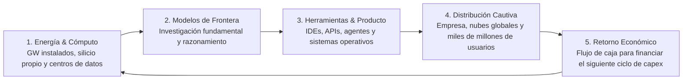

Cada semana el ciclo de noticias tecnológicas repite el mismo ritual coreografiado: un laboratorio publica una tabla de evaluación con barras de colores, las redes sociales se llenan de hilos triunfalistas anunciando que el modelo anterior ha quedado obsoleto y los departamentos de mercadotecnia lanzan campañas agresivas para captar suscripciones.

Es un espectáculo ruidoso y entretenido. Sin embargo, en la historia de la computación industrial los imperios tecnológicos jamás se han construido ganando concursos de fin de semana.

En la carrera de la inteligencia artificial generativa, el marketing puede comprar atención temporal, pero son el cómputo masivo, la integración vertical y la capacidad de ejecución los que construyen ventajas competitivas duraderas. Mientras la conversación pública sigue atrapada discutiendo si un modelo supera a otro por dos puntos porcentuales en un benchmark sintético, en los niveles más profundos de la industria se está librando una partida completamente distinta: una guerra por la energía eléctrica, el control de las obleas de silicio, la propiedad de las herramientas de desarrollo y el acceso cautivo a la pantalla del usuario final.

El tablero real no lo lidera quien tenga el modelo más carismático hoy; lo lidera quien logre cerrar el ciclo económico más exigente del planeta: transformar gigavatios de energía en cómputo, el cómputo en modelos de frontera, los modelos en productos indispensables, los productos en distribución masiva y esa distribución en los miles de millones de dólares necesarios para financiar la siguiente generación de infraestructura.

El marketing puede acelerar la percepción de liderazgo, pero la infraestructura física y la ejecución económica tienen que sostenerla. Para entender dónde estamos parados, conviene apartar los discursos de relaciones públicas y examinar cómo se están posicionando los siete gigantes que definen el destino del sector.

## La ilusión del benchmark y la física del cómputo

El primer gran espejismo que debemos disipar es confundir la potencia nominal anunciada en una nota de prensa con el cómputo efectivo puesto en producción. Se proyecta que el gasto de capital (*capex*) de los grandes proveedores de nube superará los 800,000 millones de dólares anuales, requiriendo un incremento colosal en la capacidad de generación eléctrica y al menos 300,000 millones de dólares en ingresos directos anuales por inteligencia artificial simplemente para alcanzar el punto de equilibrio financiero.

Cuando una empresa anuncia que su centro de datos alcanzó una escala de gigavatios, los ingenieros de sistemas sabemos que la capacidad de placa (*nameplate capacity*) no equivale a rendimiento útil inmediato. La energía debe interconectarse con la red, enfriarse sin colapsar las cuencas acuíferas locales y distribuirse a través de topologías de red ultrarrápidas donde la latencia de conmutación térmica y el ancho de banda de memoria de alto rendimiento (*HBM*) dictan el ritmo real de entrenamiento e inferencia.

Tener chips no garantiza tener un producto rentable. Como intento explicar en otro artículo por qué [la guerra de la IA se gana en el producto y la economía de tokens](https://www.arthurolg.com/article/technology_la-trampa-del-mejor-modelo-economia-de-tokens), el verdadero cuello de botella de esta industria no radica en sintetizar pesos en un clúster cerrado, sino en sostener millones de consultas diarias sin quemar los márgenes de operación de la compañía.

## Integración vertical extrema y soberanía de silicio

En el primer cuadrante del tablero compiten los actores que han apostado por controlar cada eslabón de la cadena de valor, desde los transformadores de energía hasta el editor donde los programadores teclean código.

### xAI y SpaceX: la integración más agresiva de la industria

El caso de **xAI** en simbiosis operativa con **SpaceX** representa el intento más agresivo de integración vertical que hayamos visto. Para levantar su supercomputador Colossus y su sucesor Colossus 2 en el área de Memphis, la compañía instaló decenas de turbinas de gas natural para sortear los retrasos de interconexión con la red eléctrica pública, alcanzando una capacidad instalada proyectada de 1.7 gigavatios, según reportes de [Reuters sobre la expansión de infraestructura energética de xAI](https://www.reuters.com/technology/artificial-intelligence/elon-musks-xai-buys-new-property-memphis-amid-supercomputer-expansion-2025-03-07/).

Sin embargo, lo más relevante no fue levantar naves industriales en tiempo récord, sino su maniobra sobre la capa de desarrollo. Cuando SpaceX cerró la compra de Anysphere —la empresa matriz del editor Cursor— mediante una transacción en acciones valorada en 60,000 millones de dólares, como detalló [Forbes al reportar la adquisición corporativa de Cursor](https://www.forbes.com/sites/siladityaray/2026/06/16/spacex-will-buy-ai-coding-firm-cursor-for-60-billion/), el objetivo no era simplemente vender suscripciones de software. El verdadero premio era capturar la telemetría, el comportamiento en tiempo real y el flujo de trabajo de millones de desarrolladores para alimentar de forma directa el entrenamiento de Grok.

La reacción de la industria fue inmediata: en un movimiento sin precedentes, OpenAI canceló su contrato de suministro directo de modelos hacia Cursor, tal como formalizó en el comunicado oficial [Our decision on Cursor following its acquisition by SpaceX publicado por OpenAI](https://openai.com/index/our-decision-on-cursor-following-its-acquisition-by-spacex/), citando cláusulas de cambio de control y el riesgo evidente de que sus modelos fueran utilizados para destilar conocimiento hacia un rival directo.

A pesar de esta audacia estructural, controlar la infraestructura no elimina la dureza de los números. Al desplegar entornos persistentes con Grok Bot, el propio Elon Musk tuvo que admitir que los costes de inferencia eran insosteniblemente elevados respecto a los ingresos generados, obligando a imponer cuotas estrictas. Levantar gigavatios no te salva de la física de la inferencia si cada llamada a herramientas destruye tu margen unitario.

### Google: la soberanía total desde el silicio hasta el sistema operativo

Si xAI representa la velocidad audaz, **Google** representa la profundidad de un ecosistema que lleva más de una década preparándose para este momento. Es el único actor de la industria que posee soberanía vertical absoluta en cada una de las capas críticas:

1. **Silicio propietario maduro:** Mientras el resto de la industria sigue pagando un peaje multimillonario a Nvidia, Google presentó Ironwood (su TPU de séptima generación), diseñada específicamente para la era de la inferencia masiva y el razonamiento a gran escala con 192 GB de memoria HBM3e y eficiencia energética superior, según detalla el [anuncio técnico oficial de Ironwood TPU en Google Blog](https://blog.google/technology/developers/ironwood-tpu/).
2. **Infraestructura de red propia:** Una red mundial de centros de datos y fibra óptica interconectada que ningún competidor privado puede igualar en latencia global.
3. **Distribución masiva garantizada:** Canales de distribución cautivos con más de dos mil millones de usuarios activos en Android, Chrome, Google Workspace y YouTube.

En el plano del liderazgo científico, Google acomodó sus piezas para ganar velocidad ejecutiva. Como anunció Sundar Pichai en el comunicado institucional [The next chapter of our AI momentum en Google Blog](https://blog.google/technology/ai/google-deepmind-leadership-updates-2026/), Demis Hassabis asumió un rol estratégico como presidente de Google DeepMind y Chief Scientist de Alphabet para centrarse en los retos teóricos de la inteligencia general y la ciencia, mientras Jeff Dean emprendió una nueva iniciativa tras casi tres décadas en la compañía. Lejos de ser una señal de debilidad, esta reorganización refleja la madurez de una organización que sabe que la investigación teórica debe desacoplarse de la operativa cotidiana para no asfixiar a los equipos.

### OpenAI: el rigor científico de Jakub Pachocki bajo la presión del producto

Por su parte, **OpenAI** sigue teniendo en Sam Altman a un maestro indiscutible de la recaudación de capital y la atención mediática. Pero reducir el valor de la compañía a su habilidad política sería un error grave de juicio.

Tras la salida de Ilya Sutskever, la dirección científica del laboratorio recayó en Jakub Pachocki, quien asumió como Chief Scientist tras haber sido el cerebro técnico detrás de proyectos fundamentales como OpenAI Five y la arquitectura central de GPT-4, como documenta el anuncio oficial [Jakub Pachocki announced as Chief Scientist en el portal de OpenAI](https://openai.com/index/ilya-sutskever-to-leave-openai-jakub-pachocki-announced-as-chief-scientist/). La capacidad investigadora de OpenAI sigue siendo formidable, especialmente en modelos de razonamiento y aprendizaje por refuerzo.

Su talón de Aquiles, sin embargo, radica en la dependencia externa de infraestructura y distribución. A pesar de sus esfuerzos por construir centros de datos propios, OpenAI sigue necesitando alianzas masivas de cómputo y depende en gran medida de interfaces de terceros o de su propia aplicación de consumo para monetizar. En un mercado donde los márgenes se comprimen, ser un laboratorio puro que no posee el silicio ni el sistema operativo donde corre su software es una posición de vulnerabilidad permanente.

## Los amos de la distribución y los ecosistemas cautivos

En el otro extremo del espectro se encuentran las empresas que comprendieron que poseer el modelo con el mejor benchmark es secundario si controlas los canales corporativos y sociales donde el mundo trabaja todos los días.

### Microsoft: la jugada maestra del arbitraje multimodelo

La estrategia de **Microsoft** es una de las más inteligentes de la industria tecnológica. En lugar de apostar todo su capital a un único proveedor, Satya Nadella ejecutó una diversificación estratégica impecable: mantuvo su participación en OpenAI, invirtió en Anthropic, desarrolló internamente la familia de modelos ligeros Phi y abrió las puertas de sus productos corporativos a la competencia.

Como anunció el equipo de GitHub al presentar la [integración multimodelo en GitHub Copilot](https://github.blog/news-insights/product-news/bringing-developer-choice-to-copilot/), los desarrolladores ahora pueden elegir libremente entre Claude de Anthropic, Gemini de Google y los modelos de OpenAI dentro del mismo entorno. A Microsoft no le preocupa qué modelo gane la carrera técnica del mes; lo que le interesa es que cualquiera de ellos se ejecute sobre **Azure**, consuma servicios en la nube de Microsoft y consolide el monopolio de distribución empresarial que representan **Microsoft 365 Copilot**, Windows y GitHub.

Además, su visión de largo plazo en infraestructura quedó demostrada con el acuerdo histórico para [reactivar la central nuclear de Three Mile Island con Constellation Energy](https://www.constellationenergy.com/newsroom/2024/constellation-to-launch-crane-clean-energy-center-restoring-jobs-and-carbon-free-power-to-the-grid.html), asegurando más de 800 megavatios de energía limpia y continua dedicados exclusivamente a sus centros de datos para los próximos veinte años.

> La ventaja de Microsoft no radica en tener el mejor modelo del mundo; radica en haber convertido la inteligencia artificial en un componente invisible de la factura que millones de corporaciones pagan todos los meses.

### Meta: la fuerza bruta de la inferencia a escala planetaria

La ventaja de **Meta** es prácticamente irreplicable para cualquier startup: tiene más de tres mil millones de usuarios cautivos en WhatsApp, Instagram, Facebook y Messenger.

Con la presentación de Muse Spark por parte de Meta Superintelligence Labs, como anunció la compañía en [Introducing Muse Spark en Meta Newsroom](https://about.fb.com/news/2026/04/introducing-muse-spark/), Mark Zuckerberg dejó claro su manual de juego: integrar modelos avanzados de razonamiento directamente en las aplicaciones que la humanidad ya utiliza a diario, sin cobrar una suscripción separada.

Sin embargo, como ya señalé al analizar [el fin de los tokens subsidiados y el coste real de la IA](https://www.arthurolg.com/article/technology_fin-tokens-subsidiados-dependencia-agentes-ia), no debemos confundir la gratuidad para el usuario final con una economía de inferencia barata. Regalar cómputo en redes sociales cuesta cientos de millones de dólares al trimestre; para Meta es una inversión defensiva que protege su negocio publicitario y captura datos frescos de entrenamiento, pero no resuelve el desafío fundamental de hacer que cada token de razonamiento sea financieramente sostenible por sí mismo.

### Apple: la privacidad en el chip y la nube sin estado

Mientras el resto de la industria construye reactores nucleares para alimentar clústeres gigantescos, **Apple** juega una partida completamente distinta basada en la intimidad del dispositivo.

Su estrategia con Apple Intelligence parte de una premisa clara: ejecutar la mayor cantidad posible de tareas locales utilizando los motores neuronales de Apple Silicon en el iPhone, el iPad y la Mac, y escalar únicamente las peticiones complejas hacia su infraestructura de [Private Cloud Compute documentada por Apple Security Research](https://security.apple.com/blog/private-cloud-compute/). Esta arquitectura utiliza servidores personalizados con chips propios de la marca, software sin almacenamiento de estado (*stateless*) y garantías criptográficas verificables por auditores independientes.

Apple no aspira a entrenar el modelo fundacional más gigantesco del mundo; aspira a controlar el filtro que decide qué datos salen de tu teléfono y qué servicios externos tienen permiso para interactuar con tu vida cotidiana. Su mayor reto sigue siendo demostrar que esa arquitectura orientada a la privacidad puede entregar una experiencia de usuario competitiva frente a modelos remotos que no tienen esas restricciones.

## El dilema de los laboratorios puros y la rueda de la rentabilidad

En medio de este choque de titanes industriales, la posición de laboratorios puros como **Anthropic** merece un análisis particularmente honesto.

Anthropic cuenta con uno de los talentos de investigación e ingeniería más brillantes del planeta. Sus modelos destacan por una coherencia excepcional, una baja varianza y un liderazgo indiscutible en herramientas para desarrolladores, tal como revisamos al estudiar [cómo orquestar modelos de razonamiento frente a workers de alta velocidad](https://www.arthurolg.com/article/technology_elegir-modelo-ia-programar-workers-razonadores-effort). La visión técnica y ética de Dario Amodei ha demostrado una lucidez admirable en seguridad, interpretabilidad y diseño de sistemas agénticos.

Sin embargo, el reto existencial de Anthropic no radica en la calidad de su investigación, sino en la **rueda de la rentabilidad y la distribución**:

| Actor en el Tablero | Soberanía de Silicio | Escala Energética Directa | Canal de Distribución Cautivo | Modelo de Negocio Dominante |
| :--- | :--- | :--- | :--- | :--- |
| **Google** | Total (TPUv7x Ironwood) | Red global propia de centros de datos | Masivo (Android, Workspace, Chrome) | Publicidad, Cloud, suscripciones |
| **Microsoft** | Mixta (Maia + Nvidia) | Nuclear dedicada (Three Mile Island PPA) | Corporativo absoluto (M365, Azure, GitHub) | Suscripciones empresariales de software |
| **xAI / SpaceX** | Terceros (Nvidia en clúster Colossus) | 1.7 GW instalados (turbinas de gas Memphis) | IDE propio (Cursor), red social (X) | Capital privado, suscripciones, satélites |
| **Meta** | En desarrollo (MTIA) + Nvidia | Clústeres masivos hiperconectados | Social global (WhatsApp, Instagram, FB) | Publicidad digital |
| **Apple** | Total en cliente/PCC (Apple Silicon) | Nube privada propia + alianzas | Cautivo en hardware (iOS, macOS) | Venta de dispositivos y servicios |
| **OpenAI** | Dependiente de terceros | Alianzas externas con hyperscalers | Aplicación directa (ChatGPT), APIs | Suscripciones de consumo y contratos corporativos |
| **Anthropic** | Dependiente de nubes aliadas | Cómputo financiado por AWS y Google | Integración en nubes de terceros y API | Venta de tokens de API y suscripciones Pro |

Como muestra la tabla, un laboratorio puro que no posee el centro de datos ni la plataforma de consumo se encuentra en una carrera contra el reloj: necesita generar flujos de caja operativos suficientes para pagar las facturas de inferencia y financiar la siguiente iteración de entrenamiento antes de que los gigantes de la nube cierren sus propios jardines amurallados.

Separar la simpatía por el liderazgo técnico de los resultados económicos es una lección básica de arquitectura de sistemas. La excelencia técnica sin canales de distribución propios es una condición necesaria, pero rara vez ha sido suficiente para ganar una guerra de plataformas.

## Conclusión

La carrera de la inteligencia artificial generativa ha entrado en su fase adulta. Los días en los que bastaba con publicar una demostración vistosa en redes sociales o anunciar un porcentaje récord en una prueba académica para dominar el mercado han quedado atrás.

La verdadera batalla se está decidiendo en el barro de la ejecución industrial: en las negociaciones de contratos energéticos a veinte años, en el diseño de aceleradores de silicio optimizados para el coste por token, en la adquisición de herramientas que forman los hábitos cotidianos de los programadores y en el control de las plataformas donde trabajan cientos de millones de empleados corporativos.

El marketing seguirá comprando titulares ruidosos para capturar nuestra atención. Pero las ventajas competitivas que perdurarán en la próxima década las están construyendo, en silencio, aquellos capaces de transformar la energía en inteligencia, la inteligencia en herramientas cotidianas y esas herramientas en un negocio sostenible capaz de autofinanciar su propia evolución.

Cuando elijas las herramientas y los modelos sobre los que vas a construir la arquitectura de tus próximos diez años, hazte una pregunta que va más allá de la pantalla: ¿estás eligiendo un modelo porque brilla en la publicidad de hoy, o porque la infraestructura y la economía de quien lo respalda garantizan que seguirá vivo mañana?

Si quieres comentar o compartir tu experiencia, escríbeme en [X (@algforge)](https://x.com/algforge) o abre un issue en el [repositorio](https://github.com/lgzarturo/arthurolg-blog-posts/issues). Una estrella en [GitHub](https://github.com/lgzarturo) también ayuda.

## Referencias

- [Tracking Trillions: The Assumptions Shaping the Scale of the AI Build-Out, Goldman Sachs Research](https://www.goldmansachs.com/insights/articles/tracking-trillions-the-assumptions-shaping-the-scale-of-the-ai-build-out)
- [Pollution from Musk's unpermitted xAI power project hits hardest in Black communities, Reuters](https://www.reuters.com/technology/artificial-intelligence/elon-musks-xai-buys-new-property-memphis-amid-supercomputer-expansion-2025-03-07/)
- [SpaceX Will Buy AI Coding Firm Cursor For $60 Billion, Forbes](https://www.forbes.com/sites/siladityaray/2026/06/16/spacex-will-buy-ai-coding-firm-cursor-for-60-billion/)
- [Our decision on Cursor following its acquisition by SpaceX, OpenAI](https://openai.com/index/our-decision-on-cursor-following-its-acquisition-by-spacex/)
- [Ilya Sutskever to leave OpenAI, Jakub Pachocki announced as Chief Scientist, OpenAI](https://openai.com/index/ilya-sutskever-to-leave-openai-jakub-pachocki-announced-as-chief-scientist/)
- [The next chapter of our AI momentum, Sundar Pichai (Google Blog)](https://blog.google/technology/ai/google-deepmind-leadership-updates-2026/)
- [Ironwood: The first Google TPU for the age of inference, Google Blog](https://blog.google/technology/developers/ironwood-tpu/)
- [Introducing Muse Spark: Meta's Most Powerful Model Yet, Meta Newsroom](https://about.fb.com/news/2026/04/introducing-muse-spark/)
- [Private Cloud Compute: A new frontier for AI privacy in the cloud, Apple Security Research](https://security.apple.com/blog/private-cloud-compute/)
- [Bringing developer choice to Copilot with Anthropic, Google, and OpenAI, The GitHub Blog](https://github.blog/news-insights/product-news/bringing-developer-choice-to-copilot/)
- [Constellation to Launch Crane Clean Energy Center (Three Mile Island PPA), Constellation Energy](https://www.constellationenergy.com/newsroom/2024/constellation-to-launch-crane-clean-energy-center-restoring-jobs-and-carbon-free-power-to-the-grid.html)

