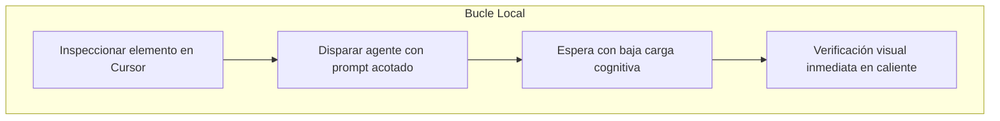
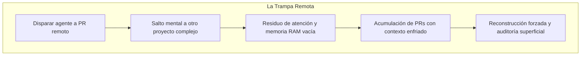

Mi mayor reto en las últimas semanas no ha sido aprender a escribir mejores instrucciones para un modelo, ni configurar herramientas complejas, ni elegir el modelo más reciente del mercado. Mi mayor reto ha sido resistir la tentación constante de avanzar en varios proyectos al mismo tiempo mientras espero a que la inteligencia artificial termine una tarea.

El escenario se repite casi a diario. Estoy trabajando en la interfaz de una aplicación con Cursor. Abro el navegador integrado, selecciono un componente visual, señalo los ajustes de diseño que necesito corregir y presiono `Enter`. Sé que el agente tardará entre sesenta y noventa segundos en inspeccionar el árbol del DOM, buscar los componentes involucrados en el proyecto, aplicar las clases de estilo y refrescar la vista previa.

En ese intervalo exacto de espera, mi cerebro busca una salida inmediata. Aprovecha esos segundos para revisar otra idea en el bloc de notas, abrir una pestaña con un pull request de otro repositorio o planear mentalmente la arquitectura de una funcionalidad futura. Nos convencemos de que estamos optimizando el tiempo muerto, pero el costo real se cobra cuando regresamos al editor: he perdido por completo el hilo de lo que estaba haciendo, el modelo mental se ha desvanecido y, en ocasiones, ni recuerdo con precisión qué cambios debía verificar.

La inteligencia artificial nos ofrece una capacidad de ejecución paralela sin precedentes. Sin embargo, si esa velocidad nos conduce a fragmentar nuestra atención, el resultado final no es mayor productividad: es fatiga cognitiva y una peligrosa acumulación de código que nadie recuerda cómo auditar.

## La ilusión del paralelismo

Cuando ejecutamos agentes en entornos locales o remotos, solemos confundir dos conceptos que operan bajo reglas radicalmente opuestas: el paralelismo computacional y el paralelismo cognitivo.

Una máquina puede compilar un servicio en segundo plano, ejecutar un análisis estático de dependencias y responder a una consulta de base de datos de manera simultánea sin degradar la precisión de ninguno de sus procesos. La mente humana no funciona así. Como demostró John Sweller en sus investigaciones sobre la [teoría de la carga cognitiva en Cognitive Science](https://doi.org/10.1207/s15516709cog1202_4), nuestra memoria de trabajo posee una capacidad estrictamente limitada cuando debe procesar información novedosa o resolver problemas que exigen razonamiento consciente.

Esto mismo aparece en el libro Deep Work de Cal Newport, donde explica que el cerebro humano es un sistema mono-núcleo: solo puede enfocar su atención en una sola tarea a la vez. El multitasking, la capacidad de hacer varias cosas al mismo tiempo, es en realidad una ilusión, ya que nuestro cerebro simplemente cambia rápidamente de una tarea a otra, perdiendo tiempo en cada cambio.

Cada vez que saltas de la tarea que la inteligencia artificial está procesando a otro problema técnico, no realizas una transición limpia y gratuita. En psicología del trabajo, la investigadora Sophie Leroy describió este fenómeno como el [residuo de atención en Organizational Behavior and Human Decision Processes](https://doi.org/10.1016/j.obhdp.2009.04.002): cuando dejamos una tarea inconclusa para atender otra, una porción considerable de nuestros recursos cognitivos permanece anclada en el contexto anterior.

> "Generar cambios de código en paralelo con agentes de IA es computacionalmente trivial; sostener tres modelos mentales distintos en la memoria de trabajo humana sin degradar el criterio técnico es biológicamente imposible."

Ya he reflexionado antes sobre cómo [el nuevo cuello de botella no es escribir código, sino administrar nuestra atención](https://www.arthurolg.com/article/technology_nuevo-cuello-de-botella-atencion-agentes-ia). La trampa radica en que el salto parece indoloro en el momento en que lo ejecutamos. Leer un comentario o revisar un cambio en otra ventana dura apenas un minuto. Pero al volver, el procesador biológico sufre el equivalente a un *cache miss* en hardware: los registros están vacíos, las hipótesis que tenías en mente han sido expulsadas y debes reconstruir pacientemente todo el mapa mental antes de poder juzgar si la respuesta del modelo es correcta.

## Inspección visual frente a la delegación remota

Esta tensión se vuelve especialmente evidente cuando desarrollamos interfaces de usuario. Para el trabajo de frontend, la experiencia de iterar con herramientas interactivas ha cambiado notablemente.

Me gusta utilizar Cursor para construir vistas porque permite acortar la distancia entre lo que ves en pantalla y el código fuente. Gracias a funciones como el [Design Mode y la integración del navegador en Cursor](https://docs.cursor.com/agent/design-mode), puedes abrir tu servidor local, inspeccionar visualmente un elemento del DOM, encadenar solicitudes contextuales y ver cómo el agente traduce tus señalamientos directos en modificaciones concretas de estilos y componentes.

```
BUCLE DE ITERACIÓN EN FRONTEND:

[ Vista Local en Navegador ]
            │
            ├──> Señalar elemento (Design Mode / DOM Inspector)
            │
            ├──> Prompt contextual en Cursor ("ajustar espaciado y contraste")
            │
            ├──> Espera del agente (~60-90 segundos)
            │
            └──> Recarga en caliente + Verificación visual instantánea
```

Este bucle interactivo es sumamente potente cuando te mantienes dentro de él. La retroalimentación es inmediata: señalas, el modelo aplica el cambio, el navegador recarga y tus ojos comprueban si la solución responde a lo esperado. El contexto no se pierde porque tu atención nunca abandonó la pantalla que estás diseñando.

El problema surge cuando el proceso se demora o cuando intentamos escalar este flujo delegándolo a agentes remotos o procesos asíncronos en segundo plano. Frente a la impaciencia de esperar un minuto a que termine una refactorización amplia de componentes, la tentación inmediata es enviar la tarea a un pull request remoto en GitHub y saltar a otra pantalla.

Parece una victoria de la automatización: el agente remoto trabaja en la nube mientras tú continúas con otra tarea en tu máquina. Pero lo que realmente acabas de hacer es romper el ciclo de retroalimentación inmediata y sembrar una futura deuda de atención.

## El costo oculto de la verificación diferida

Delegar cambios a ramas remotas y acumular revisiones en segundo plano traslada el trabajo desde la fase de construcción hacia la fase de auditoría. Y auditar código ajeno —especialmente cuando proviene de un modelo generativo— exige una carga mental significativamente más alta que escribirlo.

Cuando creamos [flujos agénticos con worktrees y PRs remotos](https://www.arthurolg.com/article/programming_codeconductor-cursor-flujo-agentico), generamos una sensación engañosa de productividad. Puedes terminar la mañana con cuatro pull requests generados por agentes esperando en tu repositorio. Sin embargo, al abrir el primero de ellos horas más tarde, te encuentras con la dura realidad de la **verificación diferida**:

1. **El contexto se enfrió:** Ya no tienes frescas las restricciones sutiles ni los motivos que te llevaron a pedir ese cambio específico.
2. **El costo de prueba se multiplica:** En lugar de validar visualmente una modificación en caliente en tu navegador local, ahora debes descargar la rama, levantar dependencias, verificar que no existan regresiones colaterales y evaluar si la solución respeta el diseño original.
3. **La auditoría se vuelve superficial:** Con tres o cuatro revisiones acumuladas y la mente saturada, la tentación de hacer una lectura rápida por encima y aprobar el cambio aumenta peligrosamente.

Las investigaciones del programa [DORA sobre el trabajo en lotes pequeños](https://dora.dev/devops-capabilities/technical/working-in-small-batches/) han demostrado durante años que reducir el tamaño de las entregas y mantener bucles de retroalimentación cortos es el factor decisivo para mantener la calidad y estabilidad de un sistema de software.

En el desarrollo asistido por inteligencia artificial, el tamaño del lote no se mide únicamente en líneas de código modificadas: **se mide en el intervalo de tiempo y distancia cognitiva que transcurre entre la instrucción original y su verificación definitiva**.

### Contexto Preservado



### Verificación Diferida



Cuando un pull request remoto se enfría, el tiempo que ahorraste al delegar la escritura del código se pierde con creces intentando recordar qué hiciste, por qué lo hiciste y cómo verificarlo con rigor.

## Tres reglas prácticas para blindar tu contexto durante la espera

Para no caer en este círculo vicioso de dispersión, he comenzado a aplicar un protocolo estricto en mi jornada diaria. No busca prohibir el uso de asistentes ni renegar de la automatización, sino proteger el recurso más escaso y vulnerable de nuestro trabajo: la concentración continua.

### 1. Define el criterio de verificación antes de presionar Enter

Antes de disparar una solicitud al modelo o delegar un cambio a un agente, asegúrate de saber exactamente cómo vas a validar el resultado. Si se trata de un componente visual en Cursor, deja el navegador visible en la pantalla secundaria con el inspector abierto en el nodo relevante. Si es una regla de negocio, mantén a la vista la prueba unitaria que debe pasar a verde.

Al tener claro el criterio de aceptación de antemano, tu mente no necesita improvisar un plan de pruebas cuando el agente concluye su trabajo; la validación se convierte en una confirmación directa y sin fricción.

### 2. Trata los tiempos de espera con tareas de baja carga cognitiva

Esos dos o tres minutos en los que el modelo analiza o escribe no son una invitación a iniciar otra tarea de ingeniería profunda. Debes tratarlos como un tiempo neutral.

Si sientes la necesidad de mantener las manos ocupadas, practica técnicas de [espera activa y combate el cambio de contexto](https://www.arthurolg.com/article/technology_la-ia-destroza-tu-concentracion-espera-activa):
- Limpia ramas locales obsoletas en tu terminal.
- Revisa la redacción de un comentario técnico en la documentación.
- Organiza tu lista de pendientes mecánicos.
- O simplemente despega las manos del teclado, respira y observa el proceso.

Cualquier actividad que requiera construir un modelo mental alternativo debe quedar estrictamente prohibida durante esos minutos. La regla es simple: si la actividad no puede interrumpirse en dos segundos sin causarte frustración, no pertenece a tu tiempo de espera.

### 3. Cierra el ciclo de verificación antes de abrir otro frente

Resiste la tentación de encadenar tareas en múltiples repositorios. Producir cinco ramas simultáneas que no han sido probadas no es productividad; es inventario de trabajo en progreso sin validar.

Adopta la disciplina de no lanzar un segundo agente ni cambiar de problema hasta que la tarea en curso esté completamente verificada, probada localmente e integrada. El verdadero ritmo sostenible en el desarrollo con inteligencia artificial no consiste en ver cuántos procesos puedes disparar a la vez, sino en cuántos ciclos completos de diseño, ejecución y verificación puedes cerrar con impecable criterio técnico.

## Conclusión

Aprender a programar con inteligencia artificial nos enfrenta a una paradoja fascinante. Las herramientas son cada vez más rápidas, los modelos disponen de ventanas de contexto cada vez mayores y la capacidad para delegar trabajo a agentes autónomos continuará expandiéndose mes a mes.

Sin embargo, el cuello de botella decisivo sigue residiendo en nuestra propia biología. Nuestro cerebro no procesa en paralelo; conmuta entre estados, pagando un peaje cognitivo en cada transición. Producir más cambios en paralelo sirve de muy poco si después debemos invertir el doble de tiempo en descifrar qué pretendíamos resolver y cómo comprobar que nada se ha roto en el camino.

El verdadero arte de la ingeniería moderna no consiste únicamente en orquestar agentes inteligentes, sino en aprender a gobernar nuestra propia atención y preservar el contexto de nuestro trabajo frente a la constante seducción de la inmediatez.

Si quieres comentar o compartir tu experiencia, escríbeme en [X (@algforge)](https://x.com/algforge) o abre un issue en el [repositorio](https://github.com/lgzarturo/arthurolg-blog-posts/issues). Una estrella en [GitHub](https://github.com/lgzarturo) también ayuda.

## Referencias

- [Design Mode & Browser Agent Integration, Cursor Documentation](https://docs.cursor.com/agent/design-mode)
- [Why is it so hard to do my work? The challenge of attention residue when switching between work tasks, Sophie Leroy (Organizational Behavior and Human Decision Processes)](https://doi.org/10.1016/j.obhdp.2009.04.002)
- [Cognitive Load During Problem Solving: Effects on Learning, John Sweller (Cognitive Science)](https://doi.org/10.1207/s15516709cog1202_4)
- [Working in Small Batches, DORA (DevOps Research and Assessment / Google Cloud)](https://dora.dev/devops-capabilities/technical/working-in-small-batches/)
