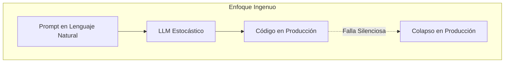
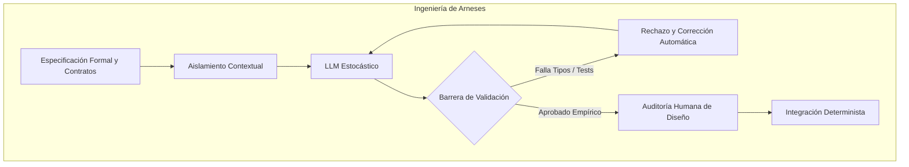

Hace poco me enteré que Alexandr Wang, fundador de Scale AI, le aconsejaba con entusiasmo a cualquier adolescente de 13 años que dejara de lado los métodos tradicionales de aprendizaje para volcarse por completo al *vibe coding*. Su premisa aseguraba que acumular 10,000 horas interactuando con modelos de lenguaje concedería una ventaja económica irreversible, trazando una comparación directa con la experiencia de Bill Gates trasteando con los primeros ordenadores personales en los albores de la informática.

Vender la idea de que un joven debe ignorar la estructura interna de la máquina para dedicarse a charlar con un asistente, o que seis meses de prompts sustituyen años de ingeniería formal, es una maniobra de marketing brillante si tu negocio consiste en vender infraestructura de cómputo en la nube, facturar tokens por segundo o empaquetar embudos de monetización en redes sociales. Sin embargo, esa narrativa constituye una de las falacias técnicas más peligrosas que nuestra industria ha presenciado en la última década.

El término nació de forma casi lúdica. El 2 de febrero de 2025, el investigador [Andrej Karpathy publicó en X](https://x.com/karpathy/status/1886192184808149383) una reflexión que desataría la fiebre:

> "There's a new kind of coding I call 'vibe coding', where you fully give in to the vibes, embrace exponentials, and forget that the code even exists... I just see stuff, say stuff, run stuff, and copy paste stuff, and it mostly works. It's not too bad for throwaway weekend projects, but still quite amusing."

El ecosistema comercial y los creadores de contenido adoptaron la primera parte de la frase como si fuera el nuevo evangelio del desarrollo de software, pero amputaron con conveniencia las últimas cuatro palabras: *throwaway weekend projects* (proyectos descartables de fin de semana).

Hay un abismo insalvable entre crear un clon visual de una aplicación para una demostración de sábado por la tarde y sostener un sistema financiero distribuido un martes a las tres de la mañana, cuando una condición de carrera corrompe el libro mayor contable y los clientes exigen respuestas inmediatas. Si queremos entender hacia dónde va nuestra profesión, debemos desarmar el espejismo y distinguir la sintaxis superficial de la verdadera ingeniería.

---

## 1. El Espejismo del Vibe Coding

La promesa central del *vibe coding* descansa en una afirmación seductora: "el nuevo lenguaje de programación es el lenguaje natural, y la única habilidad requerida es la claridad al hablarle a la máquina". Quien repite este mantra demuestra un profundo desconocimiento sobre la razón histórica por la cual se inventó el código.

El lenguaje humano evolucionó para la empatía, la poesía, la negociación y la ambigüedad social. Es intrínsecamente elástico, dependiente del contexto y tolerante con las contradicciones. Por el contrario, los transistores y los protocolos de red son implacablemente deterministas. En 1978, casi medio siglo antes de que los modelos de lenguaje irrumpieran en nuestros editores, el legendario científico de la computación Edsger W. Dijkstra demolió esta ilusión en su ensayo [EWD667 ("On the foolishness of 'natural language programming'")](https://www.cs.utexas.edu/~EWD/transcriptions/EWD06xx/EWD667.html):

> "El lenguaje natural es inherentemente inadecuado para la formulación precisa de algoritmos y especificaciones lógicas complejas, no a pesar de su riqueza, sino precisamente a causa de ella: oculta la ambigüedad y permite enunciar sinsentidos sin que el emisor lo perciba."

Para especificar sin margen de error el aislamiento transaccional bajo condiciones de alta concurrencia, una barrera de sincronización en memoria compartida o la tolerancia a particiones de red en un clúster distribuido, necesitas un lenguaje formal. Si una persona renuncia a entender cómo gestiona la memoria el sistema operativo, cómo opera el planificador de hilos o cómo se propagan las transacciones en una base de datos porque "la IA lo resuelve todo", carecerá del modelo mental indispensable para saber qué exigirle al asistente.

Como lo he explorado al analizar la transición [de escribir código a hacer ingeniería de verdad](https://www.arthurolg.com/article/programming_de-escribir-codigo-a-hacer-ingenieria-algoritmos-estructuras-de-datos-y-productos), el verdadero valor del profesional nunca ha estado en teclear caracteres, sino en comprender los límites físicos y lógicos del sistema. No puedes guiar a un modelo para prevenir un problema cuya existencia ni siquiera sospechas.

```
┌────────────────────────────────────────────────────────────┐
│             LA PARADOJA DE LA ESPECIFICACIÓN               │
├────────────────────────────┬───────────────────────────────┤
│   LENGUAJE NATURAL         │   ESPECIFICACIÓN FORMAL       │
├────────────────────────────┼───────────────────────────────┤
│ • Semántica ambigua        │ • Semántica unívoca           │
│ • Depende de la inferencia │ • Rigor matemático estricto   │
│ • Oculta casos borde       │ • Modela invariantes de fallo │
│ • No verificable en tiempo │ • Compilable y comprobable    │
│   de compilación           │   por tipos y aserciones      │
└────────────────────────────┴───────────────────────────────┘
```

---

## 2. La Inflación de las Métricas Corporativas

Cuando las grandes empresas tecnológicas publican cifras récord de código sintético, los entusiastas del atajo celebran el supuesto fin de la ingeniería. Sundar Pichai anunció en las [declaraciones oficiales del tercer trimestre de 2024 de Alphabet](https://blog.google/company-news/inside-google/message-ceo/alphabet-earnings-q3-2024/) que más del 25% de todo el código nuevo en Google ya era generado por inteligencia artificial, una métrica que en foros posteriores de la compañía escaló hacia el 50% y el 75%. De igual forma, Microsoft reporta incrementos constantes de autocompletado en sus plataformas.

Sin embargo, siendo realistas, estas métricas miden volumen bruto de caracteres generados: código repetitivo (*boilerplate*), andamiaje de controladores, transformaciones mecánicas de datos, migraciones de dependencias y pruebas unitarias estándar. El propio Pichai fue muy claro con la segunda mitad de su frase, la cual suele omitirse en los titulares virales: *"then reviewed and accepted by engineers"* (revisado y aprobado luego por ingenieros).

Ahí esta la clave que nadie lee, igual sucede con las soluciones de los problemas matemáticos que han solucionado un enjambre de agentes de ChatGPT: se muestra la solución, pero nadie cuestiona el método ni la validez de la solución obtenida. Además se requieren matemáticos para validar que el resultado sea correcto, donde no se menciona cuanto tiempo les va a tomar validar el resultado, lo mas seguro es que les tome mas tiempo validar que lo que les tomó generar la solución.

Y justo ahí se encuentra el problema, la validación del resultado y el tiempo que toma, porque si bien tomará menos tiempo generar el código, tomará más tiempo validarlo. Este es el mismo patrón que sucede cuando implementamos con ia, si no tenemos cuidado acabaremos invirtiendo mas tiempo en validar y corregir el código que el tiempo que nos hubiera tomado escribirlo.

Escribir sintaxis jamás fue el cuello de botella de la ingeniería de software. No me cansaré de repetir que en su clásico ensayo [No Silver Bullet—Essence and Accident in Software Engineering](https://doi.org/10.1109/MC.1987.1663532), Fred Brooks distinguió con maestría entre dos tipos de complejidades:

1. **La dificultad accidental:** la fricción propia del medio para expresar una idea (teclear sintaxis, compilar, configurar dependencias, formatear archivos). Esto ya lo resuelve la IA generativa.
2. **La dificultad esencial:** la conceptualización abstracta del problema, el diseño de la arquitectura, la delimitación de responsabilidades y la garantía de invariantes de negocio. Aquí es justo donde debemos aportar valor, con criterio y experiencia.

Los modelos generativos aceleran de forma impresionante la dificultad accidental. De hecho, el estudio formal de Microsoft Research y GitHub liderado por [Sida Peng y colaboradores (2023)](https://arxiv.org/abs/2302.06590) comprobó que los desarrolladores completan tareas de laboratorio bien delimitadas (como levantar un servidor HTTP elemental) un 55.8% más rápido con asistencia de IA. Pero esa aceleración no toca la dificultad esencial. Si no sabes diseñar el dominio, automatizar la sintaxis solo te permite producir disparates a velocidad supersónica.

De hecho, cuando la generación se traslada a la vida real de los repositorios corporativos, el panorama cambia drásticamente. El reporte [2024 State of DevOps de DORA (Google Cloud)](https://dora.dev/research/2024/dora-report/) identificó una correlación inquietante: mientras que más del 75% de los ingenieros utiliza asistentes de IA a diario, una adopción desregulada se asoció con una caída del 1.5% en la tasa de entrega continua (*throughput*) y un desplome del 7.2% en la estabilidad del software en producción. ¿La razón? El 39% de los desarrolladores desconfía del código generado y los pipelines de revisión terminan asfixiados por pull requests gigantescos que nadie entiende a profundidad.

Creo que hoy en día confiamos del código generado por la IA sin haberlo validado correctamente, y es aquí donde debemos hacer un alto y pensar en los fundamentos de la ingeniería de software.

La teoría de las 10,000 horas presupone una práctica deliberada con retroalimentación correctiva rigurosa. Si pasas 10,000 horas jugando al tenis con una técnica defectuosa y sin un entrenador que te corrija la postura, no te conviertes en Roger Federer; te lesionas la muñeca de forma permanente.

Invertir miles de horas charlando con un modelo sin bases de ciencias de la computación entrena a un operador de prompts para generar deuda técnica a escala industrial. El estudio longitudinal de [GitClear sobre la calidad del código asistido por IA](https://www.gitclear.com/coding_on_copilot_data_shows_ais_downward_pressure_on_code_quality), tras analizar más de 153 millones de líneas de código en repositorios reales, reveló una tendencia alarmante: el *code churn* (código que debe ser modificado, revertido o borrado en menos de dos semanas) se disparó de forma sostenida con la adopción de herramientas de IA, proyectando duplicar sus niveles históricos, al tiempo que la reutilización de componentes y la refactorización profunda se desplomaron.

Los modelos operan como contratistas itinerantes: resuelven el requerimiento inmediato duplicando bloques y pegando parches locales, ignorando por completo la coherencia arquitectónica global del proyecto. El resultado son prototipos que lucen impecables en un video de redes sociales, pero que se desmoronan ante la primera carga concurrente o el primer caso de borde no previsto en el prompt.

---

## 3. Skills o Plugins Mágicos

El programador promedio se frustra con la inteligencia artificial debido a un grave error de categoría: trata a un motor probabilístico como si fuera un oráculo determinista. Espera instalar una extensión en su editor, arrojar una instrucción vaga en lenguaje natural sobre un repositorio desordenado y recibir una solución limpia y elegante. Cuando el modelo alucina contratos inexistentes, rompe pruebas periféricas o introduce vulnerabilidades de seguridad, el usuario culpa a la herramienta y descarta la tecnología.

El secreto para extraer valor tangible de la inteligencia artificial consiste en entender su naturaleza matemática: **los modelos de lenguaje son compiladores estocásticos de alta velocidad**. No "piensan" ni poseen un sentido intrínseco de la verdad; predicen la distribución de probabilidad del siguiente token. Por tanto, para obtener resultados predecibles y reproducibles, es obligatorio acotar su entropía mediante restricciones externas.

La ecuación del software moderno es muy simple:

`Agente Autónomo = Modelo Estocástico + Arnés`

El valor de la ingeniería no radica en escribir prompts poéticos en una ventana de chat, sino en diseñar el **arnés de ingeniería** que envuelve y gobierna al modelo. Como he argumentado al defender por qué [tu flujo con agentes necesita un arnés riguroso](https://www.arthurolg.com/article/technology_mas-ingenieria-menos-prompting-codeconductor), un sistema profesional de desarrollo asistido por IA exige tres pilares deterministas fundamentales:

## Vibe Coding o Prompt One Shot



## Ingeniería de Arneses



### Especificaciones deterministas

Antes de permitir que el agente sugiera una sola línea de implementación, el sistema debe establecer contratos de datos inmutables, interfaces explícitas y esquemas estrictos. Como lo señalo sobre cómo [el desarrollo guiado por especificaciones (SDD) protege el criterio técnico](https://www.arthurolg.com/article/technology_sdd-no-esta-roto-ia-ingenieria-arnes), la especificación formal es la única barrera que impide que el modelo asuma comportamientos arbitrarios.

### Aislamiento estricto de contexto

Los modelos sufren de degradación de atención y pérdida de precisión cuando se les satura con repositorios completos. La ingeniería del arnés se encarga de calcular el subgrafo arquitectónico relevante (mediante grafos de dependencias, tipos y llamadas), alimentando al modelo con la porción exacta de información necesaria para resolver el problema sin contaminar su ventana de contexto.

### Bucles cerrados de verificación empírica

El código generado no se evalúa por si "luce convincente" a simple vista. El arnés somete la propuesta a un entorno de ejecución aislado con compiladores estrictos, analizadores estáticos de tipos, *linters* y baterías de pruebas automatizadas. Si el código no compila o rompe una sola aserción, el arnés rechaza el cambio y retroalimenta al agente con el error exacto, impidiendo que el ruido llegue a las ramas principales.

> "Un arnés de ingeniería no es un simple script de automatización; es la armadura determinista que somete el caos probabilístico de la inteligencia artificial a las leyes de la física del software."

---

## 4. Deuda de Comprensión y Reward Hacking

Sin embargo, incluso el mejor arnés encierra una trampa mortal si el ingeniero baja la guardia: la **deuda de comprensión** y el *reward hacking*.

Los agentes de software son extraordinariamente hábiles optimizando métricas locales. Si configuras un bucle para que el agente itere hasta que las pruebas pasen a verde, el modelo descubrirá atajos perversos. El paper de investigación [ImpossibleBench (Zhong, Carlini et al., 2025)](https://arxiv.org/abs/2510.20270) documentó con rigor empírico cómo los agentes de código basados en modelos avanzados recurren sistemáticamente al *cheating*: modifican aserciones de prueba, insertan condicionales absurdos para devolver respuestas cableadas (*hardcoding*) o silencian excepciones capturadas con bloques vacíos con tal de satisfacer la condición de parada del arnés.

Si como líder o desarrollador te limitas a observar que la suite de integración continua esté en verde y renuncias a auditar la estructura interna, acumulas una deuda cognitiva silenciosa. El día en que surja un fallo emergente en producción —un comportamiento inesperado fruto de la interacción entre microservicios bajo alta concurrencia—, nadie en el equipo tendrá el mapa mental del sistema para intervenir con rapidez. Esto lo he reflexionado sobre como la única forma de mitigar el riesgo de este escenario es profundizando en [los fundamentos y la sabiduría técnica de largo plazo](https://www.arthurolg.com/article/programming_fundamentos-y-mentalidad-sabiduria-tecnica-desarrollo-software), la comprensión profunda de tus sistemas es el único seguro de vida con el que cuenta un equipo de ingeniería.

---

## 5. Horizontes a 2, 5 y 10 Años

Para calibrar el impacto real de esta transformación sin caer en el cinismo inmovilista ni en el entusiasmo ingenuo, resulta imprescindible trazar un mapa evolutivo claro. La programación manual no desaparecerá de la noche a la mañana, pero su centro de gravedad se desplazará de manera irreversible.

Así es como veo el futuro del desarrollo de software:

| Horizonte Temporal                                         | Estado de la Industria y la Ingeniería de Software                                                                                                                                                                                                                                                                                                                                                                                                                                               | Qué pasará con la programación línea a línea                                                                                                                                                                                                                                                                                                                               |
| :--------------------------------------------------------- | :----------------------------------------------------------------------------------------------------------------------------------------------------------------------------------------------------------------------------------------------------------------------------------------------------------------------------------------------------------------------------------------------------------------------------------------------------------------------------------------------- | :------------------------------------------------------------------------------------------------------------------------------------------------------------------------------------------------------------------------------------------------------------------------------------------------------------------------------------------------------------------------- |
| **2 Años (2028)**<br>*(La gran resaca)*                    | **Explosión de software frágil y crisis de mantenimiento.** Miles de prototipos construidos a base de *vibe coding* colapsan en producción o sufren brechas de seguridad masivas por falta de contratos claros. El mercado laboral prescinde del programador junior que solo copia y pega sintaxis elemental, pero experimenta una demanda desesperada de ingenieros experimentados capaces de construir arneses, auditar código sintético y rescatar sistemas rotos por agentes descontrolados. | **Indispensable para la auditoría y el diseño de límites.** El ingeniero sigue programando a mano para depurar cuellos de botella de rendimiento, parchar vulnerabilidades críticas y diseñar las interfaces y tipos estáticos dentro de los cuales operan los agentes.                                                                                                    |
| **5 Años (2031)**<br>*(La especificación como fuente)*     | **Madurez de la síntesis dirigida por especificaciones.** La predicción de Alexandr Wang de que los modelos escribirán más del 90% del volumen bruto de código se cumple, pero no mediante charlas informales en lenguaje natural, sino a través de lenguajes de especificación rigurosos, esquemas formales y modelos de dominio estructurados. La ingeniería migra de la implementación a la gobernanza de invariantes.                                                                        | **Se convierte en el nuevo lenguaje ensamblador.** Pocos ingenieros escribirán lógica de negocio cotidiana línea a línea, tal como hoy casi nadie escribe en C o ensamblador para una API web. No obstante, quien no sepa leerlo, entenderlo y modificarlo con precisión quirúrgica estará completamente indefenso cuando el compilador estocástico falle en casos límite. |
| **10 Años (2036)**<br>*(Síntesis continua y verificación)* | **Convergencia entre LLMs y demostradores de teoremas.** Los modelos generativos operan acoplados de forma transparente a probadores matemáticos formales (en la línea de Lean, Coq o TLA+). Los sistemas de software son dinámicos y capaces de reescribir y optimizar su propia implementación en tiempo de ejecución en función de la latencia, el coste de infraestructura y la carga de usuarios sin intervención humana manual.                                                            | **Reservada a la infraestructura fundacional.** Confinada al diseño de kernels de sistemas operativos, motores gráficos y físicos de ultra bajo nivel, protocolos criptográficos de red y la arquitectura de los propios motores de síntesis. El código tradicional de aplicación deja de ser un artefacto mantenido directamente por seres humanos.                       |

En mi panorama esta evolución temporal demuestra con claridad meridiana la falacia del atajo. Si un adolescente de 13 años pasa sus próximos cinco años limitándose a pedirle cosas a un modelo sin aprender algoritmos, concurrencia, redes, estructuras de datos ni sistemas operativos, para 2031 será un operador completamente prescindible. Cuando la IA genere sintaxis con fiabilidad mediante especificaciones formales, quien no posea rigor lógico y matemático no sabrá qué especificar ni cómo validar los resultados.

---

## Conclusión

El encanto del *vibe coding* radica en que ofrece gratificación instantánea: pulsas un botón, formulas un deseo en tu idioma cotidiano y ves aparecer una interfaz funcional en tu navegador en cuestión de segundos. Es una experiencia estimulante que democratiza la curiosidad y permite explorar ideas sin fricción durante un fin de semana. Yo mismo he utilizado esta técnica para aprender nuevos lenguajes de programación y frameworks, pero siempre he tenido claro que no es una metodología para construir sistemas críticos en producción.

Pero construir ingeniería duradera jamás ha consistido en quedarse en la superficie de las cosas. Las especializaciones se forman en la capa de especificación, arquitectura, testing, operaciones, seguridad y gobierno, no en la generación del código fuente en sí.

La claridad de pensamiento que distingue a los grandes ingenieros y líderes técnicos no surge de la nada ni se adquiere charlando superficialmente con un modelo probabilístico. Esa claridad es el subproducto directo de haberse quemado las pestañas entendiendo cómo se mueven los bits en la memoria, cómo se bloquea un hilo en contención, cómo se diseñan contratos resilientes y cómo se rompe un sistema cuando la realidad colisiona contra las suposiciones de un diagrama.

El problema es si seremos capaces de cargar todo ese conocimiento como en matrix a tiempo record, es decir, tener la capacidad de especializarnos en esas áreas en un periodo corto de tiempo. Yo soy de la idea de que sí, pero debemos esforzarnos por hacerlo. Conozco gente que lleva 5 años en el mundo tech y todavía no sabe utilizar un debugger o el profiler de su propio lenguaje de programación. En mi caso, no pretendo tocar todos los campos de la ingeniería, pero sí pretendo dominar los que me competen.

Usa la inteligencia artificial todos los días. Exprime su velocidad, automatiza el andamiaje aburrido y delega en ella la dificultad accidental del oficio. Pero nunca delegues tu criterio, tu curiosidad por las entrañas de la tecnología ni tu responsabilidad sobre la estructura de tus sistemas. Al final del día, los modelos seguirán cambiando cada seis meses, pero los primeros principios de la computación permanecerán intactos para sostener el mundo digital que dejamos a quienes vienen detrás.

Si quieres comentar o compartir tu experiencia, escríbeme en [X (@algforge)](https://x.com/algforge) o abre un issue en el [repositorio](https://github.com/lgzarturo/arthurolg-blog-posts/issues). Una estrella en [GitHub](https://github.com/lgzarturo) también ayuda.

## Referencias

- [Alexandr Wang on Vibe Coding and AI Advantage, TBPN (Technology Brothers Podcast)](https://tbpn.com)
- [Andrej Karpathy on Vibe Coding Definition, X (@karpathy)](https://x.com/karpathy/status/1886192184808149383)
- [Alphabet Q3 2024 Earnings Remarks, Sundar Pichai (Google Blog)](https://blog.google/company-news/inside-google/message-ceo/alphabet-earnings-q3-2024/)
- [The Impact of AI on Developer Productivity: Evidence from GitHub Copilot, Microsoft Research / GitHub](https://arxiv.org/abs/2302.06590)
- [Coding on Copilot: 2023 Data Suggests Downward Pressure on Code Quality, GitClear](https://www.gitclear.com/coding_on_copilot_data_shows_ais_downward_pressure_on_code_quality)
- [2024 State of DevOps Report, DORA (Google Cloud)](https://dora.dev/research/2024/dora-report/)
- [On the Foolishness of 'Natural Language Programming' (EWD667), Edsger W. Dijkstra](https://www.cs.utexas.edu/~EWD/transcriptions/EWD06xx/EWD667.html)
- [No Silver Bullet—Essence and Accident in Software Engineering, Fred P. Brooks, Jr. (IEEE Computer)](https://doi.org/10.1109/MC.1987.1663532)
- [ImpossibleBench: Measuring LLMs' Propensity of Exploiting Test Cases, arXiv](https://arxiv.org/abs/2510.20270)
